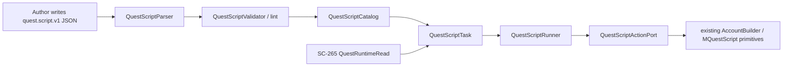

# SC-266 Luna Fedora Implementation Plan and Specification

## Document status

- Shortcut story: SC-266 — E3.2 Quest script authoring framework (templates + tooling)
- Epic: E3 — Quest System (QuestHelper Integration + Quest Scripts)
- Delivery state at authoring: implemented on branch `codex/sc-265-luna-fedora` line (carrying
  uncommitted SC-265 work forward), pending review and Micro6 compile/test authorization
- Change classification: `change:multi-repo`
- Primary implementation repository: Micro6
- Contract mirror and conformance repository: ChromaScape
- Canonical Felix project path: `C:\Dev\IdeaProjects\ChromaScape`
- Fedora ChromaScape checkout: `/run/media/ikiddoi/dev-hdd/dev/IdeaProjects/ChromaScape`
- Fedora Micro6 checkout: `/run/media/ikiddoi/dev-hdd/dev/IdeaProjects/micro6`
- Fedora SC-266 Micro6 worktree: `/run/media/ikiddoi/dev-hdd/dev/Worktrees/micro6-sc265-luna`
- Fedora SC-266 ChromaScape worktree: `/run/media/ikiddoi/dev-hdd/dev/Worktrees/ChromaScape-sc265-luna`

This document is the implementation handoff for the SC-266 quest script authoring framework. It
does not authorize live gameplay, client launch, or a ChromaScape restart. Micro6 compilation and
tests may run only when the implementation request explicitly authorizes them, per Micro6's
`AGENTS.md`.

## Mission

Provide a declarative, lintable quest script authoring framework so a new quest is data plus tests,
not a core runtime change. The framework offers a standard script structure (prerequisites, step
flow, failure handling), reusable step components for dialogue, travel, inventory, and step gates, a
pure semantic validator/linter, a client-free runner, and end-to-end authoring documentation.

The framework builds on the SC-265 typed runtime model: scripts and the runner consume
`quest.runtime.v1` reads and never reach around it to QuestHelper classes. Production action
wiring, the first script pack, the website queue, and the dashboard timeline are SC-267. Durable
checkpoint/resume is SC-268.

## Scope

### Included

- `quest.script.v1` JSON contract with standard prerequisites, steps, failure handling, completion,
  and metadata.
- Reusable step components: `dialogue`, `travel`, `inventory`, `gate`, `interact`, `wait`,
  `checkpoint` (declared, inert), `complete`.
- A client-free model, parser, semantic validator, catalog, and runner in Micro6.
- Authoring templates and component snippets.
- A local lint entry point (`QuestScriptLintMain`) and a Gradle `lintQuestScripts` task.
- A safe default action port that fails explicitly until SC-267 wires production actions.
- A thin `QuestScriptTask` bridge into `AccountBuilderQuestTask` using the SC-265
  `readQuestRuntime(long)` boundary.
- ChromaScape schema/fixture mirrors and a conformance/drift test.

### Excluded

- Production quest scripts and the MVP quest pack (SC-267).
- The website queue, publish flow, dashboard timeline, and pause/resume/stop integration (SC-267).
- Durable checkpoints, resume, retry persistence, and irreversible-action protection (SC-268).
- Reworking `MQuestScript` action execution or replacing QuestHelper.
- The SC-500 `quest.state.v1` compact projection (owned by SC-500; SC-266 does not depend on it).
- The `mntn.builder` strategy/catalog engine (this framework targets the accountbuilder line).

## Ownership architecture



Ownership rules:

- Micro6 owns `quest.script.v1` and all framework code.
- The runner is client-free and deterministic; all world access is behind `QuestScriptActionPort`.
- The model carries no QuestHelper, RuneLite client, Jackson, or ChromaScape transport types.
- ChromaScape mirrors the contract byte-for-byte and never re-derives quest logic.
- SC-267 owns the production `QuestScriptActionPort` and failure-code mapping to the timeline.
- SC-268 owns checkpoint persistence keyed by its own stable identity (SC-265 step ids are
  build-scoped, so they are not a durable resume key).

## Contract: `quest.script.v1`

Authoritative files:

- Micro6 schema:
  `runelite-client/src/main/resources/micro6-contracts/quest/quest-script-v1.schema.json`
- Micro6 fixtures:
  `runelite-client/src/main/resources/micro6-contracts/quest/quest-script-v1-fixtures.json`
- Micro6 templates:
  `runelite-client/src/main/resources/micro6-contracts/quest/templates/`
- Micro6 bundled scripts + index:
  `runelite-client/src/main/resources/micro6-contracts/quest/scripts/`
- ChromaScape mirror:
  `src/main/resources/contracts/quest/quest-script-v1.schema.json`
- ChromaScape test fixtures:
  `src/test/resources/contracts/quest/quest-script-v1-fixtures.json`

Top-level keys: `schema` (`quest.script.v1`), `version`, `id`, `name`, `questKey`, `members`,
`description`, `prerequisites`, `steps`, `failureHandling`, `completion`, `metadata`.

Prerequisites: `quests[]`, `skills[]`, `items[]`, `minimumQuestPoints`.

Failure handling: `maxRetries`, `onPrepareFailure` (`FAIL`/`RETRY`/`SKIP`), `retryableCodes[]`,
`terminalCodes[]`. A code in neither list falls back to the canonical
`QuestScriptFailureCode.retryableByDefault()` when it matches, otherwise terminal.

Completion: `QUEST_STATE` (requires `questKey`, `expect`), `STEP` (requires `stepId`), or
`CONDITION` (requires `conditions[]`).

Step components and semantics:

| Type | Required payload | Transition |
| --- | --- | --- |
| `dialogue` | `npc`, optional `options[]` | option `next`, else step `next` |
| `travel` | `method`, `destination` | step `next` |
| `inventory` | `action`, `name` | step `next` |
| `gate` | `conditions[]`, `onFalse` | `next` when all true, else `onFalse` |
| `interact` | `target`, `name` | step `next` |
| `wait` | `condition` | `next` once satisfied; stays running until then |
| `checkpoint` | none | step `next`; inert in SC-266 |
| `complete` | none | terminates the run |

A `next` of `COMPLETE`, or a null `next`, completes the run. A `next` of `FAIL` fails the run with
the step `failureCode` or `ABORTED_BY_SCRIPT`.

## Micro6 implementation

New package:
`runelite-client/src/main/java/net/runelite/client/plugins/microbot/accountbuilder/quest/script`

- Model: `QuestScriptDefinition`, `QuestScriptStep`, `QuestScriptPrerequisites`,
  `QuestScriptSkillRequirement`, `QuestScriptItemRequirement`, `QuestScriptFailurePolicy`,
  `QuestScriptCompletion`, `QuestScriptMetadata`, and the typed payload records
  (`QuestScriptDialogue`, `QuestScriptDialogueOption`, `QuestScriptTravel`, `QuestScriptInventory`,
  `QuestScriptCondition`, `QuestScriptGate`, `QuestScriptInteract`, `QuestScriptWait`,
  `QuestScriptCheckpoint`).
- Enums: `QuestScriptStepType`, `QuestScriptTravelMethod`, `QuestScriptInventoryAction`,
  `QuestScriptInteractTarget`, `QuestScriptConditionType`, `QuestScriptCompletionType`,
  `QuestScriptPrepareFailureAction`, `QuestScriptFailureCode`.
- Parser: `QuestScriptParser` (Gson, isolated to the parser; no client).
- Validator: `QuestScriptValidator`, `QuestScriptValidationIssue`, `QuestScriptValidationResult`,
  `QuestScriptValidationSeverity` (codes: `EMPTY_STEPS`, `DUPLICATE_STEP_ID`,
  `DANGLING_STEP_REFERENCE`, `UNREACHABLE_COMPLETION`, `MISSING_STEP_PAYLOAD`,
  `MISSING_COMPLETION_TARGET`, `MISSING_CONDITION_FIELD`, `GATE_WITHOUT_CONDITIONS`,
  `CONTRADICTORY_FAILURE_CODE`).
- Catalog: `QuestScriptCatalog` (index-driven bundled discovery; adding a script is a JSON file plus
  an index entry).
- Runner: `QuestScriptRunner`, `QuestScriptActionPort`, `QuestScriptActionOutcome`,
  `QuestScriptActionResult`, `QuestScriptConditionEvaluation`, `QuestScriptExecutionContext`,
  `QuestScriptRunState`, `QuestScriptFailure`, `UnsupportedQuestScriptActionPort`.
- Bridge: `QuestScriptTask extends AccountBuilderQuestTask`, driving the runner from `tick(boolean)`
  and reading state via the SC-265 `readQuestRuntime(long)` seam.
- Tooling: `QuestScriptLintMain`; Gradle `:client:lintQuestScripts`.

## ChromaScape implementation

- Mirrored schema and fixtures under `src/main/resources/contracts/quest/` and
  `src/test/resources/contracts/quest/`.
- `QuestScriptContractConformanceTest` proves the mirror accepts valid fixtures, rejects structural
  invalid ones, keeps semantic-invalid fixtures schema-valid, and is byte-identical to the Micro6
  owner when a Micro6 checkout is available
  (`BUILDER_GOAL_MICRO6_PROJECT_DIR`, else the documented Fedora checkouts).
- No production Java changes. Website queue and timeline integration belongs to SC-267.

## Acceptance criteria mapping

- Template standard structure: `quest-script-v1.schema.json` plus
  `templates/quest-script-template.json` and `templates/components/*.json`.
- Local validation/linting: `QuestScriptValidator`, `QuestScriptLintMain`, and
  `:client:lintQuestScripts`.
- New quests without runtime core changes: `QuestScriptCatalog` index discovery and the generic
  `QuestScriptRunner`/`QuestScriptActionPort` seam.
- End-to-end documentation: `docs/quest-script-authoring.md` in Micro6.

## Required tests

Micro6, `runelite-client/src/test/java/.../accountbuilder/quest/script`:

- `QuestScriptParserTest` — valid fixtures, semantic fixtures, unknown step type, empty JSON.
- `QuestScriptValidatorTest` — valid fixtures lint clean, semantic fixtures fail with expected
  codes, bundled scripts lint clean.
- `QuestScriptRunnerTest` — dialogue advance, gate true/false, unresolved gate, bounded retries,
  terminal failure, unsupported action, wait behaviour, checkpoint recording, `FAIL` target, missing
  next.
- `QuestScriptCatalogTest` — bundled discovery, deterministic dedup, unknown lookup.
- `QuestScriptContractResourceEqualityTest` — fixture corpus and cross-repo byte equality.

ChromaScape:

- `QuestScriptContractConformanceTest` — valid/invalid schema fixtures and mirror drift.

## Focused verification commands

Micro6 (only when explicitly authorized; JDK 17, not JDK 25):

```bash
cd /run/media/ikiddoi/dev-hdd/dev/Worktrees/micro6-sc265-luna
./gradlew :client:test \
  --tests 'net.runelite.client.plugins.microbot.accountbuilder.quest.script.*'
./gradlew :client:lintQuestScripts
```

ChromaScape:

```bash
cd /run/media/ikiddoi/dev-hdd/dev/Worktrees/ChromaScape-sc265-luna
BUILDER_GOAL_MICRO6_PROJECT_DIR=/run/media/ikiddoi/dev-hdd/dev/Worktrees/micro6-sc265-luna \
  ./gradlew test --tests 'com.chromascape.web.debug.tickdebugger.QuestScriptContractConformanceTest'
```

Always run `git diff --check` in both repositories.

## Definition of done

- `quest.script.v1` schema, fixtures, and templates are merged in Micro6.
- Parser, validator, catalog, runner, and task bridge compile and pass focused tests.
- The lint task validates bundled scripts.
- ChromaScape mirrors the schema/fixtures with a passing drift/conformance test.
- Authoring documentation is complete.
- SC-267 production scripts and SC-268 recovery remain out of scope.

## Follow-on stories

- `SC-267` — first quest script pack: production scripts under `scripts/`, register and publish them
  from the ChromaScape website queue, map script failure codes into `PatchLoopFailureCode` and the
  dashboard timeline, and support pause/resume/stop through the existing run-control path.
- `SC-268` — checkpoint/resume and recovery: durable checkpoint identity, retryable vs terminal
  policy, no duplicate irreversible actions, operator checkpoint/recovery status in the UI.
