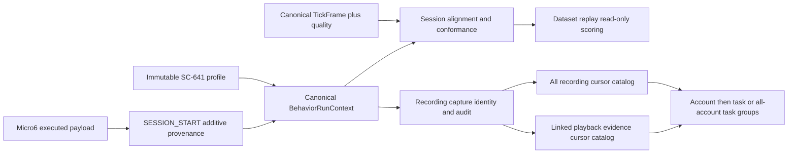
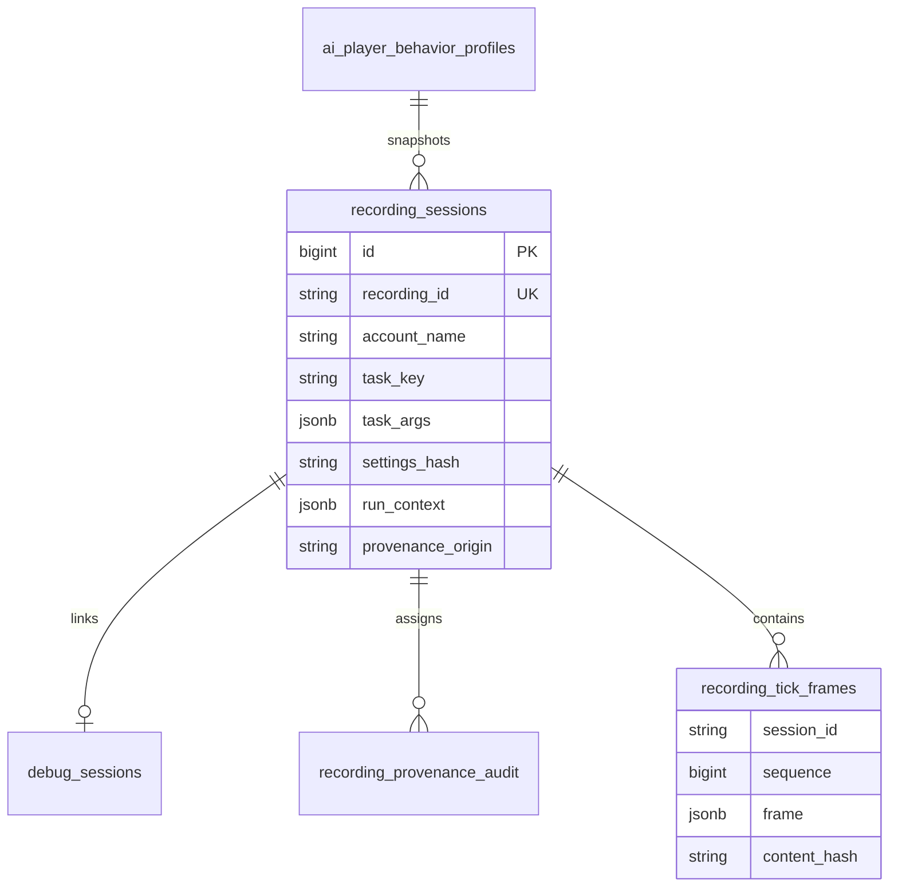

# SC-609 authoritative implementation plan
Source: https://app.shortcut.com/leeuwbot/story/609 (current story, comments and dependencies fetched 2026-10-02). SC-665 and SC-641 are Done. Classification: change:multi-repo.
Project C:\Dev\IdeaProjects\ChromaScape, coordinated producer C:\Dev\IdeaProjects\micro6.
Felix task task_1790971893615_dult4y03. Isolated branch codex/sc-609-recording-provenance follows SC-641 commit 86a6cdec.
## Scope and exclusions
- IN SCOPE: canonical versioned observation, FishingState, SemanticAction, immutable run/profile context, quality/source/privacy facts and training eligibility.
- IN SCOPE: reviewed recording catalog slice including exact args/hash, every creation/fallback path, Micro6 producer propagation, keyset account/task catalogs and safe grouping UI.
- OUT OF SCOPE: live dispatch, SC-208/666 lifecycle orchestration, SC-667 allocation, curation/readiness engines, video storage replacement, live launch or deployment.
- CONSTRAINTS: preserve legacy v2 readability and array endpoints; missing provenance stays unknown; canonical Windows Felix identity; isolated branches; Micro6 tests/compile not authorized.
## Rules
Linked rule rule_1790972015884_dqi3k441; shared AGENTS, ChromaScape AGENTS, micro6 AGENTS. Canonical Windows evidence paths, preserve user changes, no duplicate tasks or validation bypass. Existing ChromaScape pending records all conflict and preserved. Producer compile/runtime checks require exact authorization; no such request given.
## Acceptance Criteria
- [ ] Given a selected immutable profile, When recording starts, Then task/catalog/settings/profile/requirements/run/session identity is captured once and later catalog changes cannot mutate it.
- [ ] Given legacy or incomplete provenance, When training is requested, Then a stable eligibility error rejects it unless audited assignment supplies a valid context and the debug session is finalized.
- [ ] Given observation/actions, When alignment is validated, Then cross-session, stale, future and unaligned data are rejected deterministically and missing telemetry remains unknown.
- [ ] Given bounded tick capture, When overflow, gaps or disconnect occur, Then completeness, counters and terminal quality evidence persist and snapshots never imply missed transient events.
- [ ] Given canonical semantic bindings, When consumers compare contracts, Then ID/order/dimension/meaning/mask/digest mismatches fail closed and recorded/extracted/scored frames share one digest.
- [ ] Given a manual, Micro6, detected, plan or bootstrap start, When the row is created or finalized, Then capture-time account/task/exact args and server hash are retained; null differs from empty args.
- [ ] Given duplicate start times and exact account/task filters, When traversing keyset pages, Then every matching row appears once with limits clamped to 1-200 and malformed cursors rejected.
- [ ] Given recordings without debug evidence, When browsing video catalog and grouped views, Then they remain visible, task args use text nodes and tick enrichment uses canonical cursor routes.
- [ ] Given source/provider/human evidence, When recorded or replayed, Then source kind, correlation, attribution and lineage remain distinct and credential-bearing metadata is excluded.
## Architecture

One canonical settings hasher matches SC-641, no caller hashes. Null taskArgs denotes unknown; empty object known empty. Capture identity never overwritten on preferred reuse/finalization. Frame contract names source kind explicitly and stores counts/gaps/privacy limits; no manufactured human success or promotion from missing evidence.
## ERD

Normal guarded Flyway migration V33 and disposable current V5 extend recording metadata and canonical evidence tables. Current schema identity/fingerprint is bumped and pinned against a disposable PostgreSQL database. Never reset user's database.
## API Contract
```yaml
openapi: 3.1.0
info: {title: SC-609 capture provenance, version: 1.0.0}
paths:
 /api/recordings/start:
  post:
   description: Typed start request with optional taskKey, object taskArgs and exact profile/run reference; rejects invalid or sensitive metadata before capture.
   responses: {'200': {description: Recording created}, '400': {description: Stable provenance validation error}}
 /api/recordings/v1/sessions:
  get:
   description: Exact accountName/taskKey filters, limit 1-200, opaque bounded cursor; entries/nextCursor/hasMore. Preserves old array route.
   responses: {'200': {description: All recording-session page}, '400': {description: Invalid cursor or filter}}
 /api/replay/playback/v1/recordings:
  get:
   description: Same filters and cursor envelope, recording row owns capture identity, debug rows own tick evidence.
   responses: {'200': {description: Linked recording page}}
 /api/recordings/v1/sessions/{recordingId}/provenance:
  get:
   description: Canonical immutable context and eligibility/quality evidence.
   responses: {'200': {description: Shared consumer context}}
  post:
   description: Authorized audited assignment of unknown legacy provenance; inferred origin, never silently replaces captured identity.
   responses: {'200': {description: Audit and assignment}, '409': {description: Immutable provenance}}
```
Compatibility: unversioned sessions remains an array. Playback deprecated offset alias delegates to canonical service; versioned routes are cursor-only. Version 2 tick data remains replay-readable, training-ineligible. V3 fields additive, supported-version negotiation and durable receipt must never be claimed from a legacy payload.
## UI mockup
Replay catalog toolbar: [Account exact filter] [Task exact filter] [Grouping: Account → Task / All accounts → Task] [Refresh] [Load more].
Group title contains capture account and canonical task or explicit unknown. Recording row shows ID/start/video and optional ticks. Expand Settings shows exact JSON and hash through text nodes; unknown differs from {}. Empty/error/loading states retain video-only entries when tick enrichment fails.
## Decision record
The broad story remains the acceptance authority; 2026-09-29 reviewed comment specifies the recording discovery/provenance slice. Implement shared canonical contracts without moving downstream dispatch, curation or lifecycle orchestration into this story. Native producer build is an unrun check under explicit repository rules; do not mark it passed. Isolated worktrees avoid pulling unrelated uncommitted changes into the delivery.
## Observability
Stable invalid provenance/context/contract/alignment/quality codes; audited actor/reason/previous/new context hashes; no settings or tokens in errors/logs. Bounded pages and queues. Gap/overflow/disconnect evidence retained and disqualifies training rather than silently recovering quality.
## Implementation Checklist
- [ ] Implement canonical run/profile/semantic/frame contracts and conformance/quality validation with stable failures.
- [ ] Persist immutable run context and audited legacy assignment; integrate training/replay/shadow eligibility consumers.
- [ ] Persist task args and settings hash via typed validated DTOs in every recording start/fallback path.
- [ ] Propagate actual executed task/profile data through Micro6 SESSION_START and compatibility fixtures.
- [ ] Implement bounded recording and playback keyset repositories/routes with recording-row identity authority.
- [ ] Implement cursor-loading account/task grouped replay views with args drilldown and safe empty/loading/error states.
- [ ] Add additive PostgreSQL migrations/current-schema fingerprint and document compatibility, privacy, rollback and remaining integrations.
## Test Verification
- [ ] Unit: provenance canonical hashing, sensitive metadata/depth/size limits, immutable contexts, alignment, source separation and semantic conformance.
- [ ] Integration: real PostgreSQL JSONB, migrations/indexes, profile snapshots, legacy audit, eligibility and duplicate-time filtered cursor traversal.
- [ ] Transport/static: actual Micro6 DTO and executed-payload propagation fixtures, retained legacy compatibility; Micro6 compile/tests explicitly unrun under repository authorization rule.
- [ ] UI: Node/JSDOM cursor pagination, account/task grouping, null/empty args, XSS and video-only visibility; scoped Java compile/style/whitespace regression checks.
## Delivery and rollback
Evidence notes must enumerate changed files, actual tests, remaining work; verification must enumerate acceptance results, tests, risks, rollback. Keep task and Shortcut truthful if producer integration or unauthorized checks remain. Feature rollback disables new provenance consumers/UI; additive nullable columns retained to preserve recordings. No merge/deploy/database reset.
