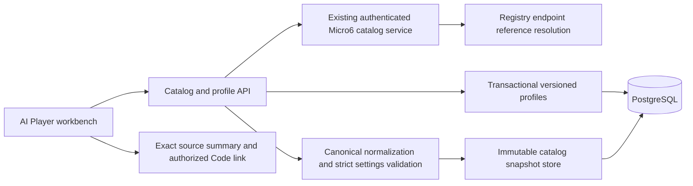
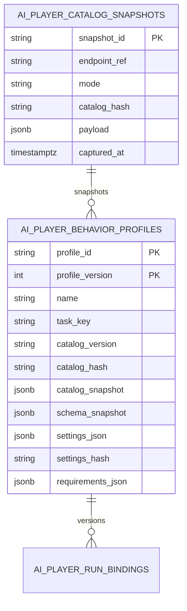

# SC-641 full delivery plan

Source https://app.shortcut.com/leeuwbot/story/641; task task_1790966531845_nb35cf2q; project C:\Dev\IdeaProjects\ChromaScape; change:ui. Branch codex/sc-641-catalog-profiles based on SC-665 commit 33ba2a02 and PR #42. One repository change; Micro6 remains metadata/schema authority.

## Scope and exclusions
- IN SCOPE: AI Player debugger catalog browser, canonical Micro6 metadata/alias normalization, lazy selected-task settings, validation/degraded states and exact source summaries.
- IN SCOPE: Named immutable versioned BehaviorProfile snapshots, durable last-known-good catalog snapshots, optional cited/versioned method facts, native PostgreSQL/Java and DOM tests.
- OUT OF SCOPE: Micro6 enumeration/schema changes, live runnability/account matching, input dispatch, recording/training provenance, inferred source mappings, method ranking or automatic routine starts.
- CONSTRAINTS: Own code only in isolated ChromaScape-sc641 branch based on verified SC-665 33ba2a02; canonical Felix identity C:\Dev\IdeaProjects\ChromaScape; no user database reset or Micro6 runtime launch.

## Linked project rules
Shared C:\Dev\IdeaProjects\AGENTS.md; C:\Dev\IdeaProjects\ChromaScape\AGENTS.md native Fedora operations; Felix Development Standards rule_1788114448331_ygxw3fk0u and schema ownership rule_1790961222483_t2tpoid4. Micro6 is static-read only; its AGENTS.md forbids compilation/runtime without an exact request, and no such actions are needed. Historical unrelated outbox conflict records were scanned and remain untouched.

## Given/When/Then acceptance criteria
1. Given canonical and DISPLAY/alias Fishing entries, When browsing/category/family/search, Then each canonical task appears once and unambiguous aliases remain searchable; collisions fail visibly.
2. Given selection of Fishing Training, When settings load lazily, Then real Micro6 defaults/options/ranges/dependencies render including fish, location, banking, inventory, stopping and supplies without fabricated fields.
3. Given missing/invalid schema or invalid/unknown settings, When editing/saving, Then unavailable and invalid states remain explicit and field-level server/client errors prevent saving.
4. Given an existing profile and later catalog refresh, When loading a version, Then its exact named immutable catalog/task/schema/settings/requirements/source/method-facts snapshot and hashes remain reproducible; updates create a new version.
5. Given temporary Micro6/registry unavailability, When browsing/searching, Then durable last-known-good metadata is visibly stale after restart; unauthorized/identity/hash failures are not downgraded to cache success and saving requires current identity.
6. Given contract and actual DOM tests, When executing tests, Then canonicalization/collisions/lazy schema/defaults/validation/versioning/degraded/loading and concurrent response races are verified.
7. Given exact Micro6 provenance, When task detail opens, Then entry/module/build/revision/source availability/plugin/config metadata and authorized Code workspace link appear; unavailable/redacted identities are explicit and no current-branch/historical-source substitution occurs.
8. Given optional versioned method facts, When viewing/saving profiles, Then ranges/units/citations/freshness/uncertainty are retained and missing/stale facts stay unknown without automatic ranking/start/account selection.

## Implementation checklist
- [x] Create durable catalog/profile storage additions compatible with SC-665 and preserve current schema fingerprint/history validation.
- [x] Implement normalization, identity-scoped durable cache, lazy selected-task schema and bounded strict settings/method/source validation.
- [x] Implement transactional named immutable profile versioning and API routes under existing operator mutation authorization.
- [x] Add accessible AI Player workspace with category/family/task search, typed settings, explicit async/degraded states, source/method summaries and profile save/version browser.
- [x] Add real Micro6 Fishing contract fixtures, PostgreSQL persistence/concurrency/immutability tests, backend/controller/auth tests and real DOM UI tests.
- [x] Document API/schema/operations/rollout/rollback and complete durable evidence with actual tests and limitations.

## Test checklist
- [x] Backend: canonicalization and alias collisions; lightweight-only startup; lazy schema retrieval/hash consistency; ranges/types/options/dependencies/unknown-field validation; unavailable/invalid schema and catalog identity conflicts.
- [x] PostgreSQL: catalog cache restart/stale behavior, atomic profile create/version concurrency, immutable snapshots and exact hashes after refresh, current schema bootstrap/validation.
- [x] UI: DOM selection/rendered controls/defaults/dependencies/errors; lazy requests; stale/degraded/loading; response race cancellation; source links and historical profile inspection; accessible form workflow.
- [x] Run Java 17 focused Gradle tests, Node DOM/contract tests, scoped style checks and git diff --check; record all actual counts and unrun live/Windows checks.

## Architecture

Lightweight mode only at browse/startup; full bundle fetch only after a task is selected because the existing upstream contract provides bundle-level schema retrieval. Normalize canonical task_key/target_enum, DISPLAY aliases and explicit metadata; reject alias collisions rather than guess. Persist bounded immutable catalog snapshots with upstream hashes/identity; use visibly stale last-known-good metadata on transient outages only. Hard authorization/identity/hash errors fail closed. Save requires current ready schema and matching catalog/schema hash; stale cache is browse-only. Async UI selection uses request generations so stale responses cannot replace current task/settings/profile.

## ERD

Extend SC-665's existing immutable profile table with nullable snapshot/name/version metadata so its seed remains valid, plus immutable native SQL cache table. Keep complete selected task/schema/canonical catalog snapshots and optional method/source references; never store raw mutable source. Create profile/version atomically under per-profile database transaction advisory lock; versions append, never update. Add released normal migration for existing app databases and a new current development migration with a reviewed identity/fingerprint update; tests verify both paths. No existing database is migrated/reset in this session.

## API Contract
```yaml
openapi: 3.1.0
info: {title: AI Player catalog and profiles, version: 1.0.0}
paths:
 /api/v1/ai-routine/catalog:
  get:
   description: Lightweight canonical tasks, explicit READY/STALE/UNAVAILABLE/INVALID state, snapshot identity; endpointRef and refresh query parameters
   responses: {'200': {description: Catalog state and normalized metadata}}
 /api/v1/ai-routine/catalog/tasks/{taskKey}:
  get:
   description: Lazy full schema and selected task/source/facts summary bound to catalog identity
   responses: {'200': {description: Task details and schema state}, '409': {description: Catalog changed}, '422': {description: Invalid schema}}
 /api/v1/ai-routine/profiles:
  get:
   responses: {'200': {description: Bounded named profile version summaries}}
  post:
   description: Operator-authenticated append-only profile creation; name, taskKey, endpointRef, expected hashes, settings, optional profileId
   responses: {'201': {description: Exact immutable snapshot and version}, '401': {description: Operator unauthorized}, '409': {description: Identity changed}, '422': {description: Field errors or missing/invalid schema}}
 /api/v1/ai-routine/profiles/{profileId}/versions/{version}:
  get:
   responses: {'200': {description: Historical exact snapshot}, '404': {description: Unknown version}}
```
All mutable endpoints inherit existing operator Bearer interceptor. Bound strings/JSON sizes, reject unknown request/settings fields and unsupported schema types, validate defaults/options/ranges/dependencies, canonicalize settings server-side and compute authoritative hashes. No client-supplied URLs, SQL fragments, source fetch URLs or settings hashes trusted. Read-only source links point only to existing authorized same-origin Code entry points with exact immutable references; unavailable/redacted identities remain explicit.

## Mockups and UI states
Separate linked Excalidraw mockup covers accessible AI Player workspace. Layout: toolbar (catalog endpoint reference, refresh/state), left category/family/search/canonical tasks, right task description/provenance/method facts and typed settings, bottom profile name/save/version history. Required visible states: initial/loading, empty, READY, STALE/degraded (timestamp and warning), unavailable catalog, unavailable/invalid schema, validation errors, save pending/success/conflict, historical snapshot. Inputs have labels, field errors and aria-live notices; native keyboard controls and responsive single-column fallback. Operator token is session-only password input, never persisted. No routine start controls.

## Decision / security record
Reuse Micro6 enumeration and existing authenticated proxy, not duplicate task definitions. Metadata runnable is catalog eligibility only; actual client/account eligibility remains unknown and belongs to SC-798. Profile version/hash binds original task/schema/catalog/settings even after refresh. Snapshot cache is useful for browse during transient loss but cannot bypass authorization/integrity hard failures. Optional method facts require version/citations/units/ranges/uncertainty/freshness; missing/stale remain unknown. No best-method score, generated factual values, auto-start or account choice. Do not infer SC-811 read-site links without evidence.

## Observability and operations
Stable catalog/schema state, reason codes, fieldErrors, saved profile/version/hash and refresh timestamps; no credential/settings dumps in server logs. Profile saving unavailable when storage schema is missing, with reviewed migration/reset instruction. Configure existing registry and operator token through existing env/config, no credentials in repo. UI loads only on workspace activation, clears settings while refreshing or changing source, and safely cancels outdated async results.

## Rollout, risks and rollback
Use isolated branch over SC-665. Validate on a newly created disposable PostgreSQL container and browser fixture server; never attach/reset existing user DB or launch Micro6/gameplay. Review additive storage migration and updated current schema identity before adoption. Revert scoped code/UI changes for rollback; append-only profile snapshots remain, and current development data follows the explicit SC-665 reset procedure. Dirty primary checkout and historical outbox conflicts are excluded. Live authenticated Micro6 transport and Windows checks are reported as unrun unless explicitly exercised.

## Tracker reconciliation
Validate planning -> spec_ready with required UI mockup and all design artifacts; immediately transition in_progress. Synchronize planned/started/review/done through official hosted Shortcut MCP and reviewed mapping with one exact marker per phase. Complete implementation/acceptance/test checklists only with actual evidence; preserve unrelated records.


## Implementation decisions recorded during delivery

Profiles include explicit schema_hash and requirements_hash as well as retained snapshots and settings/catalog hashes. The current development identity advances to sc641-current-v1 with four migrations. The SC-812 Code module is absent from the SC-665 base, so source links remain disabled until that workspace and exact SC-811 evidence exist; no current branch fallback is used. Browser preview access was denied, so visual browser verification is unrun. Static Fishing fixtures use bounded sample option lists; runtime metadata remains authoritative. See SC-641-CATALOG-PROFILES.md and the implementation/verification evidence for executed checks.
