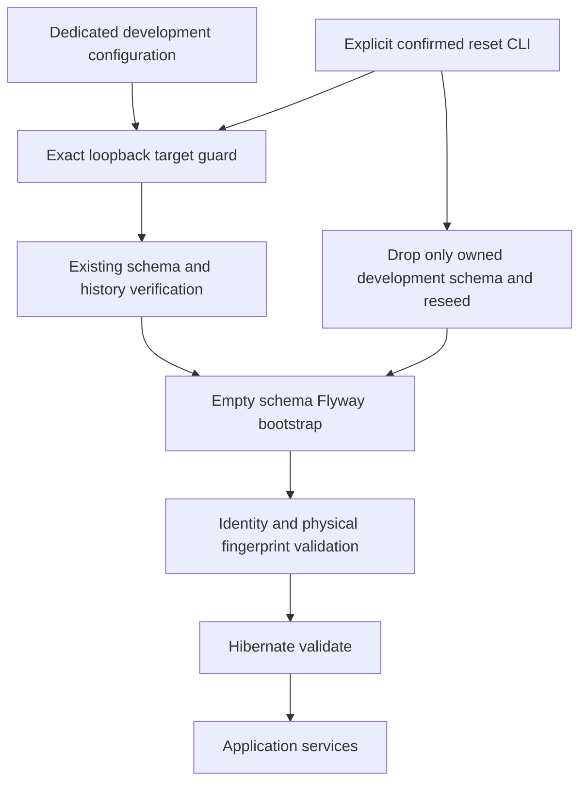
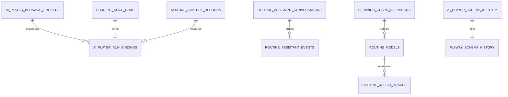

# SC-665 full delivery plan

Source https://app.shortcut.com/leeuwbot/story/665; Felix task task_1790961222622_ae65zsk9; classification change:data; owning project C:\Dev\IdeaProjects\ChromaScape.

## Scope and exclusions
- IN SCOPE: Clean development schema for every committed current JPA entity plus immutable BehaviorProfile snapshots, durable run/session bindings, job/model/graph/Assistant/source/patch/candidate evidence invariants.
- IN SCOPE: Native Fedora development profile, pre-start identity/physical-schema validation, explicit reset/reseed CLI, deterministic fixtures and real PostgreSQL tests.
- OUT OF SCOPE: Reset of any existing user/production database, old-data migration, backfill, compatibility readers, production rollback, gameplay launches and downstream feature delivery.
- CONSTRAINTS: Exact loopback database chromascape_aiplayer_dev and schema ai_player_dev only; isolated branch codex/sc-665-current-schema at df6eff61; no source copying from dirty main checkout.

## Linked project rules
C:\Dev\IdeaProjects\AGENTS.md Shared Felix + Shortcut Delivery Contract; C:\Dev\IdeaProjects\ChromaScape\AGENTS.md native host path/build rules; Felix rule rule_1790961222483_t2tpoid4 disposable schema ownership; rule_1788114448331_ygxw3fk0u Development Standards. Native worktree is ChromaScape-sc665; canonical Felix identity stays ChromaScape. No production/development instance is reset in this run; destructive acceptance runs only against a new disposable PostgreSQL test instance.

## Given/When/Then acceptance criteria
1. Given an empty dedicated development database, When bootstrap executes, Then Flyway alone creates the complete current schema and deterministic fixtures and Hibernate validates every entity without update/create.
2. Given two reset/reseed cycles, When identities and fixtures are compared, Then schema fingerprint and seeded content are identical.
3. Given published profiles/graphs/models/evidence or a terminal capture, When content is changed or completion lacks finalized artifacts, Then PostgreSQL rejects the write.
4. Given duplicate run/profile/session identities or cross-run/session attachments, When inserted, Then unique/FK/check constraints reject the write.
5. Given an interrupted transaction, When rolled back, Then no successful terminal result or finalized capture remains.
6. Given a missing/wrong identity, altered physical schema, or unexpected Flyway history, When application startup is attempted, Then it fails before services start with a development reset instruction.
7. Given an unresolved, remote, wrong database/schema, mixed production profile or missing reset confirmation, When bootstrap/reset is invoked, Then it refuses before destructive SQL and preserves unrelated public data.

## Implementation checklist
- [x] Create isolated current-schema baseline and deterministic versioned fixtures matching committed entity mappings.
- [x] Enforce published immutability, unique identity, terminal completeness and cross-run/session FK constraints.
- [x] Implement guarded bootstrap, structural identity validation and pre-JPA development profile startup strategy.
- [x] Implement one explicit native development reset/reseed procedure with exact database/schema and confirmation guards.
- [x] Add real PostgreSQL bootstrap, entity conformance, invariants, rollback, drift and reset isolation tests.
- [x] Document setup, storage ownership, version changes, reset effects, observability and rollback; persist complete evidence in Felix.

## Test checklist
- [x] Integration: fresh Flyway bootstrap and Hibernate validation of all current entities against PostgreSQL.
- [x] Integration: deterministic repeated reset/reseed, no impact to sentinel outside owned schema, and rollback after interrupted finalization.
- [x] Integration: SQL uniqueness/FKs/checks and immutability rejection for profiles, graphs, models, recordings and evidence.
- [x] Unit + integration: URL/profile/confirmation refusal, incorrect schema identity/history, physical schema drift and startup failure.
- [x] Run Java 17 focused Gradle verification, scoped style checks and git diff --check; record commands/counts and unrun checks.

## Architecture
Use a separate application-ai-player-development.yml, dedicated database chromascape_aiplayer_dev and fixed schema ai_player_dev. A dedicated Flyway location contains a frozen current baseline, invariant DDL, deterministic seed and singleton schema identity. General application entity tables are included because the existing application scans all JPA entities. This is a clean development schema, not an upgrade of db/migration history. Hibernate uses validate only. A FlywayMigrationStrategy validates configuration and existing identity before any bootstrap write, migrates only an empty schema, validates exact successful migration history and a physical-schema fingerprint, then allows JPA initialization. Native Gradle CLI modes bootstrap/verify/reset call the same schema manager without starting web/native services. Reset is explicit, transaction-bound, advisory-locked and restricted to the owned schema; reseed produces the identical baseline and current fixtures.

## ERD and ownership
All current mapped tables retain their existing application names and column contracts, including routine capture, graphs, conversations/events/proposals, models/traces/shadow/jobs, gameplay provider/orchestration, recording/debug sessions, replay artifacts, source references, patch loop and candidate evidence. Add immutable versioned ai_player_behavior_profiles and explicit ai_player_run_bindings to define profile/run/client/session/recording identity at the schema boundary without inventing downstream feature services. Add deferred cross-identity constraints where multi-step writes need same-transaction binding. Finalized rows need identities, hashes and terminal receipts, not only a boolean. Published objects and finalized evidence cannot be updated or deleted. Fixtures use stable identifiers/timestamps and controlAllowed=false, with no live client/account credential.

## Operational contract and observability
No new HTTP API. CLI actions bootstrap, verify and reset; reset requires exact confirmation RESET_AI_PLAYER_DEV and active development profile. Connection is loopback PostgreSQL to exact dedicated database, username/password from environment; no credentials in output. Nonempty unrecognized schemas are rejected. Emit stable success/identity-mismatch/unsafe-target codes and reset instructions without sensitive connection data. Lock reset/bootstrap against concurrent schema operations. Verify physical columns/types/defaults/constraints/indexes/sequences/functions/triggers rather than trusting a stored identity marker. Drift cannot be silently repaired by startup. Historical migration files remain untouched.

## Decision record
Choose an opt-in isolated development profile and current baseline rather than changing existing default migration history: the active checkout and database contain unrelated work and existing recordings. Physical identity is fail-closed and pinned with source code; destructive reset is a CLI procedure rather than a web endpoint. Include every application-mapped table for full startup/JPA conformance; downstream gameplay execution is not added. Any future schema change requires a new current identity and explicit disposable reset, not compatibility logic.

## Rollout, risks and rollback
Activate only ai-player-development against a newly provisioned dedicated development database. Bootstrap or reset is never directed at public/shared schemas. Validate current committed df6eff61 model mappings; later uncommitted upstream features require reviewed schema regeneration/version changes. Revert the task-scoped profile/tool/schema/test/docs changes to roll back code; disposable data is rebuilt from fixtures. Existing production/legacy databases are unaffected. Reset intentionally deletes only dedicated disposable development data; no recovery promise for that data.

## Tracker reconciliation
Planning -> spec_ready with validated full artifacts -> in_progress -> in_review after all implementation checks/evidence -> done only with verified acceptance/test evidence. Use reviewed .felix/shortcut-sync.json planned/started/review/done IDs and exact one-time markers. Older unrelated outbox conflicts remain pending without overwrite or invented success.

## Implementation decisions and amendments

The clean baseline preserves existing provider/orchestration/source SQL constraints rather
than treating Hibernate's export as the sole schema contract. The source JSON mapping is
corrected from @Lob/OID to TEXT, and source baseline timestamps match current Instant fields.
External dependency detection resolves relation owners for rules, triggers, defaults,
constraints and policies; unresolved dependent objects are conservatively refused.

Reset's DROP commits before grouped Flyway rebuild; interruption can leave an unavailable
schema but cannot report success. It is not a transactional preservation of old development
data. Applications must be stopped first. Physical recording/debug rows finalize before
capture completion in the same transaction. SQL checks do not certify external file bytes.
See SC-665-CURRENT-SCHEMA.md for the complete reviewed operational procedure and boundaries.

## Completion evidence
All seven acceptance criteria and five test checks passed. See upstream-integration/sc-665/implementation-evidence.md and verification-evidence.md for the complete changed files, actual test counts, limitations and rollback.
