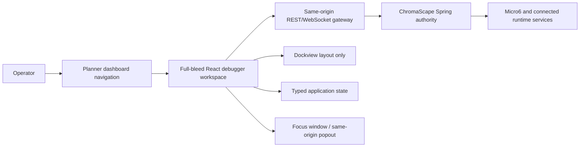

# SC-1103 Architecture and Delivery Plan — Multi-repo Decision

Shortcut: https://app.shortcut.com/leeuwbot/story/1103

Felix task: `task_1787848584095_anw9uswv`

Canonical planning project: `C:\Dev\IdeaProjects\ChromaScape`

Canonical frontend implementation repository: `C:\Dev\IdeaProjects\osrs-goal-tracker`

Classification: `change:multi-repo`

## Decision

The saved ChromaScape Session Workspace v7 is the canonical debugger direction. Build the debugger once inside the existing Planner/dashboard React application in `C:\Dev\IdeaProjects\osrs-goal-tracker`. ChromaScape Spring remains the data and control authority. There is no iframe, second debugger frontend, or duplicate backend.



## Scope

- Canonical debugger discovery, identity, navigation, deep links, presentation modes, and workspace composition.
- Same-origin typed REST/WebSocket gateway and capability manifest.
- Versioned Dockview presets, sanitized layout persistence, lifecycle ownership, focus window, and same-origin popouts.
- Investigation, replay, evidence, Assistant, and patch workspace sequencing.
- Safety, certification, legacy cutover, rollback, and child-story ownership.

## Exclusions

- No application source, dependency, configuration, generated artifact, or repository documentation change is delivered by SC-1103 planning.
- SC-1103 does not implement SC-932, SC-1104, or any other linked delivery story.
- No runtime, browser, accessibility, visual, memory, reconnect, redirect, or production result is claimed without executable evidence from its owning story.
- The Farm Users Canvas remains separate; farm topology is not debugger session data.
- Launch, Stop, Restart, and Rollback remain capability-gated. `controlAllowed=false` stays visible and backend-enforced until explicit RBAC/audit work authorizes control.
- No arbitrary upstream URL may originate from route state, query state, Dockview layout, or browser storage.

## Applicable project rules

- Follow `C:\Dev\IdeaProjects\AGENTS.md` and each repository's own `AGENTS.md`.
- Every Felix and Shortcut path is a Windows path.
- Preserve existing user changes and never create a second task tagged `shortcut:sc-1103`.
- In the Planner repository, `src\features\debugger\README.md` is authoritative for route, state ownership, and gateway rules.
- REST access stays behind the debugger gateway; WebSocket ownership stays centralized in the stream manager.
- ChromaScape upstream origin remains server configuration only.
- Dockview owns layout only; URL state owns shareable navigation state; the typed application store owns data.
- Same-origin popouts and fail-closed capabilities are mandatory.

## Canonical interfaces and ownership

Routes:

```text
/dashboard/debugger
/dashboard/debugger/sessions/:sessionId
/dashboard/debugger/sessions/:sessionId/patch/:iterationId
```

Allowlisted query state:

```text
mode=live|history|replay
tick=<number>
panel=<allowlisted-panel-id>
presentation=integrated|focus
```

Ownership:

- URL: session, mode, tick, patch iteration, panel focus, and presentation.
- Typed application store: session/tick/replay/evidence/patch data and request state.
- Dockview: allowlisted panel IDs, group positions, sizes, active tabs, and preset version only.
- ChromaScape: sessions, ticks, replay, recordings, logs, viewport/overlay streams, AI Inspector, Builder Goal, patch-loop, recovery, and provider/control state.
- Server configuration: upstream origins and credentials.

Invalid URL or layout state fails safely to the current preset. Unknown or retired panel IDs are rejected during layout restore. Tokens, origins, session payloads, evidence, and control state are never persisted in Dockview JSON.

## Workspace presets

Investigation preset:

- Viewport or recorded video.
- Micro6 execution graph.
- Session timeline and tick stream.
- Selected-tick inspector.
- Session Assistant, annotations, and evidence rail.

Patch preset:

- Evidence rail.
- Source, diff, and staged artifact.
- AI patch assistant.
- Pipeline, approval, and certification status.

Patch is a dedicated preset and route, not another narrow investigation panel.

## Delivery ownership and sequence

1. SC-1104 supplies the same-origin REST/WebSocket gateway and fail-closed capability contract.
2. SC-932 owns the Planner-hosted frontend foundation, full-bleed route, Dockview presets, bounded state, and lifecycle.
3. SC-611 and SC-669 own the live/history/replay shell plus v7 visual and interaction baseline.
4. SC-728 and SC-933 own graph/timeline behavior and the durable Assistant stream.
5. SC-812 and its linked source/proposal/build/certification stories own the patch preset.
6. SC-968 owns current-build certification, including deep links, reconnect, focus window, layout restore, and legacy redirect.
7. SC-1112, SC-1113, SC-1114, SC-1115, SC-1116, SC-1119, and SC-1123 close contract, authorization, deployment, lifecycle, disposition, and delivery-ownership gaps.

These stories are downstream delivery work. Their incomplete state does not constitute implementation performed under SC-1103.

## Given/When/Then acceptance criteria

1. Given SC-1103 is retrieved from Felix, when source traceability is inspected, then exactly one task links Shortcut story 1103 and carries `shortcut:sc-1103` plus exactly one classification, `change:multi-repo`.
2. Given the architecture decision, when frontend ownership is reviewed, then the Planner React application is the only debugger frontend and ChromaScape remains the backend authority.
3. Given a debugger URL, when ownership is reviewed, then shareable navigation belongs to the URL, application data belongs to the typed store, and layout composition alone belongs to Dockview.
4. Given integrated, focus, or popout presentation, when the workspace opens, then the same React components and same-origin gateway are used without an iframe or second source of truth.
5. Given downstream delivery stories, when SC-1103 planning is closed, then their implementation and certification remain explicitly unclaimed and independently tracked.
6. Given Shortcut workflow-state mappings are null, when this Felix planning record is restored, then no Shortcut state or idempotent synchronization comment is emitted.

## Implementation checklist

- Create one authoritative Felix task with Shortcut entity link and stable classification tags.
- Persist this complete architecture and delivery decision as the primary planning note.
- Validate task/note retrieval and record the synchronization prerequisite.
- Leave repository implementation, tests, and child-story completion to their owning Shortcut stories.
- Before any later cutover, require implementation and verification evidence from the downstream stories.

## Test and verification checklist

- Felix retrieval: the task resolves under `C:\Dev\IdeaProjects\ChromaScape`.
- Stable identity: searching `shortcut:sc-1103` returns one task, not multiple tasks.
- Artifact integrity: this note is linked to the task and contains scope, exclusions, rules, architecture, acceptance criteria, implementation sequence, verification, risks, and rollback.
- Repository safety: no repository file is changed while restoring the planning record.
- Shortcut safety: no state or comment is changed while mappings remain null.
- Downstream certification, when implemented: route/deep-link determinism, invalid-state fallback, reconnect, focus/popout, versioned layout restore, listener/socket/request cleanup, accessibility, visual baseline, memory bounds, fail-closed controls, and legacy redirect.

## Risks

- Felix data-store drift can hide earlier tasks and create duplicates; stable-tag checks are required before every future write.
- The story text contains product-level acceptance targets even though the story functions as an architecture blocker. Closure must state that executable product acceptance belongs to the linked delivery stories.
- Existing uncommitted Planner debugger work is user-owned and must not be treated as SC-1103 implementation evidence.
- Shortcut synchronization cannot be claimed until `.felix\shortcut-sync.json` contains valid state mappings and the MCP calls succeed.
- Legacy redirect must not occur before the Planner implementation is certified.

## Rollback and cutover

- Before certification, retain the existing ChromaScape debugger entry point.
- Cut over only after the canonical Planner workspace passes SC-968's browser and current-build gates.
- After certification, redirect legacy ChromaScape `/debugger` to the canonical dashboard URL; do not maintain two implementations.
- If the new workspace fails release gates, disable the new navigation/cutover and return operators to the prior entry point while preserving backend data and contracts.
- Layout-version rollback resets to the last supported preset; it never migrates or deletes application data.

## Current truth

This artifact restores planning only. No SC-1103 application implementation or application test execution is claimed. Any previously reported implementation-complete status for SC-1103 is superseded by this truthful planning record. Shortcut remains unchanged until its workflow-state mappings are configured.


## Closure execution status

- The known agent-authored session guard was removed from `C:\Dev\IdeaProjects\osrs-goal-tracker\src\features\debugger\shell\DebuggerWorkspacePage.tsx`.
- Its regression test, unused router imports, and resulting blank line were removed from `C:\Dev\IdeaProjects\osrs-goal-tracker\src\features\debugger\shell\DebuggerWorkspacePage.test.tsx`.
- No other uncommitted debugger foundation content was reset, deleted, reformatted, or attributed to SC-1103.
- Scoped Prettier verification passes for both touched files.
- Vitest could not start either fork or thread workers on the WSL/DrvFs workspace and executed no tests.
- Whole-repository typecheck/build remain red because of pre-existing missing Planner types/modules; whole-repository formatting also has unrelated failures.
- Shortcut remains in Backlog and untouched because synchronization state IDs are not configured.

### Current downstream status

- Backlog: SC-1104, SC-611, SC-1112, SC-1113, SC-1114, SC-1115, SC-1116, SC-1119, SC-1123.
- To Do: SC-932, SC-669, SC-728, SC-933, SC-812.
- In Progress: SC-968.
