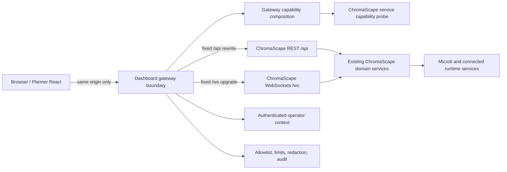

# SC-1104 Multi-repo Gateway Architecture, API Contract, and Implementation Plan

Shortcut: https://app.shortcut.com/leeuwbot/story/1104

Felix task: `task_1787860135412_93tk3147`

Classification: `change:multi-repo`

Planning owner: `C:\Dev\IdeaProjects\ChromaScape`

Affected repositories:

- `C:\Dev\IdeaProjects\ChromaScape` — authoritative domain APIs, WebSocket producers, service capability/health facts, limits, and backend tests.
- `C:\Dev\IdeaProjects\osrs-goal-tracker` — Vite development gateway, typed browser client, stream manager, store lifecycle, and browser tests.
- `C:\Dev\IdeaProjects\leeuwbotbackend` — production dashboard hosting/reverse-proxy integration owned by prerequisite SC-1115. Only the active Go services under `leeuwbot-api\leeuwbotapi` are candidates; do not modify the abandoned Java monorepo.
- `C:\Dev\IdeaProjects\sarububotlauncher-win` — not an implementation target unless production discovery proves it owns the deployed dashboard proxy. Do not modify it speculatively.

## Outcome

The Planner-hosted debugger reaches the existing ChromaScape backend through a single authenticated same-origin boundary. The browser never receives or selects a ChromaScape origin. ChromaScape remains authoritative for domain data and operations; the gateway performs routing, capability composition, normalization, security enforcement, lifecycle control, and observability only.

## Baseline already present but not yet accepted as delivered

The Planner worktree currently contains uncommitted gateway scaffolding:

- `vite.config.ts` rewrites `/api/chromascape/*` to ChromaScape `/api/*` and `/ws/chromascape/*` to `/ws/*`, using server-only `CHROMASCAPE_ORIGIN`.
- `src\features\debugger\gateway\chromascape-api.ts` defines fixed prefixes, capability parsing, REST error classification, and session-list fetching.
- `src\features\debugger\gateway\stream-manager.ts` defines allowlisted stream kinds, one socket per kind, reference-counted subscribers, reconnect backoff, and stale session/build filtering.
- The debugger store keeps at most 300 ticks.

These files are user-owned and untracked. Audit and extend them in place; do not delete, reset, wholesale-format, or claim them as newly created by SC-1104. ChromaScape has the existing domain/WebSocket handlers but no verified SC-1104 gateway capability endpoint. No production proxy implementation was found in the active leeuwbotbackend search; SC-1115 must establish that owner before production cutover.

## Multi-repository decision



Decisions:

1. The browser uses only relative same-origin paths. Remove or make private any generic API that lets panels supply arbitrary paths; expose typed endpoint functions backed by a fixed descriptor registry.
2. Development and production implement the same external contract. Vite is the development gateway; SC-1115's authenticated dashboard host is the production gateway.
3. ChromaScape exposes read-only service capability facts at `GET /api/capabilities`. The gateway serves `GET /api/chromascape/capabilities`, adds its own build/auth/proxy health, and returns the normalized public manifest.
4. The gateway does not store session, replay, evidence, patch, or control data.
5. Current MVP is read/investigation-only except explicitly allowlisted offline patch actions. Live gameplay/fleet mutations remain denied while `controlAllowed=false`.
6. SC-1112 owns correlation identity, SC-1113 owns versioned payload fixtures, SC-1114 owns operator authorization/control policy, and SC-1115 owns production proxy/deployment. SC-1104 integrates and verifies those contracts; it must not duplicate them.

## External routes

```text
GET  /api/chromascape/capabilities
GET  /api/chromascape/debug/sessions
...typed allowlisted read routes only...

WS   /ws/chromascape/viewport
WS   /ws/chromascape/overlay
WS   /ws/chromascape/bot-state
WS   /ws/chromascape/logs
WS   /ws/chromascape/state
WS   /ws/chromascape/semantic-state
WS   /ws/chromascape/stats
WS   /ws/chromascape/debugger/tick-stream
WS   /ws/chromascape/debug/patch-loop/{allowlistedExecutionId}
```

Rewrites:

```text
/api/chromascape/{path} -> configured ChromaScape /api/{path}
/ws/chromascape/{path}  -> configured ChromaScape /ws/{path}
```

The upstream origin comes only from server configuration. Reject schemes, authority components, `..`, encoded traversal, duplicate slashes where ambiguous, backslashes, control characters, fragments, userinfo, and paths absent from the descriptor registry. Dynamic IDs must match their endpoint-specific identifier grammar and be encoded as path segments.

## Capability contract

Public response for `GET /api/chromascape/capabilities`:

```ts
interface ChromascapeCapabilitiesV1 {
  schemaVersion: 'debugger-gateway/v1';
  gatewayBuildId: string;
  serviceBuildId: string | null;
  restCapabilities: readonly string[];
  streamKinds: readonly StreamKind[];
  streamSchemaVersions: Readonly<Record<StreamKind, string>>;
  maxRestBodyBytes: number | null;
  maxFrameBytes: number | null;
  replayModes: readonly ('live' | 'history' | 'replay')[];
  features: {
    sessions: boolean;
    recordings: boolean;
    patch: boolean;
  };
  controlAllowed: boolean;
  allowedMutations: readonly string[];
  health: {
    status: 'ok' | 'degraded' | 'unavailable';
    reasons: readonly string[];
  };
}
```

Rules:

- Arrays contain bounded allowlisted enum values, not arbitrary backend strings.
- Health reasons are bounded public codes such as `UPSTREAM_UNAVAILABLE`, `AUTH_CONTEXT_MISSING`, `SCHEMA_MISMATCH`, or `PROXY_DEGRADED`; never raw exceptions, URLs, headers, credentials, filesystem paths, or machine names.
- Missing, malformed, stale, or unauthorized manifests normalize to `controlAllowed=false`, no allowed mutations, and unavailable/degraded health.
- `controlAllowed=true` is valid only when the authenticated operator policy and backend capability both authorize at least one named mutation.
- Unknown fields are ignored by the current frontend; an unknown major `schemaVersion` is rejected.
- `maxFrameBytes` must admit the verified current 1 MiB viewport traffic with explicit overhead. Choose the configured production ceiling in SC-1115; do not silently rely on framework defaults.

## REST contract

- Keep `fetchChromascapeJson` private.
- Export typed functions for each approved operation; panels import those functions and cannot pass a URL.
- Every request carries the hosting system's authenticated operator context and a correlation ID. Do not invent a second login mechanism.
- GET/HEAD are allowed only for registered read descriptors.
- Mutations require a registered descriptor, explicit capability name, SC-1114 authorization, idempotency semantics where supported, and an audit record.
- Session/mode changes abort obsolete requests. An aborted request produces `GatewayError('aborted')` and never updates current state.
- Normalize public errors:

```ts
type GatewayErrorKind =
  | 'network_error'
  | 'auth_error'
  | 'forbidden'
  | 'not_found'
  | 'rate_limited'
  | 'payload_too_large'
  | 'schema_mismatch'
  | 'upstream_timeout'
  | 'http_error'
  | 'parse_error'
  | 'aborted';

interface GatewayErrorBody {
  code: GatewayErrorKind;
  message: string;
  correlationId: string | null;
  retryable: boolean;
}
```

Never return upstream stack traces or sensitive detail. A timeout or dropped connection is not success. Mutation retryability must come from the typed contract, not HTTP status guessing.

## WebSocket and lifecycle contract

Public stream envelope:

```ts
interface StreamEnvelopeV1<T> {
  schemaVersion: 'debugger-stream/v1';
  sessionId: string;
  buildId: string | null;
  seq: number | null;
  emittedAtMs: number | null;
  payload: T;
}
```

Migration rule: during the compatibility window, a stream may omit `schemaVersion` only when the capability manifest explicitly advertises its legacy version and the typed adapter for that stream normalizes it. Otherwise reject it as `schema_mismatch`. Remove legacy adapters after SC-968 certification.

Lifecycle:

- One physical connection per stream kind per browser window.
- Each subscriber registers session, optional expected build/schema, and callbacks.
- First subscriber opens; final unsubscribe cancels reconnect, detaches handlers, closes the socket, and deletes the manager entry.
- Session/build/schema mismatches are dropped before panel callbacks.
- Reconnect uses exponential backoff with full jitter, capped at 30 seconds. Reset attempts after a successful open.
- Expose connecting/open/reconnecting/closed/degraded states.
- Reconnect exhaustion uses the configured attempt/time budget from SC-1115 and remains visibly degraded until explicit retry or a new subscriber lifecycle.
- Viewport keeps only the latest pending frame (coalescing).
- Tick storage remains capped at 300 ordered entries.
- Logs and event streams use bounded queues with explicit oldest-drop counters; no stream may accumulate unbounded browser history.
- Focus/popout windows are same-origin but separate browser contexts; they may create their own manager. Within one window, panels share the manager.
- Closing panels, resetting/restoring layout, switching session/mode, StrictMode remounts, and navigating away must leave zero orphan sockets/timers/listeners.

## Authentication, authorization, and audit

- Production gateway requires the authenticated dashboard operator context supplied by the hosting system.
- Vite development uses an explicit server-side development identity mechanism from SC-1114; it must be loopback-only and must never be bundled into browser JavaScript.
- Forward only the minimum upstream authorization material. Strip client-supplied forwarding headers and construct trusted headers at the gateway.
- Allowlist methods, paths, stream kinds, mutation names, and content types.
- Enforce request body, response body where feasible, and WebSocket frame limits before application processing.
- Redact authorization headers, cookies, API/provider tokens, account secrets, filesystem roots, upstream hosts, and payload bodies from public errors and routine logs.
- Allowed mutation audit fields: timestamp, operator ID, correlation ID, session/run/iteration identity, capability/action, result class, upstream status, and duration. Do not audit secret payload fields.
- Unauthorized, unsupported, or ambiguous operations fail before reaching ChromaScape.
- `controlAllowed=false` remains the default and current production posture.

## Observability

Bounded metrics:

- REST request count/latency/error by descriptor and normalized result class.
- Active WebSockets and subscribers by allowlisted stream kind.
- Reconnect attempts/exhaustion, stale drops, schema drops, malformed drops, oversized drops, and bounded-buffer drops by stream kind.
- Capability health state and probe failures by bounded reason.
- Authorized/denied mutation count by capability and result class.

Structured logs include correlation ID, operator ID where permitted, descriptor/stream kind, session/run/iteration identity, normalized result, and duration. Never use IDs, URLs, or raw errors as metric labels.

Release alerts:

- sustained upstream unavailable/degraded state;
- reconnect exhaustion or growing active-socket count without subscribers;
- schema mismatch after deployment;
- oversized viewport frames;
- denied live-control attempts;
- missing capability manifest or authorization context.

## Implementation sequence

1. Baseline and dependencies:
   - Read every repository's `AGENTS.md`.
   - Inventory existing uncommitted changes and preserve them.
   - Confirm SC-1112, SC-1113, SC-1114, and SC-1115 contracts; implement SC-1104 against their accepted interfaces or record a hard dependency instead of duplicating provisional logic.
   - Enumerate every consumed REST route, method, content type, stream kind, frame shape, and current size.

2. ChromaScape service capability:
   - Add a read-only service capability provider/controller for `GET /api/capabilities`.
   - Derive build identity, feature availability, replay modes, stream contract versions, configured limits, control policy, and sanitized health probes.
   - Do not query or persist domain data beyond existing read-only health/capability services.
   - Add controller/service serialization, degraded/error, redaction, and build/feature tests.

3. Development gateway:
   - Retain server-only `CHROMASCAPE_ORIGIN`.
   - Replace unrestricted wildcard behavior with typed allowlist validation while preserving the fixed external prefixes.
   - Serve/compose the public capability manifest with development gateway identity.
   - Enforce timeouts, size limits, WebSocket upgrade, trusted headers, and normalized failures.
   - Keep root Vite files in their existing formatting style; do not run the src-only formatter on them.

4. Production gateway:
   - Implement in the active host chosen by SC-1115, not the abandoned leeuwbot Java tree.
   - Match development paths, auth context, rewrites, WebSocket upgrade, timeouts, limits, capability composition, trusted headers, and error/redaction behavior.
   - Add deployment configuration and health checks without committing credentials or machine-specific origins.

5. Typed frontend:
   - Add `schemaVersion`, stream versions, normalized errors, fixed typed endpoint descriptors, correlation, and abort ownership.
   - Keep all REST access in `chromascape-api.ts`; keep all sockets in `stream-manager.ts`.
   - Add bounded/coalesced per-stream buffering and schema/legacy adapters.
   - Wire capability/degraded state into the existing store/chrome; never infer permission from endpoint failure.

6. Security and audit:
   - Apply SC-1114 operator/control policy.
   - Enforce route/method/content/size allowlists and mutation capability checks.
   - Add redaction and audit correlation with bounded logging/metrics.

7. Verification and rollout:
   - Run targeted tests after each subsystem.
   - Run full repository suites in every changed repository.
   - Verify development and production parity, authenticated REST, all WebSocket upgrades, 1 MiB viewport traffic, reconnect/failure behavior, focus/popout lifecycle, and zero leaks.
   - Roll out gateway and capability endpoint before enabling Planner navigation.
   - Keep legacy ChromaScape debugger and `controlAllowed=false` until SC-968 certification.

## Required tests

ChromaScape:

- capability manifest healthy/degraded/unavailable serialization;
- build/feature/limit/replay/stream facts;
- sanitized reasons and secret redaction;
- control fail-closed behavior;
- WebSocket frame/envelope compatibility and 1 MiB viewport path;
- existing REST/WebSocket regression suites.

Planner:

- path traversal, scheme/authority, encoded traversal, unknown descriptors, methods, and dynamic-ID validation;
- manifest v1 parsing, unknown-major rejection, missing-field fail closed, bounded enums/reasons;
- REST error normalization, aborts, stale completion suppression, auth/limit/timeout behavior;
- one socket per stream kind, reference counts, StrictMode remount, final cleanup;
- reconnect jitter/cap/exhaustion, stale session/build/schema drops, malformed/oversized drops;
- viewport coalescing, 300-tick cap, bounded log/event drop counters;
- focus/popout same-origin behavior and layout/session changes.

Production gateway:

- authenticated REST rewrite and trusted-header construction;
- WebSocket upgrade for every allowlisted stream;
- unsupported paths/methods/content types and oversized traffic rejected;
- upstream unavailable/timeout/auth/schema failures normalized;
- secrets absent from public errors/logs;
- mutation authorization, idempotency where applicable, and audit correlation;
- development/production contract fixture parity.

E2E:

- same frontend build works through Vite and production `/dashboard/`;
- session switching and panel/layout lifecycle produce no socket/request/listener leaks;
- current viewport frames pass without truncation;
- stale identities never update current UI;
- degraded state is visible and permissions remain fail closed;
- a dropped/timed-out mutation is never displayed as success.

## Rollout and rollback

Rollout order:

1. ChromaScape capability/service contract.
2. SC-1115 production gateway with auth, limits, and WebSocket upgrade.
3. Planner typed client/stream lifecycle.
4. Read-only operator rollout.
5. Offline patch mutations only after SC-1114 authorization/audit.
6. SC-968 certification before legacy redirect.

Rollback:

- Disable Planner debugger navigation or gateway route exposure; retain the existing ChromaScape debugger.
- Revert gateway/frontend binaries/configuration without deleting ChromaScape domain data.
- Keep capability endpoint additive and read-only; older clients ignore it.
- Do not roll back by exposing direct ChromaScape origins to the browser.
- Preserve audit records and correlation evidence.
- If schema mismatch occurs, restore the last supported adapter/manifest pair and keep controls disabled.

## Risks and explicit non-goals

- The Planner foundation is untracked and the repository currently has unrelated type/build/format failures; isolate SC-1104 evidence from those baselines.
- Production reverse-proxy ownership is a prerequisite from SC-1115. Do not implement in an arbitrary repo when that story has not established the deployed host.
- WebSocket proxy defaults may reject current viewport frames; limits require explicit tests.
- Authentication/control decisions belong to SC-1114; temporary permissive production behavior is forbidden.
- No database/ERD change is required.
- No debugger panel content, Dockview layout feature, farm topology, live gameplay control, or legacy redirect is part of SC-1104.

## Completion evidence contract

Before Felix `in_review`, create an Implementation Evidence note with:

- `## Changed files`
- `## Tests`
- `## Remaining work`

Before Felix `done`, create a Verification Evidence note with:

- `## Acceptance results`
- `## Tests`
- `## Risks`
- `## Rollback`

Record exact commands, results, unrun checks, dependency blockers, production deployment evidence, and Shortcut synchronization outcome. Never claim a gateway, credential, state transition, test, or deployment succeeded unless directly verified.
