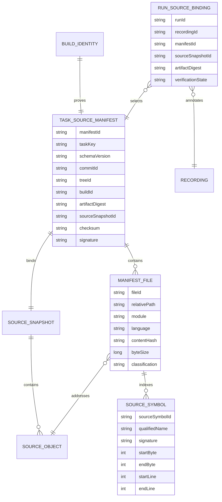

# SC-810 Luna Max implementation specification and remediation record

## Current audited implementation status — 2026-09-01

Audit date: 2026-09-01, Europe/Amsterdam
Audit mode: read-only static inspection
Felix note: note_1787866248248_c4812448
Requested Felix task: task_1787544447065_1qv4uilz
Shortcut: SC-810
Repositories:
- C:\Dev\IdeaProjects\ChromaScape
- C:\Dev\IdeaProjects\micro6

SC-810 is not complete. Implementation has advanced materially, but source defects and all final verification gates remain.

No repository files were edited, no ChromaScape tests were run, and Micro6 was not compiled, tested, launched, or restarted during this audit.

### Current repository evidence

- ChromaScape branch: nathangemieee/sc-1112/dbg-ui-02-session-identity-a
- ChromaScape HEAD: fea2c8af8f223dc2bde0de64a57044ebc57ee9e6
- ChromaScape has extensive mixed dirty/untracked work. Preserve all unrelated SC-1498, replay, gameplay, debugger, builder-goal, recording-action, migration, UI, and Felix database work.
- Micro6 branch: sc-572-remediation
- Micro6 HEAD: 4a2564a6218df2a144e6f3bd68c52891aca40f9b
- Micro6 worktree is clean.
- Shortcut SC-810 remains To Do and its latest comments still state implementation has not started.
- Felix task task_1787544447065_1qv4uilz still returns Task not found. Do not create a replacement task or note.
- git diff --check produced no reported whitespace error, but emitted extensive line-ending conversion warnings.
- No current SC-810 ChromaScape test-result XML exists under C:\Dev\IdeaProjects\ChromaScape\build\test-results\test.
- The only matching Micro6 source test result remains C:\Dev\IdeaProjects\micro6\runelite-client\build\test-results\test\TEST-net.runelite.client.plugins.microbot.accountbuilder.integration.builder.SourceManifestCatalogTest.xml dated 2026-08-20, before the current implementation.

### Schema status

The source contract copies are byte-identical:

- C:\Dev\IdeaProjects\ChromaScape\src\main\resources\contracts\source\task-source-manifest-v1.schema.json
- C:\Dev\IdeaProjects\micro6\runelite-client\src\main\resources\micro6-contracts\task-source-manifest-v1.schema.json

Current SHA-256 for both:

708148850725a8817f43325cdb9869ca2ded8c82c062eba360de500983da7ad8

The new schema now requires environment, repository/build identity, entry source_symbol_id, non-empty files/symbols, typed closure/warning/failure shapes, and signature. Micro6 pins the new hash in:

C:\Dev\IdeaProjects\micro6\runelite-client\src\test\java\net\runelite\client\plugins\microbot\accountbuilder\integration\builder\TaskSourceManifestSchemaEqualityTest.java

### Phase matrix

| Phase | Current status | Evidence-based conclusion |
|---|---|---|
| 1 State rehydration | Partial | Repositories/schema audited; Felix task mapping remains unavailable |
| 2 Static compile blockers | Repaired, unverified | Named typeIds/HashMap/List issues are fixed; no authorized compile |
| 3 Gradle/artifact identity | Mostly implemented, one blocker | Root/shadowJar/direct digest fixed; attestation still defaults false |
| 4 Multi-task generation | Implemented statically, unverified | Isolated per-task output, sorted merge and distinct providers now exist |
| 5 Signing/promotion | Partial, security blocker | Full validation/atomic promotion exists; generation may skip cryptographic public-key verification |
| 6 Compiler-tree closure | Partial, correctness blockers | Wildcard/static/same-package/top-level work exists; constructor and UTF-8 tests remain wrong |
| 7 Runtime catalog | Implemented statically, unverified | Real-path/link checks, exact current path, identity, environment and signature validation exist |
| 8 Audit enforcement | Implemented statically, unverified | Incomplete contexts rejected and purposes bound to endpoints |
| 9 Micro6 tests | Partial and currently unreliable | Hermetic keys/distinct tasks improved; Unicode and tamper sequencing defects remain |
| 10 Chroma transactions | Partial | NOT_SUPPORTED and concurrent insert proof added; capture rollback proof absent |
| 11 Alias validation | Implemented statically, unverified | All four explicit disagreement directions and presence detection exist |
| 12 Contract alignment | Mostly implemented, one verifier blocker | Schema strict/parity/pin done; Chroma verifier can still accept unsigned authoritative v1 when config is false |
| 13 Chroma verification | Not run/currently unproven | No focused current result evidence |
| 14 Micro6 verification | Not authorized/not run | Must remain pending until separately authorized |
| 15 End-to-end proof | Not run | Requires phases 13/14 and separate launch authorization |
| 16 Felix/Shortcut | Partial/stale | Note updated; Felix task unavailable; Shortcut remains stale To Do |

## Exact remaining implementation work

### P0 — Make detached authoritative generation mandatory, not optional

File:

C:\Dev\IdeaProjects\micro6\runelite-client\build.gradle.kts

Current defect:

generateAllTaskSourceBundles correctly depends on shadowJar, uses C:\Dev\IdeaProjects\micro6 as repository root, reads the actual archive output, and computes SHA-256 from final bytes. However, --require-attestation still defaults to false.

Required change:

- Detached generateAllTaskSourceBundles must force require-attestation=true.
- Do not allow an operator default/property to silently produce non-attested authoritative output.
- Reject missing clean commit/tree/build/environment/signing configuration before assembly.

Related file:

C:\Dev\IdeaProjects\micro6\runelite-client\src\main\java\net\runelite\client\plugins\microbot\accountbuilder\integration\builder\TaskSourceBundleGenerator.java

Current defect:

- verifySignature() checks Ed25519 only when a verification public key happens to be configured.
- The main CLI constructs TaskSourceBundleGenerator without injected verification material.
- A syntactically valid signature and signed_bytes_hash can therefore pass bundle promotion without cryptographic verification.

Required change:

- Require a nonblank Ed25519 verification public key and safe key ID for every detached authoritative promotion.
- Fail before promotion if either is missing.
- Make the CLI load and pass configured verification material.
- Keep tests injectable/hermetic.
- Require configured key ID to match every manifest.
- Never treat signed_bytes_hash alone as authentication.

### P0 — Fix constructor classification

File:

C:\Dev\IdeaProjects\micro6\runelite-client\src\main\java\net\runelite\client\plugins\microbot\accountbuilder\integration\builder\JavaCompilerTreeSourceIndexer.java

Current defect:

Constructor recognition tests getReturnType() == null and additionally checks whether the enclosing type name ends with the method-tree name. Javac commonly exposes constructor names as <init>, so the extra name condition can misclassify a constructor as a METHOD.

Required change:

- Treat every MethodTree with getReturnType() == null as a constructor.
- Apply the selected policy consistently: exclude it or publish CONSTRUCTOR.
- Do not depend on the method-tree name matching the class.

Test file:

C:\Dev\IdeaProjects\micro6\runelite-client\src\test\java\net\runelite\client\plugins\microbot\accountbuilder\integration\builder\JavaCompilerTreeSourceIndexerTest.java

Current weakness:

The constructor assertion only rejects a qualified name containing WithCtor#WithCtor and can miss a wrongly indexed WithCtor#<init> symbol.

Required test:

- Assert no METHOD symbol originates from any returnType-null constructor.
- If constructors are excluded, explicitly reject <init> and the source constructor span.
- If CONSTRUCTOR is selected, assert exactly that kind and stable identity.

### P0 — Fix UTF-8 byte-range tests

File:

C:\Dev\IdeaProjects\micro6\runelite-client\src\test\java\net\runelite\client\plugins\microbot\accountbuilder\integration\builder\JavaCompilerTreeSourceIndexerTest.java

Current defect:

The test still passes published byte offsets to String.substring at approximately lines 80 and 99. That is invalid for non-ASCII text because Java substring indexes UTF-16 code units, not UTF-8 bytes.

Required change:

- Convert normalized source to byte[] with StandardCharsets.UTF_8.
- Slice byte arrays using startByte/endByte.
- Decode only the selected byte slice for assertions.
- Add Unicode before and inside symbols, surrogate pairs/non-BMP text, and CRLF→LF normalization.
- Never use byte offsets with String.substring.

### P0 — Repair impossible bundle catalog test sequencing

File:

C:\Dev\IdeaProjects\micro6\runelite-client\src\test\java\net\runelite\client\plugins\microbot\accountbuilder\integration\builder\SourceManifestCatalogBundleTest.java

Current defect:

unreadableOrTamperedBundlesFailClosed() restores current.json after pointer tampering, then corrupts an object and correctly expects bundle load to fail. It subsequently attempts a successful bundle load for unknown-task behavior without restoring the corrupted object.

Required change:

- Restore/regenerate the bundle object before the next success-path assertion, or isolate every tamper case in a fresh bundle root.
- Prefer one independent fixture per tamper condition.
- Add/confirm separate cases for tampered signature, bundle metadata, exact current path, duplicate task, duplicate manifest path, task/manifest mismatch, symlink, Windows junction/reparse escape, and unknown task without fallback.
- Report unsupported junction creation as environmental, not passed.

### P0 — Make ChromaScape authoritative v1 signatures unconditional

File:

C:\Dev\IdeaProjects\ChromaScape\src\main\java\com\chromascape\web\aiplayer\routine\source\TaskSourceManifestVerifier.java

Current defect:

The strict schema requires signature for authoritative v1, but the verifier only requires a signature when requireSignature configuration is true. With false development defaults, a manually supplied unsigned non-legacy v1 manifest can pass manual verification even though it violates the schema.

Required change:

- Every AVAILABLE non-legacy authoritative v1 manifest must contain and cryptographically verify its signature.
- Configuration may govern legacy/development compatibility only through an explicit legacy/unverified contract, not weaken authoritative v1.
- Keep legacy resources explicitly legacy/unverified.
- Add a test proving unsigned authoritative v1 fails even when the legacy/config toggle is permissive.

Related paths:

- C:\Dev\IdeaProjects\ChromaScape\src\main\java\com\chromascape\web\aiplayer\routine\source\SourceManifestFetchService.java
- C:\Dev\IdeaProjects\ChromaScape\src\main\java\com\chromascape\web\aiplayer\routine\source\SourceManifestBindingService.java
- C:\Dev\IdeaProjects\ChromaScape\src\test\java\com\chromascape\web\aiplayer\routine\source\TaskSourceManifestVerifierTest.java

### P0 — Add the real capture-completion rollback proof

No matching *Capture*Source*IntegrationTest.java currently exists under:

C:\Dev\IdeaProjects\ChromaScape\src\test\java

Existing improvements:

- SourceManifestFetchService now uses Propagation.NOT_SUPPORTED.
- SourceManifestBindingService no longer catches DataIntegrityViolationException and continues in a rollback-only transaction.
- SourceManifestConcurrentPersistenceIntegrationTest now contains a two-thread same-identity race and immutable-byte checks.

Still required:

- A real PostgreSQL integration test for capture completion covering:
  - fetch outside transaction;
  - capture identity changed between phases;
  - binding conflict;
  - run-stage conflict;
  - capture update failure;
  - rollback of manifest, binding, run, capture and operation writes;
  - separate UNCERTAIN marker transaction;
  - idempotent completion retry.
- Put this proof in an SC-810-owned test matching *Capture*Source*IntegrationTest*.
- Do not place it in or change SC-967 closure through:
  C:\Dev\IdeaProjects\ChromaScape\src\test\java\com\chromascape\web\aiplayer\routine\service\Sc967FlywaySchemaTest.java

Primary production path:

C:\Dev\IdeaProjects\ChromaScape\src\main\java\com\chromascape\web\aiplayer\routine\service\CaptureOperationResultService.java

### P1 — Remove the repository pathing violation from the Chroma schema equality test

File:

C:\Dev\IdeaProjects\ChromaScape\src\test\java\com\chromascape\web\aiplayer\routine\source\SourceContractSchemaEqualityTest.java

Current issue:

The test contains a WSL fallback path even though C:\Dev\IdeaProjects\ChromaScape\AGENTS.md requires Windows project paths.

Required change:

- Use configured BUILDER_GOAL_MICRO6_PROJECT_DIR first.
- Use C:\Dev\IdeaProjects\micro6 as the documented fallback.
- Remove the WSL mount fallback from source, comments, plans, and reports.
- Preserve fail-closed behavior when the sibling schema is unavailable.

Also clean corrupted comment characters visible in this test and JavaCompilerTreeSourceIndexerTest so source documentation remains readable.

## Implemented but still unverified

The following source work now appears present but cannot be claimed passed until native verification:

- Exact root-level shadowJar artifact hashing.
- Isolated multi-task assembly and object merging.
- Sorted manifests and deterministic bundle metadata.
- AVAILABLE/environment/files/symbol validation.
- Existing-bundle revalidation and atomic current.json replacement.
- Real-path containment and symlink/reparse checks.
- Exact current.json.path enforcement.
- Deterministic bundle ID validation.
- Runtime Ed25519 verification with configured key.
- Unknown authoritative task no-fallback behavior.
- Wildcard/static/same-package dependency closure.
- All top-level type indexing.
- Audit-context completeness and endpoint purpose binding.
- SourceManifestFetchService NOT_SUPPORTED transaction suspension.
- Conflict propagation and two-thread concurrent manifest persistence test.
- Four-direction legacy alias validation.
- Strict byte-identical schema and new pinned SHA-256.

## Required verification gates

### ChromaScape — native Windows Java 17

~~~bat
cd /d C:\Dev\IdeaProjects\ChromaScape
gradlew.bat compileJava
gradlew.bat test --tests "*SourceConfigurationValidatorTest*"
gradlew.bat test --tests "*SourceContractSchemaEqualityTest*"
gradlew.bat test --tests "*SourceRunOrchestrationIntegrationTest*"
gradlew.bat test --tests "*Capture*Source*IntegrationTest*"
gradlew.bat test --tests "*SourceManifestConcurrentPersistenceIntegrationTest*"
gradlew.bat test --tests "*TaskSourceManifestVerifierTest*" --tests "*Micro6SourceManifestClientTest*" --tests "*SourceManifestBindingServiceTest*" --tests "*SourceDebuggerReadServiceTest*" --tests "*SourceAccessAndCacheTest*" --tests "*SourceRetentionServiceTest*"
gradlew.bat test
git diff --check
~~~

Record Java version, exact commands, exit codes, test totals, report paths, failures, schema hash, and worktree state.

### Micro6 — only after separate explicit authorization

~~~bat
cd /d C:\Dev\IdeaProjects\micro6
gradlew.bat :client:compileJava
gradlew.bat :client:test --tests "*TaskSourceManifestGeneratorTest*" --tests "*JavaCompilerTreeSourceIndexerTest*" --tests "*FishingTaskSourceProviderTest*" --tests "*TaskSourceBundleGeneratorTest*" --tests "*SourceManifestCatalogBundleTest*" --tests "*SourceManifestCatalogTest*" --tests "*TaskSourceManifestSchemaEqualityTest*"
gradlew.bat :client:shadowJar
gradlew.bat :client:generateAllTaskSourceBundles
git diff --check
~~~

Do not run these commands without separate authorization. The bundle task must require attestation and cryptographic verification after the P0 fixes.

### Read-only end-to-end proof

After both native verification gates and separate launch authorization:

1. Build final Micro6 artifact.
2. Generate/promote signed detached bundle.
3. Start Micro6 with bundle root, environment, token, signing verification key and audit enforcement.
4. Fetch Fishing manifest/file/symbols with endpoint-bound purposes.
5. Prove missing/partial/wrong-purpose headers fail.
6. Prove environment/artifact/snapshot mismatches fail.
7. Create ChromaScape source-bound run.
8. Complete/bind recording.
9. Read exact source through http://localhost:8090/debugger.
10. Confirm repository, commit, tree, build, environment, artifact, manifest, snapshot, file and symbol identities agree.
11. Confirm neither developer checkout changed.

## Completion gate

Do not mark SC-810 Done until:

- all P0/P1 defects above are repaired;
- native ChromaScape verification is recorded;
- separately authorized native Micro6 verification is recorded;
- the read-only end-to-end proof passes;
- both developer checkouts remain unchanged by runtime activity;
- Felix task mapping is recovered without creating a duplicate;
- Shortcut comments/state are synchronized with evidence;
- no downstream story or SC-967 closure was changed;
- no unrun test is claimed as passed.

# Historical specification

# SC-810 — Authoritative Micro6 task-source manifest and immutable source snapshots

## Planning status

Planning-only handoff for Shortcut story [SC-810](https://app.shortcut.com/leeuwbot/story/810).

- Workflow: `shortcut_delivery`
- Classification: `shortcut:sc-810`, `change:multi-repo`
- Initial enablement: Fishing-first, with reusable per-task contracts
- Intended Felix state: `spec_ready`
- Implementation status: not started
- Source safety: Micro6 runtime and developer checkout remain strictly read-only

## Outcome

Give ChromaScape a safe, immutable, version-correct view of the exact Micro6 source that produced a selected task run. This is the prerequisite for evidence-backed debugger source navigation and every later patch-loop story.

The BehaviorGraphDefinition remains an explanatory and policy artifact. Micro6 source is executable truth. ChromaScape must never read a mutable developer checkout, silently show current-branch code for an older artifact, or accept a branch/tag as sufficient provenance.

## Scope

### In scope

1. Generalize the existing Fishing-oriented manifest/snapshot groundwork into reusable per-task publication.
2. Resolve a task entry class and its relevant helper, subroutine, configuration, and plugin closure.
3. Bind the closure to an exact repository commit/tree, Micro6 build, launched artifact digest, catalog/settings versions, and immutable source snapshot.
4. Publish stable file, symbol, range, content-hash, and manifest identities.
5. Let ChromaScape fetch, verify, reference, authorize, audit, cache, and expose only exact immutable snapshot content.
6. Produce stable unavailable, redacted, pruned, generated-only, and build-mismatch outcomes.
7. Preserve compatibility/versioning through SC-663 and migrations through SC-665.
8. Integrate with SC-609 run/recording identity, SC-293 launched-artifact attestation, SC-753 authorization, SC-754 integrity/retention, and SC-802 trusted routing.

### Out of scope

- Editing source in the debugger.
- Applying a patch or writing to Micro6 source.
- Mutating a developer checkout or live client.
- Static inference that claims a source span executed.
- xRSPS simulation, real-client retesting, candidate building, signing, registration, download, or deployment.
- SC-811 execution-to-source evidence, SC-812/813 proposal/approval, SC-814 isolated application, SC-815 certification, and SC-934 registry delivery.
- Closing SC-967; it remains a separate track.

## Ownership and repository boundaries

- **Micro6:** source discovery, task entry-point resolution, closure calculation, symbol indexing, source/build provenance, immutable snapshot production, and authoritative manifest signing.
- **ChromaScape:** verified manifest/snapshot references, run binding, authorized read-only debugger access, validation, caching by content hash, audit integration, and stable API error mapping.
- **Launcher/Mule:** attest the launched Micro6 artifact/revision; they do not enumerate or serve source.
- **LeeuwBotAPI:** no SC-810 implementation dependency; candidate registry work starts downstream at SC-934.

No repository may use another repository's mutable working tree as an API.

## Architecture

```mermaid
flowchart LR
    CAT[Micro6 catalog task] --> RES[Entry-point and closure resolver]
    SRC[Clean pinned Micro6 source tree] --> RES
    BUILD[Commit/tree + build + artifact digest] --> RES
    RES --> IDX[Versioned symbol and range indexer]
    IDX --> MAN[Signed TaskSourceManifest]
    SRC --> CAS[Content-addressed immutable source snapshot]
    MAN --> CAS
    LAUNCH[Launcher/Mule artifact attestation] --> RUN[SC-609 run and recording]
    MAN --> VERIFY[ChromaScape manifest verifier]
    CAS --> VERIFY
    RUN --> VERIFY
    VERIFY --> REF[Verified run-to-snapshot reference]
    REF --> API[Authorized read-only debugger source API]
    API --> UI[/debugger source view]
```

### Trust rules

- The manifest is authoritative only when its signature/checksum, commit/tree, build ID, artifact digest, and snapshot ID agree.
- The snapshot is immutable and content-addressed.
- Every file is addressed by normalized repository-relative identity plus content hash; host paths never cross the service boundary.
- ChromaScape fails closed on missing proof or mismatched identities.
- No fallback to current source, a branch, a tag, or a caller-provided filesystem/service location is allowed.
- Shared helpers may occur in multiple task closures but resolve to one content-hashed source object.

## TaskSourceManifest contract

Publish a versioned manifest containing:

### Manifest identity and provenance

- schema/version and compatibility metadata;
- `taskKey`, task family/category;
- catalog version and settings-schema version;
- repository identity;
- canonical commit and tree IDs;
- clean/dirty source state, with dirty builds rejected or explicitly non-patchable;
- build ID and build timestamp;
- launched/signed artifact digest;
- `sourceSnapshotId`;
- parser/indexer version;
- manifest checksum/signature;
- retention/confidentiality classification;
- warnings and typed partial/failure results.

### Task closure

- entry class and entry source file;
- resolved helper/subroutine/config/plugin closure;
- reason/edge for every included file;
- module/language;
- generated, transformed, vendor, test, unrelated, sensitive, and excluded classification;
- normalized repository-relative path;
- byte size and cryptographic content hash.

### Symbols and ranges

- stable `sourceSymbolId`;
- symbol kind, qualified name, signature, and enclosing symbol;
- exact UTF-8 line, column, and byte spans;
- source file/content identity;
- generated/transformed-source mapping where applicable;
- collision and ambiguity reporting.

### Determinism

For identical source, configuration, task key, parser/indexer version, and build identity, normalized manifest bytes, snapshot ID, file hashes, symbol IDs, and manifest checksum must be identical.

## Conceptual data model



## API contract

Preserve and generalize these Micro6 read-only interfaces:

### Fetch manifest

`GET /api/v1/source-manifests/{taskKey}`

Selectors must identify an immutable build/artifact, directly or through a trusted server-side run/build reference. A mutable "latest" response cannot be bound to a historical run.

Successful response includes the versioned `TaskSourceManifest`, integrity metadata, and immutable snapshot reference.

### Fetch snapshot file

`GET /api/v1/source-snapshots/{snapshotId}/files/{fileId}`

The server resolves `fileId` only through the signed manifest. It verifies content hash before returning UTF-8 content and metadata. The caller cannot provide a host path.

### Optional symbol/range query

Expose manifest-indexed symbol/range metadata without re-reading or re-indexing a mutable checkout. Pagination and bounded response sizes are mandatory.

### Stable failure states

- `SOURCE_UNAVAILABLE`
- `SOURCE_REDACTED`
- `SOURCE_PRUNED`
- `SOURCE_GENERATED_ONLY`
- `SOURCE_BUILD_MISMATCH`
- `SOURCE_MANIFEST_INVALID`
- `SOURCE_CONTENT_HASH_MISMATCH`
- `SOURCE_ACCESS_DENIED`
- `SOURCE_INDEX_PARTIAL`

Responses must not reveal host paths, secrets, raw upstream URLs, or unauthorized existence information.

## Security and confidentiality

1. Separate authorization for metadata view, content view, export, patch proposal, patch approval, and isolated validation.
2. Audit source reads and exports with actor, tenant/environment, task, run/recording, snapshot, file, purpose, result, and correlation ID.
3. Enforce tenant/environment boundaries and SC-802 trusted endpoint routing.
4. Reject absolute paths, drive/UNC paths, traversal, encoded separators, symlink/junction escape, alternate data streams, redirects, DNS rebinding, and caller-supplied raw target URLs.
5. Exclude credentials, local configuration, secrets, caches, logs, build outputs, unrelated repository files, and other sensitive material.
6. Apply rate, response-size, file-size, closure-size, and pagination bounds.
7. Verify signatures/checksums before persistence or display.
8. Never log source content or authorization tokens.
9. Treat legacy recordings as `sourceProvenance=UNKNOWN`; allow graph/replay features but prohibit entry into the patch loop.

## Implementation plan

### Phase 1 — Contract and current-groundwork inventory

- Locate existing Fishing manifest/snapshot endpoints and fixtures in Micro6 and their ChromaScape consumers.
- Document current hardcoded task, file, symbol, build, test, and path assumptions.
- Define versioned DTO/schema ownership and compatibility rules.
- Confirm SC-293/609/663/665/753/754/802 integration points.
- Record any deviations from this plan before code changes begin.

### Phase 2 — Micro6 deterministic manifest producer

- Introduce a task-source provider/resolver interface selected by catalog task key.
- Convert Fishing support into the first provider without retaining Fishing constants in generic contracts.
- Resolve the entry class and bounded helper/config/plugin closure with explicit inclusion reasons.
- Normalize repository-relative paths and enforce exclusion/classification rules.
- Generate deterministic file IDs, hashes, symbol IDs, UTF-8 spans, and transformed-source mappings.
- Bind output to clean commit/tree, build ID, artifact digest, catalog/settings versions, and snapshot ID.
- Sign/checksum normalized manifest bytes.
- Make all runtime endpoints read-only; reject direct source mutation.

### Phase 3 — Immutable snapshot storage and serving

- Store source objects by cryptographic content hash.
- Create one immutable snapshot index per validated manifest.
- Serve only manifest-allowlisted file IDs.
- Enforce traversal, symlink/junction, size, authorization, and environment controls.
- Implement retention/pruning markers without allowing identity reuse.
- Return stable typed errors for unavailable/redacted/pruned/mismatch cases.

### Phase 4 — ChromaScape verification and persistence

- Fetch only through trusted configured endpoint references.
- Validate schema compatibility, manifest integrity, signature, commit/tree, build, artifact digest, snapshot ID, file hashes, and task identity.
- Bind SC-609 run/recording records to the exact verified manifest/snapshot.
- Persist immutable references and verification results according to SC-754.
- Cache only verified authorized content by content hash.
- Never substitute a different revision after cache miss or retention expiry.

### Phase 5 — Authorized debugger read model

- Expose a bounded server-side ChromaScape read API for manifest tree, files, and symbols.
- Apply SC-753 permissions and audit at the ChromaScape boundary and upstream boundary.
- Represent unavailable/redacted/pruned/mismatch states honestly in the read model.
- Keep patch proposal/application endpoints outside SC-810.

### Phase 6 — Compatibility, fixtures, and documentation

- Publish schema compatibility through SC-663 and migration handling through SC-665.
- Add Fishing-first fixtures plus reusable multi-module/shared-helper/generated/parser-failure cases.
- Document repository ownership, provenance, read-only behavior, retention, security, and operational recovery.
- Explicitly state that BehaviorGraph cannot substitute for executable source.

## Acceptance criteria

1. A real Micro6 Fishing task resolves its entry class and relevant helper/config closure through reusable task contracts.
2. Every returned file and symbol is content/range hashed and tied to immutable commit/tree, build, launched-artifact digest, and snapshot identity.
3. SC-609 can bind a run/recording to the exact snapshot and rejects all mismatches.
4. Generated, vendor, test, unrelated, and sensitive files are excluded or explicitly classified.
5. APIs reject absolute paths, traversal, symlink/junction escape, raw caller-supplied targets, and cross-environment access.
6. Reads, exports, and retention are authorized and audited through SC-753/754.
7. Missing, pruned, redacted, invalid, and mismatched snapshots return stable states without displaying another revision.
8. Fixtures cover multi-module tasks, shared helpers, generated/transformed source, parser failure, and dirty-tree artifacts.
9. Schema/version compatibility is published through SC-663 and migrations through SC-665.
10. Documentation explicitly states that BehaviorGraph does not replace executable source.
11. The running Micro6 service and all developer checkouts remain read-only throughout SC-810.
12. No SC-811–SC-934 patch-platform behavior is accidentally enabled.

## Verification plan

### Micro6 unit tests

- Deterministic manifest serialization and checksum/signature inputs.
- Entry-point and transitive closure resolution.
- Shared-helper deduplication.
- Stable file and symbol identifiers.
- UTF-8 line/column/byte range correctness.
- Include/exclude classification.
- Generated/transformed mapping.
- Parser partial/failure behavior.
- Dirty-tree and missing-build-identity rejection.
- Content-addressed snapshot immutability.

### API and security tests

- Manifest and file happy paths.
- Unknown task/build/snapshot/file.
- Artifact, commit, tree, task, and content-hash mismatch.
- Absolute, drive, UNC, traversal, encoded separator, alternate data stream, symlink/junction escape, redirect, rebinding, and raw-target rejection.
- Authorization separation and cross-tenant/environment denial.
- Rate, file-size, closure-size, and pagination limits.
- Stable redacted/pruned/unavailable responses without sensitive leakage.
- Audit events without source content or tokens.

### ChromaScape tests

- Contract parsing and version compatibility.
- Signature/checksum and per-file hash verification.
- SC-609 exact run/recording binding.
- Fail-closed behavior for stale/current-branch substitution attempts.
- Verified content-address cache behavior.
- Retention/pruning state handling.
- Authorized debugger read-model behavior.
- Legacy `sourceProvenance=UNKNOWN` behavior.

### Contract and integration tests

- Identical fixture manifests across producer and consumer.
- Fishing task end-to-end manifest → snapshot → ChromaScape verification → run binding → authorized file/symbol read.
- Multi-module and shared-helper closure.
- Generated source and parser degradation.
- Clean restart/cache reconstruction.
- Compatibility with one supported older schema version and explicit rejection of unsupported versions.

### Execution constraints

- Run Micro6 builds/tests only with separate implementation authorization and natively on Windows.
- This planning action runs no build, test, restart, source mutation, or implementation command.

## Observability

Record bounded structured metrics/events for manifest generation duration/result, closure file/symbol counts, snapshot bytes, verification result, mismatch category, cache hit/miss, pruned/redacted access, authorization denial, and upstream latency.

Correlate by opaque task/build/run/recording/manifest/snapshot IDs. Do not emit source text, host paths, tokens, signatures, or sensitive filenames. Alert on integrity mismatches, signature failures, repeated traversal attempts, unexpected closure growth, and missing launched-artifact attestation.

## Risks and mitigations

- **Incomplete closure:** retain inclusion reasons, fixture shared helpers/configuration, and fail patch eligibility on partial indexes.
- **Nondeterministic indexing:** normalize ordering/encoding and pin parser/indexer versions.
- **Wrong-build display:** require full identity equality and prohibit mutable fallback.
- **Sensitive-source exposure:** deny by default, classify/exclude before publication, and apply independent content permission.
- **Repository coupling:** keep versioned service contracts and repository-local implementations.
- **Large closures/storage growth:** bounded traversal, deduplication by content hash, retention classification, and metrics.
- **Generated-source ambiguity:** explicit mappings and generated-only states.
- **Dirty build provenance:** reject or mark non-patchable; never represent it as a clean immutable base.
- **Legacy recordings:** mark provenance unknown and prohibit patch-loop entry.

## Dependencies and sequence

SC-810 is the first patch-platform story.

`SC-810 → SC-811 → SC-812/813 → SC-814 → SC-815 → SC-934`

SC-810 depends on the relevant contracts/controls from SC-293, SC-609, SC-663, SC-665, SC-753, SC-754, and SC-802. It blocks SC-811 and every safe patch proposal because a diff cannot prove its target without an authoritative immutable source base.

## Rollout

1. Land versioned contracts and disabled/read-only plumbing.
2. Enable deterministic generation for Fishing only.
3. Validate real Fishing build provenance and ChromaScape exact-snapshot binding.
4. Observe integrity, closure-size, access, and cache behavior.
5. Generalize by adding task providers without changing the core contract.
6. Do not enable patch proposal/application through this rollout.

## Completion evidence required during implementation

- Exact changed files by repository.
- Manifest/schema examples with secrets and host paths absent.
- Test commands and results from native Windows where required.
- Integrity and mismatch test evidence.
- Security/path-validation evidence.
- Run/recording binding demonstration.
- Documentation and compatibility/migration updates.
- Known limitations, residual risks, and rollback procedure.

## Planning handoff

This note is the plan of record. The implementing agent must inspect the task's linked artifacts and current state, preserve completed planning work, and start implementation only after explicit authorization. Any material contract, trust-boundary, or scope change must be recorded in Felix before code changes.


## Static implementation audit — 2026-08-27

### Audit constraints

This was a read-only static audit of `C:\Dev\IdeaProjects\micro6` and `C:\Dev\IdeaProjects\ChromaScape`. No source was edited and no build, test, client, server, or restart command was run. Micro6 tests require separate explicit authorization and native Windows execution.

### Overall assessment

Estimated SC-810 foundation implemented: **25–30%**.

This estimate reflects useful prototype code, not acceptance completion. No SC-810 acceptance criterion is currently proven end-to-end. The existing implementation is a Fishing-specific embedded source fixture used by the SC-967 patch prototype; it is not yet a reusable authoritative task-source platform.

### Implemented groundwork

#### Micro6

1. `runelite-client/build.gradle.kts` defines `generateFishingSourceManifest`.
   - Captures `TaskFactory.java` plus every Java file under the Fishing directory.
   - Normalizes line endings.
   - Generates deterministic path-derived file IDs.
   - Computes SHA-256 content hashes and byte sizes.
   - Computes a canonical manifest hash and content-derived snapshot ID.
   - Embeds generated source copies and the manifest into the runtime resources.

2. `SourceManifestCatalog.java` loads only build-embedded resources.
   - Does not use a developer checkout for source browsing.
   - Validates schema, exact Fishing task key, snapshot format, manifest hash, file IDs, relative paths, sizes, duplicate IDs/paths, and file content hashes.
   - Fails the entire catalog closed when validation fails.
   - Exposes an immutable file map.

3. `Micro6BuilderExecutorServer.java` exposes read-only prototype endpoints.
   - `GET /api/v1/source-manifests/{taskKey}`
   - `GET /api/v1/source-snapshots/{snapshotId}/files/{fileId}`
   - Returns an ETag using the declared content hash.
   - The source catalog supports only `FISHING_TRAINING`.

4. Direct source writes are blocked.
   - Non-dry-run calls to the legacy `apply-patch` endpoint return `DIRECT_SOURCE_MUTATION_DISABLED`.
   - The embedded source-serving path itself has no write operation.

5. `SourceManifestCatalogTest.java` statically contains validation tests for malformed schema/task/snapshot/hash/file IDs, duplicate IDs, traversal/absolute/drive paths, missing files, size/hash mismatches, and map immutability.

#### ChromaScape

1. `Micro6SourceManifestClient.java` can fetch a manifest and snapshot file from the configured Micro6 executor endpoint.
2. It recomputes the manifest hash and selected file hash before returning a binding.
3. It selects the Fishing execution file and locates `FishingExecutionTask#getFishType(String)` using hardcoded text/line scanning.
4. It exposes pinned file metadata to the existing SC-967 patch workflow.
5. `PatchCandidateWorkflowService.java` persists source snapshot/manifest/file/range/preimage identity for the seeded Fishing patch proposal.
6. Candidate worker/validator code carries source snapshot and manifest hashes into later patch artifacts.

### Important limitations in existing groundwork

1. The generator is hardcoded to Fishing and directory enumeration; it does not resolve a semantic task dependency closure.
2. The runtime catalog has one constant task key, one fixed manifest resource, and one fixed source prefix.
3. The manifest schema is minimal. It lacks repository identity, canonical tree, entry class, catalog/settings versions, module/language/classification, closure reasons, symbols, stable symbol IDs, UTF-8 spans, parser/indexer version, generated-source mappings, warnings/failures, retention class, and signature metadata.
4. `client_build_id` is a commit-like value, but canonical commit/tree/build/artifact identities are not modeled separately.
5. The checked-in/generated Fishing manifest declares `artifact_digest: UNVERIFIED`; it is not bound one-to-one to a verified launched artifact.
6. Manifest integrity is an unkeyed checksum. No signature or trusted-key verification is present.
7. The Micro6 source endpoints have no source-specific authentication, authorization, audit, rate limit, response-size limit, or confidentiality/redaction policy. Loopback is the default bind, but the bind is configurable and CORS is `*`.
8. Failure responses are basic HTTP 404/error strings, not the complete stable SC-810 state model.
9. There is no reusable symbol endpoint or symbol/range metadata. ChromaScape discovers one symbol by hardcoded source text.
10. ChromaScape has no generic per-task manifest verifier/service, immutable manifest/snapshot persistence model, SC-609 run/recording binding, authorized debugger read API, content-addressed cache, pruning/redaction model, or legacy `sourceProvenance=UNKNOWN` patch-loop gate.
11. The ChromaScape source client collapses most failures to `SOURCE_SNAPSHOT_NOT_FOUND`, losing typed mismatch/redaction/pruning causes.
12. ChromaScape’s legacy patch service still sends `dry_run=false` to an endpoint that correctly rejects direct mutation. This is downstream legacy behavior and must not be used as the SC-810 integration.
13. Current Micro6 endpoint integration tests were not found. The cached test-result XML is stale and reports only an older single test, so it is not evidence that the present multi-test source passes.
14. Multi-module, shared-helper, generated/transformed-source, parser-degradation, dirty-tree, schema-compatibility, authorization, audit, and exact run-binding fixtures are absent.

### Acceptance-criteria gap matrix

1. **Fishing entry class and reusable closure:** partial. Nine Fishing-related files are embedded, but no reusable provider or semantic closure/entry-class contract exists.
2. **Files/symbols tied to immutable build/artifact:** partial. Files are hashed and snapshot-bound; symbols/ranges, tree identity, verified artifact digest, and signature are missing.
3. **SC-609 exact run/recording binding:** not implemented.
4. **Classification/exclusion:** partial. Hardcoded inclusion limits exposure, but classification and policy-driven exclusion are absent.
5. **Path/target/cross-environment security:** partial. Manifest path validation and ID-based file lookup exist; trusted routing, authorization, environment checks, redirect/rebinding controls, and complete tests are missing.
6. **Authorization/audit/retention:** not implemented for source browsing.
7. **Stable unavailable/redacted/pruned/mismatch states:** mostly not implemented.
8. **Required fixtures:** mostly not implemented.
9. **SC-663/665 compatibility and migration:** not implemented beyond naming the v1 schema.
10. **BehaviorGraph/source documentation:** present in this Felix plan, not yet delivered as repository/operator documentation.
11. **Read-only runtime/developer checkout:** substantially implemented for embedded browsing; non-dry-run mutation is rejected.
12. **No accidental downstream enablement:** needs cleanup/guarding because existing SC-967 patch code consumes the Fishing fixture directly.

## Remaining implementation backlog

### P0 — contract and trust foundation

- Define the complete versioned TaskSourceManifest contract and typed error model.
- Separate commit, tree, build, launched artifact digest, snapshot, manifest checksum, and signature identities.
- Define task provider/resolver and closure-edge contracts.
- Define stable file and source-symbol identities with UTF-8 byte/line/column spans.
- Decide signing keys, verification boundary, retention/confidentiality classes, and compatibility policy.
- Record the final cross-repository ADR before implementation.

### P1 — reusable Micro6 producer

- Replace `generateFishingSourceManifest` with a reusable per-task generator.
- Keep Fishing as the first provider.
- Resolve the entry class and bounded helper/config/plugin closure instead of walking one directory.
- Add normalization, classification/exclusion, closure reasons, symbol indexing, generated mappings, warnings, and deterministic serialization.
- Reject dirty/unattested inputs for patch-eligible manifests.
- Bind the manifest to verified commit/tree/build/artifact identity and sign it.
- Package immutable content-addressed objects without host paths.

### P2 — Micro6 serving/security

- Replace the singleton catalog with a registry keyed by task and immutable build/snapshot identity.
- Add manifest, file, and symbol/range endpoints with pagination and size bounds.
- Implement stable typed errors.
- Enforce source-specific authorization and audit.
- Restrict trusted routing and reject cross-environment/confused-deputy access.
- Preserve the no-direct-mutation invariant and isolate/remove legacy patch transport from SC-810.

### P3 — generic ChromaScape consumer and persistence

- Replace `resolveFishingSource()` with a generic manifest client/verifier.
- Validate schema, signature, checksum, task, repository, commit/tree, build, artifact digest, snapshot, files, and symbols.
- Preserve typed upstream errors.
- Add immutable manifest/snapshot reference persistence and verified content-address caching.
- Bind SC-609 runs/recordings to exact verified source identities.
- Backfill legacy records as `sourceProvenance=UNKNOWN` and block patch-loop entry.

### P4 — authorized debugger read model

- Add server-side APIs for manifest tree, file, and symbol/range reads.
- Resolve only through trusted endpoint references; never accept caller roots or raw upstream URLs.
- Enforce metadata/content/export permissions separately.
- Audit every read/export.
- Display unavailable/redacted/pruned/mismatch states without fallback.
- Keep editing and patch application out of SC-810.

### P5 — verification and rollout

- Add deterministic/unit, schema-contract, HTTP integration, security, compatibility, persistence, and end-to-end Fishing tests.
- Add multi-module, shared-helper, generated, parser-failure, dirty-tree, redacted, pruned, and mismatch fixtures.
- Run Micro6 verification natively on Windows only after explicit authorization.
- Run ChromaScape tests, then perform a read-only end-to-end Fishing manifest/snapshot/run-binding demonstration.
- Document rollout, rollback, operations, retention, and known limitations.
- Enable Fishing first; add further task providers without changing the base contract.

## Luna Max implementation handoff

### Recommended operating instructions

Use Luna Max as an implementation agent only after explicitly authorizing code changes and the desired test scope. Give it this task ID and require Felix to remain the plan of record:

> Continue Felix task task_1787544447065_1qv4uilz for SC-810 using project C:\Dev\IdeaProjects\ChromaScape. Read primary note note_1787866248248_c4812448 and all linked artifacts. Implement only SC-810; do not implement SC-811 through SC-934 or alter SC-967 closure. Work Fishing-first but keep contracts reusable per task. Use Windows paths for every project/tool operation. Treat C:\Dev\IdeaProjects\micro6 and C:\Dev\IdeaProjects\ChromaScape as separate repositories and obey each AGENTS.md. Keep the running Micro6 service and developer checkout read-only. Persist major decisions, checklist progress, changed files, test evidence, risks, and deviations in Felix. Do not use waivers or skip validation.

### Ordered Luna Max execution

1. **Rehydrate and protect state**
   - Load the Felix task/note and Shortcut SC-810.
   - Inspect both repositories and preserve unrelated dirty changes.
   - Confirm the exact implementation boundary and dependencies.
   - Do not restart, compile, test, or launch Micro6 until separately authorized.

2. **Write contracts first**
   - Add shared schema examples and typed error definitions.
   - Finalize the ADR for provenance/signing/ownership.
   - Add contract tests that initially fail for the known gaps.

3. **Generalize Micro6 generation**
   - Introduce a provider/resolver registry.
   - Port Fishing into the first provider.
   - Add deterministic closure, classifications, symbols/ranges, provenance, signing, and immutable objects.
   - Keep generated artifacts out of mutable runtime paths.

4. **Generalize and secure Micro6 serving**
   - Implement task/build/snapshot-aware registry lookup.
   - Add bounded manifest/file/symbol APIs, authorization, audit, and typed failures.
   - Retain fail-closed validation and direct-write rejection.

5. **Implement ChromaScape verification and run binding**
   - Replace hardcoded Fishing source scanning with generic contracts.
   - Add persistence/cache and SC-609 exact binding.
   - Add legacy unknown-provenance gating and mismatch handling.

6. **Expose authorized debugger reads**
   - Add read-only server APIs and honest failure states.
   - Keep source editing and patch application disabled/out of scope.

7. **Verify in layers**
   - Run static/contract tests first.
   - Run ChromaScape tests.
   - With explicit authorization, run targeted Micro6 tests natively on Windows.
   - Perform the end-to-end Fishing proof with exact build/artifact/snapshot identity.
   - Record every command/result in Felix.

8. **Finish SC-810 only**
   - Check acceptance criteria using evidence, not assertions.
   - Update documentation and rollback notes.
   - Move to review only when all SC-810 implementation items are complete.
   - Do not start SC-811 automatically.

### Suggested implementation slicing

- Slice A: schemas, ADR, deterministic identity primitives, failing contract tests.
- Slice B: reusable Micro6 Fishing provider and signed manifest/snapshot generation.
- Slice C: secured Micro6 read APIs and integration tests.
- Slice D: ChromaScape verifier, persistence, cache, and SC-609 run binding.
- Slice E: debugger read API, authorization/audit, legacy states, end-to-end verification.

Each slice should be independently reviewable and should leave source serving read-only.
