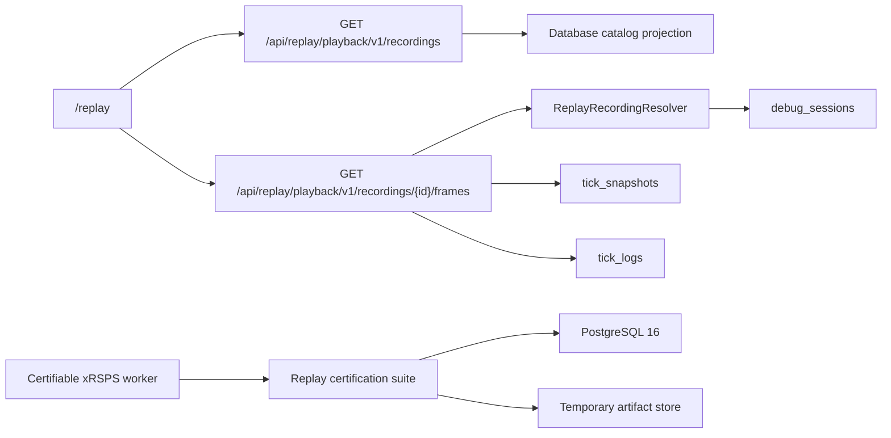

# Replay/xRSPS Finalization — Full Plan, API Contract, and Certification Spec

## Durable record and execution boundary

This task is the authoritative Felix record for replay/xRSPS final certification and playback contract hardening.

- Canonical Felix project: `C:\Dev\IdeaProjects\ChromaScape`
- ChromaScape implementation worktree: `C:\Dev\Worktrees\ChromaScape-replay`
- Planned ChromaScape baseline: `fb9e1c0`
- xRSPS source repository: `C:\Dev\IdeaProjects\xrsps-typescript`
- xRSPS certification worktree: `C:\Dev\Worktrees\xrsps-replay-certification`
- Planned xRSPS baseline: `c64ac9a`
- No Shortcut story was supplied. Do not invent one or synchronize externally.
- Planning only at creation time: do not implement source changes as part of preparing this record.

## Verified starting state

- The isolated ChromaScape worktree was reported clean on branch `replay-xrsps-final` at `fb9e1c0`.
- The active ChromaScape checkout contains unrelated changes and must not be edited, cleaned, reset, or used for certification.
- xRSPS replay-kernel source is committed at `c64ac9a`, while the active checkout has widespread modifications including apparent line-ending changes.
- Generated runtime identity currently reports `buildCommit=dev`, `certifiable=false`, and `packages\replay-kernel\dist\worker\main.js` is absent.
- `REPLAY_ENABLED=false` and `REPLAY_WORKER_ENABLED=false` are mandatory defaults.

## Scope

Deliver:

1. A clean, certifiable xRSPS replay-kernel distribution.
2. Versioned, log-inclusive observed-playback APIs.
3. Database keyset pagination and aggregate coverage queries.
4. Migration of `/replay` away from the legacy tick-card endpoint.
5. Automated 100-run determinism, failure-injection, and PostgreSQL race certification.
6. Complete Windows build/certification evidence and Felix implementation/verification evidence.

Explicit exclusions:

- Do not modify the active ChromaScape checkout.
- Do not bulk-commit apparent xRSPS line-ending changes.
- Do not enable either replay flag.
- Do not remove the legacy endpoint before parity is proven.
- Do not change OpenRune or legacy simulator behavior outside `openrune-legacy`.
- Do not merge, deploy, or synchronize Shortcut without separate authorization and a reviewed mapping.

## Architecture and data flow



Observed playback is read-only and independent of causal simulation. The playback endpoints expose captured evidence and must never start or communicate with the xRSPS worker.

## Versioned playback API

### Routes and compatibility

Canonical routes:

- `GET /api/replay/playback/v1/recordings`
- `GET /api/replay/playback/v1/recordings/{recordingId}/frames`

Deprecated one-cycle aliases:

- `GET /api/replay/playback/recordings`
- `GET /api/replay/playback/recordings/{recordingId}/frames`

Both route families use the same v1 service and schema. The `/replay` page must use only v1. All endpoints call `ReplayPrincipalService.requirePrincipal`. Evidence remains shared between authenticated operators because `recording_sessions` has no owner field.

### Catalog request and cursor semantics

- `accountName`: optional; trim; exact match; blank means absent.
- `limit`: default 50; clamp to 1..200.
- `cursor`: optional opaque v1 cursor.
- `offset`: supported only by deprecated alias; v1 ignores it and new UI never sends it.
- Order: `debug_sessions.start_time DESC, debug_sessions.id DESC`.
- Cursor payload: JSON with `version`, `startTime`, and `id`, Base64 URL-safe without padding.
- Cursor carries no authority and need not be signed.
- Malformed, incomplete, or unsupported-version cursors return HTTP 400 `VALIDATION_ERROR`.
- Cursor predicate: `start_time < :cursorStartTime OR (start_time = :cursorStartTime AND id < :cursorId)`.
- Fetch `limit + 1` to calculate `hasMore`; `nextCursor` represents the final returned tuple.

Catalog schema: `replay-playback-catalog/v1`. Each entry contains `recordingId`, `sessionId`, `accountName`, `scriptName`, `startTime`, `endTime`, `startTick`, `endTick`, `tickCount`, `positionFrameCount`, `logCount`, `positionCoveragePct`, `replayable`, and `replayabilityReason`. The envelope contains `entries`, nullable `nextCursor`, and `hasMore`.

The query must join `debug_sessions.recording_id` to `recording_sessions.recording_id`, exclude orphans in SQL, and aggregate snapshot/position/log counts in one native projection or bounded database queries—never one resolver/count query per entry. Nested position evidence is `player_state.position.x` plus either `position.y` or `position.z`.

### V22 database migration

Add `V22__replay_playback_catalog_pagination.sql` using `IF NOT EXISTS` and preserving all evidence:

- Partial keyset index on `debug_sessions(start_time DESC, id DESC) WHERE recording_id IS NOT NULL`.
- Filtered account index on `debug_sessions(account_name, start_time DESC, id DESC) WHERE recording_id IS NOT NULL`.
- Confirm or add `tick_snapshots(session_id, tick, id)`.
- Confirm or add `tick_logs(session_id, tick, id)`.

### Frame request, ordering, and response

- `recordingId`: required, nonblank.
- `fromTick`: default 0, clamp to zero.
- `limit`: default 100, clamp to 1..500.
- Order snapshots by `tick ASC, id ASC`; fetch `limit + 1`.
- `nextFromTick` is retained only if one snapshot per session/tick is enforced or proven. If duplicates are allowed, replace it before release with opaque `(tick,id)` cursor.
- No frames returns HTTP 200 with `frames=[]`, `hasMore=false`.

Frame schema: `replay-playback-frame-page/v1`. Envelope contains recording/session/account identity, tick range, frames, nullable `nextFromTick`, and `hasMore`. Every frame preserves `tick`, `timestamp`, `playerState`, `inventory`, `equipment`, `threats`, `projectiles`, `cooldowns`, `quest`, `questHelper`, `npcs`, `gameObjects`, `groundObjects`, `groundItems`, `players`, `widgets`, `schemaVersion`, and an always-present `logs` array.

Log rules:

- Query only the returned page's minimum through maximum snapshot ticks.
- Group by tick and deterministically order by `tick ASC, id ASC`.
- Every log has `ACTION`.
- Add `DIALOGUE` when event type contains dialogue case-insensitively or subsystem equals dialogue.
- Add `VARBIT` under the equivalent varbit rule.
- Do not synthesize frames for log-only ticks.
- Preserve `questHelper` exactly.
- Preserve all existing frame fields.
- Canonical player aliases are `worldX -> x`, `worldY/y -> z`, nested `position.x` and `position.z|y`, `hp.current -> hp`, and `prayer.current -> prayer`.
- Never overwrite already-present canonical fields.

Errors retain `RECORDING_NOT_FOUND` and `DEBUG_SESSION_NOT_FOUND`; invalid cursor or identifier returns `VALIDATION_ERROR`.

## UI migration and legacy route

Update `/replay` to page through the v1 catalog using cursors, load v1 frame pages, adapt frame DTOs into the current tick-card rendering model, and render action/dialogue/varbit details from `frame.logs`. Preserve video-only playback with an explanation when synchronized evidence is absent. Continue DOM-safe rendering through `textContent` and element APIs. The page must stop calling `/api/debug/replay/tick-cards/{recordingId}`.

Retain the legacy route for one migration cycle. Mark it deprecated in JavaDoc/comments, return `Deprecation: true`, and add a `Link` header to the v1 frame route. A parity test must prove v1 retains action/dialogue/varbit evidence formerly supplied by tick cards. Removal is a separate follow-up after every known consumer migrates.

## xRSPS certifiable build

Use the dedicated clean worktree at `C:\Dev\Worktrees\xrsps-replay-certification`. Confirm clean tracked status and `git diff --check`, verify required `server\cache` and replay content inputs, do not set `XRSPS_ALLOW_DEV_IDENTITY`, do not commit generated `dist`, and preserve/push source commits separately.

Authoritative Windows commands:

```bat
cd /d C:\Dev\Worktrees\xrsps-replay-certification
rmdir /s /q packages\replay-kernel\dist
corepack yarn install --immutable
corepack yarn workspace @xrsps/replay-kernel build
corepack yarn workspace @xrsps/replay-kernel test
corepack yarn workspace @xrsps/replay-kernel test:integration
node packages\replay-kernel\dist\worker\main.js --capabilities
```

Capabilities must prove:

- `certifiable=true`.
- `xrsps.buildCommit` is 40 lowercase hex and equals worktree HEAD.
- `cacheRevision` and `contentRevision` match `sha256:<64 lowercase hex>`.
- `modes.causalSimulation=true`.
- Forbidden control/OpenRune/policy surfaces remain absent or false.

Configure ChromaScape certification through `REPLAY_XRSPS_ENTRYPOINT` and `REPLAY_XRSPS_WORKING_DIRECTORY` if the worktree differs from defaults.

## Certification batteries

Add `ReplayStressCertificationTest` to the Windows-only certification source set. It uses the real worker, PostgreSQL 16 Testcontainers, Flyway through V22, and a real temporary artifact directory. Missing prerequisites fail; they never skip.

### Determinism: 100 runs

Execute one immutable manifest 100 times with identical identity, seed, clock origin, tick duration, and initial state. Every run must end `SUCCEEDED/PASSED` with identical final chain hash; ordered state/event hashes; checkpoint ticks; action indexes; snapshot checksums; artifact checksums; and canonical traces after excluding only run/attempt IDs and persistence timestamps. Finalized artifact readback must pass content-address verification. No process or lease may leak.

Write `build\replay-certification\determinism-100.json` with worker identity, manifest checksum, baseline hashes, run/pass counts, and elapsed duration.

### Failure injection

Cover: exit before capabilities; exit during reset; exit between step and snapshot; malformed stdout; timeout; missing staged artifact; corrupt bytes; snapshot checksum mismatch; snapshot identity mismatch; manifest runtime-pin mismatch; and PostgreSQL uniqueness conflict during finalization.

Each must produce deterministic terminal state/error code; never falsely claim `SUCCEEDED/PASSED`; never finalize missing/corrupt bytes; never emit a partial completion report; resume only from a valid checkpoint or fail closed; and release processes/leases.

Write `build\replay-certification\failure-injection.json`.

### PostgreSQL races

Use explicit barriers/latches and run each at least 25 times: two claims of one queued run; two reclaims of an expired attempt; two manifest inserts for one checksum; two artifact finalizations for one checksum; recovery vs normal completion; two report writers; and catalog paging concurrent with a newer inserted session.

Prove one winner where uniqueness applies, deterministic loser behavior, no duplicate manifest/report/artifact/active-attempt records, no terminal-state regression, no duplicate catalog IDs, and no shift of an already-issued cursor page.

Write `build\replay-certification\postgres-races.json`.

## Test plan and authoritative gates

Automate:

- Controller authentication, validation, clamping, aliases, and deprecation headers.
- Cursor round trip plus malformed/version mismatch rejection.
- PostgreSQL repository keyset ordering, filtering, orphan exclusion, nested position coverage, aggregates, and concurrent insert stability.
- Service log grouping/categories/order, empty logs, missing sessions, canonical aliases, and exact `questHelper`.
- Exact contract schema identifiers and fields.
- Replay-page Node tests for v1 URLs, cursor continuation, frame-to-card conversion, log preservation, video-only fallback, and safe DOM rendering.
- Existing playback/profile suites.
- xRSPS unit/integration suites.
- Certification discovered/executed count > 0, zero skips, zero failures.

Authoritative Windows ChromaScape gate:

```bat
cd /d C:\Dev\Worktrees\ChromaScape-replay
gradlew.bat clean compileJava replayTest test check replayCertificationTest --no-daemon
git diff --check
git status --short
```

If stress certification is separate, include `replayStressCertificationTest` in both `check` and the final handoff command.

## Acceptance criteria

1. Given a clean committed xRSPS checkout, when replay-kernel builds without a development override, then capabilities identify exact HEAD and report `certifiable=true`.
2. Given an authenticated operator, when v1 catalog is requested, then only real linked recording/debug-session rows appear in stable keyset order.
3. Given a catalog cursor, when newer sessions are inserted, then continuation has no duplicates or offset shifting.
4. Given nested position telemetry, when coverage is calculated, then it counts as position-bearing.
5. Given `questHelper`, when v1 frames serialize, then it remains unchanged.
6. Given action/dialogue/varbit logs, when frames load, then all logs appear in deterministic order with correct categories.
7. Given video without tick evidence, when `/replay` loads, then video plays and explains synchronized frames are unavailable.
8. Given the migrated page, when data loads, then it never calls the legacy tick-card route.
9. Given identical runtime inputs, when 100 runs execute, then deterministic outputs equal baseline.
10. Given injected worker/artifact/identity/transaction failures, when execution ends, then it fails closed.
11. Given PostgreSQL races, when batteries run, then uniqueness, leasing, terminal-state, and pagination invariants hold.
12. Given any incomplete certification gate, then both replay flags remain disabled.

## Completion evidence

Before `in_review`, link **Implementation Evidence** with:

- `## Changed files`
- `## Tests`
- `## Remaining work`

Before `done`, link **Verification Evidence** with:

- `## Acceptance results`
- `## Tests`
- `## Risks`
- `## Rollback`

Evidence identifies ChromaScape and xRSPS commits, capability manifest, PostgreSQL image, JDK/Node/Yarn/Gradle versions, exact commands and actual counts, three JSON artifact paths, and every unrun check marked unverified.

## Rollback and release policy

Rollback by reverting the ChromaScape hardening commit and V22 application code while leaving additive indexes harmlessly in place, or removing them only in a separately reviewed migration. The legacy endpoint remains available. Never set `REPLAY_ENABLED=true` or `REPLAY_WORKER_ENABLED=true` until every acceptance item, Windows gate, certification battery, and Felix verification artifact passes.


## Shortcut traceability audit (2026-08-28)

The ChromaScape repository currently has no `C:\Dev\IdeaProjects\ChromaScape\.felix\shortcut-sync.json`. Therefore external Shortcut synchronization is prohibited until a reviewed mapping is restored; no workflow state or synchronization comment was changed.

A read-only Shortcut search found several related To Do stories, but no single exact source story for this multi-repository hardening/specification task:

- [SC-276](https://app.shortcut.com/leeuwbot/story/276), **REPLAY-4: Headless xRSPS semantic simulator kernel adapter** — owns the headless xRSPS kernel/capability contract and is blocked with substantial partial source evidence noted in its existing comment.
- [SC-280](https://app.shortcut.com/leeuwbot/story/280), **REPLAY-8: ChromaScape Debugger replay/simulation adapter** — owns debugger-facing replay/simulation integration and is blocked.
- [SC-400](https://app.shortcut.com/leeuwbot/story/400), **SIM-01: xRSPS -> ChromaScape Debugger Certification Runbook** — owns reproducible xRSPS certification evidence and is To Do.
- [SC-1199](https://app.shortcut.com/leeuwbot/story/1199), **REPLAY-12: ChromaScape recording to xRSPS replay vertical slice** — owns the end-to-end recording-to-simulation flow, is blocked, and depends on SC-276/280 plus other replay stories.

The playback-v1 SQL/API/UI migration in this specification is more specific than any one of those story descriptions, while the worker and certification scope crosses several of them. Treat these as reference/ownership candidates, not as an invented source link. Before implementation starts, the operator should either designate the canonical Shortcut story or create/approve a dedicated hardening story; only then add `shortcut:sc-<id>`, a `shortcut_story` source link, and synchronization markers.

A search for Felix task ID `task_1787879364196_ur2bm3bc` in Shortcut comments returned no matches.
