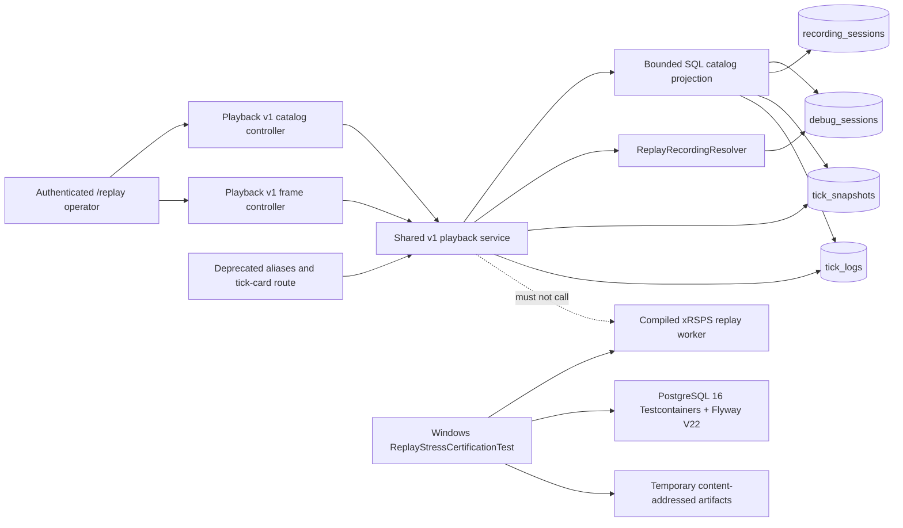

# Architecture

## Boundaries and decisions

- Observed playback is read-only evidence retrieval, not causal simulation.
- Controllers authenticate through `ReplayPrincipalService.requirePrincipal`.
- Canonical APIs are versioned under `/api/replay/playback/v1`; aliases share one service/schema.
- Catalog pagination is keyset-based on `(start_time DESC, id DESC)` and aggregates in bounded SQL.
- Frame paging is deterministic on `(tick ASC, id ASC)`; release requires uniqueness proof or an opaque compound cursor.
- Logs are joined to actual frame-page tick bounds and never synthesize a frame.
- Replay flags remain disabled until all certification evidence is verified.
- Implementation/certification uses isolated clean worktrees and never the active dirty checkouts.

## Migration

1. Add V22 indexes without destructive data changes.
2. Add v1 schemas/routes and compatibility aliases.
3. Migrate `/replay` and prove tick-card parity.
4. Certify the worker and PostgreSQL behavior.
5. Keep legacy route for one cycle; remove only in a separate task after consumer audit.
