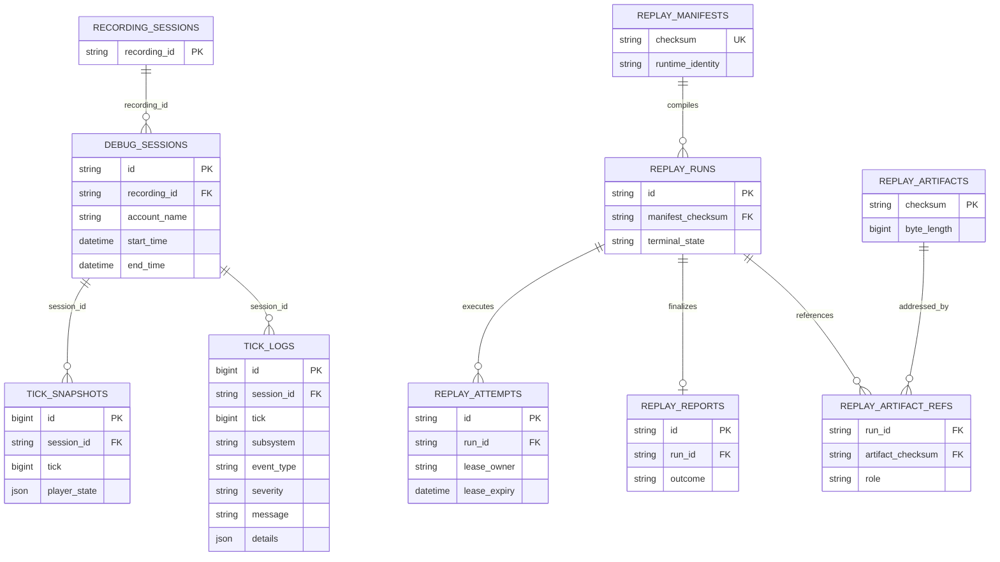

# ERD

## Required index/invariant changes

- Partial keyset: `debug_sessions(start_time DESC, id DESC) WHERE recording_id IS NOT NULL`.
- Account keyset: `debug_sessions(account_name, start_time DESC, id DESC) WHERE recording_id IS NOT NULL`.
- Frame/log reads: `tick_snapshots(session_id, tick, id)` and `tick_logs(session_id, tick, id)`.
- Catalog joins exclude orphaned `debug_sessions`.
- Verify uniqueness of snapshot `(session_id,tick)`; otherwise v1 must use an opaque `(tick,id)` cursor.
- Migration is additive, uses `IF NOT EXISTS`, and never deletes evidence.
