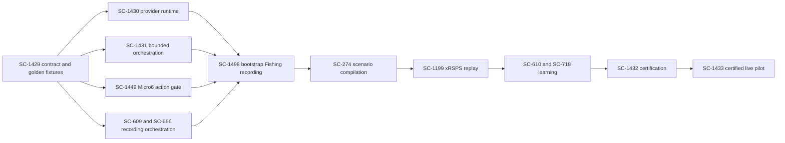
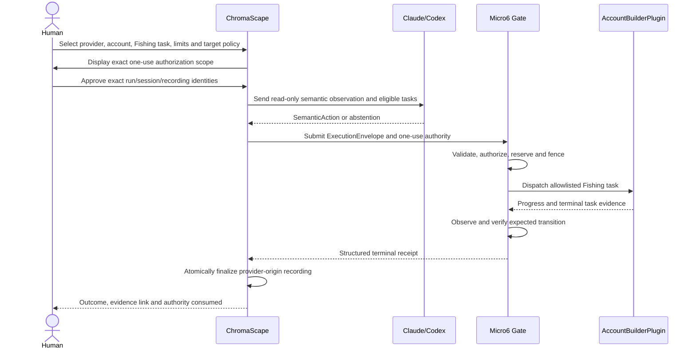

# Contract-first implementation plan

## Goal

Deliver the smallest safe vertical slice that allows Claude or Codex to direct one bounded Fishing run while Micro6 AccountBuilderPlugin remains the only live executor and ChromaScape records the complete evidence chain.

The first implementation authority is Shortcut SC-1429. The first integrated milestone is SC-1498 `BOOTSTRAP_RECORDING`. SC-1498 creates evidence only; it grants no reusable live authority and is not the later SC-1433 certified live pilot.

## Roadmap position

This Felix task covers A through F only. G through K remain downstream tasks.

## Non-negotiable ownership

- Claude/Codex decide only through provider-neutral semantic contracts.
- Micro6 AccountBuilderPlugin is the sole live action executor.
- ChromaScape owns recording, provenance, curation, evidence and later learning/patch orchestration.
- xRSPS remains the sole causal simulator, but xRSPS work begins only after SC-1498 produces a finalized recording.
- No provider or model receives raw mouse, keyboard, packet, WebSocket, direct client, reflection, filesystem-command or tick-mutation APIs.
- No model, recording, replay or training result can approve a live run, patch, deployment or activation.
- Provider-origin recordings retain CLAUDE or CODEX attribution and are never labeled as human demonstrations.

## Phase 1 — SC-1429 contract and golden fixtures

Freeze one versioned contract shared by all repositories before implementing live adapters.

### Observation

Minimum fields:

- schema and contract version;
- observation ID, monotonic revision and capture timestamp/tick;
- account, client and environment identity;
- run, task, session and recording identity;
- source/build/plugin/catalog identity;
- semantic player state, inventory, skills, nearby eligible targets and current AccountBuilder task state;
- confidence, freshness and completeness indicators.

Observations are read-only evidence. They cannot contain a live-capability handle.

### SemanticAction

Use a closed vocabulary. For the first slice, support only the minimum Fishing actions needed by the deterministic AccountBuilder task catalog. Each action contains:

- action kind and typed allowlisted settings;
- semantic target and expected transition;
- preconditions and verifier reference;
- provider decision identity and abstention/failure reason when no action is proposed.

Coordinates, arbitrary method names, scripts and unrestricted tool calls are invalid.

### ExecutionEnvelope

Bind every proposed state change to:

- provider and model/version;
- decision and request/idempotency identity;
- GoalPlan and ordered TaskSkill digests;
- AccountBuilder task key and validated settings;
- account/client/environment;
- run/task/session/recording/source identities;
- catalog, schema, policy, verifier, build and artifact identities;
- expected observation/task revision;
- one-use authority identity;
- lease generation/fence;
- action, attempt and elapsed-time budgets;
- deadline and kill-switch scope.

Changing any bound field changes the envelope digest and requires fresh authorization.

### Receipt and outcome model

Represent validation, authorization, reservation, dispatch acknowledgement, activation/progress, AccountBuilder terminal state and expected-transition verification separately.

Terminal verification classifications:

- `CONFIRMED`: sufficient evidence proves the expected transition.
- `REFUTED`: required evidence is readable and the transition did not occur.
- `UNVERIFIABLE`: evidence is missing, stale, incomplete or below threshold.
- `UNCERTAIN_OUTCOME`: delivery or completion cannot be reconciled safely.
- `ABSTAINED`: provider deliberately proposed no state-changing action.
- `DENIED`: policy, authority, precondition, identity or budget gate rejected the request.

HTTP success, queue insertion, dispatch acknowledgement and AccountBuilder completion are not verifier confirmation.

### Golden fixture matrix

Publish versioned fixtures for:

- valid Claude and Codex Fishing decisions producing equivalent envelopes;
- provider abstention;
- malformed or unsupported semantic action;
- stale observation or expected revision;
- missing, expired, changed or reused human authority;
- task/catalog/build/plan/skill mismatch;
- exceeded action/time/attempt budget;
- lease/fence mismatch;
- dispatch rejection;
- confirmed and refuted transitions;
- unverified and uncertain outcomes;
- duplicate identical request reconciliation;
- conflicting idempotency reuse;
- stop and kill-switch request at safe AccountBuilder boundary;
- simulator credential presented to the live Micro6 gate.

All consumers must pass the same conformance fixtures.

## Phase 2 — parallel prerequisite lanes

These lanes may start after SC-1429 fixtures are frozen. They integrate only after conformance passes.

### SC-1430: Claude/Codex runtime

- Translate the same observation contract to each provider adapter.
- Emit only SemanticAction/ExecutionEnvelope proposals.
- Persist provider/model/version, decision, abstention and error provenance.
- Apply bounded session, timeout and retry policy.
- Never retry an uncertain state-changing result.
- Prove Claude and Codex use the identical downstream execution interface.

### SC-1431: bounded AccountBuilder orchestration

- Validate the envelope and exact authorization scope.
- Submit only allowlisted AccountBuilder tasks and settings.
- Correlate request, reservation, task, run, session and recording identities.
- Expose pause/stop/kill status without claiming success before it is effective.
- Convert delivery and verification evidence into the canonical receipt model.
- Create no alternate executor or provider-specific path.

### SC-1449: Micro6 server-side action gate

Implement the enforced lifecycle:

`observe → validate preconditions → authorize → reserve → dispatch AccountBuilder task → observe → verify → terminal outcome`

- Consume one-use human authority immediately before dispatch.
- Enforce catalog, capability, plan/skill digest, revision, lease/fence, budgets and deadline.
- Fence concurrent incompatible work per account/client/executor slot.
- Perform gameplay mutation only on the canonical AccountBuilder task/script loop.
- Reconcile identical retries; reject conflicting identity reuse.
- Mark lost acknowledgement, restart, timeout-after-delivery or ambiguous completion as uncertain.
- Never allow simulator credentials or evidence to authorize live delivery.

### SC-609 and SC-666: ChromaScape evidence chain

Record atomically:

- human authorization and exact scope;
- provider/model/version and decision provenance;
- observations and semantic actions;
- envelope digests and immutable identities;
- authorization, reservation, delivery, progress and verification receipts;
- failures, abstentions, stop/kill evidence and final outcome.

Finalization must either publish one complete immutable recording or fail closed. Live recordings and later xRSPS traces use separate identities and storage with explicit lineage.

## Phase 3 — SC-1498 integration

### Exact operator flow

### Human gate

The operator must explicitly select and approve:

- Claude or Codex and exact model/version policy;
- account/client/environment;
- one bounded Fishing task;
- action, attempt and elapsed-time budgets;
- target/area policy;
- run, session and recording identities;
- kill-switch scope.

Authority is one-use, digest-bound, expiring and non-transferable. Any change requires a new human approval. The kill switch remains available throughout the run.

### SC-1498 exit criteria

- One bounded run completes or stops safely through AccountBuilder only.
- Every attempted action has authorization and terminal receipt evidence.
- Provider/model provenance survives unchanged into the finalized recording.
- Budgets, allowlists, timeout, safe stop and kill switch are demonstrated.
- Duplicate and uncertain-outcome behavior fails closed.
- No learned model is activated.
- No reusable or continuing live authority exists.
- The recording is ready for SC-274 compilation without manual identity repair.
- Simulator data is absent from the live recording.

## Testing strategy

### Contract tests

- Serialize/deserialize all golden fixtures in ChromaScape, provider runtime and Micro6.
- Require canonical digest agreement across implementations.
- Reject unknown fields where security-sensitive and reject unsupported action kinds.
- Pin provenance and identity round trips.

### Unit tests

- Envelope validation and digest binding.
- Authority expiry, one-use consumption and changed-scope denial.
- Budget and deadline enforcement.
- Idempotency reconciliation and conflicting reuse.
- Terminal classification mapping.
- Recording finalization invariants.

### Integration tests

- Fake Claude and Codex adapters produce equivalent semantic actions.
- Fake AccountBuilder adapter demonstrates accepted, denied, failed and uncertain paths.
- Restart/disconnect cannot duplicate execution.
- Concurrent requests cannot bypass the fenced executor slot.
- Kill request becomes effective only at a declared safe boundary.
- Full evidence chain resolves to one exact run/session/recording.

### Human-enabled acceptance

Run only after automated gates pass. Use the deterministic allowlisted Fishing task, smallest practical budgets and a prepared kill switch. A failed run still passes evidence acceptance only when it stops safely and the complete failure chain is finalized.

## Implementation order and handoff

1. Freeze SC-1429 schema, enums, identity rules and fixtures.
2. Add cross-repository contract conformance tests.
3. Implement SC-1430, SC-1431, SC-1449 and SC-609/666 minimum slices in parallel.
4. Run fixture conformance before connecting live components.
5. Assemble a fake-adapter end-to-end run.
6. Conduct the exact human-gated SC-1498 Fishing recording.
7. Finalize and audit the recording.
8. Hand the immutable recording to SC-274/SC-1199.

Do not begin provider-only/mixed learning, PPO, model activation or automated patch deployment inside this task.

## Definition of done

The task is done when the SC-1429 contract is frozen and versioned, all prerequisite lanes pass conformance and safety tests, and SC-1498 can produce one complete human-authorized AccountBuilder-only provider recording suitable for xRSPS replay.
