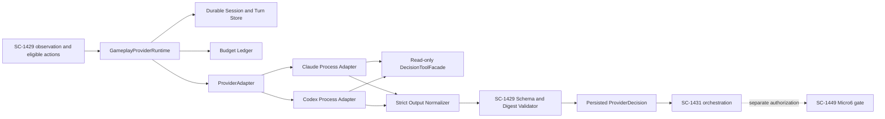
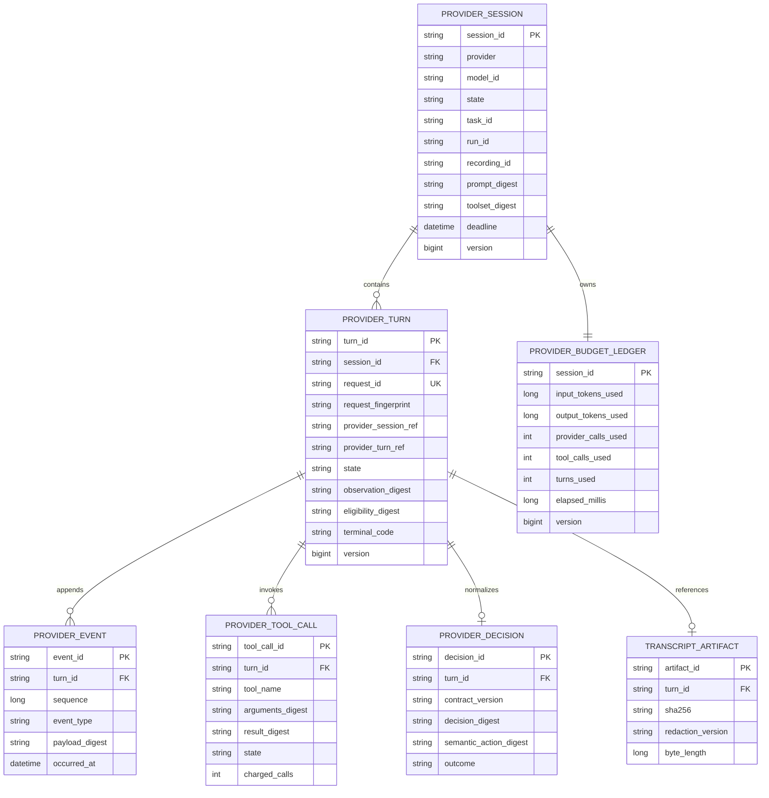

# SC-1430 — Claude/Codex provider runtime and durable gameplay sessions

Shortcut: https://app.shortcut.com/leeuwbot/story/1430  
Felix task: `task_1788115615447_1ojbwltn`  
Canonical project: `C:\Dev\IdeaProjects\ChromaScape`  
Classification: `change:runtime`

## Decision

Implement SC-1430 in ChromaScape as a durable **decision-only provider runtime**. Claude and Codex are interchangeable adapters behind one application interface. They receive a read-only SC-1429 observation and closed eligible action set, then return one normalized SC-1429 decision or a typed non-decision outcome.

The runtime never delivers gameplay. It has no AccountBuilder credentials, live authority, executor handle, raw-input API or Micro6 mutation API. SC-1431 and SC-1449 remain the only path from a persisted decision to authorized AccountBuilder delivery.

Version one invokes the locally installed Claude and Codex provider processes. Adapters launch direct argument arrays without a shell, use sanitized environments and no interactive TTY, and expose only the dedicated read-only decision tool facade. Future SDK/MCP transports must implement the same adapter contract and cannot alter persistence, budget, recovery or output semantics.

## Current state

- SC-1429/v1 schemas and golden fixtures exist.
- ChromaScape verifies Claude/Codex MCP registration.
- SC-1498 currently accepts a prebuilt proposal file instead of invoking a provider.
- No durable provider session, turn, budget ledger or restart-reconciliation runtime exists.
- SC-1430 is blocked by SC-1429 and blocks SC-1498 and SC-1432.

## Scope

Included:

- Provider-neutral application and adapter interfaces.
- Production Claude and Codex adapters.
- Durable sessions, turns, events, tool calls, budgets and transcript references.
- Strict SC-1429/v1 normalization and local digest validation.
- Provider/model/prompt/tool/knowledge/plan provenance.
- Restart resume and reconciliation.
- Token, provider-call, tool-call, turn and wall-time budgets.
- Typed failures and fail-closed behavior.
- Feature-flagged, operator-authenticated decision/status endpoints.
- Contract, unit, integration, restart and real-provider smoke tests.

Excluded:

- AccountBuilder/Micro6 dispatch or raw game control.
- Human approval or authority minting/consumption.
- Changes to SC-1498 approval/dispatch.
- xRSPS, training, learned activation or patch deployment.
- Shell, filesystem, packet, direct-client, raw-input, unrestricted network or general MCP tools.
- Automatic provider switching after an unknown outcome.
- Compatibility/migration for old provider transcripts.

## Architecture



Responsibilities:

- `GameplayProviderRuntime`: session/turn orchestration, idempotency, recovery and terminal classification.
- `ProviderAdapter`: provider capabilities, start/resume/cancel/reconcile and typed usage/events.
- `ClaudeProviderAdapter` / `CodexProviderAdapter`: provider-process/session/transcript translation only.
- `DecisionToolFacade`: pinned observation, eligible actions and pinned knowledge/plan reads only.
- `ProviderOutputNormalizer`: extracts one structured result; never repairs ambiguous state-changing output.
- `Sc1429DecisionValidator`: contract version, closed vocabulary, evidence references and digests.
- `ProviderBudgetService`: transactional reserve/charge before provider/tool calls.
- `ProviderRecoveryService`: restart classification and proof-based reconciliation.

## Public runtime contracts

### ProviderDecisionRequest

Required:

- session, turn, request and idempotency identities;
- canonical request fingerprint;
- provider `CLAUDE|CODEX` and allowlisted model;
- SC-1429/v1 observation plus digest;
- ordered eligible actions plus digest;
- prompt/toolset/knowledge/GoalPlan/TaskSkill digests;
- task/run/session/recording/source correlation;
- immutable budget and absolute deadline;
- `decideOnly=true`.

The request fingerprint covers every decision-affecting field. Reusing a request ID with a changed fingerprint fails before provider invocation.

### ProviderAdapter

```text
capabilities() -> ProviderCapabilities
startTurn(ProviderInvocation) -> ProviderTurnHandle
resumeTurn(providerSessionRef, providerTurnRef) -> ProviderTurnHandle
reconcile(providerSessionRef, providerTurnRef) -> ReconciliationResult
cancel(providerSessionRef, providerTurnRef, reason) -> CancelResult
```

Adapters emit typed transport events and usage. They cannot return credentials, provider SDK objects, process handles or execution clients to application code.

### ProviderDecisionResult

Exactly one terminal result:

- `DECIDED` with validated SC-1429 decision;
- `ABSTAINED`;
- `INVALID_OUTPUT`;
- `PROVIDER_UNAVAILABLE`;
- `TIMEOUT`;
- `BUDGET_EXHAUSTED`;
- `CANCELLED`;
- `UNKNOWN_PROVIDER_OUTCOME | NEEDS_RECONCILIATION`;
- `INTERNAL_FAILURE`.

Every result contains identities, provider/model, provenance digests, usage, stable terminal code, evidence/transcript references and timestamps. Only `DECIDED` contains a decision; none contains authority.

## Durable lifecycle

Session:

`CREATED → ACTIVE → COMPLETED | CANCELLED | FAILED | NEEDS_RECONCILIATION`

Turn:

`CREATED → RESERVED → SUBMITTED → STREAMING → NORMALIZING → DECIDED | ABSTAINED | INVALID_OUTPUT | TIMEOUT | BUDGET_EXHAUSTED | CANCELLED | PROVIDER_UNAVAILABLE | NEEDS_RECONCILIATION | INTERNAL_FAILURE`

Rules:

1. Persist session, turn, fingerprint and reserved budget before provider invocation.
2. Append provider/tool events with monotonic sequence.
3. Store redacted raw transcript as content-addressed evidence; persist its digest/reference.
4. Persist normalized output before SC-1431 can read it.
5. Identical retries return the stored turn/result.
6. Conflicting ID reuse fails before invocation.
7. Terminal turns remain immutable across restart.
8. A pre-submission turn may resume with the same identity.
9. Submitted/streaming work lacking proven terminal output becomes `NEEDS_RECONCILIATION`.
10. Reinvoke only after proof the provider did not accept/start the turn.
11. Never switch Claude↔Codex after uncertainty without a new turn, fresh budget and explicit orchestration choice.
12. Process cancellation is not proof that no output was produced.

## Persistence



Use optimistic versions and unique request identity/fingerprint constraints. Create current v1 tables only; no legacy migration/backfill.

## Budgets and timeouts

Immutable session maximums:

- input/output tokens;
- provider calls;
- tool calls;
- decision turns;
- per-turn and session wall time;
- optional cost ceiling when reliable usage exists.

Reserve before work and charge actual usage. If usage is unavailable, charge a conservative estimate—never zero. Tool calls reserve before execution. Exhaustion persists `BUDGET_EXHAUSTED` and prevents another call.

Separate process-start, first-event, tool-response, turn-total and session-total timeouts. Timeout after provider submission is uncertain until reconciled.

## Prompt and tool boundary

The versioned prompt requires one SC-1429/v1 JSON result, selection only from eligible actions, abstention when evidence is insufficient, and no claims of execution or authority.

Allowed read-only tools:

- fetch pinned semantic observation;
- list already-computed eligible actions;
- read pinned knowledge/GoalPlan/TaskSkill by digest;
- read provider-session status.

Do not expose the generic ChromaScape MCP registry. Unknown/mutating tools, changed arguments or budget excess fail the turn closed.

## Output normalization

- Accept one structured result; never scrape ambiguous prose into an action.
- Reject multiple decisions.
- Reject unknown action kinds/settings/targets/transitions/evidence.
- Require exact `sc-1429/v1`.
- Recompute decision/action digests locally.
- Require evidence references to pinned inputs.
- Assign provider/model/session/prompt/tool provenance from trusted runtime context.
- Treat transport success as transport success only.
- Persist malformed transcript reference and redacted diagnostics.
- Do not call another model to repair malformed state-changing output.

## Operator API

All routes are default-off and protected by gameplay operator authentication.

```yaml
openapi: 3.1.0
info:
  title: ChromaScape Gameplay Provider Runtime
  version: sc-1430/v1
paths:
  /api/v1/gameplay/provider-sessions:
    post:
      summary: Create a durable decide-only session
      security: [{ gameplayOperatorKey: [] }]
      responses:
        "201": { description: Session created }
        "400": { description: Invalid immutable configuration }
        "409": { description: Identity conflict }
  /api/v1/gameplay/provider-sessions/{sessionId}/turns:
    post:
      summary: Submit one SC-1429 decision turn
      security: [{ gameplayOperatorKey: [] }]
      responses:
        "202": { description: Durably accepted }
        "200": { description: Existing identical turn }
        "409": { description: Conflicting request identity }
        "422": { description: Contract or budget rejection }
  /api/v1/gameplay/provider-sessions/{sessionId}:
    get:
      summary: Read session and budget state
      security: [{ gameplayOperatorKey: [] }]
      responses:
        "200": { description: Session state }
  /api/v1/gameplay/provider-sessions/{sessionId}/turns/{turnId}:
    get:
      summary: Read turn/result
      security: [{ gameplayOperatorKey: [] }]
      responses:
        "200": { description: Turn state/result }
  /api/v1/gameplay/provider-sessions/{sessionId}/resume:
    post:
      summary: Reconcile and resume safe work
      security: [{ gameplayOperatorKey: [] }]
      responses:
        "200": { description: Reconciled/resumed }
        "409": { description: Outcome remains uncertain }
  /api/v1/gameplay/provider-sessions/{sessionId}/cancel:
    post:
      summary: Request bounded provider cancellation
      security: [{ gameplayOperatorKey: [] }]
      responses:
        "202": { description: Cancellation requested }
components:
  securitySchemes:
    gameplayOperatorKey:
      type: apiKey
      in: header
      name: X-Gameplay-Operator-Key
```

A submit response is acceptance, never gameplay success. Reuse the existing durable event mechanism; do not add another WebSocket protocol.

## Failure and retry rules

| Condition | State | Retry |
|---|---|---|
| Provider unavailable | PROVIDER_UNAVAILABLE | New attempt only after readiness |
| Failure before submission | INTERNAL_FAILURE/TIMEOUT | Same identity only after proof nothing started |
| Loss after submission | NEEDS_RECONCILIATION | No retry/switch until proven |
| Malformed/unsupported output | INVALID_OUTPUT | Terminal; new turn required |
| Any budget exhausted | BUDGET_EXHAUSTED | Terminal; runtime cannot extend |
| Unknown/mutating tool | INVALID_OUTPUT | Terminal security event |
| Conflicting ID reuse | IDEMPOTENCY_CONFLICT | Reject before invocation |
| Restart | recovered | Terminal immutable; non-terminal reconciles |
| Transport success without valid SC-1429 | INVALID_OUTPUT | Never DECIDED |

## Observability and secrets

Record provider readiness, sessions, turns, latency, usage, budget denials, invalid output, reconciliation and terminal states correlated by session/turn/request/run/recording IDs.

Never log credential values/files, provider environments, unredacted transcripts or raw sensitive tool results. Logs contain digests, stable codes and bounded redacted diagnostics. Provider readiness remains separate; one healthy provider cannot silently substitute for another.

## Implementation order

1. Reuse SC-1429 schemas, fixtures and digest rules.
2. Implement runtime domain/state/failure types.
3. Add persistence and transaction constraints.
4. Implement budgets/deadlines.
5. Implement DecisionToolFacade.
6. Implement safe process transport.
7. Implement Claude adapter.
8. Implement Codex adapter.
9. Implement normalizer/validator.
10. Implement restart recovery/reconciliation.
11. Add protected API/readiness.
12. Add audit/metrics/transcript handling.
13. Pass fixture, fake-adapter, restart and real-provider tests.
14. Hand persisted decisions to SC-1431 in decide-only/shadow mode.
15. Demonstrate SC-1498 consumption without provider delivery access.

## Rollout and rollback

Ship default-off. Enable fake adapters, then real decide-only shadow sessions, then allow SC-1498 to select a persisted decision. Never enable delivery here.

Rollback disables new sessions, retains status/terminal reads, requests bounded cancellation, and preserves durable evidence. Do not delete or rewrite session history.
