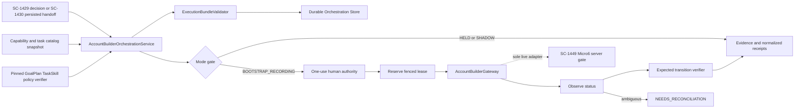
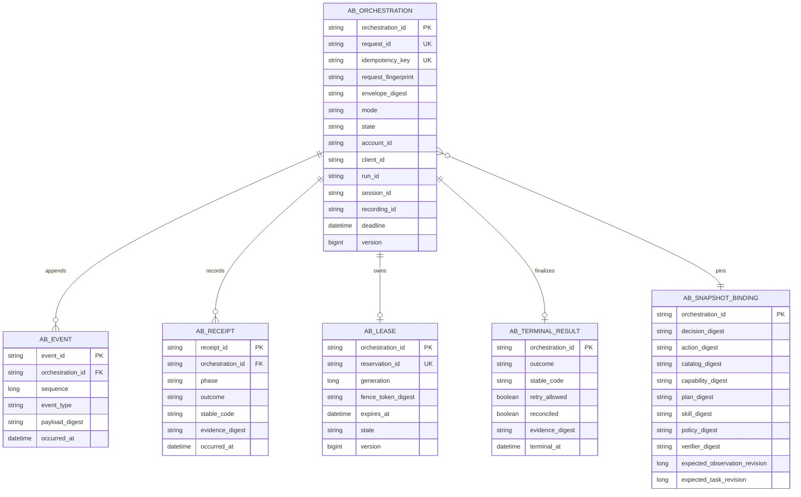

# SC-1431 — Bounded AccountBuilder task orchestration

Shortcut: https://app.shortcut.com/leeuwbot/story/1431  
Felix task: `task_1788122221223_uphlga0o`  
Canonical project: `C:\Dev\IdeaProjects\ChromaScape`  
Classification: `change:runtime`

## Decision

Implement a source-neutral, durable ChromaScape orchestration application service. It consumes a validated SC-1429 decision (including SC-1430 persisted decisions), revalidates an immutable execution bundle, and drives one fenced AccountBuilder request through a narrow gateway.

Modes are explicit:

- `HELD`: validate and record evidence; never reserve or dispatch.
- `SHADOW`: compare decisions and record eligibility/verdict evidence; never reserve or dispatch.
- `BOOTSTRAP_RECORDING`: require exact one-use human authority; deliver only through the SC-1449 AccountBuilder gate.
- `LIVE_TASK`: contract-defined but unavailable until certification and SC-1449 conformance exist.
- `SIMULATION`: excluded from the Micro6 route; xRSPS owns execution.

SC-1431 owns orchestration, not Micro6 enforcement. SC-1449 owns the live server-side action gate. The current SC-1429 bootstrap coordinator is a compatibility consumer and must be refactored onto this durable core rather than become a second execution path.

## Dependencies and truth boundary

SC-1431 is blocked in Shortcut by SC-1429, SC-573 and SC-666. SC-1449 conformance is additionally required before live integration is complete. Safe ChromaScape domain, persistence, fake-gateway and HELD/SHADOW lanes can be implemented now. No external dependency or live readiness may be claimed from local tests.

## Architecture



Responsibilities:

- `AccountBuilderOrchestrationService`: identity ownership, state machine, mode gate, durable reconciliation and terminal result.
- `ExecutionBundleValidator`: exact contract/digest/revision/catalog/capability/policy/plan/skill/verifier validation.
- `AccountBuilderGateway`: catalog/capabilities, reserve, dispatch, status, stop and reconcile only; no raw input.
- `OrchestrationStore`: atomic identity/fingerprint ownership, append-only events/receipts, lease and terminal state.
- `ExpectedTransitionVerifier`: emits `CONFIRMED | REFUTED | UNVERIFIABLE`; it never retries.
- SC-1429/SC-1498 compatibility facade: delegates to the core and preserves recording evidence/provenance.

## Immutable public contracts

### OrchestrationRequest

Required fields:

- orchestration/request/idempotency identities and canonical fingerprint;
- mode and upstream source;
- exact SC-1429 decision and decision/action digests;
- immutable ExecutionEnvelope;
- account/client/environment/run/session/recording/source identities;
- expected observation and task revisions;
- task key/settings plus task catalog and capability snapshot digests;
- GoalPlan, TaskSkill, tool schema, knowledge, policy and verifier digests;
- lease generation/fence and immutable budgets/deadline;
- optional human authority reference (required only for BOOTSTRAP_RECORDING/LIVE_TASK).

The fingerprint covers every decision-, authorization-, reservation- and verification-affecting field. Same identity/same fingerprint returns stored state; changed reuse fails before any gateway call.

### AccountBuilderGateway

```text
readCapabilities() -> CapabilitySnapshot
readTaskCatalog() -> TaskCatalogSnapshot
reserve(ReserveCommand) -> ReserveReceipt
dispatch(DispatchCommand) -> DispatchReceipt
status(StatusQuery) -> StatusReceipt
stop(StopCommand) -> StopReceipt
reconcile(ReconcileQuery) -> ReconciliationReceipt
```

Every mutation carries request identity, idempotency key, envelope digest, lease generation/fence and expected revisions. Gateway results use stable normalized codes. Transport success alone is not delivery, activation or verification success.

## Durable lifecycle

`CREATED → VALIDATED → HELD | AUTHORIZED → RESERVED → DISPATCH_SUBMITTED → ACTIVE → VERIFYING → CONFIRMED | REFUTED | UNVERIFIABLE | DENIED | STOPPED | FAILED | NEEDS_RECONCILIATION`

Rules:

1. Persist request, fingerprint and immutable bundle before external work.
2. HELD/SHADOW terminate without reservation or dispatch.
3. Recheck capability, catalog, revisions, budgets and authority immediately before reserve and dispatch.
4. Consume one-use authority atomically with the reservation transition.
5. Acknowledged or ambiguous delivery is never automatically retried with any identity.
6. Lease loss, timeout, disconnect, restart or unknown terminal state becomes NEEDS_RECONCILIATION unless proof establishes a safe terminal result.
7. Stop is idempotent and becomes effective only at the server-declared safe boundary.
8. Terminal receipts and provenance are immutable.
9. Provider, deterministic, trained-policy and human-authored decisions traverse the same contract.
10. No orchestration type contains a process handle, raw input, packet, reflection or direct-client surface.

## Persistence



Use a current-version Flyway migration, optimistic versions, unique request/idempotency constraints and append-only sequence uniqueness. No legacy backfill is part of this story.

## Protected API contract

```yaml
openapi: 3.1.0
info:
  title: ChromaScape AccountBuilder Orchestration
  version: sc-1431/v1
paths:
  /api/v1/gameplay/accountbuilder/capabilities:
    get:
      summary: Read normalized catalog and capability snapshots
      security: [{ gameplayOperatorKey: [] }]
      responses:
        "200": { description: Current read-only snapshots }
        "503": { description: Gateway unavailable or stale }
  /api/v1/gameplay/accountbuilder/orchestrations:
    post:
      summary: Create and evaluate an immutable orchestration request
      security: [{ gameplayOperatorKey: [] }]
      responses:
        "201": { description: Persisted request }
        "200": { description: Existing identical request }
        "409": { description: Identity or fingerprint conflict }
        "422": { description: Contract, eligibility, revision, budget or authority denial }
  /api/v1/gameplay/accountbuilder/orchestrations/{orchestrationId}:
    get:
      summary: Read durable state, receipts and terminal result
      security: [{ gameplayOperatorKey: [] }]
      responses:
        "200": { description: Orchestration state }
        "404": { description: Unknown identity }
  /api/v1/gameplay/accountbuilder/orchestrations/{orchestrationId}/stop:
    post:
      summary: Request an idempotent bounded stop
      security: [{ gameplayOperatorKey: [] }]
      responses:
        "202": { description: Stop durably requested }
        "409": { description: Terminal or uncertain conflict }
  /api/v1/gameplay/accountbuilder/orchestrations/{orchestrationId}/reconcile:
    post:
      summary: Reconcile without blind redispatch
      security: [{ gameplayOperatorKey: [] }]
      responses:
        "200": { description: Proven normalized state }
        "409": { description: Outcome remains uncertain }
components:
  securitySchemes:
    gameplayOperatorKey:
      type: apiKey
      in: header
      name: X-Gameplay-Operator-Key
```

The feature is default-off. Read-only state may remain available during rollback; mutation routes fail closed.

## Failure matrix

| Condition | Result | Dispatch allowed | Retry |
|---|---|---:|---|
| Unsupported/stale/incompatible task | DENIED / TASK_INELIGIBLE | No | New immutable request only after inputs change |
| Capability/catalog/digest/revision mismatch | DENIED / STALE_BINDING | No | No same-request mutation |
| Missing/expired/mismatched authority | DENIED / AUTHORITY_INVALID | No | Fresh human gate required |
| HELD or SHADOW | HELD | No | Not applicable |
| Reservation/idempotency conflict | DENIED / IDENTITY_CONFLICT | No | Identical request may read existing state |
| Rejected before acknowledgement | FAILED / DISPATCH_REJECTED | No activation proven | Only if gateway proves nothing started |
| Lost acknowledgement, timeout or disconnect | NEEDS_RECONCILIATION | Unknown | Never blind retry |
| Lease/fence expiry | NEEDS_RECONCILIATION or STOPPED | No further dispatch | Reconcile only |
| Expected transition false | REFUTED | No further dispatch | Never implicit retry |
| Evidence unavailable | UNVERIFIABLE | No further dispatch | Never implicit retry |
| Unknown/raw-input bypass attempt | DENIED / BOUNDARY_VIOLATION | No | Security event |

## Security, provenance and evidence

Persist source type, provider/model where applicable, decision/prompt/tool/knowledge/plan/skill/catalog/capability/policy/verifier/build digests, authority identity/reference, lease/fence generation and every normalized receipt. Never persist secrets or raw credentials. Provider-origin evidence is never relabeled as human demonstration. Simulator traces are never finalized as live recordings.

## Implementation order

1. Define immutable orchestration models, modes, states, stable codes and validator.
2. Define normalized catalog/capability and narrow gateway contracts.
3. Add durable store interface plus current-version JPA/Flyway implementation.
4. Implement atomic identity/fingerprint ownership and event/receipt sequencing.
5. Implement HELD/SHADOW zero-dispatch paths.
6. Implement exact authority, budget, catalog, capability, revision and digest gates.
7. Implement reserve/dispatch/status/stop/reconcile state machine with lease fencing.
8. Adapt the Micro6 HTTP boundary without adding server-side behavior owned by SC-1449.
9. Connect SC-1430 ProviderDecisionHandoff as a read-only source.
10. Refactor the SC-1429/SC-1498 bootstrap facade onto the shared core.
11. Add protected default-off API and readiness.
12. Add fake-gateway contract, idempotency, restart, timeout, lease and negative-boundary tests.
13. Add persistence and API integration tests.
14. Demonstrate HELD/SHADOW handoff and record remaining live dependency verification.

## Rollout and rollback

Roll out fake gateway → HELD/SHADOW persisted decisions → SC-1498 bootstrap only after exact human gate and SC-1449 conformance. LIVE_TASK remains unavailable until certification. Rollback disables create/stop mutations, preserves reads/evidence, requests bounded stop for active work, and never deletes or rewrites orchestration history.

## Exit criteria and remaining external gates

Local implementation may be complete when the safe ChromaScape contract, persistence, APIs, fake gateway, recovery and HELD/SHADOW handoff pass. SC-1431 remains in progress until SC-1429, SC-573, SC-666 and SC-1449 conformance close and an isolated end-to-end AccountBuilder verification proves no raw-input route, no duplicate dispatch and complete recording receipts.
