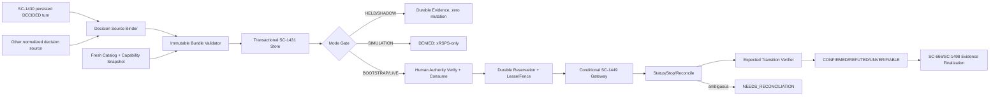
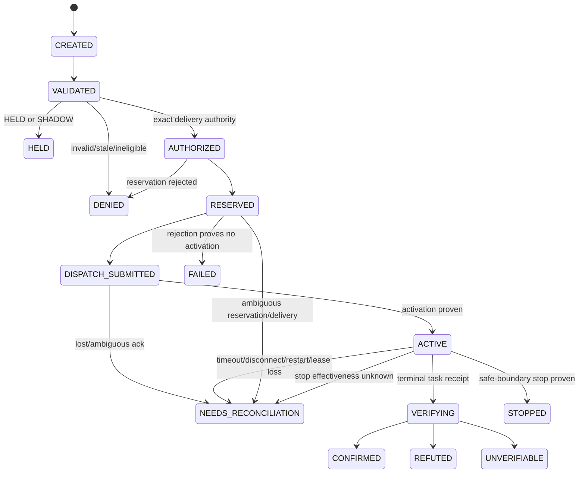

# SC-1431 Luna Max Full Implementation Runbook

Shortcut: https://app.shortcut.com/leeuwbot/story/1431  
Parent Felix task: `task_1788122221223_uphlga0o`  
Canonical project: `C:\Dev\IdeaProjects\ChromaScape`  
Authoritative architecture/spec parent: `note_1788122370698_ac5ccb2a`  
Implementation checkpoint: `note_1788123435184_d5c3d6b7`  
Boundary rule: `rule_1788122248722_j8v59sbe`

This note is the executable handoff for a Luna-max implementation run. Read the repository `AGENTS.md` files, this runbook, the parent specification, the five ordered child tasks, and the current code before editing. Preserve the dirty worktree and all unrelated SC-1429/SC-1430/SC-1498/user changes.

## Mission

Finish the ChromaScape-owned, provider/source-neutral AccountBuilder orchestration boundary:

`observe → validate TaskSkill preconditions → authorize → reserve → dispatch → observe → verify`

Every upstream decision source must enter the same immutable `OrchestrationRequest` and `ExecutionEnvelope`. The orchestrator may compare decisions in `SHADOW`, but exactly one explicitly selected and human-authorized envelope may enter `BOOTSTRAP_RECORDING` delivery. It never gains raw input, packet, reflection, shell, direct-client or provider-specific executor capabilities.

SC-1431 owns orchestration. SC-1449 owns the Micro6 server-side enforcement and delivery boundary. Do not implement SC-1449 behavior in ChromaScape or claim live conformance without its reviewed contract/evidence.

## Current truth — do not redo finished work

Already implemented under:

`C:\Dev\IdeaProjects\ChromaScape\src\main\java\com\chromascape\web\gameplay\orchestration\accountbuilder`

- Immutable modes, states, failure codes, capability/snapshot/request/lease/receipt/view models.
- Strict request fingerprinting and initial decision/envelope/capability/revision/authority gates.
- Narrow `AccountBuilderOrchestrationGateway`.
- Default closed gateway.
- In-memory store and JPA store foundation.
- HELD/SHADOW zero-dispatch behavior.
- Reserve/dispatch/status/stop/reconcile skeleton with no blind retry.
- Protected default-off controller and properties.
- Read-only `ProviderDecisionHandoff` source.
- Flyway V23 schema.
- Six focused tests passing under isolated Java 17 compilation.

Known incomplete or unsafe-to-claim areas:

1. `ab_snapshot_binding`, `ab_orchestration_lease`, `ab_orchestration_receipt`, and `ab_orchestration_terminal_result` exist in V23 but lack complete JPA mappings and transactional writes.
2. `view_json` currently carries facts that must become authoritative normalized rows.
3. Authority validation does not yet verify the HMAC/signature through `HumanGameplayAuthorityService`, and durable one-use consumption is only a boolean transition.
4. The service does not yet enforce the exhaustive budget/deadline, transition, receipt-order and stop-safe-boundary matrices.
5. `BootstrapGameplayOrchestrator` and `BootstrapGameplayOperatorService` still own a parallel in-memory state/idempotency path.
6. `ProviderDecisionOrchestrationSource` does not yet prove the stored SC-1430 turn is terminal `DECIDED` with all required provenance.
7. The only SC-1431 gateway bean is intentionally closed. The existing `Micro6AccountBuilderGameplayGateway` implements the older bootstrap interface, not the SC-1431 gateway.
8. Protected controller tests, PostgreSQL/Flyway tests, restart tests and exhaustive gateway faults are missing.
9. Full Gradle quality is unverified because DrvFs failed while enumerating an unrelated source directory.
10. SC-1429, SC-573 and SC-666 remain dependency blockers; SC-1449 conformance remains required for live completion.

## Ownership and dependency gates

| Concern | Owner | SC-1431 action |
|---|---|---|
| Provider-neutral decision/envelope vocabulary | SC-1429 | Consume exactly; do not fork |
| Claude/Codex durable decision runtime | SC-1430 | Consume through read-only persisted handoff |
| Cross-system AccountBuilder orchestration | SC-1431 | Implement here |
| Micro6 server enforcement/action gate | SC-1449 | Consume reviewed semantic API only |
| AccountBuilder execution lifecycle/fake executor | SC-573 | Consume contract/evidence |
| Atomic session/recording evidence | SC-666 | Integrate finalized receipts |
| First human-gated Fishing recording | SC-1498 | Delegate through SC-1431 |
| Simulation | xRSPS stories | Never route to Micro6 from SIMULATION |

Safe work may continue with fakes and closed gateway. Live delivery and final review/done require external dependency evidence.

## Target architecture



## Canonical lifecycle



Rules:

- `HELD`, `CONFIRMED`, `REFUTED`, `UNVERIFIABLE`, `DENIED`, `STOPPED`, and `FAILED` are immutable terminal states.
- `NEEDS_RECONCILIATION` is quiescent and permits only status/reconcile/stop as defined by the remote contract. It can transition to a proven terminal result, never back to reserve/dispatch/active.
- No state may skip durable persistence.
- A transport response is not activation or semantic success.
- `retryAllowed=true` is permitted only when the gateway proves no reservation, task or activation was created. Ambiguity always sets it false.
- Restart never invokes reserve/dispatch automatically. It hydrates state and reconciles.

## Immutable request and fingerprint contract

The canonical fingerprint must cover, in stable canonical JSON:

- contract version;
- orchestration, request and idempotency identities;
- mode and source type/source identity;
- complete trusted SC-1429 decision;
- decision and semantic-action digests;
- complete immutable `ExecutionEnvelope`;
- account, client, environment, task, run, gameplay-session, provider-session, provider-turn, recording and source identities;
- task key and settings;
- catalog, capability, tool-schema, build, GoalPlan, TaskSkill, knowledge, policy and verifier identities/digests;
- expected observation and task revisions;
- authority ID, exact scope digest and authority envelope digest when delivery mode;
- lease generation/fence expectations;
- every action/time/task/tool budget and absolute deadline;
- expected transition and kill-switch scope.

Do not trust a caller-provided fingerprint until locally recomputed. Same orchestration/request/idempotency identity plus same fingerprint returns the existing state. Any identity collision with a different fingerprint returns `IDEMPOTENCY_CONFLICT` before capability read, authority consumption, reservation or dispatch.

## Validation order

Perform the gates in this exact order:

1. Parse/type/closed-enum validation.
2. Contract version and required stable identity validation.
3. Locally recompute request, decision, action and envelope digests.
4. Bind trusted decision/provider/model/session provenance.
5. Validate envelope-to-decision action/task/settings/expected-transition/verifier match.
6. Validate observation/account/client/environment/run/session/recording/source identity match.
7. Validate plan/skill/tool/knowledge/policy/catalog/capability/build digests.
8. Validate expected observation/task revisions.
9. Validate budgets and absolute deadline.
10. Claim request/idempotency identities transactionally.
11. For HELD/SHADOW, persist terminal evidence and stop: zero gateway mutations.
12. Reject SIMULATION from Micro6 route.
13. Read fresh capability/catalog snapshots and repeat freshness/eligibility/revision gates.
14. Verify human signature, exact scope, expiry and one-use state for delivery modes.
15. Reserve and consume authority atomically.
16. Recheck deadline, lease generation/fence and current snapshot immediately before dispatch.
17. Dispatch once.
18. Observe/status, stop or reconcile using the same immutable identities.
19. Verify expected transition as `CONFIRMED | REFUTED | UNVERIFIABLE`.
20. Persist immutable terminal evidence.

## Durable write contract

| Transaction | Required writes | Forbidden behavior |
|---|---|---|
| Claim | orchestration row, snapshot binding, CREATED event | no external calls |
| Validate | state/version update, VALIDATED or DENIED event/receipt | no authority consumption |
| Hold/shadow | HELD terminal result plus provenance receipt | no gateway read required; zero mutation |
| Authorize/reserve | verified authority-use record, reservation receipt, lease row, AUTHORIZED/RESERVED events | never mark authority consumed without committed reservation outcome |
| Dispatch | DISPATCH_SUBMITTED event before/with immutable remote request identity | never issue a second dispatch |
| Status/progress | append-only correlated receipts/events | never overwrite earlier receipts |
| Verify | terminal receipt/result plus evidence digest | never collapse REFUTED and UNVERIFIABLE |
| Reconcile | append proof and move NEEDS_RECONCILIATION only to proven terminal | never return to delivery states |

Implement and map:

- `AccountBuilderSnapshotBindingEntity`
- `AccountBuilderOrchestrationLeaseEntity`
- `AccountBuilderOrchestrationReceiptEntity`
- `AccountBuilderOrchestrationTerminalResultEntity`
- an authority-use/consumption row or a reviewed integration with an existing durable authority table; if V23 must change before shared environments consume it, edit V23. If V23 has already shipped, add V24 rather than rewriting history.

Normalized rows are authoritative. `request_json` and `view_json` are immutable/bounded audit snapshots and response caches. Hydration must compare row facts against snapshot digests and fail closed on corruption.

Event sequence allocation must be safe under concurrent transitions. Use the locked orchestration version/next-sequence field or a database-safe allocation; do not rely on an unlocked `count + 1`.

## Gateway boundary

`AccountBuilderOrchestrationGateway` is the only delivery port. It may expose:

- capability/catalog read;
- reserve;
- dispatch/start;
- status;
- stop;
- reconcile.

It may not expose:

- raw mouse/keyboard;
- packets;
- reflection;
- arbitrary scripts/tasks;
- direct RuneLite/client objects;
- shell/filesystem;
- generic MCP mutation tools;
- provider-specific handles.

Every mutation carries request ID, idempotency key, envelope digest, account/client/executor slot, lease generation/fence, expected revisions and absolute deadline. Every response must echo enough identity to reject cross-run/cross-request assignment.

The real adapter must be conditional. `ClosedAccountBuilderOrchestrationGateway` remains selected by default. Do not guess SC-1449 paths or fields: read its reviewed story/spec/current implementation first. Until available, implement the adapter seam and deterministic fake only, keep live readiness false, and document the blocker.

Bound connect, request, poll and total deadlines and response bytes. A timeout after possible submission is `NEEDS_RECONCILIATION`, not `FAILED`. An HTTP 2xx containing `ok=false` or a failure string is a structured negative result, not success.

## Human authority contract

Reuse `HumanGameplayAuthorityService`; do not invent a second signer.

Required proof:

- actor type is HUMAN;
- stable approver identity;
- exact displayed scope digest;
- exact envelope digest;
- provider/model, account, task/settings, budgets, policy, identities, expected transition, verifier, deadline and kill-switch scope are bound;
- HMAC signature verifies in constant time;
- not expired;
- one-use;
- authority ID matches envelope;
- durable consumption is atomic with reservation ownership.

A crash after authority consumption but before a proven reservation result yields `NEEDS_RECONCILIATION`; it never remints authority or retries with a new identity.

## SC-1430 and SC-1498 integration

`ProviderDecisionOrchestrationSource` must accept only a persisted SC-1430 turn whose terminal state is `DECIDED`. Bind:

- provider runtime session/turn/request;
- provider/model;
- prompt/tool/knowledge/plan/skill digests;
- decision/action digests;
- transcript/evidence reference;
- run/recording/source identity.

The binder creates no authority and performs no gateway call.

Refactor the SC-1498 path so:

- preview remains read-only;
- human approve remains explicit;
- bind/dispatch delegates to `AccountBuilderOrchestrationService`;
- stop delegates to the durable orchestration identity;
- `BootstrapGameplayOrchestrator` becomes a compatibility facade or is removed after all callers/tests migrate;
- there is only one idempotency owner and state machine;
- `BootstrapEvidenceStore` finalizes from durable receipts and never publishes partial evidence;
- provider-origin evidence stays provider-origin;
- no learned model activation or continuing authority is emitted.

## Protected API

Keep one versioned base:

`/api/v1/gameplay/accountbuilder`

Required routes:

- `GET /readiness` — configured/enabled/gateway/freshness and stable failure code; never secrets.
- `GET /capabilities` — normalized read-only catalog/capability snapshot when enabled and authenticated.
- `POST /orchestrations` — claim/evaluate immutable request.
- `GET /orchestrations/{id}` — durable state, bounded receipts and terminal result.
- `POST /orchestrations/{id}/stop` — idempotent bounded stop.
- `POST /orchestrations/{id}/reconcile` — proof-based reconciliation, never redispatch.

Status mapping:

| Condition | HTTP |
|---|---:|
| Created request | 201 |
| Existing identical request | 200 |
| Stop accepted | 202 |
| Invalid JSON/contract | 400 |
| Missing/invalid operator key | 401 |
| Unknown orchestration | 404 |
| Identity/terminal/uncertain conflict | 409 |
| Eligibility/revision/budget/authority denial | 422 |
| Disabled, stale or unavailable gateway | 503 |

Use constant-time key comparison. Do not log keys, signatures, credentials, full authorities or unredacted provider transcripts.

## Stable failure matrix

| Condition | State/code | Mutation/retry |
|---|---|---|
| Invalid contract/digest | DENIED / INVALID_CONTRACT or STALE_BINDING | zero mutation |
| Task absent/ineligible/schema mismatch | DENIED / TASK_INELIGIBLE | zero mutation |
| Capability/catalog/build/revision stale | DENIED / STALE_BINDING or REVISION_MISMATCH | zero mutation |
| Budget/deadline exhausted | DENIED / BUDGET_EXHAUSTED or DEADLINE_EXPIRED | zero mutation |
| Missing/bad/expired/used authority | DENIED / AUTHORITY_INVALID, AUTHORITY_EXPIRED or AUTHORITY_ALREADY_USED | zero mutation |
| HELD/SHADOW | HELD / NONE | zero mutation |
| SIMULATION | DENIED / MODE_NOT_DELIVERABLE | no Micro6 route |
| Reservation rejects and proves absent | DENIED / RESERVATION_REJECTED | no dispatch |
| Lease generation/fence mismatch | DENIED or NEEDS_RECONCILIATION / FENCE_MISMATCH | no further delivery |
| Dispatch rejects before acceptance | FAILED / DISPATCH_REJECTED | retry only with proof nothing started |
| Lost/ambiguous acknowledgement | NEEDS_RECONCILIATION / DELIVERY_UNCERTAIN | never blind retry |
| Accepted but not activated before deadline | NEEDS_RECONCILIATION | reconcile/stop only |
| Task completes, transition proven | CONFIRMED | terminal |
| Task completes, transition disproven | REFUTED | terminal |
| Evidence cannot decide | UNVERIFIABLE | terminal, no retry |
| Stop effective at safe boundary | STOPPED | terminal |
| Stop ack but still active/unknown | NEEDS_RECONCILIATION | reconcile only |
| Wrong/malformed/late/cross-run receipt | NEEDS_RECONCILIATION / BOUNDARY_VIOLATION | quarantine; no redispatch |
| Raw-input/bypass attempt | DENIED / BOUNDARY_VIOLATION | security event |

## Ordered Felix work packets

1. `task_1788124158189_bq4lu5ws` — normalized persistence and atomic authority/lease invariants.
2. `task_1788124158975_be9ttdmd` — lifecycle, budgets, fencing, faults and security tests.
3. `task_1788124159175_vj7m5bhs` — unify SC-1430 decision handoff and SC-1498 bootstrap.
4. `task_1788124159376_2za7ci8l` — conditional SC-1449 gateway and protected API.
5. `task_1788124159575_zlrbznd8` — full verification, dependency handoff and review evidence.

Each child is `spec_ready`. Follow the required dependency links; do not mark a child complete until its own checklists and evidence are true.

## Exact file plan

Primary existing files to modify:

- `...\accountbuilder\AccountBuilderOrchestrationModels.java`
- `...\accountbuilder\AccountBuilderOrchestrationValidator.java`
- `...\accountbuilder\AccountBuilderOrchestrationStore.java`
- `...\accountbuilder\AccountBuilderOrchestrationEntities.java`
- `...\accountbuilder\JpaAccountBuilderOrchestrationStore.java`
- `...\accountbuilder\AccountBuilderOrchestrationService.java`
- `...\accountbuilder\AccountBuilderOrchestrationGateway.java`
- `...\accountbuilder\ClosedAccountBuilderOrchestrationGateway.java`
- `...\accountbuilder\ProviderDecisionOrchestrationSource.java`
- `...\accountbuilder\AccountBuilderOrchestrationController.java`
- `...\accountbuilder\AccountBuilderOrchestrationProperties.java`
- `...\orchestration\BootstrapGameplayOperatorService.java`
- `...\orchestration\BootstrapGameplayOrchestrator.java`
- `...\orchestration\BootstrapEvidenceStore.java`
- `...\authority\HumanGameplayAuthorityService.java`
- `...\provider\runtime\ProviderDecisionHandoff.java`
- `...\provider\runtime\GameplayProviderRuntime.java`
- `...\resources\db\migration\V23__sc1431_accountbuilder_orchestration.sql`
- `...\resources\application.yml`
- `.env.example`

Expected new files where appropriate:

- normalized entity classes or one clearly grouped entity file;
- `Micro6AccountBuilderOrchestrationGateway.java` only after SC-1449 contract review;
- deterministic fake gateway/fixtures;
- JPA/PostgreSQL integration tests;
- controller HTTP contract tests;
- restart fixture/runner if required.

Do not modify Micro6 in this story.

## Golden fixtures and mandatory tests

Use the existing `sc-1429-golden-fixtures-v1.json` as the canonical decision/envelope basis. Derive immutable test variants by changing exactly one field per negative case and recomputing only caller-owned values. Never recompute trusted expected values to make an invalid fixture pass.

Mandatory suites:

1. Fingerprint table test: mutate every covered field; every digest changes.
2. Identity table test: orchestration/request/idempotency collisions.
3. Eligibility table: missing task, ineligible task, schema mismatch, stale catalog/capability/build.
4. Revision table: observation/task stale independently.
5. Authority table: bad signature, scope, envelope, actor, ID, expiry, reuse and crash window.
6. Budget table: each action/time/task/tool ceiling and absolute deadline.
7. Lease table: missing/expired/wrong generation/wrong fence.
8. Receipt table: non-2xx, `ok=false`, malformed, wrong identity, late, duplicate, out-of-order.
9. Lifecycle table: every legal transition and every illegal transition.
10. Stop table: requested, acked, safe-boundary effective, remains active, unknown.
11. Restart table: kill/restart at CREATED, VALIDATED, AUTHORIZED, RESERVED, DISPATCH_SUBMITTED, ACTIVE, VERIFYING and NEEDS_RECONCILIATION.
12. Concurrency table: identical and conflicting submissions/reservations for same account/client/executor slot.
13. HTTP table: authentication and every mapped status.
14. Secret/provenance audit.
15. SC-1430 Claude/Codex persisted decision → SC-1431 HELD/SHADOW.
16. SC-1498 compatibility and atomic evidence.
17. SC-1449 live conformance only when dependency is available.

## Verification commands and environment

Use Java 17 explicitly. WSL currently defaults to Java 11.

Preferred full verification outside the DrvFs enumeration problem:

```text
set JAVA_HOME=C:\path\to\jdk-17
gradlew.bat spotlessApply spotlessCheck compileJava test checkstyleMain check
```

On WSL for scoped diagnostics:

```text
JAVA_HOME=/usr/lib/jvm/java-17-openjdk-amd64
PATH=/usr/lib/jvm/java-17-openjdk-amd64/bin:$PATH
./gradlew <task> --no-daemon
```

If DrvFs fails to enumerate an unrelated path, record the exact failure, use scoped Java 17 compilation/tests for iteration, then rerun the complete pipeline from Windows or local storage before review. Scoped compilation is not final quality evidence.

For PostgreSQL use an isolated database/schema, never the user's active ChromaScape data. Record database version, migration start/end version and cleanup method. Do not launch ChromaScape unless the user explicitly authorizes it.

## Implementation completion gate

Before parent task can enter review:

- all five child tasks are complete;
- all parent implementation checklist items are checked;
- every acceptance criterion has durable evidence;
- V23/current migrations and normalized JPA persistence pass isolated PostgreSQL;
- all fault, concurrency, lease, restart, API, security and handoff tests pass;
- full Java 17 quality pipeline passes;
- implementation evidence note contains `## Changed files`, `## Tests`, `## Remaining work`;
- no live claim is made without SC-1449 evidence;
- Shortcut receives the existing review marker only once.

Before done:

- verification evidence note contains `## Acceptance results`, `## Tests`, `## Risks`, `## Rollback`;
- SC-1429, SC-573, SC-666 and SC-1449 prerequisites are proven closed;
- isolated end-to-end AccountBuilder path proves no duplicate dispatch, no raw-input route, correct terminal receipts and atomic recording evidence;
- all Felix acceptance/test items are checked truthfully;
- Shortcut done transition/comment succeeds exactly once.

## Rollout and rollback

Rollout:

1. Schema and store with feature flags off.
2. Fake gateway and persistence tests.
3. HELD/SHADOW using persisted SC-1430 decisions.
4. SC-1498 compatibility facade with delivery still off.
5. Reviewed SC-1449 adapter in readiness-only mode.
6. One exact human-gated BOOTSTRAP_RECORDING after all prerequisites.
7. LIVE_TASK remains unavailable until later certification stories.

Rollback:

- disable orchestration and live-delivery flags;
- keep read-only status/evidence available;
- request bounded stop for active work;
- preserve all rows, receipts, provenance and reconciliation state;
- never delete/rewrite history or reuse consumed authority;
- closed gateway becomes the selected bean;
- roll back application code without rolling back committed evidence schema/data.

## Hard prohibitions

- No raw input, direct client, packets, reflection, shell or generic mutation tools.
- No provider-specific execution route.
- No automatic provider/source switching after uncertainty.
- No blind retry after reservation, acknowledgement or ambiguous state.
- No self-approved authority, authority extension or authority reuse.
- No treating transport success as activation or semantic success.
- No merging REFUTED and UNVERIFIABLE.
- No simulator trace labeled live.
- No provider evidence labeled human demonstration.
- No model activation, patch approval or deployment authority.
- No Micro6 edits under SC-1431.
- No review/done transition while verification/dependencies remain open.
