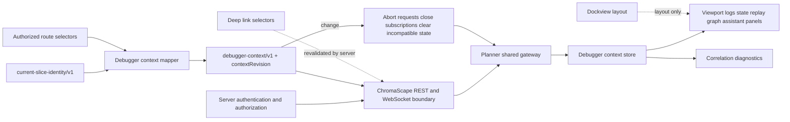
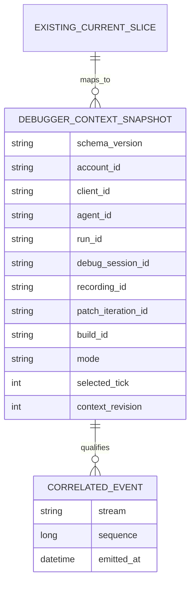

# SC-1112 — Session Identity and Cross-Stream Correlation Contract

## Outcome

Publish and implement `debugger-context/v1`, a single correlation context for every debugger REST result, WebSocket subscription/event, cached record, evidence record, and deep link. It maps existing ChromaScape domain identity; it does not replace `current-slice-identity/v1`.

## Scope

In scope:

- ChromaScape contract/validation and Planner TypeScript model for account, client/agent, run, debug session, recording, patch iteration, build, mode, selected tick, and context revision.
- REST request/response and WebSocket subscribe/event correlation.
- Atomic context switching, cancellation, cache invalidation, reconnect, late-event rejection, diagnostics, and tests across `C:\Dev\IdeaProjects\ChromaScape` and `C:\Dev\IdeaProjects\osrs-goal-tracker`.
- Compatibility review for the production gateway contract in `C:\Dev\IdeaProjects\leeuwbotbackend`.

Out of scope:

- Authentication or authorization policy changes.
- Replacing `CurrentSliceIdentity`, changing Dockview layout ownership, making the ChromaScape origin browser-selectable, or persisting identity authority in browser storage.
- New database tables or migrations.
- Panel feature work beyond adopting the shared context.
- Completing SC-1104, SC-1118, or SC-1120.

## Dependencies and consumers

- Immediate prerequisite: SC-1103 must restore and verify the ChromaScape runtime/migration baseline.
- Direct consumers: SC-1104 same-origin gateway, SC-1118, and SC-1120.
- Existing SC-1104 work is partial input only; SC-1112 owns the canonical contract.

## Architecture



### Authority rules

1. ChromaScape server responses establish authorized identity after independent access checks.
2. `CurrentSliceIdentity` remains the authoritative domain grouping for task/run/client/capture/recording/source/graph/model/candidate fields.
3. `debugger-context/v1` adds debugger correlation dimensions and maps existing identity without duplicating ownership.
4. The Planner context store owns the current accepted client snapshot; route values are requested selectors only.
5. Dockview and browser storage own presentation/layout only.
6. Every asynchronous result is accepted only when its complete required identity and `contextRevision` match the active context.

## Versioned context

```ts
type DebuggerMode = 'live' | 'recording' | 'replay';

interface DebuggerContextV1 {
  schemaVersion: 'debugger-context/v1';
  accountId: string;
  clientId: string;
  agentId: string;
  runId: string;
  debugSessionId: string;
  recordingId: string | null;
  patchIterationId: string;
  buildId: string;
  mode: DebuggerMode;
  selectedTick: number | null;
  contextRevision: number;
}
```

Requiredness:

- Always required: schemaVersion, accountId, clientId, agentId, runId, debugSessionId, patchIterationId, buildId, mode, contextRevision.
- `recordingId` is required and non-null for recording/replay; it is null for live mode.
- `selectedTick` is required and non-null for replay; it may be null while live or before a recording tick is selected.
- Identifiers are opaque, compared exactly, and never interpreted as credentials.

## Identity propagation matrix

| Surface | Carries | Source of truth | Rejection/reset rule |
|---|---|---|---|
| REST request | selector fields plus expected context revision when operating within a context | active store snapshot | abort on local switch; server rejects unauthorized/stale selectors |
| REST response | full debugger context | authorized server result | discard unless full required identity matches active snapshot |
| WebSocket subscribe | full debugger context | authorized active snapshot | server authenticates independently and rejects invalid combinations |
| WebSocket event | full context plus stream sequence and emitted time | server stream | discard wrong schema/context/build/revision or non-monotonic sequence |
| Cache/evidence record | immutable full context | producer event/response | namespace by context fingerprint; never reuse across mismatch |
| Deep link | selectors only | URL | resolve through server; never hydrate authoritative store directly |
| Dockview/layout storage | panel IDs and layout | Dockview | identity fields are removed/rejected during sanitization |

## Reset and invalidation

- Any change to account, client/agent, run, debug session, recording, patch iteration, build, or mode increments `contextRevision`, aborts in-flight REST work, closes/re-subscribes streams, clears incompatible selected tick and panel data, and prevents old callbacks from committing.
- A selected-tick-only change increments the revision for tick-scoped requests and clears tick-scoped data without discarding compatible session-level capability metadata.
- Reconnect starts from a newly server-authorized context snapshot; queued events from the prior socket are invalid.
- Missing, malformed, unsupported-version, stale-revision, mixed-session, mixed-build, or out-of-order payloads fail closed and emit diagnostics. They are never partially rendered.
- Logout or lost authorization clears the entire context before navigation.

## Data decision / ERD

No database schema change is required. The contract is carried and validated at API, stream, cache-key, and client-state boundaries. Existing persisted domain records retain their current keys; any evidence written by consumers stores the context as versioned metadata under that consumer's existing persistence design.



This is a logical contract diagram, not approval for new tables or a Flyway migration.

## REST API contract

```yaml
openapi: 3.1.0
info:
  title: ChromaScape Debugger Context
  version: 1.0.0
paths:
  /api/debugger/context:
    get:
      summary: Resolve an authorized debugger context from requested selectors
      parameters:
        - { name: debugSessionId, in: query, required: true, schema: { type: string } }
        - { name: mode, in: query, required: true, schema: { type: string, enum: [live, recording, replay] } }
        - { name: recordingId, in: query, required: false, schema: { type: string } }
        - { name: selectedTick, in: query, required: false, schema: { type: integer, minimum: 0 } }
      responses:
        '200':
          description: Independently authorized context
          content:
            application/json:
              schema: { $ref: '#/components/schemas/DebuggerContextV1' }
        '400': { description: Invalid or incompatible selectors }
        '401': { description: Authentication required }
        '403': { description: Context is not authorized for the principal }
        '404': { description: Selected context does not exist }
        '409': { description: Context revision or identity is stale }
components:
  schemas:
    DebuggerContextV1:
      type: object
      additionalProperties: false
      required: [schemaVersion, accountId, clientId, agentId, runId, debugSessionId, patchIterationId, buildId, mode, contextRevision]
      properties:
        schemaVersion: { const: debugger-context/v1 }
        accountId: { type: string, minLength: 1 }
        clientId: { type: string, minLength: 1 }
        agentId: { type: string, minLength: 1 }
        runId: { type: string, minLength: 1 }
        debugSessionId: { type: string, minLength: 1 }
        recordingId: { type: [string, 'null'] }
        patchIterationId: { type: string, minLength: 1 }
        buildId: { type: string, minLength: 1 }
        mode: { type: string, enum: [live, recording, replay] }
        selectedTick: { type: [integer, 'null'], minimum: 0 }
        contextRevision: { type: integer, minimum: 1 }
```

## WebSocket contract

Subscribe and event envelopes use the same context:

```json
{
  "schemaVersion": "debugger-stream/v1",
  "type": "subscribe|event",
  "stream": "viewport|logs|bot-state|semantic-state|statistics|tick|replay|graph|assistant|patch",
  "context": { "schemaVersion": "debugger-context/v1", "contextRevision": 42 },
  "sequence": 17,
  "emittedAt": "2026-08-31T00:00:00Z",
  "payload": {}
}
```

The actual context object must contain every required field; the abbreviated example is not a relaxation. Unsupported envelopes close/reject with a protocol error. Oversized-message and authentication behavior remain owned by SC-1104.

## Observability

Emit structured, secret-free diagnostics with reason codes: `schema_mismatch`, `context_mismatch`, `stale_revision`, `sequence_regression`, `unauthorized_context`, and `invalid_selector`. Include safe correlation dimensions (hashed/redacted where policy requires), stream name, expected/received revisions, and disposition. Add counters for accepted, dropped by reason, context switches, aborts, reconnects, and active subscriptions. Never log tokens, authorization headers, raw secrets, or identity values classified as sensitive.

## Risks and rollback

- Risk: contract adoption can split between server and Planner. Mitigation: shared fixtures, compatibility tests, and one version string.
- Risk: false-positive stale drops during reconnect. Mitigation: monotonic revision ownership and deterministic reconnect tests.
- Risk: URLs/storage accidentally regain authority. Mitigation: sanitizer tests and server re-resolution.
- Risk: legacy streams omit dimensions. Mitigation: fail closed behind a rollout flag or compatibility adapter scoped to `debugger-context/v1`; do not silently infer.
- Rollback: disable consumption of v1 at the Planner feature boundary and restore the last compatible gateway path while retaining drop diagnostics. No database rollback is needed.

## Implementation sequence

1. After SC-1103 is verified, publish shared field semantics, requiredness, fingerprint/equality, mapping from `CurrentSliceIdentity`, and fixtures in ChromaScape.
2. Add server resolver/validator and REST/WebSocket serialization with independent authorization.
3. Add the Planner TypeScript model, runtime parser, context store, atomic revision transitions, abort wiring, and namespaced cache/evidence keys.
4. Apply validation centrally in `gateway/chromascape-api.ts` and `gateway/stream-manager.ts`; panels consume only accepted store data.
5. Sanitize deep-link and Dockview persistence boundaries; resolve deep links through the server.
6. Add structured diagnostics/metrics and redaction tests.
7. Run ChromaScape and Planner unit/integration suites, cross-stream late/mismatch/reconnect tests, typecheck/lint/format/build, and live gateway checks.
8. Record Implementation Evidence before review and Verification Evidence before done.

## Verification plan

- ChromaScape unit tests for mapping, requiredness, mode/tick conditions, authorization independence, and serialization.
- Planner unit tests for parser/equality/fingerprint, revision transitions, abort/reset, cache partitioning, and storage sanitization.
- Integration tests inject late REST results, mixed session/build events, sequence regressions, reconnect races, and authorization loss across concurrent streams.
- Deep-link tests prove only server-authorized context is restored.
- Runtime verification confirms diagnostics/metrics, secret redaction, and zero stale panel commits.
- Full repository gates: ChromaScape Gradle tests/build per repository instructions and Planner `npm run test && npm run typecheck && npm run lint && npm run format:check && npm run build`.
