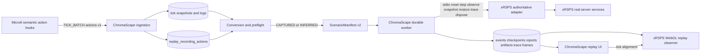

# SC-1199 — Authoritative Visual ChromaScape Recording Replay on xRSPS

## Purpose and completion definition

This is the decision-complete implementation specification for Luna Max. The delivery is complete only when a finalized ChromaScape recording can be launched with one operator action, executed by authoritative xRSPS services, watched in the xRSPS WebGL client, recovered after refresh/restart, and inspected through deterministic artifacts. The existing observed video/frame/log player is a prerequisite and comparison surface; it is not xRSPS replay.

Two truthful outcomes are supported:

- `CERTIFIED`: the recording contains a complete typed semantic action stream, all actions are supported by a pinned `XRSPS_AUTHORITATIVE` worker, deterministic and differential gates pass, and no evidence gap or approximation exists.
- `BEST_EFFORT`: legacy logs/snapshots were deterministically inferred or approximated. The result is watchable, all gaps are disclosed, and certification is permanently prohibited for that run.
- `UNSUPPORTED`: evidence cannot produce a meaningful action sequence or initial state. Observed playback remains available.

## Source and ownership

- Shortcut source: SC-1199, `REPLAY-12: ChromaScape recording to xRSPS replay vertical slice`.
- Felix task: `task_1788137869927_5y6pxvp5`, child of `task_1787879364196_ur2bm3bc`.
- Canonical Felix project: `C:\Dev\IdeaProjects\ChromaScape`.
- Repositories: `C:\Dev\IdeaProjects\ChromaScape`, `C:\Dev\IdeaProjects\micro6`, and `C:\Dev\IdeaProjects\xrsps-typescript`.
- Classification: `change:multi-repo`.

SC-1199 requires browser-independent execution. The added visual requirement does not change simulation authority: the headless xRSPS run remains authoritative; the xRSPS WebGL client reads immutable trace frames and cannot send gameplay commands.

## Verified starting state

- ChromaScape observed playback v1 exists and the standalone page can render captured frames/logs.
- The replay execution foundation persists manifests, runs, events, checkpoints, reports, artifacts, and uses `reset/step/observe/snapshot/restore/trace/dispose`.
- The current xRSPS replay kernel reports `SYNTHETIC_CONTRACT`, supports only `WAIT_UNTIL_TICK` and `INTERACT_NPC`, and duplicates simplified world/fishing behavior. It is not authoritative game fidelity.
- Existing recordings contain snapshots and loosely structured tick logs, not a complete typed semantic action stream.
- Replay flags default false and must remain false until every gate passes.
- ChromaScape migration branches conflict around V22/V23. Merge/rebase the intended application line first and allocate the new additive migration as V24. Never edit or renumber an applied migration.

## Scope and exclusions

Deliver typed semantic action capture, append-only storage, legacy deterministic inference, manifest v2, authoritative xRSPS execution, immutable trace frames, xRSPS WebGL observer mode, one-click ChromaScape orchestration, aligned observed/simulated timelines, durable recovery, and full certification evidence.

Do not replay raw mouse/keyboard events, RuneLite packets, WebSocket frames, or binary protocol messages. Do not add Micro6/live-game control, OpenRune fallback, SQLite replay accounts, autosave, a real-time simulation timer, model training/activation, deployment, or default-enabled replay.

## Architecture



Execution and viewing are separate. The worker owns state transitions and durable truth. The viewer consumes content-addressed trace pages and may pause/seek locally without changing the run.

## Recording action contract

Extend `TICK_BATCH` with `actions`, always an array. Each `recording-action/v1` envelope contains:

```json
{
  "schema": "recording-action/v1",
  "sessionId": "debug-session-id",
  "tick": 12345,
  "sequence": 0,
  "actionType": "INTERACT_NPC",
  "target": {"kind":"NPC","stableId":"npc:shrimp-spot:3200:3200:0","definitionId":1518},
  "arguments": {"option":"net"},
  "source": "MICRO6_SEMANTIC_DISPATCH",
  "confidence": 1.0,
  "capturedAt": "2026-08-31T00:00:00Z"
}
```

Closed action set for v1: `WAIT_UNTIL_TICK`, `WALK_TO`, `INTERACT_NPC`, `INTERACT_OBJECT`, `INTERACT_GROUND_ITEM`, `INTERACT_INVENTORY_ITEM`, `INTERACT_WIDGET`, `SELECT_DIALOGUE_OPTION`, `CAST_SPELL`, and `EQUIP_ITEM`.

Capture at Micro6 semantic dispatch boundaries before the action is submitted, not from mouse coordinates. Preserve same-tick order. Stable targets use definition ID plus world position/plane and an occurrence discriminator where needed. Arguments are action-specific canonical JSON. Retries carry distinct sequence values only when they were genuinely dispatched.

ChromaScape validates session ownership, tick bounds, nonnegative sequence, closed action/target/source enums, canonical arguments, and maximum payload size. Delivery is idempotent by `(session_id,tick,sequence)`; an identical duplicate is accepted and a conflicting duplicate fails closed.

## Persistence and migration

Add V24 with `replay_recording_actions`: UUID/identity primary key, `session_id`, `recording_id`, `tick`, `sequence`, `schema`, `action_type`, `target_kind`, `target_stable_id`, `target_json`, `arguments_json`, `source`, `confidence`, `captured_at`, `ingested_at`, and content checksum. Add a unique constraint on `(session_id,tick,sequence)`, lookup indexes on `(recording_id,tick,sequence)` and `(session_id,tick,sequence)`, JSON/object size checks where supported, and foreign keys that preserve finalized evidence.

Extend manifest/run/report storage additively with `manifest_version`, `fidelity`, `conversion_quality`, `action_coverage_pct`, `gap_count`, `approximation_count`, `viewer_trace_checksum`, and `viewer_trace_frame_count`. Never store viewer bearer tokens. Store only token hash, run binding, expiry, and revocation timestamp if server-side token tracking is required.

## Legacy conversion rules

Build a deterministic converter ordered by `(tick,log_id)`. A log becomes an exact inferred action only when event type, stable target, option/arguments, and tick are present and valid. Position deltas may produce `WALK_TO` approximations to the first observed changed tile; missing intermediate routes remain a disclosed gap. Dialogue/varbit consequences are expectations unless a dispatch log identifies the initiating action. Unknown logs are retained as source evidence but never fabricated into supported actions.

Converter output is an immutable curation with provenance `CAPTURED`, `INFERRED`, `OPERATOR_SUPPLIED`, or `DEFAULTED` per field. Any value other than fully `CAPTURED` forces `BEST_EFFORT`. Re-running conversion over identical evidence yields the same curation checksum and ordered gap list.

## Manifest v2

`ScenarioManifest/v2` contains recording/session checksums and tick bounds; curation checksum; compiler version; runtime pins; deterministic seed, virtual clock origin, and 600 ms tick duration; canonical initial state; ordered semantic actions with provenance; expectations/tolerances; conversion summary; fidelity requirement; and `controlAllowed=false`.

The compiler must reject corrupt ordering, duplicate/conflicting actions, unresolved required targets, missing initial world/resource state, tick gaps required by the scenario, unsupported captured actions for a certification request, and runtime identity mismatches. A best-effort request may keep unsupported items as explicit nonexecuted gaps but cannot silently drop them.

## Authoritative xRSPS adapter

Replace certification-path use of the custom synthetic world with adapters around the real xRSPS server services: movement/pathfinding/collision, action scheduling, NPC/object/item interaction, inventory/equipment, widgets/dialogue, spells, skills, variables, and tick phases.

Create an isolated replay context with a replay-only player identity, scoped world/entity state, virtual clock, seeded RNG, deterministic ID namespace, no sockets, no account login, no SQLite, no autosave, no global ticker, and no access to normal players. Implement `reset`, `step`, `observe`, `snapshot`, `restore`, `trace`, and `dispose` over this context. Snapshot restore into a fresh worker must continue byte-identically.

Capabilities add closed fields:

- `fidelity`: `SYNTHETIC_CONTRACT | XRSPS_AUTHORITATIVE`.
- `supportedActions`: closed list of semantic action names.
- `viewerTraceSchema`: `xrsps-replay-trace/v1` when supported.
- existing `certifiable`, build commit, cache revision, content revision, and mode flags.

`XRSPS_AUTHORITATIVE` is permitted only after runtime-closure inventory and differential tests prove the adapter uses the same implementations as normal server execution. A clean Git identity alone is insufficient.

## Visual xRSPS viewer

The xRSPS worker emits `xrsps-replay-trace/v1` frames containing tick, player render state, NPC/entity deltas, movement path, animations, graphics/projectiles, interfaces/dialogue, inventory/equipment/skills/vars, ordered semantic effects, state hash, and source action index. Frames are canonical, paginated, content-addressed, and linked to the terminal report.

Add an xRSPS WebGL client `REPLAY_OBSERVER` data source. It loads the normal client artifact with a ChromaScape-issued short-lived viewer URL, fetches trace metadata/pages, and feeds existing rendering models without opening a game login or gameplay WebSocket. Pause, speed, seek, and timeline controls affect only local presentation. All movement, interaction, widget, dialogue, spell, and chat input paths are disabled.

Use the normal local xRSPS client/dev server for assets and rendering. Do not place replay state in normal xRSPS account persistence or global game-server state.

## ChromaScape orchestration and UI

Canonical operator endpoint:

`POST /api/replay/v2/recordings/{recordingId}/xrsps-runs` with `{ "conversionMode":"AUTO", "openViewer":true, "stopPolicy":"STOP_ON_FIRST_HARD", "idempotencyKey":"..." }`.

`AUTO` uses complete captured actions when present, otherwise deterministic legacy inference. The response returns run ID, fidelity, conversion quality, preflight state, gap summary, and viewer availability; it never returns a viewer token until a trace/session is ready.

Supporting endpoints provide preflight/conversion preview, durable run state/events/report, paginated viewer trace frames, and a short-lived viewer launch URL. All use authenticated ownership checks, bounded pagination, idempotency, and stable error codes.

On `/replay`, add one `Replay in xRSPS` action. Show readiness, conversion class, coverage, gaps/approximations, runtime pins, run phase, live event/action progress, first mismatch, report download, and Open Viewer. Display observed and simulated state as distinct columns. Synchronize both players by relative tick without treating video timestamps as simulation authority. Keep advanced manual curation available but unnecessary for the common path.

## Failure behavior

- Missing/invalid action evidence: `UNSUPPORTED` or `BEST_EFFORT` with gap list; never false certification.
- Synthetic or noncertifiable capability: reject authoritative run before persistence mutation.
- Worker crash/timeout/malformed output: deterministic terminal failure, released lease/process, no finalized corrupt artifact.
- Viewer unavailable/disconnected: run continues; durable report remains valid; viewer can reconnect with a new token.
- Corrupt/missing trace page: content verification fails and viewer reports evidence corruption without changing run outcome.
- Runtime pin mismatch on retry/restore: fail closed.
- Cancellation: terminal cancellation with partial trace marked incomplete.
- ChromaScape restart: recover queued/claimed work using leases and valid checkpoints only.

## Implementation sequence for Luna Max

1. Create clean native-Windows worktrees for all three repositories; preserve active dirty checkouts.
2. Reconcile ChromaScape migration lines and merge the already-completed playback/API work before allocating V24.
3. Implement and contract-test typed Micro6 capture plus ChromaScape ingestion/persistence.
4. Implement converter, provenance, gaps, classification, and manifest v2.
5. Refactor xRSPS server service wiring into reusable authoritative replay composition without changing normal behavior.
6. Implement the isolated adapter and full v1 semantic action dispatch; keep synthetic capability truthful.
7. Add trace schema/artifacts, viewer APIs/tokens, and WebGL observer mode.
8. Add one-click ChromaScape orchestration and aligned UI.
9. Run differential, determinism, failure, PostgreSQL race, isolation, Playwright, and regression gates.
10. Add Felix Implementation Evidence, move to review and synchronize Shortcut only after actual evidence; add Verification Evidence before done.

## Test and certification gates

Micro6 tests cover hook placement, exact action envelopes, same-tick sequencing, retry behavior, stable targets, and WebSocket compatibility. ChromaScape tests cover V24, ingestion races, conversion, preflight, manifest v2, auth/idempotency, durable recovery, UI safety, and playback regression. xRSPS tests cover every action adapter, service parity, snapshots, capabilities, trace frames, client rendering, viewer input rejection, and shared-state isolation.

Run one legacy Fishing fixture end to end as `BEST_EFFORT` and one newly typed Fishing capture as `CERTIFIED`. Run the certified immutable manifest 100 times and compare ordered action/event payload hashes, state hash chain, checkpoints, snapshot checksums, trace checksum, report JSON, and terminal outcome. Use PostgreSQL 16 Testcontainers and real compiled worker/client assets; prerequisites fail rather than skip.

Authoritative Windows gates:

- ChromaScape: `gradlew.bat clean compileJava replayTest test check replayCertificationTest replayStressCertificationTest --no-daemon`.
- xRSPS: immutable install, replay-kernel build/unit/integration, server typecheck/tests, client build/tests, capabilities, and Playwright viewer E2E.
- Micro6: native Windows focused module compile/tests authorized by this implementation task; do not run from WSL.
- All repositories: `git diff --check` and clean intended worktree status.

## Release, evidence, and rollback

Keep `REPLAY_ENABLED=false`, `REPLAY_WORKER_ENABLED=false`, and viewer/control gates false by default. Local enablement uses `.env.local`/operator environment with pinned entrypoint, working directory, expected build/cache/content revisions, viewer origin, and secrets outside Git.

Implementation Evidence must list changed files by repository, commits, capability manifest, migrations, exact commands/counts, generated artifacts, and remaining work. Verification Evidence must list each acceptance result, visual evidence, 100-run and failure/race artifact paths, risks, and rollback.

Rollback disables all replay/viewer flags, reverts application/client/adapter changes, and leaves additive V24 tables/columns inert unless a separately reviewed forward migration removes them. Observed playback remains available throughout.
