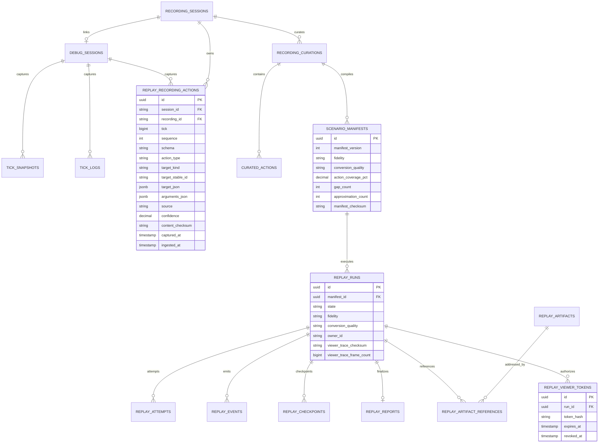

# ERD

V24 is additive. Enforce unique `(session_id,tick,sequence)`, bounded JSON payloads, and indexes `(recording_id,tick,sequence)` and `(session_id,tick,sequence)`. Never store plaintext viewer tokens.
