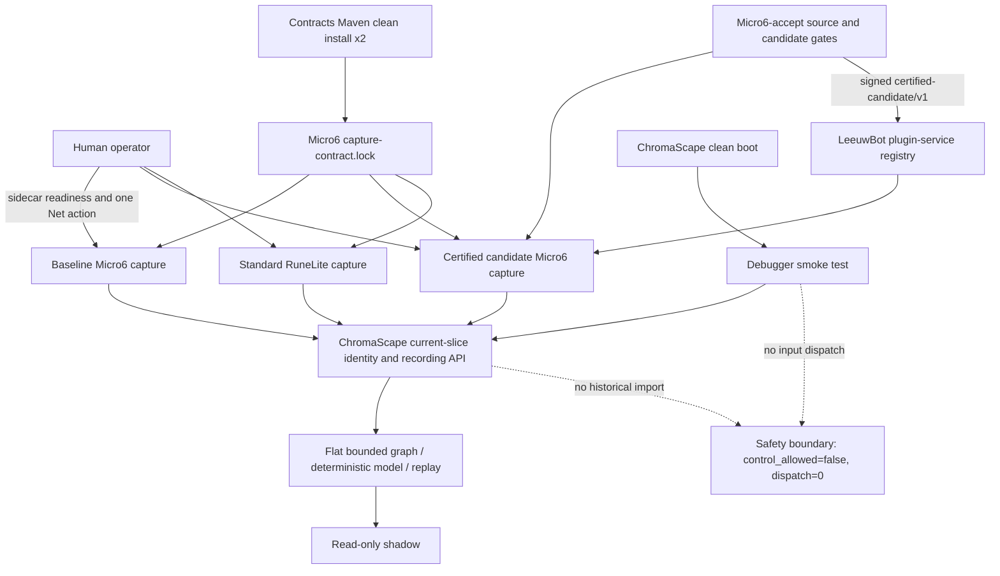

# Luna Max integrated delivery architecture

This is the authoritative design for the SC-1452/SC-967/SC-968 integrated verification run. All filesystem paths in evidence are Windows paths.

## Boundaries

- ChromaScape owns current-slice orchestration, debugger UI, recording/graph/replay/shadow evidence, and the final manifests.
- Contracts owns the versioned capture contract; its reproducible JAR is installed into isolated Maven repositories.
- Micro6-accept owns managed capture execution, revision-sensitive source manifests, stabilization provenance, candidate build gates, shadow JAR, and runtime SBOM.
- LeeuwBot owns candidate certification/registration/readback and preserves the opaque idempotency key.
- RuneLite owns the standard human-capture adapter; it does not claim Micro6 managed-executor capability.
- The human/sidecar is the only authority for login and one fishing action. AI Routine and replay/shadow are read-only.
- No path resolves an original dirty checkout implicitly. The runner receives explicit roots for every participant.

## State and failure policy

The acceptance state is monotonic per phase: readiness -> login -> recording -> one action -> completed. Any pre-prompt action, sequence greater than one, queued event, missing identity, stale revision, failed substantive gate, or uncertain external result aborts the run. Required artifacts are immutable after creation; reporter failures remain under diagnostics.

## Safety invariant

The integrated run must prove `FEATURES_AI_PLAYER_CONTROL=false`, `control_allowed=false`, and `control_dispatch_count=0` in manifests and every runtime artifact. Real Fishing publication remains fail-closed because the documented profile-derived and AccountConnector hashes have not been migrated.
