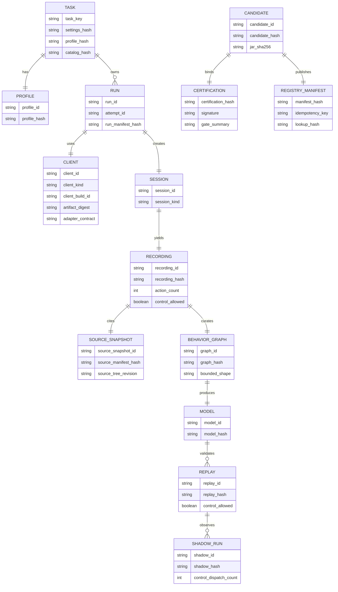

# Current-slice evidence model

No production schema migration is in scope. This ERD documents the logical entities that cross the current-build evidence boundary and the hashes that bind them.

All identifiers are immutable opaque IDs. Hash equality is byte/canonical-content equality; client kind is explicit and cannot be inferred or aliased.
