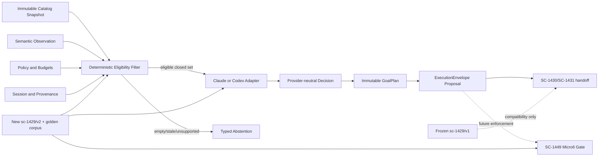

# SC-1429 recovered implementation specification

Felix task: `task_1788438246897_fzmkmv44`  
Shortcut: [SC-1429](https://app.shortcut.com/leeuwbot/story/1429)  
Classification: `change:multi-repo`  
Estimated Luna Max effort: about five focused hours  
Planning date: 2026-09-03

## 1. Objective and correction of scope

Complete the full amended SC-1429 provider-neutral contract without destabilizing the already-used bootstrap contract. The current `sc-1429/v1` schema and fixture are internally consistent and must remain byte-identical, but they do not model every amended Shortcut requirement. Add an additive `sc-1429/v2` contract that covers execution modes, an immutable task catalog, typed GoalPlan/TaskSkill references, deterministic eligibility, three independent confidence values, bounded tool operations, lifecycle evidence, and executable failure fixtures.

SC-1429 owns the semantic contract and conformance corpus. It does **not** own durable provider sessions (SC-1430), orchestration (SC-1431), trusted TaskSkill lifecycle (SC-1445), live Micro6 enforcement (SC-1449), the operator-authorized Fishing run (SC-1498), recording execution, learning, or activation.

The old plan incorrectly coupled SC-1429 completion to SC-1498 live acceptance. This recovered task separates them: SC-1429 is done when the contract is complete, frozen, mirrored, and executable as a conformance suite. Live delivery stays blocked downstream.

## 2. Current audit baseline

Preserve these existing files and pinned v1 bytes:

- `C:\Dev\IdeaProjects\ChromaScape\src\main\resources\contracts\gameplay\sc-1429-gameplay-contract-v1.schema.json`
- `C:\Dev\IdeaProjects\ChromaScape\src\main\resources\contracts\gameplay\sc-1429-golden-fixtures-v1.json`
- `C:\Dev\IdeaProjects\micro6\runelite-client\src\main\resources\gameplay-contract\sc-1429-gameplay-contract-v1.schema.json`
- `C:\Dev\IdeaProjects\micro6\runelite-client\src\main\resources\gameplay-contract\sc-1429-golden-fixtures-v1.json`

Pinned v1 SHA-256 values:

- Schema: `010cba11ada57f328b43968be894f4875edd2ef8ee582c6eb5a924153e461469`
- Fixture: `c55ad78af5b6367803bc7098e0ef0a03e03d8efff6465bd4eae7829aa743c19c`

Verified v1 currently supplies observation, Fishing semantic action, provider proposal, envelope, human authority, receipts, canonical digests, and 23 named cases. Gaps against the amended story are:

1. no explicit `SIMULATION | SHADOW | LIVE_TASK` mode;
2. no typed immutable catalog snapshot or exact per-task settings schema;
3. no concrete GoalPlan or ordered TaskSkill reference structures—only digests in the envelope;
4. no deterministic capability/prerequisite eligibility result;
5. decision output does not carry adapter-observation and knowledge-freshness confidence separately;
6. no provider-neutral policy/session/provenance input bundle;
7. no closed six-operation tool contract;
8. fixture case rows are descriptions, not all independently executed one-field mutations;
9. no full v2 cross-repository canonical-digest proof;
10. SC-1429 and SC-1498 completion gates are conflated in older evidence.

## 3. Architecture



Ownership:

| Component | Owner | This task |
|---|---|---|
| Contract schema, canonicalization rules, fixtures, stable failures | SC-1429 | Implement |
| Claude/Codex decision-only conformance adapters | SC-1429/SC-1430 boundary | Implement fixture normalization only |
| Durable provider execution/session persistence | SC-1430 | Excluded |
| Bounded orchestration, recovery, authority reconstruction | SC-1431 | Excluded |
| TaskSkill maturity and trusted artifact lifecycle | SC-1445 | Referenced by identity/digest only |
| Live gate, reserve/dispatch/fence enforcement | SC-1449 | Excluded |
| Human approval and real Fishing recording | SC-1498 | Excluded |

## 4. Version and compatibility rules

- Never edit either v1 resource. Tests must continue pinning their existing hashes.
- Define `sc-1429/v2` as a new contract version. Do not call it v1.1 and do not reinterpret old v1 payloads.
- v2 is the canonical complete SC-1429 contract for new downstream work.
- Existing v1 bootstrap code remains readable and unchanged. This task must not make v1 automatically live-authorized.
- No implicit v1-to-v2 conversion is allowed for live delivery. If a compatibility mapper is useful for tests, it must return `HELD`, mark the source version, and require a fresh v2 decision/envelope/authority before future live delivery.
- Canonicalization remains UTF-8 JSON, recursively lexicographic object keys, preserved array order, no insignificant whitespace, lowercase `sha256:` digests.
- Arrays whose order is semantically meaningful—GoalPlan nodes, TaskSkill refs, evidence refs, receipts—must retain order in digest calculation.

## 5. v2 semantic contract

### 5.1 Common primitives

Use closed objects with `additionalProperties: false` for security-sensitive definitions. Define reusable token, SHA-256 digest, timestamp, evidence reference, revision, identity, and budget types. Tokens must not carry file paths, commands, URLs with credentials, or arbitrary code.

### 5.2 ExecutionMode

`SIMULATION | SHADOW | LIVE_TASK`

- `SIMULATION`: xRSPS/non-live evidence only; cannot carry human live authority or enter Micro6.
- `SHADOW`: permits observe/catalog/decision/status evaluation only; reservation and start are invalid.
- `LIVE_TASK`: still only a proposal at the provider boundary. Downstream authorization and SC-1449 enforcement are mandatory before state change.

### 5.3 ImmutableTaskCatalogSnapshot

Required fields:

- `contractVersion`, `catalogId`, `catalogRevision`, `catalogDigest`, `capturedAt`;
- `executorArtifactId`, `executorBuildId`, `pluginId`;
- exact `capabilitySnapshotDigest`;
- ordered `tasks`.

For v2, the only live-bootstrap catalog member is a discriminated `FISHING_TRAINING` task with:

- exact settings schema: `targetLevel: 2..99`, `areaPolicy: LUMBRIDGE | DRAYNOR | BARBARIAN_VILLAGE`;
- required semantic capabilities;
- prerequisites and preconditions;
- permitted expected transitions;
- verifier IDs;
- maximum policy bounds.

Do not combine unrelated task settings under a loose object. Future tasks require new discriminated variants and a contract version review.

### 5.4 SemanticObservation

Retain v1 identity and semantic player fields, then add:

- `mode`;
- `capabilitySnapshotDigest`;
- `policyDigest` and `knowledgeDigest`;
- explicit freshness/completeness metadata;
- separate `adapterObservationConfidence` and `knowledgeFreshnessConfidence`;
- current catalog, task and observation revisions.

It is read-only evidence and contains no authority handle, raw input handle, reflection method, client object, socket, or executable command.

### 5.5 PlanningInput

One immutable provider input object binds:

- mode;
- catalog snapshot digest and observation digest;
- eligible task keys and rejected eligibility entries with stable reason codes;
- policy/budgets/deadline;
- account, client, environment, run, task, session, recording and source identities;
- provider-neutral provenance references;
- prompt schema/version identity.

The provider sees only the deterministic eligible set. It cannot resurrect a filtered task.

### 5.6 EligibilityResult

The deterministic filter runs before either provider adapter. For each task, emit `ELIGIBLE` or one closed reason:

- `NO_ELIGIBLE_TASK`
- `STALE_OBSERVATION`
- `STALE_KNOWLEDGE`
- `UNSUPPORTED_CAPABILITY`
- `PREREQUISITE_UNMET`
- `POLICY_DENIED`
- `BUDGET_EXHAUSTED`
- `IDENTITY_MISMATCH`

No eligibility result grants execution authority.

### 5.7 GoalPlan and TaskSkillRef

A `GoalPlan` is immutable and bounded:

- `goalPlanId`, `goalPlanDigest`, mode, identities and source decision;
- one to sixteen ordered nodes;
- aggregate action/attempt/elapsed budgets;
- deadline and terminal objective;
- no loops or unbounded fallback.

Each node contains:

- stable `nodeId` and ordinal;
- closed AccountBuilder `taskKey`;
- ordered `TaskSkillRef` values with `taskSkillId`, version, artifact digest, maturity, capability requirements and provenance;
- exact task settings;
- prerequisite node IDs;
- semantic preconditions;
- expected observation/task revisions;
- expected transition and verifier;
- per-node bounded budgets;
- at most one bounded fallback node;
- evidence references and stable abstention/failure reason.

SC-1429 validates shape and binding. SC-1445 later proves whether a TaskSkill may be `TRUSTED`; fixture maturity must not be treated as live certification.

### 5.8 ProviderDecision

Two closed variants:

- `SELECTED`: provider, exact model/version, decision/prompt IDs, `policyConfidence`, `adapterObservationConfidence`, `knowledgeFreshnessConfidence`, eligible input digest, GoalPlan, evidence references.
- `ABSTAINED`: the same provenance/confidence binding plus a stable abstention reason; no GoalPlan or action.

Claude and Codex may differ only in provider/model/transcript provenance. Equivalent eligible inputs must normalize to the same provider-neutral GoalPlan and semantic action digest.

### 5.9 ExecutionEnvelope

Retain v1 bindings and add:

- explicit mode;
- concrete catalog, eligibility, planning-input, GoalPlan and ordered TaskSkill digests;
- provider decision and prompt identities;
- executor artifact/plugin/capability snapshot identities;
- exact observation/catalog/task revisions;
- authority reference only for `LIVE_TASK`;
- bounded operation, attempt and elapsed budgets.

Changing any field changes the digest. v2 envelope acceptance in this task means schema/conformance acceptance only, not Micro6 delivery.

### 5.10 Tool operations

The provider-neutral operation vocabulary is exactly:

- `CATALOG`
- `RESERVE`
- `START`
- `STATUS`
- `STOP`
- `OBSERVE`

Operation request/response objects carry request/idempotency identities, mode, deadline, lease/fence where applicable, and semantic payloads only. `SIMULATION` and `SHADOW` reject `RESERVE` and `START`. No operation accepts coordinates, mouse/keyboard input, packet data, arbitrary methods, scripts, reflection selectors, WebSockets, filesystem commands, or tick mutation.

### 5.11 Lifecycle receipts and outcomes

Represent validation, authorization, reservation, dispatch acknowledgement, activation, progress, AccountBuilder terminal state, transition verification, and finalization independently.

Outcomes remain:

`HELD | DELIVERED | CONFIRMED | REFUTED | UNVERIFIABLE | UNCERTAIN_OUTCOME | ABSTAINED | DENIED | FAILED | STOPPED`

Rules:

- acknowledgement is never `CONFIRMED`;
- `UNVERIFIABLE` is neither success nor failure;
- ambiguous delivery/completion is `UNCERTAIN_OUTCOME` and is not automatically retried;
- `CONFIRMED` requires verifier evidence bound to the expected transition;
- failure code, retry allowance, evidence references, envelope digest and request identity are mandatory where applicable.

## 6. API contract projection

This OpenAPI fragment is a conformance projection of the six semantic operations, not authorization to add public HTTP endpoints. Existing controllers must not be changed merely to satisfy this document.

```yaml
openapi: 3.1.0
info:
  title: SC-1429 v2 provider-neutral gameplay operations
  version: 2.0.0
paths:
  /gameplay/v2/catalog:
    get:
      operationId: catalog
      responses:
        "200": {description: Immutable catalog snapshot}
  /gameplay/v2/reservations:
    post:
      operationId: reserve
      responses:
        "200": {description: HELD reservation receipt}
        "409": {description: Identity, lease, fence, policy, or mode denial}
  /gameplay/v2/executions:
    post:
      operationId: start
      responses:
        "202": {description: Delivery acknowledgement, never verifier success}
  /gameplay/v2/executions/{requestId}:
    get:
      operationId: status
      parameters:
        - {in: path, name: requestId, required: true, schema: {type: string}}
      responses:
        "200": {description: Structured lifecycle state}
  /gameplay/v2/executions/{requestId}/stop:
    post:
      operationId: stop
      responses:
        "202": {description: Stop intent accepted; effectiveness still requires evidence}
  /gameplay/v2/observations/{clientId}:
    get:
      operationId: observe
      parameters:
        - {in: path, name: clientId, required: true, schema: {type: string}}
      responses:
        "200": {description: Read-only semantic observation}
```

## 7. Exact file plan

### ChromaScape — create

- `C:\Dev\IdeaProjects\ChromaScape\src\main\resources\contracts\gameplay\sc-1429-gameplay-contract-v2.schema.json`
- `C:\Dev\IdeaProjects\ChromaScape\src\main\resources\contracts\gameplay\sc-1429-golden-fixtures-v2.json`
- `C:\Dev\IdeaProjects\ChromaScape\src\main\java\com\chromascape\web\gameplay\contract\v2\GameplayV2Contracts.java`
- `C:\Dev\IdeaProjects\ChromaScape\src\main\java\com\chromascape\web\gameplay\contract\v2\GameplayV2ContractValidator.java`
- `C:\Dev\IdeaProjects\ChromaScape\src\main\java\com\chromascape\web\gameplay\contract\v2\GameplayV2EligibilityFilter.java`
- `C:\Dev\IdeaProjects\ChromaScape\src\main\java\com\chromascape\web\gameplay\provider\v2\GameplayV2ProviderAdapter.java`
- `C:\Dev\IdeaProjects\ChromaScape\src\main\java\com\chromascape\web\gameplay\provider\v2\ClaudeGameplayV2ProviderAdapter.java`
- `C:\Dev\IdeaProjects\ChromaScape\src\main\java\com\chromascape\web\gameplay\provider\v2\CodexGameplayV2ProviderAdapter.java`
- `C:\Dev\IdeaProjects\ChromaScape\src\test\java\com\chromascape\web\gameplay\contract\v2\GameplayV2ContractConformanceTest.java`
- `C:\Dev\IdeaProjects\ChromaScape\src\test\java\com\chromascape\web\gameplay\contract\v2\GameplayV2MutationMatrixTest.java`
- `C:\Dev\IdeaProjects\ChromaScape\src\test\java\com\chromascape\web\gameplay\contract\v2\GameplayV2EligibilityFilterTest.java`
- `C:\Dev\IdeaProjects\ChromaScape\src\test\java\com\chromascape\web\gameplay\provider\v2\GameplayV2ProviderEquivalenceTest.java`

### ChromaScape — inspect but preserve behavior

- `C:\Dev\IdeaProjects\ChromaScape\src\main\java\com\chromascape\web\gameplay\contract\CanonicalGameplayJson.java`
- `C:\Dev\IdeaProjects\ChromaScape\src\main\java\com\chromascape\web\gameplay\contract\GameplayContracts.java`
- `C:\Dev\IdeaProjects\ChromaScape\src\main\java\com\chromascape\web\gameplay\contract\GameplayContractValidator.java`
- `C:\Dev\IdeaProjects\ChromaScape\src\test\java\com\chromascape\web\gameplay\contract\GameplayContractConformanceTest.java`

Reuse `CanonicalGameplayJson` only if it preserves the pinned v1 digests. Do not change existing v1 records or controller/orchestration behavior.

### Micro6 — create

- `C:\Dev\IdeaProjects\micro6\runelite-client\src\main\resources\gameplay-contract\sc-1429-gameplay-contract-v2.schema.json`
- `C:\Dev\IdeaProjects\micro6\runelite-client\src\main\resources\gameplay-contract\sc-1429-golden-fixtures-v2.json`
- `C:\Dev\IdeaProjects\micro6\runelite-client\src\main\java\net\runelite\client\plugins\microbot\accountbuilder\integration\builder\gameplay\contract\GameplayContractV2Validator.java`
- `C:\Dev\IdeaProjects\micro6\runelite-client\src\test\java\net\runelite\client\plugins\microbot\accountbuilder\integration\builder\gameplay\contract\GameplayContractV2ConformanceTest.java`

### Micro6 — update only for resource pinning

- `C:\Dev\IdeaProjects\micro6\runelite-client\src\test\java\net\runelite\client\plugins\microbot\accountbuilder\integration\builder\gameplay\GameplayContractResourceEqualityTest.java`

Do not modify `C:\Dev\IdeaProjects\micro6\runelite-client\src\main\java\net\runelite\client\plugins\microbot\accountbuilder\integration\builder\gameplay\GameplayEnvelopeGate.java` in this task. That is SC-1449 live-enforcement scope. The v2 validator is contract conformance only.

## 8. Golden fixture corpus

The v2 fixture manifest must contain canonical valid objects and expected digests for:

1. Fishing catalog snapshot;
2. complete semantic observation;
3. planning input and eligibility result;
4. equivalent Claude and Codex selected decisions;
5. provider abstention;
6. one-node GoalPlan and ordered TaskSkillRef;
7. HELD execution envelope;
8. DELIVERED lifecycle receipt;
9. CONFIRMED, REFUTED, UNVERIFIABLE and UNCERTAIN_OUTCOME terminal receipts;
10. stop and kill intent/effect evidence.

Add named negative cases that mutate exactly one field and assert both outcome and stable failure code:

- unknown field;
- unsupported action/task;
- task settings unknown property;
- out-of-range target level;
- missing/stale capability snapshot;
- prerequisite unmet;
- no eligible task;
- stale observation;
- stale knowledge;
- mismatched catalog, policy, knowledge, GoalPlan or TaskSkill digest;
- duplicate node ordinal;
- cyclic/unbounded fallback;
- confidence missing or out of bounds;
- observation/task revision mismatch;
- deadline expired;
- budget exhausted;
- lease/fence invalid;
- authority missing/changed/expired/reused;
- simulator identity presented for live authority;
- identical idempotent reconciliation;
- conflicting idempotency reuse;
- acknowledgement mislabeled CONFIRMED;
- verifier mismatch;
- missing evidence producing UNVERIFIABLE;
- disconnect-after-delivery producing non-retryable UNCERTAIN_OUTCOME;
- forbidden raw capability/property.

The test must execute mutations. A string such as `replace:path=value` is not coverage unless the harness actually applies it and validates the result.

## 9. Implementation sequence

1. Snapshot the scoped worktree and preserve unrelated user changes. Record v1 hashes before editing.
2. Convert the amended Shortcut text into the v2 JSON Schema definitions above.
3. Build the valid v2 fixture manifest; calculate expected canonical digests once from the final canonical objects.
4. Add ChromaScape v2 records/enums and validator. Keep these immutable and avoid framework coupling where possible.
5. Implement the deterministic eligibility filter; provider adapters receive only its closed eligible output.
6. Implement Claude/Codex fixture adapters and prove normalized equivalence.
7. Add the executable one-field mutation matrix and forbidden-surface assertions.
8. Copy the two finalized v2 resource bytes to Micro6; never hand-edit the mirror independently.
9. Add the Micro6 structural validator and conformance tests without wiring it to dispatch.
10. Extend the cross-repository equality test to pin v2 hashes while retaining v1 pins.
11. Run ChromaScape v1 + v2 focused tests, compile, Checkstyle, and scoped diff checks.
12. Run native-Windows Micro6 v1 + v2 focused tests and compilation.
13. Create an implementation-evidence note listing commands, counts, hashes, changed files, failures, and scope exclusions.
14. Post a truthful SC-1429 Shortcut handoff. Close only if all contract gates pass; leave SC-1430, SC-1431, SC-1445, SC-1449 and SC-1498 unclaimed.

## 10. Verification commands

From native Windows:

```bat
cd /d C:\Dev\IdeaProjects\ChromaScape
gradlew.bat test --tests "com.chromascape.web.gameplay.contract.*" --tests "com.chromascape.web.gameplay.contract.v2.*" --tests "com.chromascape.web.gameplay.provider.v2.*"
gradlew.bat compileJava compileTestJava checkstyleMain checkstyleTest
git diff --check -- src/main/resources/contracts/gameplay src/main/java/com/chromascape/web/gameplay/contract src/main/java/com/chromascape/web/gameplay/provider/v2 src/test/java/com/chromascape/web/gameplay/contract src/test/java/com/chromascape/web/gameplay/provider/v2
```

```bat
cd /d C:\Dev\IdeaProjects\micro6
gradlew.bat :runelite-client:test --tests "net.runelite.client.plugins.microbot.accountbuilder.integration.builder.gameplay.GameplayContractResourceEqualityTest" --tests "net.runelite.client.plugins.microbot.accountbuilder.integration.builder.gameplay.contract.GameplayContractV2ConformanceTest"
gradlew.bat :runelite-client:compileJava :runelite-client:compileTestJava
git diff --check -- runelite-client/src/main/resources/gameplay-contract runelite-client/src/main/java/net/runelite/client/plugins/microbot/accountbuilder/integration/builder/gameplay/contract runelite-client/src/test/java/net/runelite/client/plugins/microbot/accountbuilder/integration/builder/gameplay
```

Required assertions:

- both old v1 hashes unchanged;
- both v2 resource hashes pinned and equal across repositories;
- every valid fixture accepted by both validators;
- every negative fixture executed and rejected with the same stable code;
- Claude/Codex normalized decisions equivalent;
- mode restrictions enforced;
- eligibility precedes provider selection;
- no forbidden raw tool/property exists;
- compilation and scoped style/diff checks pass.

WSL-only parsing is not a substitute for the native-Windows Micro6 test gate.

## 11. Failure handling

| Failure | Required behavior |
|---|---|
| v1 hash changes | Stop; restore only the accidental scoped edit without touching unrelated work |
| v2 mirror drift | Fail the equality test; copy from the canonical finalized ChromaScape resource |
| Schema accepts unknown security field | Tighten the relevant closed definition and add regression mutation |
| Validators return different codes | Treat contract as unfinished; reconcile to one pinned code |
| Provider can select filtered task | Fail closed; move eligibility ahead of adapter invocation |
| Canonical digest differs | Do not update expected values blindly; identify number/date/key/order divergence |
| Native Micro6 test cannot run | Keep task todo/in progress and record exact blocker; do not close SC-1429 |
| Existing unrelated suite failure | Record baseline command/test identity; scoped failures still block this task |
| Dirty worktree overlaps | Preserve user changes and make narrow additive edits; stop if safe separation is impossible |

## 12. Ai_Boting_DreamBot reference boundary

Pinned reference: `C:\Dev\aibot\Ai_Boting_DreamBot` at `bea5c5943cda8d46083593f8ed924e7f87411416`.

Adopt only these behavioral ideas:

- explicit state/strategy decomposition;
- operator-visible progress and stop intent;
- transport-fault fixtures for malformed, late, duplicate, out-of-order, lost, wrong-identity and ambiguous responses;
- bounded semantic precondition → action → observation → verification scenarios.

Reject and do not copy:

- direct movement/object/item mutation tools;
- `call_java_method` or reflection-selected dispatch;
- timestamp-only request identity;
- shared response pipes/files;
- direct mutation from transport threads;
- unlimited retry;
- string-level success;
- in-memory authority/skip state;
- DreamBot as a second executor.

The root/DreamBot code is unlicensed and is behavior/test-reference only. This task creates no DreamBot runtime dependency.

## 13. Exit criteria and downstream handoff

SC-1429 may move to review/done only when:

- v1 resources remain byte-identical and v1 focused tests pass;
- v2 schema and fixture corpus are committed as complete artifacts in both repositories;
- ChromaScape and native-Windows Micro6 conformance suites pass;
- every advertised negative case is executable;
- canonical hashes and stable failure codes agree;
- Claude/Codex equivalence and deterministic pre-filtering are proven;
- the evidence note states that no gameplay was dispatched;
- Shortcut receives the evidence link and version/hashes.

Then:

1. SC-1430 migrates its durable provider runtime to v2 input/decision output.
2. SC-1431 adds explicit v2 orchestration acceptance while preserving its recovery invariants.
3. SC-1445 supplies genuinely verified TaskSkill maturity.
4. SC-1449 implements the v2 live gate.
5. Parent SC-1431 is closed only after those dependencies.
6. SC-1498 performs the separate exact human-gated Fishing recording.

No completion is claimed here for any downstream story.
