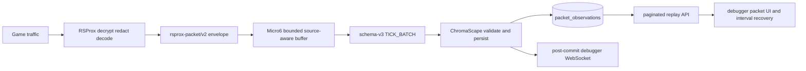
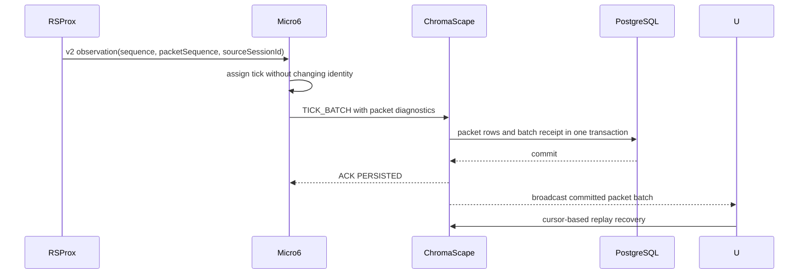

# SC-1618 Architecture

The packet path is observational only. Raw sanitized bytes are disabled by default, packets are not forwarded to the Go backend by default, and no packet injection or replay-to-game is in scope.
