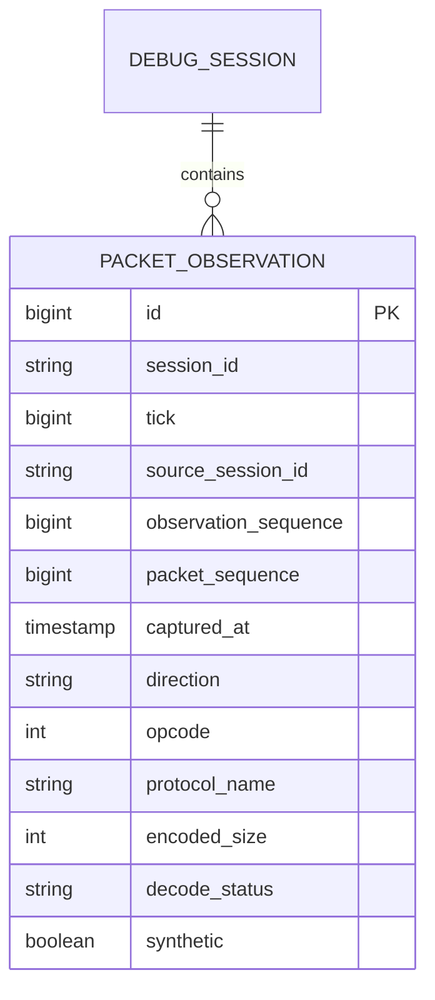

# SC-1618 ERD

The v2 uniqueness boundary is session plus source session plus observation identity. Real packets retain capture identity; GAPs have no packet sequence. Query ordering is deterministic and matches the replay cursor.
