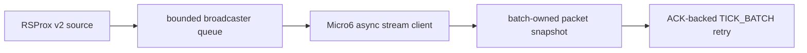

# SC-1618 transport architecture

The transport preserves v1 semantics separately from v2 observation identity, keeps source-scoped GAP diagnostics, and never lets pre-accept rejection or terminal failure double-own a batch.
