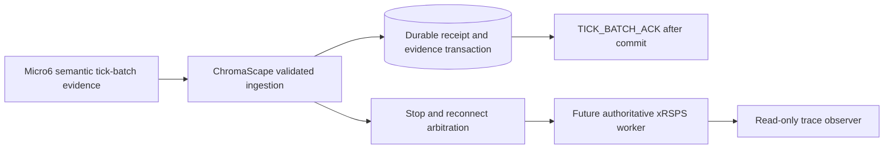

## Architecture

## Durability boundary

Micro6 retains bounded serialized batches until a durable ChromaScape acknowledgement. ChromaScape converges equivalent duplicate identities, rejects conflicting batch reuse, commits evidence before acknowledgement, and keeps stop delivery deferred until retained acknowledgements drain.

## Remaining vertical slice

The authoritative xRSPS adapter, complete semantic action coverage, viewer, differential proof, and final certification remain outside this durability closure. Replay and worker flags remain disabled and `controlAllowed=false` remains invariant.
