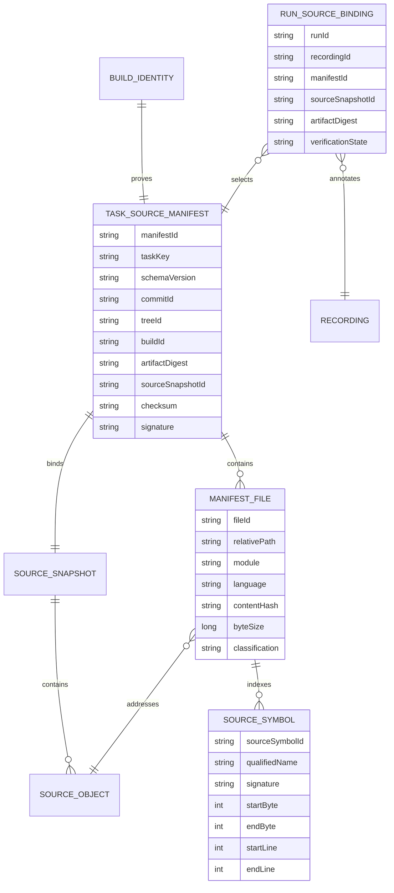

Reproduced from the SC-810 planning note (`note_1787866248248_c4812448`) — unchanged, no new
schema decision this session (no migration was added or altered for SC-810 this session).

`RUN_SOURCE_BINDING` (atomic binding of a genuine run/recording to a manifest+snapshot) remains
unexercised against a real run this session — blocked on the still-unauthorized account-record
migration (Phase 10/11 in `docs/sc810-evidence/sc810-remaining-work-plan-20260911.md`).
