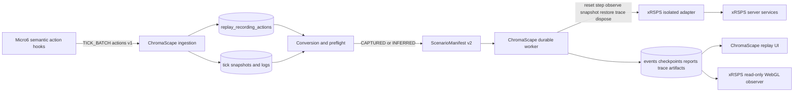
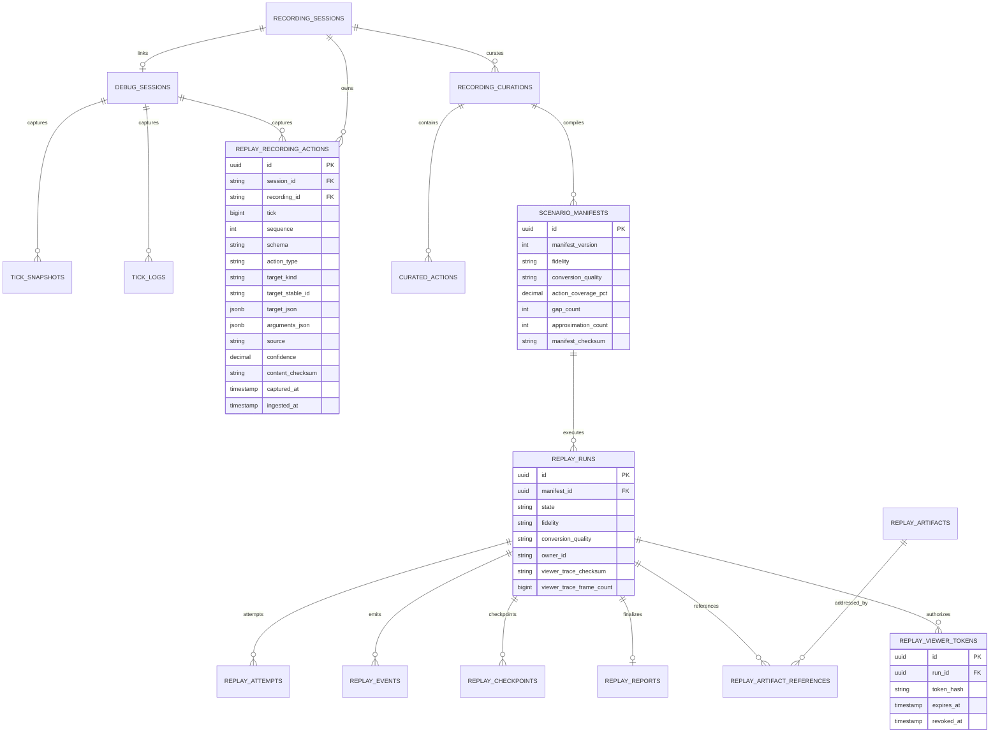

## Task resolution

Resolve `task_1788137869927_5y6pxvp` in the canonical Felix project `C:\Dev\IdeaProjects\ChromaScape`.
If the task lookup is unavailable, search the project by the stable tag `shortcut:sc-1199`; never
create a second task. The task is a `shortcut_delivery` task for Shortcut
[SC-1199](https://app.shortcut.com/leeuwbot/story/1199),
`REPLAY-12: ChromaScape recording to xRSPS replay vertical slice`.

The currently verified external state is Felix task status `todo`, spec state `spec_ready`, assigned
to Luna Max, and Shortcut state `To Do` (`500000007`) with the story marked blocked by its upstream
dependencies. The authoritative Felix note is `note_1788138097588_74b34580`; linked design notes are
Architecture `note_1788138167233_b06a9854`, ERD `note_1788138167342_1d11d77c`, and API Contract
`note_1788138167592_fdcc4f3a`.

Classification is exactly `change:multi-repo`. The owning project identity is ChromaScape, while the
implementation spans these repositories:

- `C:\Dev\IdeaProjects\ChromaScape`
- `C:\Dev\IdeaProjects\micro6`
- `C:\Dev\IdeaProjects\xrsps-typescript`

### Scope

Deliver typed semantic action capture, append-only action storage, deterministic legacy conversion,
provenance and gaps, ScenarioManifest v2, capability/runtime validation, durable xRSPS orchestration,
immutable trace/report artifacts, authenticated viewer APIs, a read-only xRSPS WebGL observer, and the
ChromaScape Replay UI flow.

### Exclusions and safety boundaries

Do not replay raw mouse or keyboard events, RuneLite packets, WebSocket frames, or binary protocol
messages. Do not add Micro6/live-game control, OpenRune fallback, SQLite replay accounts, autosave, a
real-time simulation timer, model training or activation, deployment, or default-enabled replay. The
headless worker is the authority; the browser viewer is read-only and must keep `controlAllowed=false`.

## Note payload

This is the complete authoritative plan payload needed to reconstruct the existing Felix
specification if the task record is unavailable. Do not replace the already-created primary note when
replaying this record.

### Purpose and outcomes

The delivery is complete only when a finalized ChromaScape recording can be launched with one operator
action, executed by an authoritative xRSPS service, watched in the xRSPS WebGL client, recovered after
refresh/restart, and inspected through deterministic artifacts. Observed video/frame/log playback stays
available as a comparison surface and is never simulation state.

The supported outcomes are:

- `CERTIFIED`: complete typed semantic capture, pinned authoritative xRSPS runtime, deterministic and
  differential gates pass, and no gap or approximation exists.
- `BEST_EFFORT`: legacy evidence was inferred or approximated; it is watchable with every gap disclosed
  and certification is permanently prohibited for that run.
- `UNSUPPORTED`: evidence cannot produce a meaningful action sequence or initial state; observed
  playback remains available.

### Architecture and trust boundaries



Micro6 is an evidence producer, never an executor. ChromaScape owns validation, persistence,
authentication, idempotency, leases, artifacts, and viewer-token issuance. xRSPS runs in an isolated
replay context with a replay-only identity, scoped world state, virtual clock, seeded RNG, deterministic
ID namespace, no sockets, no login, no SQLite, no autosave, no global ticker, and no normal-player access.
The viewer can fetch immutable trace pages and change only local presentation.

### ERD design artifact



V24 is additive. Enforce unique `(session_id,tick,sequence)`, bounded JSON payloads, and indexes
`(recording_id,tick,sequence)` and `(session_id,tick,sequence)`. Never store plaintext viewer tokens.

### API contract design artifact

```yaml
openapi: 3.1.0
info:
  title: ChromaScape Authoritative xRSPS Replay
  version: 2.0.0
paths:
  /api/replay/v2/recordings/{recordingId}/preflight:
    get:
      summary: Preview conversion, fidelity eligibility, action coverage, gaps, and runtime compatibility
  /api/replay/v2/recordings/{recordingId}/xrsps-runs:
    post:
      summary: Convert, compile, and queue an authoritative or best-effort xRSPS replay
      requestBody:
        required: true
        content:
          application/json:
            schema: { $ref: '#/components/schemas/CreateXrspsRunRequest' }
      responses:
        '201': { description: Run created }
        '200': { description: Existing idempotent run returned }
        '409': { description: Conflicting idempotency key or immutable evidence conflict }
        '422': { description: Unsupported recording }
        '503': { description: Authoritative xRSPS capability unavailable }
  /api/replay/v2/runs/{runId}:
    get: { summary: Get durable owned run state }
  /api/replay/v2/runs/{runId}/events:
    get: { summary: Get ordered events after an ordinal with bounded limit }
  /api/replay/v2/runs/{runId}/report:
    get: { summary: Get terminal report and content-addressed artifact references }
  /api/replay/v2/runs/{runId}/viewer-session:
    post:
      summary: Mint a short-lived read-only xRSPS WebGL viewer launch URL
      responses:
        '201': { description: Viewer URL and expiry }
        '409': { description: No verified trace available }
  /api/replay/v2/runs/{runId}/viewer/frames:
    get:
      summary: Read content-verified trace frames using owner auth or viewer token
      parameters:
        - { in: query, name: cursor, schema: { type: string } }
        - { in: query, name: limit, schema: { type: integer, minimum: 1, maximum: 500, default: 100 } }
      responses:
        '200': { description: Trace frame page }
        '410': { description: Viewer token expired or revoked }
components:
  schemas:
    CreateXrspsRunRequest:
      type: object
      additionalProperties: false
      required: [conversionMode, openViewer, stopPolicy, idempotencyKey]
      properties:
        conversionMode: { enum: [AUTO, CAPTURED_ONLY, LEGACY_BEST_EFFORT] }
        openViewer: { type: boolean }
        stopPolicy: { enum: [STOP_ON_FIRST_HARD, RUN_TO_END] }
        idempotencyKey: { type: string, minLength: 8, maxLength: 128 }
    XrspsRun:
      type: object
      required: [schema, runId, state, fidelity, conversionQuality, controlAllowed, gaps, viewerAvailable]
      properties:
        schema: { const: xrsps-replay-run/v2 }
        runId: { type: string, format: uuid }
        state: { enum: [QUEUED, CLAIMED, STARTING, RUNNING, CANCELLING, SUCCEEDED, FAILED, CANCELLED, TIMED_OUT] }
        fidelity: { enum: [SYNTHETIC_CONTRACT, XRSPS_AUTHORITATIVE] }
        conversionQuality: { enum: [CERTIFIED, BEST_EFFORT, UNSUPPORTED] }
        controlAllowed: { const: false }
        actionCoveragePct: { type: number, minimum: 0, maximum: 100 }
        gaps: { type: array, items: { $ref: '#/components/schemas/ReplayGap' } }
        viewerAvailable: { type: boolean }
    ReplayGap:
      type: object
      required: [tick, code, message, provenance]
      properties:
        tick: { type: integer, format: int64 }
        code: { type: string }
        message: { type: string }
        provenance: { enum: [CAPTURED, INFERRED, OPERATOR_SUPPLIED, DEFAULTED] }
    TraceFramePage:
      type: object
      required: [schema, runId, frames, hasMore]
      properties:
        schema: { const: xrsps-replay-trace-page/v1 }
        runId: { type: string, format: uuid }
        frames: { type: array, items: { type: object } }
        nextCursor: { type: [string, 'null'] }
        hasMore: { type: boolean }
```

All endpoints require owner authentication except frame reads with a valid short-lived run-scoped
viewer token. Cursors are opaque, mutation endpoints are idempotent, and stable errors include a code,
retryability, message, and remediation.

### UI design artifact

The `/replay` operator surface has explicit loading, empty, blocked-preflight, queued/running,
completed-with-viewer, failed, cancelled, mismatch, and report-download states. The primary action is
`Replay in xRSPS`. Observed playback and simulated state are separate columns aligned by relative tick.
The observer route has loading, invalid-token, empty-trace, WebGL-unavailable, and ready states; ready
shows the trace stage, run/checksum, source action, player position, hashes, semantic effects, and local
pause/play, speed, and seek controls. No UI state or control changes the durable run.

### Recording action contract

Extend `TICK_BATCH` with an always-present `actions` array. Each `recording-action/v1` envelope contains
the session ID, tick, same-tick sequence, closed `actionType`, stable target, canonical arguments,
`MICRO6_SEMANTIC_DISPATCH` source, confidence, and capture timestamp. The v1 action set is:
`WAIT_UNTIL_TICK`, `WALK_TO`, `INTERACT_NPC`, `INTERACT_OBJECT`, `INTERACT_GROUND_ITEM`,
`INTERACT_INVENTORY_ITEM`, `INTERACT_WIDGET`, `SELECT_DIALOGUE_OPTION`, `CAST_SPELL`, and `EQUIP_ITEM`.

Capture occurs at semantic dispatch boundaries before submission, never from coordinates. Stable targets
include definition ID plus world position/plane and an occurrence discriminator where needed. ChromaScape
validates ownership, bounds, sequence, closed enums, canonical arguments, and payload size. Persistence
is idempotent on `(session_id,tick,sequence)`; identical duplicates are accepted and conflicting
duplicates fail closed.

### Persistence and conversion

V24 is additive and stores the action identity, recording/session IDs, tick and sequence, schema,
action/target/arguments JSON, source, confidence, capture/ingest timestamps, and content checksum. It
adds uniqueness on `(session_id,tick,sequence)` and lookup indexes on recording and session order.
V25/V26 add manifest/run/report fidelity and viewer metadata plus request idempotency without storing
plaintext viewer tokens.

The converter orders legacy evidence by `(tick,log_id)`. It emits an exact inferred action only when
event type, stable target, option/arguments, and tick are valid. Position deltas may emit a disclosed
`WALK_TO` approximation. Dialogue/varbit consequences remain expectations unless a dispatch log
identifies the action. Unknown logs remain source evidence and are never fabricated into supported
actions. Every field retains `CAPTURED`, `INFERRED`, `OPERATOR_SUPPLIED`, or `DEFAULTED` provenance;
anything other than fully captured forces `BEST_EFFORT`.

### Manifest, capability, worker, and trace contract

`ScenarioManifest/v2` contains recording/session and curation checksums, compiler version, runtime pins,
deterministic seed and virtual clock, canonical initial state, ordered semantic actions, expectations,
conversion summary, fidelity, and `controlAllowed=false`. Compilation rejects corrupt order, conflicting
duplicates, unresolved targets, missing required state, required tick gaps, unsupported captured actions
for certification, and runtime identity mismatch. Best-effort gaps are explicit and nonexecuted.

Capabilities expose `SYNTHETIC_CONTRACT` or `XRSPS_AUTHORITATIVE`, supported actions, the
`xrsps-replay-trace/v1` viewer schema, exact build/cache/content identity, and closed mode flags.
Synthetic or non-certifiable capability must fail closed before a certified run mutates persistence.
The worker uses only `reset/step/observe/snapshot/restore/trace/dispose`, emits canonical observations,
ordered effects, a state hash chain, mismatch evidence, and a terminal reason. Viewer trace frames are
canonical, paginated, content-addressed, and linked to the terminal report.

### Visual and ChromaScape flow

`POST /api/replay/v2/recordings/{recordingId}/xrsps-runs` accepts `conversionMode`, `openViewer`,
`stopPolicy`, and an idempotency key. Supporting endpoints expose preflight, durable run state/events,
report/artifacts, a short-lived run-scoped viewer session, and authenticated paginated trace frames.
The `/replay` page offers `Replay in xRSPS`, shows separate eligibility and conversion quality, displays
gaps and runtime pins, aligns observed and simulated timelines by relative tick, and keeps browser state
out of authority. Viewer controls are pause, speed, seek, and timeline presentation only.

Failure behavior is deterministic: invalid evidence is `UNSUPPORTED` or `BEST_EFFORT`; unavailable or
synthetic capability is rejected; worker crash/timeout/malformed output produces a terminal failure;
viewer failure does not change the run; corrupt pages fail content verification; retry/restore pin
mismatch fails closed; cancellation marks partial trace incomplete; and restart recovers only valid
lease/checkpoint state.

## Checklist reconciliation

Replay must preserve existing task content and reconcile by the exact canonical checklist names below.
The implementation and test states are intentionally not all complete; do not check an item without the
evidence named in the item.

### Acceptance Criteria

| Checked | Item |
| --- | --- |
| false | Given one curated finalized Fishing recording with complete typed actions, When the operator starts Replay in xRSPS, Then one durable run completes the full flow and exposes its report and viewer. |
| false | Given the same immutable manifest and pinned runtime input, When it is replayed repeatedly, Then ordered actions, events, state hashes, trace checksum, report, and terminal outcome are identical. |
| false | Given an incomplete recording, When the operator runs preflight, Then observed playback remains available while Simulation is blocked with actionable gaps. |
| false | Given cancellation, retry, or browser refresh, When the run is recovered, Then one durable run remains authoritative and no browser-owned truth is introduced. |
| false | Given a verified trace, When the read-only observer is opened, Then recorded evidence and simulated consequences are visually distinct and all controls remain local. |
| false | Given the existing ChromaScape Playback path, When the replay v2 changes are enabled, Then Playback has no regression. |
| false | Given the vertical slice deployment, When it starts and runs, Then no OpenRune process, bridge, endpoint, artifact, or fallback is required. |

### Implementation Checklist

| Checked | Item | Evidence |
| --- | --- | --- |
| true | Add typed `recording-action/v1` envelopes to `TICK_BATCH` and validate/idempotently persist them. | ChromaScape compile and action-ingestion source; full integration gate remains. |
| true | Add deterministic captured/legacy conversion, provenance, gaps, and ScenarioManifest v2 metadata. | Replay compiler/conversion implementation and Java compile. |
| true | Add fail-closed capability validation, fidelity/runtime pin checks, mismatch evidence, and viewer trace normalization. | `XrspsStartupValidatorTest`, worker code, and replay-focused tests. |
| true | Add durable run orchestration, report/artifact metadata, viewer session, paginated frames, and Replay UI. | `ReplayV2RunServiceTest`, viewer/report tests, static schema checks, and browser build. |
| true | Add xRSPS replay trace recorder/source-action mapping and isolated read-only WebGL observer route. | Replay-kernel tests, client typecheck/regression/build, and observer source review. |
| false | Replace the synthetic kernel on the certification path with the real xRSPS service-composed authoritative adapter and prove differential parity. | No authoritative adapter evidence exists yet; capability remains `SYNTHETIC_CONTRACT`. |
| false | Run typed Micro6 capture and golden/incomplete Fishing fixtures through the full certified flow. | Fixtures and native Windows Micro6 gate remain. |
| false | Run 100-run determinism, failure/race, isolation, Playwright viewer E2E, and clean certifiable identity gates. | Not complete; current checkout is deliberately non-certifiable. |

### Test Verification

| Checked | Item | Evidence |
| --- | --- | --- |
| true | Unit: `ReplayV2RunServiceTest` passes after correcting byte-content comparison to `assertArrayEquals`. | Prior Java 17 focused run. |
| true | Unit/integration: xRSPS replay-kernel reports 62 unit tests with 61 passed and one Linux platform skip, plus two compiled-worker integration tests passing over stdio. | Current replay-kernel test runs; the dev worker remains explicitly non-certifiable. |
| true | Client: typecheck, regression tests, and production build pass. | Prior xRSPS client commands; build completed with warnings only. |
| true | Contract: JavaScript syntax/schema validation and scoped `git diff --check` pass. | Prior scoped validation. |
| false | Integration: PostgreSQL ingestion/recovery/race tests and the complete ChromaScape replay suite pass in an isolated build directory. | Current rerun was blocked by a concurrent Gradle process deleting/writing ChromaScape build resources. |
| false | E2E: native Windows Micro6 capture, xRSPS server/client, Playwright viewer, and existing Playback regression pass. | Not run or not yet available. |

### Regression Testing

| Checked | Item | Evidence |
| --- | --- | --- |
| false | Existing Playback remains unchanged under the replay v2 feature flags. | Requires isolated app/browser regression run. |
| false | Replay remains disabled by default and cannot open live-game control paths. | Static guards are present; deployment/runtime evidence remains. |

### Linked rules and design artifacts

Preserve or restore links to the existing Architecture, ERD, and API Contract notes listed in Task
resolution. Preserve links to the applicable Felix coding/validation rules by existing rule ID; the
required rule intents are `spec_before_implementation`, `architecture_required_for_features`,
`erd_required_for_data_changes`, `mockups_required_for_ui`, `acceptance_criteria_gherkin`,
`test_coverage_required`, and `checklist_non_empty`. Do not create duplicate rules during replay.

## State reconciliation

Replay these operations in order, stopping on a validation conflict:

1. Resolve the existing task by `felix_task_id` or `shortcut:sc-1199`; never create a duplicate.
2. Fetch the task, the four linked design notes, and current checklists; preserve unrelated content.
3. Confirm `spec_state=spec_ready` and validate the existing specification. Do not use
   `skip_validation`, a waiver, or fabricated evidence.
4. Transition the task from `todo` to `in_progress` through the `shortcut_delivery` workflow. The
   intended state is `in_progress` with `spec_ready` unchanged. Record the actual transition response.
5. Create/link the separate Implementation Evidence note from the companion outbox record, adding its
   `offline-sync:<record-id>` tag before creation and searching that tag first.
6. Only after Felix confirms the transition, reconcile Shortcut to In Progress and post the exact
   started marker if it is not already present.

The later `in_progress -> in_review` transition is not intended by this record. It requires every
implementation item checked and a linked Implementation Evidence note with `## Changed files`,
`## Tests`, and `## Remaining work`. The later `in_review -> done` transition additionally requires
Verification Evidence with `## Acceptance results`, `## Tests`, `## Risks`, and `## Rollback`.

## Shortcut reconciliation

Current verified state: SC-1199 is `To Do` (`workflow_state_id=500000007`), blocked, with the existing
planned marker comment. The intended state after a successful Felix `in_progress` transition is
`In Progress` (`workflow_state_id=500000008`). Search comments for this exact marker before posting:

`[felix-sync:task_1788137869927_5y6pxvp:started]`

The exact intended comment is:

```text
[felix-sync:task_1788137869927_5y6pxvp:started]
Felix task task_1788137869927_5y6pxvp is in_progress under C:\Dev\IdeaProjects\ChromaScape. Outcome: replay v2 orchestration, deterministic conversion/manifest metadata, immutable trace/report/viewer APIs, fail-closed capability validation, and the read-only xRSPS observer implementation are present and locally verified. Remaining blocker: the certification-path xRSPS authoritative service adapter, complete native fixture/E2E/differential gates, and Felix transport recovery remain outstanding; the current worker truthfully remains SYNTHETIC_CONTRACT/non-certifiable.
```

Do not post this marker, change Shortcut state, or claim synchronization until the corresponding
Felix transition succeeds. The existing planned marker is already present and must not be duplicated.

## Sync result

Pending. Felix reads/writes currently return `Error: Project not found: C:\Dev\IdeaProjects\ChromaScape`.
No Felix state transition, note write, checklist write, or Shortcut started synchronization has
succeeded from this recovery record. On recovery, replay this record oldest-first, write actual IDs and
timestamps here, then move it to
`C:\Dev\IdeaProjects\ChromaScape\docs\builderflow\felix-sync\synced\sc-1199\` with
`sync_status: synced`. If the existing task or notes conflict with this payload, set
`sync_status: conflict`, preserve Felix content, leave this record pending, and report the conflict.
