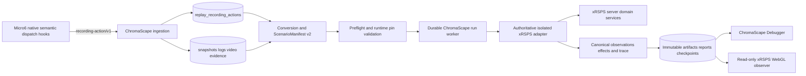

## Task resolution

Resolve the existing Felix task `task_1788137869927_5y6pxvp5` by its full ID or stable tag
`shortcut:sc-1199` under canonical project `C:\Dev\IdeaProjects\ChromaScape`. Never create a second
task. Fetch `note_1788138097588_74b34580` first and preserve its existing content. Append or merge the
note payload below as the authoritative remaining-implementation section. The task uses workflow
`shortcut_delivery`, classification `change:multi-repo`, spec state `spec_ready`, and intended executor
Luna Max with extra-high reasoning.

The implementation spans:

- `C:\Dev\IdeaProjects\ChromaScape`
- `C:\Dev\IdeaProjects\xrsps-typescript`
- `C:\Dev\IdeaProjects\micro6`

Current known repository anchors are ChromaScape
`4c9c41752b8c0f15165d89f77ac6d7aa8f696fde`, xRSPS
`c64ac9a770c851ad2ad20a1744abafebfb8e67ef`, and Micro6
`4a2564a6218df2a144e6f3bd68c52891aca40f9b`. Re-read each repository's rules and inventory current
changes before editing; these are audit anchors, not reset targets.

## Note payload

# SC-1199 authoritative xRSPS replay — remaining implementation specification

## Outcome

Deliver the actual user-visible path requested by SC-1199: select a finalized ChromaScape Debugger
recording, validate and compile its typed semantic evidence, execute it through authoritative isolated
xRSPS server behavior, and watch the immutable result in a read-only xRSPS WebGL observer. Browser
refresh or ChromaScape restart must recover the same durable run. Playback evidence and simulated
consequences remain visibly and semantically distinct.

The current ChromaScape v2 orchestration is substantial but not completion evidence. The current xRSPS
worker truthfully reports `SYNTHETIC_CONTRACT` and supports only `WAIT_UNTIL_TICK` and `INTERACT_NPC`.
Micro6 has no `recording-action/v1` semantic capture. The observer/trace work in xRSPS is uncommitted.
Therefore authoritative replay is not yet delivered and replay flags must remain disabled.

## Scope

- Native Micro6 typed semantic-action capture with stable targets and deterministic ordering.
- Append-only ChromaScape ingestion/storage and complete/incomplete immutable Fishing fixtures.
- Deterministic ScenarioManifest v2 conversion with provenance, gaps, fidelity, and runtime pins.
- A real xRSPS replay adapter over actual server domain services.
- Complete Fishing semantic action coverage with explicit rejection of unsupported actions.
- Durable ChromaScape run lifecycle, recovery, artifacts, reports, viewer sessions, and PostgreSQL
  concurrency correctness.
- A read-only xRSPS WebGL observer driven solely by immutable verified trace pages.
- Differential parity, 100-run determinism, failure injection, PostgreSQL races, Playwright E2E, and
  full Playback regression evidence.
- Clean certifiable xRSPS build identity tied to the exact committed source/cache/content.

## Exclusions and safety boundaries

- No raw mouse/keyboard replay, packets, WebSocket frames, or binary protocol replay.
- No Micro6, RuneLite, OpenRune, bridge, or live-game control route from replay.
- No browser-owned simulator truth, browser execution authority, or mutating observer control.
- No socket login, SQLite replay account, autosave, global ticker, or wall-clock simulation timer.
- No silent action skipping, target guessing, or certification of inferred/approximated legacy data.
- No unrelated xRSPS line-ending commit, destructive reset, merge, deployment, or flag enablement.
- No removal of existing observed playback or legacy compatibility during this delivery.

## Architecture

Micro6 produces evidence only. ChromaScape owns authenticated orchestration, idempotency, leases,
fencing, state transitions, artifacts, and viewer tokens. The headless xRSPS adapter is the only causal
authority. The observer reads verified immutable trace pages and changes only local presentation state.

## Exact implementation sequence

1. **Inventory and preserve work.** Confirm branches, commits, relevant status, runtime inputs, and
   repository rules. Preserve the uncommitted xRSPS observer, replay-trace contract/recorder, and
   `client/index.tsx` routing. Separate intentional source edits from widespread line-ending noise.
2. **Authoritative xRSPS adapter.** Introduce an isolated replay context backed by actual xRSPS server
   services. Implement `reset`, `step`, `observe`, `snapshot`, `restore`, `trace`, and `dispose` using a
   virtual clock, seeded RNG, deterministic IDs, isolated world/service state, and explicit cleanup.
   Remove synthetic Fishing logic from the certification path; it may remain only as clearly named
   non-certifiable development test support.
3. **Service-parity action dispatch.** Define and implement every typed action required by the complete
   Fishing fixture. Resolve stable targets against pinned content. Route each action through the same
   domain services as normal xRSPS behavior. Unknown action, ambiguous target, missing content, or
   illegal precondition must fail closed with stable bounded errors. Add differential tests comparing
   normal-service and replay-adapter effects/observations from identical state.
4. **Micro6 semantic capture.** Add `recording-action/v1` emission at native semantic dispatch
   boundaries. Include recording/session ID, tick, monotonic per-tick sequence, schema, action type,
   target kind/stable ID, bounded arguments, source, provenance/confidence, captured time, and content
   checksum. Never derive certified actions from mouse/keyboard or transport traffic. Run Micro6 tests
   only on native Windows and only with explicit runtime/build authorization.
5. **Fixtures and ingestion.** Capture or construct reviewed immutable complete and incomplete Fishing
   fixtures. Verify ChromaScape idempotent ingestion, unique `(session_id,tick,sequence)`, checksum
   conflict handling, finalization identity, ordered reads, bounded JSON, and provenance retention.
6. **Conversion and preflight closure.** Use captured actions when complete. Legacy inference always
   produces `BEST_EFFORT`; ambiguous or materially incomplete evidence produces `UNSUPPORTED`.
   `CERTIFIED` requires 100% required typed-action coverage, zero gaps/approximations, authoritative
   capabilities, exact build/cache/content pins, and complete initial state. Preserve `questHelper` and
   existing observed playback evidence without treating it as simulated state.
7. **Durable ChromaScape execution.** Verify create/idempotent resolution, claim/reclaim fencing,
   cancellation, retry, checkpoint recovery in a fresh worker, timeout, terminal monotonicity, artifact
   staging/finalization, owner authorization, trace/report checksums, and viewer-token hashing,
   expiry/revocation, and bounded pagination on PostgreSQL 16.
8. **Read-only observer closure.** Finish and commit the xRSPS `/replay-observer` route and trace
   renderer. It may call only the ChromaScape viewer-frame endpoint with its short-lived token. Pause,
   speed, seek, camera, and display controls are local. Add Playwright assertions for no login/gameplay
   socket, no gameplay input handlers, no mutating request, schema/checksum rejection, token expiry,
   refresh recovery, pagination, and complete/incomplete presentation.
9. **Certification truthfulness.** Change ChromaScape stress-gate expectations from
   `SYNTHETIC_CONTRACT` to `XRSPS_AUTHORITATIVE` only after the adapter and parity tests exist. Require
   exact committed `buildCommit`, SHA-256 cache/content identities, complete supported actions,
   `certifiable=true`, `controlAllowed=false`, and no OpenRune/control surfaces. Never promote synthetic
   harness evidence as authoritative certification.
10. **Full gates and handoff.** Run the complete E2E, regression, deterministic, failure, race,
    isolation, security, and clean-build gates. Record exact versions, commands, counts, commits,
    capability output, and artifact paths. Keep flags disabled until all evidence passes. Then update
    Implementation Evidence, enter `in_review`, create Verification Evidence, and enter `done` only
    when every acceptance/test item is checked truthfully.

## Given/When/Then acceptance criteria

- Given a finalized complete Fishing recording, when an authenticated operator starts xRSPS replay,
  then one durable run executes through authoritative xRSPS services and opens a watchable read-only
  observer.
- Given the same immutable manifest, identity, seed, clock, and initial state, when executed 100 times,
  then all ordered observations, effects, state hashes, chain hashes, checkpoints, artifacts, traces,
  and terminal reports are identical after excluding run/attempt IDs and persistence timestamps.
- Given an incomplete or legacy recording, when preflight runs, then observed playback remains usable,
  every gap is actionable, and the run is `BEST_EFFORT` or `UNSUPPORTED`, never `CERTIFIED`.
- Given a captured semantic action, when replay dispatches it, then the authoritative adapter and normal
  xRSPS service path produce equivalent ordered domain effects and canonical observations.
- Given cancellation, worker death, timeout, stale lease, duplicate create, or publication races, when
  recovery occurs, then exactly one durable truth remains and no stale worker can publish success.
- Given a viewer session, when the observer loads or seeks, then it reads only checksum-verified immutable
  frames and opens no login/gameplay socket or mutating control route.
- Given viewer-token expiry, revocation, wrong run, corruption, or ownership mismatch, when frames are
  requested, then access fails closed with a stable bounded response.
- Given existing observed Playback, when replay changes are installed with flags disabled, then video,
  frames, logs, actions, dialogue, varbits, and video-only fallback have no regression.
- Given the authoritative gate, when capabilities still say `SYNTHETIC_CONTRACT`, then certification
  fails and both replay flags remain false.
- Given all gates pass, when evidence is finalized, then Felix and Shortcut advance in order with exact
  commands, counts, commits, risks, and rollback recorded.

## Implementation checklist

- [ ] Inventory all three repositories and preserve unrelated/uncommitted work.
- [ ] Implement isolated authoritative xRSPS service adapter.
- [ ] Implement complete Fishing semantic action vocabulary and stable target resolution.
- [ ] Add xRSPS normal-service versus replay-adapter differential tests.
- [ ] Implement native Micro6 `recording-action/v1` capture.
- [ ] Produce immutable complete and incomplete Fishing fixtures.
- [ ] Verify ChromaScape action ingestion and V24-V26 PostgreSQL migrations.
- [ ] Close conversion/preflight fidelity, provenance, gaps, and runtime pin rules.
- [ ] Close durable run lifecycle, fencing, recovery, and immutable artifact publication.
- [ ] Finish and commit the read-only xRSPS WebGL observer and trace contract.
- [ ] Replace synthetic certification expectations with authoritative requirements.
- [ ] Preserve legacy observed Playback and keep replay flags disabled.
- [ ] Record complete Implementation Evidence before review.
- [ ] Record complete Verification Evidence before done.

## Test checklist

- [ ] xRSPS unit and stdio integration suites pass from a clean build.
- [ ] xRSPS differential service-parity suite passes for every certified Fishing action.
- [ ] xRSPS client typecheck, tests, production build, and Playwright observer E2E pass.
- [ ] Native Windows Micro6 capture unit/integration tests pass.
- [ ] Complete Fishing recording executes end to end and is watchable.
- [ ] Incomplete Fishing recording remains playable and is blocked from certification.
- [ ] PostgreSQL 16 V24-V26 migration/integration tests pass.
- [ ] Duplicate create, claim/reclaim, recovery, finalization, report, and pagination races pass with
      explicit barriers and at least 25 repetitions per scenario.
- [ ] Worker/protocol/timeout/artifact/checksum/identity failure-injection battery fails closed.
- [ ] 100 authoritative identical runs produce identical verified evidence.
- [ ] Full ChromaScape replay and observed Playback regression passes in an isolated build.
- [ ] Clean xRSPS capabilities report exact commit/digests, `certifiable=true`,
      `XRSPS_AUTHORITATIVE`, complete actions, and `controlAllowed=false`.
- [ ] Zero required tests are skipped; any unrun check is explicitly marked unverified.

## Rollback and release policy

Keep feature and worker flags false throughout implementation. Rollback is a reviewed revert of the
SC-1199 application/adapter commits while retaining additive database migrations or removing indexes
only through a later migration. Preserve legacy observed Playback. Do not merge, deploy, enable flags,
or remove compatibility routes without separate authorization after complete certification.

## Luna Max execution prompt

Use Luna Max with extra-high reasoning. Open existing Felix task
`task_1788137869927_5y6pxvp5` under `C:\Dev\IdeaProjects\ChromaScape` and read its primary,
Architecture, ERD, API Contract, Implementation Evidence, and pending outbox records. Resolve by
`shortcut:sc-1199`; never create a duplicate. Implement the remaining SC-1199 specification above
across ChromaScape, xRSPS, and Micro6. Preserve existing work and unrelated changes, especially the
uncommitted xRSPS observer/trace files; do not bulk-commit line-ending noise. The delivery is not a
synthetic trace demo: it must replay typed Micro6 semantic actions through actual isolated xRSPS server
services and render the immutable result in the read-only xRSPS observer. Work in the exact sequence
listed, fail closed on unsupported evidence, keep OpenRune/live-control paths absent, and keep replay
flags false. Run tests in proportion to repository rules; Micro6 build/runtime actions require explicit
native-Windows authorization. Continue until implementation and all authorized gates are complete or a
real external blocker remains. Update Felix checklists only with evidence, attach exact Implementation
and Verification Evidence, and synchronize Shortcut only after the corresponding Felix transitions
succeed. Report commits, changed files, exact commands/counts, capability manifest, artifacts, risks,
rollback, unrun checks, and remaining blockers.

## Checklist reconciliation

Merge the Implementation and Test checklist items above into the existing task checklists without
duplicating equivalent entries. Preserve already-checked items and their evidence. Do not mark any new
item checked from this planning record. Existing ChromaScape orchestration items may remain checked only
if their linked Implementation Evidence still matches the current committed code. Authoritative adapter,
Micro6 capture, fixture E2E, differential parity, Playwright, PostgreSQL race/recovery, 100-run
authoritative certification, clean identity, and full regression items remain unchecked.

## State reconciliation

Replay oldest pending records first. Resolve the actual full task ID and fetch the target note before
updating. Add stable tag
`offline-sync:offline_sc1199_20260901T002627Z_remaining_implementation_3d91cb84`; search for it before
writing so the update is idempotent. Preserve unrelated note content. Validate `spec_ready` without
waivers. The intended task state is `in_progress/spec_ready`, not `in_review` or `done`.

## Shortcut reconciliation

Shortcut SC-1199 is currently blocked in To Do with the planned marker already present. Do not mutate
Shortcut for this note update alone. Only after Felix confirms `in_progress`, verify the repository
mapping, move the story to In Progress (`500000008`), search comments, and post at most one exact marker:

`[felix-sync:task_1788137869927_5y6pxvp5:started]`

Include the actual Felix note ID, truthful partial outcome, `SYNTHETIC_CONTRACT` blocker, and remaining
authoritative gates. Never claim synchronization unless the MCP calls succeed.

## Sync result

Synced on 2026-09-01 as authoritative recovered plan and gap-audit note
`note_1788264581553_8680ae4f`, linked primarily to task `task_1788264505764_479zgp12` and Shortcut
SC-1199. The prior note remained readable through the recovered mirror but was not writable, so the
idempotently tagged continuation note preserved its full content and appended the exact Luna Max
extra-high implementation contract. Shortcut synchronized to In Progress only after Felix reached
`in_progress/spec_ready`.
