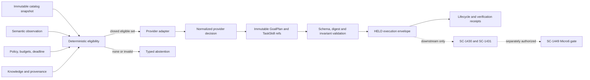

## Task resolution

Reuse Felix task `task_1788438246897_fzmkmv44` under workflow
`shortcut_delivery` and canonical project `C:\Dev\IdeaProjects\ChromaScape`.
Never create another task for SC-1429. The task is linked to Shortcut story 1429,
tagged `shortcut:sc-1429`, and classified with exactly one authoritative change
tag: `change:multi-repo`.

This note supersedes the implementation sequencing and completion gates in the
2026-09-03 planning note while preserving that note's frozen v1/v2 contract design.
The work is not greenfield: most contract code and fixtures exist and native focused
and full tests have passed on recorded frozen inputs. Remaining delivery work is to
recover and isolate the reviewed source, close scoped style/provenance gaps, repeat
verification on the exact candidate, create reviewable commits/PRs, and synchronize
Felix and Shortcut truthfully.

Canonical repositories:

- `C:\Dev\IdeaProjects\ChromaScape` — contract authority, validation, eligibility,
  provider normalization, and evidence.
- `C:\Dev\IdeaProjects\micro6` — byte-identical contract consumer, independent
  validation/conformance, and AccountBuilder boundary compatibility.

Protected recovery source:

- `C:\Dev\IdeaProjects\ChromaScape-sc1449-review`, branch
  `sc-1449-review-20260908`, contains the recovered SC-1429/SC-1449 review state.
- The canonical ChromaScape checkout has since moved to unrelated work. Do not reset,
  overwrite, or claim it as the verified SC-1429 candidate.
- Micro6 contains extensive mixed history and unrelated work. Extract only reviewed
  SC-1429 paths into a clean delivery branch; never push the broad remediation branch
  as the SC-1429 merge unit.

Scope:

- Freeze a provider-neutral gameplay contract and executable golden corpus shared by
  ChromaScape and Micro6.
- Preserve v1 byte-for-byte and complete additive v2 semantics.
- Define deterministic eligibility before provider invocation.
- Normalize Claude and Codex output to one closed decision model.
- Bind immutable catalog, observation, policy, knowledge, plan, TaskSkill, envelope,
  lifecycle receipt, and evidence identities by canonical digest.
- Prove signed reconciliation receipt trust and one-time promotion semantics.
- Deliver source-only, reviewable, independently testable changes in both repositories.

Exclusions:

- Durable provider sessions and process execution (SC-1430).
- Bounded AccountBuilder orchestration and recovery (SC-1431).
- TaskSkill maturity/promotion lifecycle (SC-1445).
- Live Micro6 authority enforcement and dispatch (SC-1449).
- Human approval, a real Fishing run, and recording (SC-1498).
- Raw mouse, keyboard, packets, sockets, reflection, arbitrary methods/scripts,
  filesystem commands, direct client handles, or tick mutation.
- Schema migration/backfill, v1 reinterpretation, automatic v1-to-v2 live conversion,
  deployment, learned-model activation, or reusable gameplay authority.

Linked rules:

- Follow `C:\Dev\IdeaProjects\AGENTS.md`,
  `C:\Dev\IdeaProjects\ChromaScape\AGENTS.md`, and
  `C:\Dev\IdeaProjects\micro6\AGENTS.md`.
- All Felix/Shortcut paths use Windows notation.
- Micro6 compile, test, and runtime commands run only from native Windows and only
  with explicit user authorization.
- Preserve unrelated staged, dirty, untracked, stashed, and recovery-worktree content.
- Keep `FEATURES_AI_PLAYER_CONTROL=false` and `controlAllowed=false`; this story does
  not authorize gameplay.

## Note payload

# SC-1429 — Full implementation and closeout specification

## 1. Outcome

SC-1429 is complete when ChromaScape and Micro6 independently accept the same frozen,
versioned provider-neutral gameplay contract and golden corpus; reject the same invalid
mutations with stable codes; normalize equivalent Claude and Codex decisions to the
same semantic plan; preserve all identity/digest bindings; and expose no live-control
surface. Completion requires reviewable delivery commits and current-candidate evidence,
not merely previously passing tests in a mixed worktree.

## 2. Current verified baseline

Facts already supported by recorded evidence:

- Existing v1 schema SHA-256:
  `010cba11ada57f328b43968be894f4875edd2ef8ee582c6eb5a924153e461469`.
- Existing v1 fixture SHA-256:
  `c55ad78af5b6367803bc7098e0ef0a03e03d8efff6465bd4eae7829aa743c19c`.
- Existing v2 schema SHA-256:
  `1d032dc935e36af0b10ad0269330c7e3df65a26b9212c81caae5bc4afd0abf0b`.
- Existing v2 fixture SHA-256:
  `96813afb0a3af5dcb79cf41d32d86db2bcf0e921d8c94968a887492253d7f549`.
- Cross-runtime signed-receipt vector signature:
  `hmac-sha256:decd6deb4a9238a065fb4a368bd72bcbfa1280c1b89e1b5275750462d4f1cb53`.
- Recorded native full runs: Micro6 1,473 tests with zero failures; ChromaScape
  2,270 tests with zero failures and 17 skips on the frozen review inputs.
- Recorded focused v2 suites, resource equality, migration regression, and default-off
  ChromaScape startup passed.

These facts do not yet prove a deliverable candidate because the tested ChromaScape
state was later stashed/recovered, Micro6 history is mixed, full style gates remain
failed or unavailable, no scoped PRs exist, and Felix replay is incomplete.

## 3. Architecture and ownership



Ownership boundaries:

| Concern | Owner | SC-1429 action |
|---|---|---|
| Schema, canonicalization, fixtures, failures | SC-1429 | Implement and freeze |
| Deterministic eligibility | SC-1429 | Implement before provider call |
| Claude/Codex normalization | SC-1429 boundary | Fixture/conformance adapters only |
| Durable provider sessions | SC-1430 | Excluded |
| Reservation/orchestration/recovery | SC-1431 | Excluded |
| TaskSkill trusted maturity | SC-1445 | Digest/reference only |
| Live enforcement/dispatch | SC-1449 | Excluded |
| Human live run/recording | SC-1498 | Excluded |

No database migration is required for SC-1429. The contract consists of immutable Java
models, validators, JSON Schema resources, golden fixtures, and conformance tests.

## 4. Contract specification

### 4.1 Versioning and canonicalization

- v1 resources remain byte-identical and retain their pinned hashes.
- v2 is additive and is the complete amended SC-1429 contract.
- No implicit conversion can make a v1 payload live-authorized. Any compatibility
  projection is `HELD`, records its source version, and requires a fresh v2 decision.
- Canonical JSON is UTF-8, LF, recursively lexicographic object keys, preserved array
  order, and no insignificant whitespace.
- Digests use lowercase `sha256:<hex>`; signed receipts use
  `hmac-sha256:<hex>` and constant-time verification.
- Security-sensitive schemas set `additionalProperties: false`.

### 4.2 Execution modes

Closed enum: `SIMULATION | SHADOW | LIVE_TASK`.

- `SIMULATION` is xRSPS/non-live evidence and cannot carry live authority.
- `SHADOW` permits catalog, observe, decision, and status evaluation only.
- `LIVE_TASK` at this boundary remains a proposal; SC-1449 authorization is required
  before state change.
- `SIMULATION` and `SHADOW` reject `RESERVE` and `START`.

### 4.3 Immutable catalog

`ImmutableTaskCatalogSnapshot` requires contract/catalog IDs and revision, captured
time, catalog digest, executor artifact/build/plugin IDs, capability digest, and an
ordered task list. The first contract admits only `FISHING_TRAINING`, with typed:

- `targetLevel` in 2..99;
- `areaPolicy` in `LUMBRIDGE | DRAYNOR | BARBARIAN_VILLAGE`;
- capabilities, prerequisites, preconditions, expected transitions, verifier IDs,
  and maximum policy bounds.

Unknown tasks, settings, properties, enum values, aliases, or mutable catalog bindings
fail closed.

### 4.4 Observation and planning input

`SemanticObservation` binds observation ID/revision/time, mode, account/client/world/
environment, run/task/session/recording, source/build/plugin/catalog, semantic player
state, inventory/skills/targets, current AccountBuilder state, capability/policy/
knowledge digests, freshness/completeness, and independent adapter-observation and
knowledge-freshness confidence.

`PlanningInput` binds that observation to the immutable catalog, eligible and rejected
task sets, policy/budgets/deadline, all runtime identities, provider-neutral provenance,
and prompt/tool schema versions. Providers receive only this filtered input.

### 4.5 Deterministic eligibility

Every task receives `ELIGIBLE` or exactly one stable reason:

- `NO_ELIGIBLE_TASK`
- `STALE_OBSERVATION`
- `STALE_KNOWLEDGE`
- `UNSUPPORTED_CAPABILITY`
- `PREREQUISITE_UNMET`
- `POLICY_DENIED`
- `BUDGET_EXHAUSTED`
- `IDENTITY_MISMATCH`

Eligibility checks identity equality, revisions, freshness, completeness, capabilities,
prerequisites/preconditions, confidence thresholds, deadlines, and budgets. The adapter
cannot reintroduce a rejected task.

### 4.6 GoalPlan and TaskSkillRef

A `GoalPlan` is immutable, acyclic, and contains 1..16 ordered nodes. It binds goal-plan
ID/digest, mode, source decision, all runtime identities, aggregate budgets, deadline,
and terminal objective.

Each node has a stable ID and ordinal; closed AccountBuilder task key; ordered
`TaskSkillRef` values with ID/version/artifact digest/maturity/capabilities/provenance;
typed settings; prerequisite node IDs; semantic preconditions; expected observation and
task revisions; expected transition and verifier; bounded node budgets; at most one
bounded fallback; evidence; and stable failure/abstention reason.

Validation rejects duplicate IDs/ordinals, missing prerequisite/fallback targets,
cycles, backward or deep fallback chains, aggregate overflow, catalog inconsistency,
untrusted maturity claims, and digest mismatch.

### 4.7 Provider decision

Closed variants:

- `SELECTED`: provider, exact model/version, decision/prompt IDs, policy confidence,
  adapter-observation confidence, knowledge-freshness confidence, eligible-input digest,
  immutable GoalPlan, and evidence.
- `ABSTAINED`: the same provenance/confidence binding plus one stable abstention reason;
  no action or GoalPlan.

Equivalent Claude/Codex fixtures must normalize to the same provider-neutral GoalPlan
and semantic-action digest. Provider-specific transcript/provenance may differ.

### 4.8 Execution envelope and operations

The envelope binds mode; catalog, observation, planning input, eligibility, semantic
action, GoalPlan and ordered TaskSkill digests; provider/prompt identity; executor
artifact/plugin/capabilities; exact revisions; request/idempotency/lease/fence values;
deadline; budgets; and authority reference only for `LIVE_TASK`.

Closed semantic operations are exactly `CATALOG`, `RESERVE`, `START`, `STATUS`, `STOP`,
and `OBSERVE`. They accept semantic payloads only. Acknowledgement is not success.

### 4.9 Receipts and signed reconciliation

Track validation, authorization, reservation, delivery acknowledgement, activation,
progress, AccountBuilder terminal state, transition verification, stop effectiveness,
and finalization independently.

Outcomes are `HELD | DELIVERED | CONFIRMED | REFUTED | UNVERIFIABLE |
UNCERTAIN_OUTCOME | ABSTAINED | DENIED | FAILED | STOPPED`.

- `CONFIRMED` requires verifier evidence bound to the expected transition.
- Missing evidence yields `UNVERIFIABLE`.
- Ambiguous post-delivery state yields non-retryable `UNCERTAIN_OUTCOME`.
- Unsigned receipts never promote state.
- `issueTrusted` signs eight canonical fields using HMAC-SHA-256 with a 32+ byte secret.
- Verification checks key ID, signature, <=900-second lifetime, expiry/current time,
  request/idempotency identity, recomputed envelope digest, CONFIRMED outcome, and
  nonblank verifier identity.
- Promotion is compare-and-set and succeeds once only.

## 5. Exact implementation surface

### ChromaScape contract authority

Production classes:

- `C:\Dev\IdeaProjects\ChromaScape\src\main\java\com\chromascape\web\gameplay\contract\v2\GameplayV2Contracts.java`
- `...\GameplayV2ContractValidator.java`
- `...\GameplayV2EligibilityFilter.java`
- `...\GameplayV2EnvelopeRules.java`
- `...\GameplayV2ReconciliationReceipt.java`
- `...\GameplayV2ValidatedEligibility.java`
- `C:\Dev\IdeaProjects\ChromaScape\src\main\java\com\chromascape\web\gameplay\provider\v2\GameplayV2ProviderAdapter.java`
- `...\ClaudeGameplayV2ProviderAdapter.java`
- `...\CodexGameplayV2ProviderAdapter.java`

Resources:

- `C:\Dev\IdeaProjects\ChromaScape\src\main\resources\contracts\gameplay\sc-1429-gameplay-contract-v1.schema.json`
- `...\sc-1429-golden-fixtures-v1.json`
- `...\sc-1429-gameplay-contract-v2.schema.json`
- `...\sc-1429-golden-fixtures-v2.json`

Tests:

- `...\GameplayV2ContractConformanceTest.java`
- `...\GameplayV2EligibilityFilterTest.java`
- `...\GameplayV2IdempotencyTest.java`
- `...\GameplayV2MutationMatrixTest.java`
- `...\GameplayV2SealedEligibilityTest.java`
- `...\GameplayV2ProviderEquivalenceTest.java`

Preserve existing v1 implementation behavior. Do not modify v2 orchestration/live-gate
classes for SC-1429; those belong to SC-1449.

### Micro6 independent consumer

Production/conformance classes:

- `C:\Dev\IdeaProjects\micro6\runelite-client\src\main\java\net\runelite\client\plugins\microbot\accountbuilder\integration\builder\gameplay\contract\GameplayContractV2Canonical.java`
- `...\GameplayContractV2Eligibility.java`
- `...\GameplayContractV2EnvelopeRules.java`
- `...\GameplayContractV2ReconciliationReceipt.java`
- `...\GameplayContractV2Validator.java`

Resources:

- `C:\Dev\IdeaProjects\micro6\runelite-client\src\main\resources\gameplay-contract\sc-1429-gameplay-contract-v1.schema.json`
- `...\sc-1429-golden-fixtures-v1.json`
- `...\sc-1429-gameplay-contract-v2.schema.json`
- `...\sc-1429-golden-fixtures-v2.json`

Tests:

- `...\gameplay\GameplayContractResourceEqualityTest.java`
- `...\gameplay\contract\GameplayContractV2ConformanceTest.java`
- `...\gameplay\contract\GameplayContractV2IdempotencyTest.java`

Do not modify `GameplayEnvelopeV2Gate`, AccountBuilder dispatch, reservation storage, or
executor lifecycle as part of SC-1429. If a contract test exposes a live-gate problem,
record it against SC-1449.

## 6. Implementation sequence

1. Freeze evidence: record HEAD/index/worktree fingerprints for both repositories and
   the recovery worktree. Stop if another session changes an owned path.
2. Reconcile the seven older SC-1429 outbox records oldest-first when Felix recovers.
   Preserve note content and use each `offline-sync:` tag for idempotency.
3. Use the recovered review worktree as evidence source. Compare every planned SC-1429
   path against the recorded hashes and latest review report.
4. Create clean branches from current target branches. Apply only SC-1429 contract,
   fixture, validator, adapter, and test changes. Exclude SC-1449, generated output,
   runtime logs, Felix mirrors, and unrelated staged work.
5. Preserve v1 resources byte-for-byte. Copy finalized v2 resource bytes from
   ChromaScape to Micro6; never independently edit the consumer copies.
6. Review all immutable/snapshot boundaries: deep-copy inputs on entry, validate and
   hash one snapshot, never retain caller-owned JSON, and return defensive copies.
7. Review signed-receipt boundaries and independently reproduce the pinned vector in
   Jackson and Gson without one repository reading the other's output.
8. Execute the mutation corpus. Each case changes one field and asserts the exact stable
   failure/outcome; descriptive rows without execution do not count.
9. Run native Windows focused tests, resource comparisons, compile, full suites, and
   scoped style/diff checks against the exact candidate.
10. Classify full-style failures path-by-path. Fix SC-1429-owned violations. Baseline
    failures may remain documented, but they cannot be used to conceal scoped failures.
11. Recheck hashes and repository fingerprints after tests. Any source/index change
    invalidates the result and requires a rerun.
12. Commit source-only changes separately per repository with Shortcut linkage. Push
    review branches and open focused PRs; attach exact commands, counts, hashes, and
    known baseline failures.
13. Add Felix Implementation Evidence before moving to review. Verify PR CI and review
    findings. Add Verification Evidence before done.
14. Synchronize Shortcut only after Felix transitions succeed. Reuse the existing
    planned marker and do not post duplicate comments.

## 7. Acceptance criteria

### AC1 — Frozen versions

Given the current v1 and v2 resources in both repositories, when raw SHA-256 and binary
comparisons run, then v1 retains its pinned hashes and v2 is byte-identical across repos.

### AC2 — Deterministic eligibility

Given identical catalog, observation, policy, knowledge, deadline and budget snapshots,
when eligibility runs repeatedly and in different event arrival orders, then it emits
the same ordered eligible/rejected result and stable reasons.

### AC3 — Provider equivalence

Given equivalent Claude and Codex selected fixtures, when normalized, then provider-
neutral GoalPlan and semantic-action digests match while provider provenance remains
distinct and immutable.

### AC4 — Fail-closed decisions

Given malformed, unknown, stale, ineligible, mismatched or out-of-budget input, when an
adapter or validator processes it, then no plan/envelope is promoted and the expected
stable failure or abstention code is returned.

### AC5 — Immutable binding

Given a validated snapshot and sealed eligibility result, when caller-owned catalog,
observation, planning input, eligibility, provider output, GoalPlan or settings are
mutated afterward, then stored and returned digests/results remain unchanged.

### AC6 — Plan safety

Given a GoalPlan containing duplicate/missing nodes, cycles, invalid fallback, aggregate
overflow, unknown task/settings, revision drift or untrusted TaskSkill maturity, when
validated, then it is rejected before downstream handoff.

### AC7 — Idempotency and receipt trust

Given a valid signed CONFIRMED reconciliation receipt, when consumed twice, then the
first matching compare-and-set may advance once and every replay/forgery/mismatch/
expiry attempt fails without state advancement.

### AC8 — Closed capability surface

Given the schema, Java models and adapter/tool surface, when statically and dynamically
inspected, then only the six semantic operations exist and no raw-input/direct-client/
arbitrary-execution capability is reachable.

### AC9 — Independent conformance

Given the same golden corpus, when ChromaScape/Jackson and Micro6/Gson conformance suites
run independently, then all valid objects pass, all negative mutations fail with the
same codes, and pinned canonical digests/signatures match.

### AC10 — Reviewable delivery

Given clean branches based on current targets, when PRs are opened, then their diffs
contain only reviewed SC-1429 source/resources/tests, CI is green or has explicitly
scoped baseline exceptions, and no generated/runtime/SC-1449 material is included.

### AC11 — No gameplay authority

Given the completed SC-1429 delivery, when deployed or loaded with default configuration,
then both live-control flags remain false, no reservation/task/gameplay is dispatched,
and completion grants no authority to SC-1498 or learned models.

## 8. Test specification

Native Windows ChromaScape commands:

```bat
cd /d C:\Dev\IdeaProjects\ChromaScape-sc1429-delivery
gradlew.bat compileJava compileTestJava
gradlew.bat test --tests "com.chromascape.web.gameplay.contract.*" --tests "com.chromascape.web.gameplay.contract.v2.*" --tests "com.chromascape.web.gameplay.provider.v2.*"
gradlew.bat checkstyleMain checkstyleTest spotlessCheck
gradlew.bat test
git diff --check
```

Native Windows Micro6 commands:

```bat
cd /d C:\Dev\IdeaProjects\micro6
gradlew.bat :client:verifyCaptureContract
gradlew.bat :client:compileJava :client:compileTestJava
gradlew.bat :client:test --tests "net.runelite.client.plugins.microbot.accountbuilder.integration.builder.gameplay.GameplayContractResourceEqualityTest" --tests "net.runelite.client.plugins.microbot.accountbuilder.integration.builder.gameplay.contract.*"
gradlew.bat :client:test
gradlew.bat :client:checkstyleMain :client:checkstyleTest
git diff --check
```

Use `:client`, not the nonexistent `:runelite-client` Gradle project path in the current
composite build. Do not run Micro6 tests from WSL.

Required test groups:

- v1 hash/regression pinning;
- v2 schema-valid positive corpus;
- executable one-field mutation matrix;
- eligibility determinism and contradiction rejection;
- GoalPlan DAG/ordinal/fallback/budget validation;
- provider equivalence and abstention;
- defensive snapshot/TOCTOU coverage;
- idempotency and conflicting reuse;
- signed-receipt golden vector and forgery/expiry/replay rejection;
- forbidden property/tool/capability inspection;
- cross-repository binary resource equality;
- current-candidate compile, full suite, Checkstyle/Spotless or exact scoped evidence.

## 9. Security and failure model

| Threat/failure | Required response |
|---|---|
| Unknown schema property | Reject before normalization |
| Catalog or capability substitution | `IDENTITY_MISMATCH` / catalog mismatch |
| Stale observation or knowledge | Stable abstention; no provider-selected task |
| Provider emits prose/multiple actions/raw tool | `INVALID_PROVIDER_DECISION` |
| Caller mutates JSON during/after validation | Snapshot once; defensive copy; reject mismatch |
| Digest or revision mismatch | Reject before handoff |
| Missing/weak signing secret | Fail closed; no trusted receipt |
| Forged/wrong-key/expired receipt | Constant-time rejection; ledger unchanged |
| Lost acknowledgement/ambiguous delivery | `UNCERTAIN_OUTCOME`; no blind retry |
| Missing verifier evidence | `UNVERIFIABLE`, never success |
| v1 resource changes | Stop and restore only accidental scoped edits |
| Cross-repo v2 drift | Fail resource equality and copy canonical bytes |
| Concurrent worktree mutation | Invalidate evidence; preserve other work; rerun |
| Mixed/broad commit | Re-cut source-only commits; never push wholesale |

No secrets, signatures, raw device/account identifiers, provider transcripts, or local
paths containing credentials may enter logs, fixtures, commits, Felix, or Shortcut.

## 10. Observability and evidence

SC-1429 emits test/evidence metadata only, not a runtime dashboard. Evidence must record:

- repository, branch, HEAD, index/source fingerprints, and candidate commit;
- contract versions and all four resource hashes;
- canonical digest/signature vector;
- commands, start/end timestamps, environment/JDK/Gradle versions;
- test discovered/passed/failed/skipped counts;
- stable failure-code matrix results;
- scope and baseline failure classification;
- explicit statement that no gameplay ran and live flags remained false.

Before `in_progress -> in_review`, check every implementation item and link an
Implementation Evidence note with `## Changed files`, `## Tests`, and
`## Remaining work`.

Before `in_review -> done`, check every acceptance/test item and link a Verification
Evidence note with `## Acceptance results`, `## Tests`, `## Risks`, and `## Rollback`.

## 11. Rollback

- Revert each repository's focused SC-1429 delivery commit independently.
- Never reset shared checkouts, delete the recovery worktree, drop stash
  `72578e0cca1c5cde674931e502c73e0c4e5f3b1a`, or rewrite mixed shared history.
- If v2 is rejected, retain frozen v1 and remove only v2 source/resources/tests from the
  focused delivery branch.
- If a trust-boundary change is rejected, preserve fail-closed behavior; do not restore
  unsigned promotion.
- Keep all live flags false and retain denied/uncertain state whenever termination or
  identity cannot be proven.

## 12. Definition of done

- The scoped ChromaScape and Micro6 PRs are merged into their intended target branches.
- v1 and v2 resources/hashes are correct and identical where required.
- Focused and full candidate tests are green, or any repository-wide exception is
  demonstrably outside the diff and explicitly accepted without hiding scoped failure.
- All SC-1429-owned style violations are fixed; style-tool limitations are documented.
- Every implementation, acceptance, and test checklist item is checked with evidence.
- Felix outbox records are replayed without conflict and task state is truthful.
- Shortcut links the actual PRs/commits and synchronizes only after Felix succeeds.
- No gameplay was dispatched, no live authority exists, and downstream stories remain
  independently gated.

## Checklist reconciliation

### Implementation checklist

- [x] Freeze and preserve v1 contract/resources.
- [x] Define additive v2 schema and executable corpus.
- [x] Implement ChromaScape immutable models, validator and eligibility filter.
- [x] Implement Claude/Codex fixture normalization and equivalence coverage.
- [x] Implement envelope/GoalPlan/TaskSkill binding rules.
- [x] Implement defensive snapshot and sealed-eligibility protections.
- [x] Implement signed reconciliation receipts and cross-runtime golden vector.
- [x] Mirror v2 resources and independent Micro6 conformance.
- [ ] Reconcile all older SC-1429 Felix outbox records oldest-first.
- [ ] Recover and audit exact candidate bytes from the protected worktree.
- [ ] Re-cut clean ChromaScape and Micro6 branches from current targets.
- [ ] Exclude every SC-1449, generated, runtime, evidence-log and unrelated path.
- [ ] Resolve all SC-1429-owned style findings and document true baseline/tool limits.
- [ ] Create scoped commits and PRs linked to SC-1429.
- [ ] Address review findings and merge both delivery PRs.
- [ ] Attach final Felix evidence and synchronize Shortcut.

### Test checklist

- [x] Recorded native focused v1/v2 ChromaScape suites passed.
- [x] Recorded native focused Micro6 contract/resource suites passed.
- [x] Recorded native full ChromaScape run passed on frozen input.
- [x] Recorded native full Micro6 run passed on frozen input.
- [x] V45 absent-table regression and default-off ChromaScape startup passed.
- [x] Cross-runtime hashes and signed-receipt vector matched.
- [ ] Repeat all required focused tests on the clean exact delivery commits.
- [ ] Repeat resource binary/hash checks on the clean exact delivery commits.
- [ ] Repeat ChromaScape compile/full suite/scoped style checks on exact commit.
- [ ] Repeat Micro6 compile/full suite/Checkstyle checks on exact commit from Windows.
- [ ] Record before/after source/index fingerprints proving test-input stability.
- [ ] Verify PR CI and all review findings are resolved.
- [ ] Verify no live-control capability and both flags remain false.

## State reconciliation

1. Replay the existing SC-1429 pending records oldest-first and preserve unrelated note
   content. The earliest conflict must be resolved by comparing the Felix note rather
   than overwriting it.
2. Update existing plan note `note_1788438392194_e63c340e` with this complete payload and
   add `offline-sync:b86b4466-9235-4112-903c-cf15cea0eb79`.
3. Validate the `planning -> spec_ready` gate. Do not claim success until Felix returns it.
4. Because this request is planning/specification only, keep the task at `todo` after
   `spec_ready`; do not transition to `in_progress` or implement without a separate
   implementation request.
5. Preserve the existing Shortcut planned marker. After Felix confirms `spec_ready`,
   reconcile Shortcut to state 500000007 without posting a duplicate marker.

## Shortcut reconciliation

- Intended state after successful Felix `spec_ready`: To Do (`500000007`).
- Existing idempotency marker:
  `[felix-sync:task_1788438246897_fzmkmv44:planned]`; do not post it again.
- Attach future clean ChromaScape and Micro6 PRs to SC-1429.
- Do not move to In Progress, In Review, or Done from this planning-only record.
- Remaining blockers: Felix transport/replay, candidate isolation, scoped style closure,
  clean commits/PRs, and exact-candidate verification.

## Sync result

Synced 2026-09-10T19:40:34Z. Felix note `note_1788438392194_e63c340e` was updated
with this full specification and tagged `offline-sync:b86b4466-9235-4112-903c-cf15cea0eb79`.
Felix confirmed `spec_ready`; on the explicit implementation request it then confirmed
`in_progress`. Shortcut transitioned to mapped state `500000008` and comment marker
`[felix-sync:task_1788438246897_fzmkmv44:started]` was created successfully.
