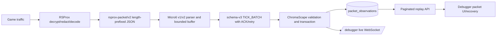
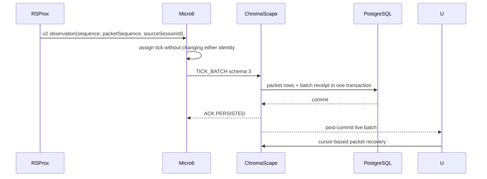
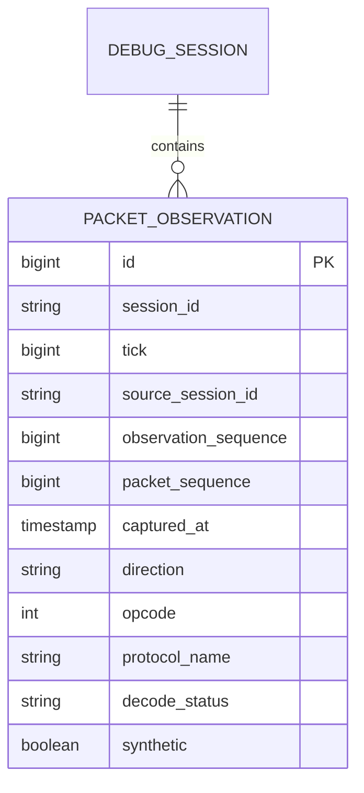

## Task resolution

Felix task lookup was attempted twice through the canonical Felix MCP HTTP service and failed with the server error `SQLite package has not been found installed`. Resolve an existing task by the stable tag `shortcut:sc-1618` before creating anything. If no task exists, create exactly this payload:

```json
{
  "project": "C:\\Dev\\IdeaProjects\\ChromaScape",
  "action": "create",
  "title": "SC-1618 — Complete RSProx v2 packet pipeline, retry-safe diagnostics, and replay recovery",
  "description": "Implement the blocker-first v2 packet observation pipeline across RSProx, Micro6, and ChromaScape, including retry-safe diagnostics, accurate loss ranges, and replay interval recovery. Preserve v1 and legacy Kryo compatibility. See the linked authoritative plan note for scope, exclusions, acceptance criteria, implementation checklist, test checklist, and required evidence.",
  "task_type": "story",
  "task_status": "todo",
  "task_priority": "critical",
  "workflow": "shortcut_delivery",
  "spec_state": "draft",
  "stable_tags": ["shortcut:sc-1618", "change:multi-repo", "system:tick-debugger", "transport:tick-batch", "plan:rsprox-packets-tick-debugger-v2"],
  "entity_links": [{"entity_type":"shortcut_story","entity_id":"1618","entity_name":"DBG-PACKETS: Stream RSProx packets through Micro6 Tick Debugger to the ChromaScape packet viewer","link_strength":"primary"}]
}
```

Shortcut source: `https://app.shortcut.com/leeuwbot/story/1618`. The authoritative classification is exactly `change:multi-repo`; do not add another `change:*` tag. Existing project rules apply, including Windows paths for Felix arguments, preservation of unrelated worktree edits, no `wsl --shutdown`, native Windows-only Micro6 compilation/testing, next-unused Flyway migration allocation, and required Implementation/Verification Evidence headings.

## Note payload

# RSProx v2 packet pipeline — blocker-first implementation plan

## Outcome and scope

Complete the end-to-end post-redaction RSProx packet observation path so v2 observations retain separate delivery and capture identities through Micro6, durable ChromaScape ingestion, live debugger display, and paginated replay. Fix the RSProx producer first because its current source mixes incompatible helper generations and does not compile.

In scope: RSProx v2 envelope/codec/broadcaster/transcriber/socket writer; Micro6 v1/v2 parsing, identity preservation, bounded packet delivery, checksum/ACK/retry settlement, and batch-owned diagnostics; ChromaScape v1/v2 DTO validation, packet persistence/migration, deterministic replay pagination, live publication, and browser recovery/UI; focused regression and authorized native integration verification.

Out of scope: packet injection or mutation; replay-to-game; public packet listeners; replacement of RSProx binary capture/transcription; packet forwarding to leeuwbotbackend by default; a fully shaded Micro6 client in the RSProx overlay; unrelated debugger redesign; editing an already-applied Flyway migration; claiming full verification from earlier standalone slices.

## Linked rules and constraints

- Canonical Felix project: `C:\\Dev\\IdeaProjects\\ChromaScape`; RSProx is the unlisted repository identity `C:\\Dev\\IdeaProjects\\rsprox`; Micro6 identity is `C:\\Dev\\IdeaProjects\\micro6`.
- Read and preserve repository-local rules. Micro6 compilation/testing/runtime is authorized by this delivery request but must run from native Windows, not WSL.
- Read `.felix/shortcut-sync.json` before Shortcut mutations. Current mapping is planned `500000007`, started `500000008`, review `500000009`, done `500000010`; blocked/cancelled are null.
- Scan and replay pending Felix outbox records oldest-first when Felix recovers. Add `offline-sync:<offline_record_id>` to notes replayed from this record.
- Never use skip validation, spec waivers, fabricated evidence, or a second task for SC-1618. Never claim a state transition until the MCP response succeeds.
- Keep raw sanitized packet bytes disabled by default and bounded when explicitly enabled. Never log packet bodies or secrets.

## Architecture







## Version and identity contract

- RSProx v1 remains `rsprox-packet/v1`; its `sequence` is the legacy capture identity and must not be reinterpreted as a v2 observation identity.
- RSProx v2 is `rsprox-packet/v2`; `sequence` is a monotonically allocated per-source observation identity for both real observations and GAPs, while `packetSequence` is the original capture identity for real packets and is null for GAPs.
- One allocator per source is used for real observations and GAPs. Allocate an observation identity when entering delivery order and preserve it during requeue/retry.
- A GAP keeps source identity, dropped count, and exact first/last packet sequences. A failed GAP merges its represented losses back into pending diagnostics instead of becoming one lost packet.
- Micro6 accepts v1 and v2 explicitly. ChromaScape accepts v1-compatible historical data and v2; v2 ordering is per source and delayed GAPs do not invalidate otherwise valid batches.
- Database uniqueness includes sufficient source/session context and observation identity. A retry with identical content is idempotent; changed content under the same identity is permanent `PACKET_IDENTITY_CONFLICT`.

## Implementation plan

### 1. Finish the RSProx v2 producer (blocking)

Files: `C:\\Dev\\IdeaProjects\\rsprox\\proxy\\src\\main\\kotlin\\net\\rsprox\\proxy\\packetstream\\RsproxPacketEnvelope.kt`, `RsproxPacketStreamCodec.kt`, `PacketStreamBroadcaster.kt`, `transcriber\\LiveTranscriberSession.kt`, `unix\\UnixSocketConnection.kt`, and focused codec/broadcaster tests.

- Remove obsolete global drop counters and incompatible helper definitions; make broadcaster calls and named arguments consistent.
- Define `sequence` as observation identity and `packetSequence` as capture identity. Use one allocator per source for real observations and GAPs.
- Allocate identity at delivery insertion; preserve it on requeue. Update LiveTranscriberSession so it supplies capture identity as `packetSequence`, not `sequence`.
- Keep source identity in every loss record. Merge failed GAP ranges back into pending diagnostics.
- Connect `drainPendingLosses()` to the socket writer/flush path so a pending GAP is delivered without another game packet.
- Preserve count and byte bounds, partial-write ordering, reconnect behavior, legacy Kryo behavior, and v1 fixtures.

Acceptance: partial write plus reconnect yields ordered valid observations; pending GAPs flush with stopped game traffic; real packets and GAPs never share an observation identity; requeued observations retain identity; source sessions remain isolated.

### 2. Complete Micro6 v2 compatibility

Files: `RsproxPacketEnvelope.java`, `RsproxPacketStreamClient.java`, `RsproxPacketBuffer.java`, `TickBatchMessage.java`, `TickBatchCanonicalChecksum.java`, and their bridge/DTO/checksum tests.

- Accept v1 and v2 explicitly, require version-specific fields, preserve `packetSequence`, and apply per-source v2 ordering including GAPs.
- Keep v1 sequence semantics explicit; preserve both identities through tick assignment, trimming, retries, and checksums.
- Bound or retire per-source sequence state on source-session end and retain stale-socket rejection behavior with reconnect-path coverage.

Acceptance: RSProx v2 fixtures parse and survive Micro6 serialization; interleaved sources reject duplicate observations; tick stamping changes neither identity; v1 remains documented and functional.

### 3. Complete ChromaScape persistence and replay compatibility

Files: `TickBatchMessage.java`, `PacketObservation.java`, `PacketObservationRepository.java`, `TickStreamIngestionService.java`, `TickBatchCanonicalChecksumService.java`, `TickStreamWebSocketHandler.java`, `TickReplayController.java`, `docs\\TICK_MESSAGE_FORMAT.md`, and the next-unused migration after inspecting `V39__sc1618_packet_observations.sql`.

- Add version-aware validation/persistence of capture identity. Define source/session-aware observation uniqueness and deterministic cursor ordering consistent with queries.
- Preserve v1 records using a new migration if V39 is already applied; never rewrite V39.
- Include identities in checksums, replay, and live responses. Keep permanent packet-error classification. Delayed loss markers must not fail normal v2 ordering.

Acceptance: identical retries add no rows; changed content under one identity fails permanently; old recordings remain readable; PostgreSQL migration/uniqueness/retry/cursor/search tests pass.

### 4. Replace cumulative diagnostic snapshots with batch ownership

Files: Micro6 `RsproxPacketBuffer.java`, `DebugRecorderPlugin.java`, `TickBatchMessage.java`, `ChromaScapeWebSocketClient.java`, plus bridge/plugin/WebSocket tests.

- Atomically detach pending diagnostics into immutable session-bound batch tokens; subsequent drops use a fresh bucket.
- Include configured omissions and stripped-byte counts in the owned snapshot and serialized retry bytes. Remove the eight-item stash limit.
- Restore exactly once on pre-transport rejection; let accepted pending batches be owned by WebSocket retry; distinguish durable ACK, pre-accept rejection, and terminal failure.
- Prevent old-session callbacks from modifying new-session diagnostics and reset malformed-frame state on transitions.

Acceptance: batch A’s five drops plus one concurrent drop becomes exactly one new drop in batch B; rejected submission restores configured omissions and buffer diagnostics; out-of-order ACKs do not double count or clear another batch; terminal rejection is not repeatedly requeued.

### 5. Make range aggregation accurate

Apply to buffer/broadcaster and transport DTOs as needed.

- Aggregate separately per source; merge overlap/adjacency; preserve exact counts independently of endpoint span; handle newer losses before older retry-tail losses; bound storage and disclose summary-only retention.
- Keep observation and capture sequences distinct in diagnostics and display.

Acceptance: newer loss then older retry overflow has correct endpoints; non-contiguous ranges do not imply delivered packets were lost; failed GAP preserves represented count.

### 6. Repair replay interval recovery and packet access

Files: `debugger.js`, `debugger.css`, `TickReplayController.java`, and `PacketObservationRepository.java`; choose browser test location after inspecting the existing runner.

- Subtract recovered intervals from truncated windows: `[0,50]` from `[0,100]` leaves `[51,100]`; middle recovery leaves both sides.
- Choose the range around the clicked tick, separate packet-loading status from tick-card coverage, retain cursor at 10,000 rows, and provide single-tick continuation.
- Prevent duplicate in-flight requests, show failed loads with retry, expose packets outside the 500-row snapshot via pagination/filtering, and display capture sequence/GAP ranges distinctly from observation identity.

Acceptance: warnings disappear only for recovered ticks; all subranges remove the original warning; single-tick overflow remains navigable; recording switches discard stale responses; failed recovery retries.

### 7. Regression and native integration verification

Run, in order: RSProx focused compile/codec/broadcaster tests; complete Micro6 plugin compile and buffer/plugin/DTO/checksum/WebSocket tests from native Windows; ChromaScape compile/focused Java tests; PostgreSQL migration/uniqueness/retry/cursor/search tests; browser recovery tests; then live RSProx script/replay comparison after restart, clean reconnect, stale socket, partial write, lost ACK, and overflow checks. Historical slice results do not verify the new broadcaster or full plugin graph.

### 8. Record and deliver

Resolve SC-1618 and `shortcut:sc-1618`, persist this plan/checklists before implementation, roll out ChromaScape compatibility, then Micro6, then enable RSProx v2 output. Before review link Implementation Evidence with `## Changed files`, `## Tests`, `## Remaining work`; before done link Verification Evidence with `## Acceptance results`, `## Tests`, `## Risks`, `## Rollback`. Inspect exact scoped diff and untracked files before any commit.

## Given/When/Then acceptance criteria

1. Given a v2 RSProx source emits real observations and GAPs, when they are partially written, requeued, and reconnected, then ordered observations have unique per-source identities and exact source-scoped loss ranges.
2. Given Micro6 receives v1 and v2 sources, when it assigns ticks, trims, retries, and checksums, then capture and observation identities remain unchanged and version-specific validation is enforced.
3. Given ChromaScape receives an identical retry, when the batch is already committed, then the receipt ACK is returned without duplicate packet rows.
4. Given a reused observation identity with changed content, when ingestion validates it, then the transaction is rolled back and a permanent packet identity error is returned.
5. Given configured omissions and concurrent drops, when a batch is rejected before transport ownership, then its immutable diagnostic snapshot is restored exactly once and later drops belong only to the next batch.
6. Given a truncated replay interval, when any subinterval is recovered, then only that subinterval’s warning is removed and uncovered portions remain navigable.
7. Given v1 recordings or legacy Kryo clients, when v2 support is deployed, then historical data and legacy behavior remain usable.
8. Given hostile or oversized decoded text, when the debugger renders it, then it is escaped/bounded and the page remains responsive.

## Implementation checklist

- [ ] Replay this record idempotently after Felix recovery; resolve existing `shortcut:sc-1618` task.
- [ ] Persist architecture, ERD, API contract, scope, acceptance, implementation, and test artifacts; pass `planning -> spec_ready` without waivers.
- [ ] Repair and compile RSProx broadcaster/codec/transcriber/socket integration.
- [ ] Add RSProx v2 producer and GAP/requeue/socket-writer coverage.
- [ ] Add Micro6 v1/v2 identity validation and source lifecycle handling.
- [ ] Implement Micro6 batch-owned diagnostics, range aggregation, checksum, retry, and stale-session protection.
- [ ] Implement ChromaScape v1/v2 validation, next-unused migration, uniqueness, transactional persistence, and post-commit publication.
- [ ] Implement deterministic replay cursor/filter API and interval subtraction/recovery UI.
- [ ] Run authorized focused/native/live verification in the stated order.
- [ ] Create and link Implementation Evidence, then Verification Evidence only after their headings and evidence are complete.

## Test checklist

- [ ] RSProx v1/v2 codec golden round trips and malformed/oversized validation.
- [ ] RSProx broadcaster partial write, requeue identity, pending GAP flush, source isolation, bounds, and exact range tests.
- [ ] Micro6 v1/v2 bridge parsing, fragmented read/reconnect, stale socket, tick assignment, trim/retry/checksum, and source lifecycle tests.
- [ ] Micro6 diagnostics ownership, omissions/stripped bytes, concurrent drop, ACK ordering, terminal failure, malformed reset, and full plugin compile tests.
- [ ] ChromaScape DTO/checksum/ordering/session validation, clean upgrade migration, uniqueness conflict, rollback/ACK, cursor/filter/search, and post-commit WebSocket tests.
- [ ] Browser interval subtraction, middle/single-tick recovery, stale response, duplicate request, retry, pagination, escaping, and bounded rendering tests.
- [ ] Native live two-direction capture, restart/replay equality, clean reconnect, partial write, lost ACK, stale socket, overflow, and redaction checks.

## Conditional design artifacts

- Architecture flow and sequence diagrams are included above because this is a multi-repository transport change.
- The packet observation ERD is included above because schema/persistence changes are in scope.
- The replay API contract is represented by the endpoint and response requirements in the implementation plan; persist a dedicated API Contract documentation note if Felix validation requires it.
- No mockup is required: the existing debugger UI is extended within its current layout and the requested change does not introduce a new screen.

## Shortcut reconciliation

Current Shortcut story state is `To Do` (`workflow_state_id: 500000007`), matching the planned mapping. Do not post `[felix-sync:<felix-task-id>:planned]` until the Felix task lookup/reconciliation and `planning -> spec_ready` transition have succeeded. Then synchronize planned, started, review, and done only after their corresponding Felix transitions, checking the exact marker before each comment. Never invent a task ID or state ID.

## State reconciliation

After replay resolves the task, restore/update the note and checklists without overwriting unrelated content. Validate and transition `planning -> spec_ready`; after success transition automatically to `in_progress`. Before `in_review`, all implementation items must be checked and Implementation Evidence linked. Before `done`, all acceptance/test items must be checked and Verification Evidence linked. If validation reports missing artifacts, add them and retry. If Felix remains unavailable, leave this record pending and do not claim any state.

## Checklist reconciliation

Create or reconcile exactly these checklist names on the Felix task: `Scope and Exclusions`, `Acceptance Criteria`, `Implementation Checklist`, `Test Verification`, and `Regression Testing`. Preserve existing unrelated items. Use the complete item text from the Implementation and Test checklist sections above; checked state is false until the corresponding evidence exists. Checked implementation items require file/diff/test evidence; checked acceptance/test items require the named passing test or live evidence.

## Sync result

Pending. Felix task ID, note IDs, state-transition responses, Shortcut comment IDs, and timestamps are intentionally unknown because the canonical Felix task calls failed twice at the server layer. Replay oldest-first after Felix recovery; record actual IDs and any conflict here without fabricating success.

## Intended Felix note update

Update existing note `note_1788549424937_15d2e3af` if it resolves for `shortcut:sc-1618`, preserving unrelated content and adding this blocker-first v2 plan. If the note does not resolve, create a documentation note with stable tag `offline-sync:offline-20260906T215300Z-sc1618-v2-pipeline-01` plus the stable plan/classification tags, linked to the resolved Felix task and Shortcut story.

## Handoff status

Implementation may proceed during the Felix outage using this durable record. No Felix state, note, checklist, or Shortcut synchronization has succeeded yet.

## Checklist reconciliation

- Task checklist names and exact items are defined in the Note payload above. All are initially unchecked.
- No item is checked by this offline record; checked states require replayed Felix evidence.

## State reconciliation

- Intended order: `planning -> spec_ready -> in_progress -> in_review -> done`.
- Required gates: complete architecture/ERD/API/scope/acceptance/checklist artifacts for `spec_ready`; Implementation Evidence and all implementation items for `in_review`; Verification Evidence and all acceptance/test items for `done`.

## Shortcut reconciliation

- Intended planned marker: `[felix-sync:<felix-task-id>:planned]`, only after Felix reaches `spec_ready`.
- Intended started marker: `[felix-sync:<felix-task-id>:started]`, only after Felix reaches `in_progress`.
- Intended review marker: `[felix-sync:<felix-task-id>:review]`, only after Felix reaches `in_review`.
- Intended done marker: `[felix-sync:<felix-task-id>:done]`, only after Felix reaches `done`.

## Sync result

Synced at `2026-09-07T19:28:28.118Z`. Existing Felix task
`task_1788808364914_0z4klpcjk` was resolved and its stable tags were repaired without creating a
duplicate. Felix accepted `spec_ready -> in_progress` after all three validation bundles passed.
Shortcut SC-1618 was already in planned state, then moved successfully to `500000008` (In Progress);
the planned and started idempotency comments were created as activities `1637` and `1638`.
No future review/done transition is claimed by this record.
