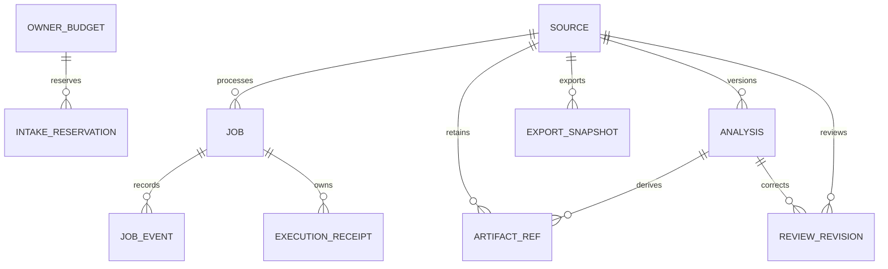

# SC-2150 — Complete delivery plan after independent review

Latest amendment: second process/lease/output review, 2026-10-19. Sections 21–24 specify the
four remaining review corrections and their new gates. All earlier scope and acceptance
obligations remain in force; existing implementation progress is preserved as evidence.

Prepared 2026-10-19. Planning only. No corrective implementation, new software test result,
deployment, restart, workflow transition or feature enablement is claimed by this document.

Canonical project: `C:\Dev\IdeaProjects\ChromaScape`.
Existing Felix task: `task_1792382767281_cd8dbu69`, workflow `shortcut_delivery`, classification
`change:ui`. Current task read-back: `in_progress`, `spec_state=draft`.
Shortcut: https://app.shortcut.com/leeuwbot/story/2150, In Progress, incomplete.

This is the current completion amendment. It retains the original full scope and all original
and remediation acceptance gates. Where this document conflicts with earlier implementation
choices, its explicit decisions take precedence. Historical evidence remains unchanged.

## 1. Outcome, scope and exclusions

Deliver the complete workflow: upload a bounded video or import a supported public YouTube
video; inspect qualified media and source-linked observations; see gaps and unavailable facts;
correct points/events and review source use; retrieve immutable, versioned evidence exports.

Include authenticated intake, content identity, quotas, durable jobs, safe isolated media
processing, correct source/proxy timing, reviewed cursor templates and bounded tracking,
append-only corrections, source provenance, accessible catalog/inspection UI, observability,
cleanup, operator documentation and independent qualification.

Exclude Micro6 source/runtime changes, gameplay/login/dispatch, video-to-native-tick alignment
(SC-2151), movement-classifier verdicts (SC-309), published curation/admission ownership
(SC-712), automatic human verification, model training/activation and production promotion.
Video observations remain estimates; physical clicks, hidden state, exact ticks and native
input telemetry are never invented. Import or a HUMAN declaration never grants training use.

## 2. Rules and evidence baseline

Apply the shared IdeaProjects Felix/Shortcut contract, repository `AGENTS.md`, linked rule
`rule_1792384572818_kvbix29u`, the original full plan, and the review remediation plan.
Use native Fedora paths for local commands and canonical Windows paths in Felix/Shortcut.
Preserve unrelated work and pending outbox conflicts. Do not create another SC-2150 task.

Prior authoritative documents:

- `C:\Dev\IdeaProjects\ChromaScape\docs\builderflow\sc-2150\full-plan.md`.
- `C:\Dev\IdeaProjects\ChromaScape\docs\builderflow\sc-2150\review-remediation-and-completion-plan.md`.
- Implementation Evidence `note_1792419311737_d6c9bfa1`.
- Independent Review `note_1792422268459_3de0c3fa`.

Latest independently rerun baseline: Java video suite 75 selected, 69 passed, 6 skipped,
zero failures/errors; JS 6 passed; Python 2 passed. The six skips are four migration and two
database tests. Implementation Evidence note_1792424108569_4668a957 and Review
note_1792426293312_7809a1bf supersede the earlier test selection. The named-field PTS
regression passes and independent scheduling/startup preservation are implemented in the
covered fixtures. New actual-class harnesses reproduced escaped descendants, reconciliation
not stopping the worker, and truncated drain output returned as successful/complete. The
heartbeat/progress version-collision finding is source-established and still needs real
PostgreSQL reproduction. Full browser, real DB races, release-host and public-source success
remain unverified. Earlier evidence remains historical and is not erased or relabelled.

HEAD at planning intake: `5a7c30f8369806be6d6a400fd1fd59a45a32b5ec`. The worktree contains
unrelated tracked and untracked work. Reinventory actual files, hashes and migration versions
before implementation. Historical checked items are not proof of the amended acceptance gates.

## 3. Delivery sequence and dependencies

| Package | Work | Depends on | Exit evidence |
|---|---|---|---|
| P0 | Baseline, contracts, specification alignment | Current plan | Scoped inventory, design notes, checklist mapping |
| P1 | Owned process cleanup and cancellation | P0 | Real child/descendant cancellation and ambiguity tests |
| P2 | Periodic lease renewal and safe recovery | P1 | Long-job heartbeat, fencing and two-instance tests |
| P3 | Bounded isolated tool runner | P1/P2 | Silent/noisy/stalled/hostile process limits |
| P4 | Correct PTS/proxy/thumbnail evidence | P3 | Exact timing corpus and original/proxy mapping |
| P5 | Intake, quotas, registration, media/export closure | P2/P3 | Actual HTTP/browser/PostgreSQL correction gates |
| P6 | Reviewed templates, tracking and quality | P4 | Held-out annotated clip report and repeatability |
| P7 | Review API, lineage and correction/source-use UI | P5/P6 | Concurrent revision, immutability and browser workflow |
| P8 | Pinned supported YouTube acquisition | P3/P5 | Isolation/fault corpus plus real public-source success |
| P9 | Catalog, accessibility and operator controls | P4/P7/P8 | Complete browser/native regression and operations evidence |
| P10 | Independent qualification and delivery handoff | P1–P9 | Every original/amended gate proved, evidence notes |

Next increment: Q0 contracts -> Q1 containment and Q2 lease/transaction correction -> Q3 drain
completion -> Q4 integrated qualification -> Q5 handoff (section 21). Q1/Q2 design can proceed
independently; both must exist before claiming truthful cancellation or lifecycle completion.
P4's named-field parser is retained and expanded, not replaced with positional parsing again.

P5 audit and fixture preparation may proceed alongside media work; do not publish qualified
observations before P4/P6 pass. Packages describe dependency order, not authorization for
delegation. Both feature flags remain disabled during ordinary development. Isolated test
instances may enable the needed paths against disposable data without replacing the user's
running application. Missing approved clips/tools remain explicit blockers to qualification.

## 4. P0 — Reconcile contracts and specification

Inventory only owned source/test/doc changes, current build inputs, running builds and database
versions. Use JDK 17 and isolated Gradle outputs/cache where shared builds could interfere.
Retain applied V42/V43 migrations; use the next actually free migration only if necessary.

Update the linked Architecture, ERD, API Contract, Security Decision, UX Mockup and Observability
notes to incorporate this amendment, preserving unrelated content. Freeze versioned schemas
for intake, acquisition, job/error, process-cleanup receipt, source/analysis/frame evidence,
cursor gaps, review and export. Add golden UTF-8 manifests and explicit unavailable reasons.
Specify request-conflict behavior and all user-facing limits before updating clients.

When implementation begins, satisfy amended specification validation normally before claiming
spec_ready. No skip_validation, waiver or fabricated evidence. This planning-only request
leaves the existing in_progress/draft state unchanged.

## 5. P1 — Make process cancellation and cleanup truthful

Replace per-tool ad hoc lifetime management with one owned execution abstraction. Its identity
includes job, generation, instance UUID and execution UUID. It owns the Future/thread, root
process, tracked descendants/process group, output drains and cleanup completion receipt.
Registry registration/removal/cancellation must compare the exact execution identity; a late
old execution must never remove or signal a replacement generation's worker.

Every launch uses a try/finally covering spawn, wait, reads and publication preparation.
Interrupting waitFor or a stream reader cannot bypass cleanup. On cancel, timeout, lease loss,
shutdown or exception: stop accepting authoritative output, terminate only owned processes, wait a bounded
grace period, force termination if needed, and verify root/descendant exit. Preserve interrupt
status after cleanup. Close/drain/join owned readers with bounds. Cleanup receipt records what
was observed, including uncertainty; process-tree tracking alone is not an OS isolation boundary.
Normal completion drains through EOF before closing input streams or returning a result.
Section 21 requires execution-owned OS containment; sampled descendants are diagnostics only.

Cancellation revokes publication in a short locked transaction, then signals the matching
execution. Return 202 while stopping. Persist CANCELLED only after confirmed cleanup for the
cancelled execution/revision; otherwise NEEDS_RECONCILIATION. A missing local registry entry
does not establish that another instance's process stopped. Retain occupied capacity until
safe reconciliation. An already-successful job stays successful if success won the lock first.
Shutdown stops intake/polling, drains or cancels owned executor work and confirms cleanup.

Tests: cancellation before spawn, during blocked read/wait/encoding and immediately before
finalization; real slow child and child-with-descendant; delayed exit, failed kill, cleanup
timeout, late deregistration, shutdown, and request routed to a different instance. Assert
actual process liveness, retained capacity, job/event/analysis/ref state and bounded response.

## 6. P2 — Renew leases and preserve live foreign ownership

Use a collision-resistant instance identity, not PID alone. PostgreSQL time is authoritative
for claim/renewal/expiry. Claims, heartbeat, progress, failure, cancellation and finalization
must condition on valid status, generation and owner; use locking/conditional SQL with an
explicit acquired/updated result. Terminal jobs reject stale mutations. Section 21 selects one
consistent job-row locking policy so heartbeat/progress cannot fail each other through ordinary
version collisions; lease expiry creation and comparison both use database time.

Run a dedicated bounded heartbeat throughout acquisition, probing, indexing, encoding and
tracking: default every five seconds, expiry thirty seconds. Stop and join it at settlement.
Renewal must not depend on tool output or the occupied single-worker executor. On lease loss
or inability to establish continued ownership, stop the owned process and refuse publication;
record cleanup uncertainty rather than continuing indefinitely. Do not resurrect expired leases.

Startup/polling must not change live foreign leases, including when the feature is disabled.
Recover expired/orphaned claims under a row lock and recheck expiry/status after locking.
Expired lease does not prove process death: reclaim only after safe previous-execution cleanup
or explicit reconciliation; ambiguous work remains NEEDS_RECONCILIATION. Recovery and reclaim
must not share a job-only writable workspace with a stale attempt. Use attempt/execution paths.

Keep finalization short and atomic: validate the fence and receipts, register complete
analysis/refs, qualify media, and publish success/event in one transaction. Failure rolls back
the entire graph. Every acquired-original attachment also requires the proper job fence.

Tests use real PostgreSQL independent sessions and barriers: live second-instance startup,
long work beyond multiple expiry intervals, expiry/heartbeat/cancel/finalize competition,
temporary database outage, stale fail/progress, restart at each stage and late publication.
The existing sequential conditional UPDATE demonstration is not sufficient race evidence.

## 7. P3 — Enforce resource and tool boundaries independently of output

Use the P1 runner for probe, index, encoder detection, derivatives and acquisition. Drain
stdout/stderr concurrently into bounded buffers or files; define byte and line limits, total
output limits and overflow results. The watchdog observes elapsed time independently of
blocking readLine/read/waitFor. No unread pipe, blocking encoder-discovery read, or silent
downloader may bypass cancellation/deadline handling. Timeouts/nonzero exit/frame truncation
cannot be reported as a complete index or analysis.

Apply reviewed default caps: file/download 512 MiB, request 520 MiB, metadata 16 KiB,
duration 20 minutes, 3840x2160, 120 fps, 150,000 decoded frames, one active worker and eight
waiting jobs within the defined admission scope, source/job disk 4 GiB, process RSS 2 GiB,
probe 30 seconds, acquire 10 minutes, analysis 20 minutes and child shutdown five seconds.
Resolve current property names and per-stage/output limits in the frozen configuration schema.
Intake also has a bounded elapsed/read budget. Enforce disk/output limits while writing, not
only by checking completed files. Define cross-instance active/waiting admission in PostgreSQL.

Provide a supported-host restricted launcher: dedicated scratch/workspace access, read-only
required tool/input mounts, no application secrets, no decoder egress, protocol allowlist,
memory/CPU/PID/disk bounds and owned process containment. Choose and document the native host
mechanism after inspecting available facilities; unsupported isolation makes readiness false.
File-only FFmpeg protocols alone do not prevent secret-file access. Provider acquisition has
its separate constrained egress policy. Pin binary/runtime/package hashes and verify before
spawn; hash encoder/derivative tools as well as the Python script. No runtime downloads or
silent tool updates. Fail closed when required tools/isolation are absent.

Tests: silent process, never-terminated output line, flooded stdout/stderr, pipe saturation,
nonzero exit after partial output, disk full, oversized output, timeout/interrupt, descendant
escape attempts, decoder network/secret reads, and worker/admission exhaustion. Test configured
caps with bounded fixtures rather than consuming the full production limit unnecessarily.

## 8. P4 — Correct source-frame and proxy evidence

Parse named ffprobe fields rather than assuming CSV column order. Preserve stream ID, ordinal,
integer PTS, rational timebase, optional duration/key-frame flags, rotation and source dimensions.
Handle missing/duplicate/nonmonotonic timestamps explicitly; never turn key_frame into time.
Use bounded streaming/index shards with validated schema and checksums. Exit status, completeness
and limits are part of qualification; a truncated index remains partial/unavailable.

Generate verified thumbnail and browser proxy under the same runner. Record source/proxy
transform and temporal mapping, output dimensions/rotation, exact tool/config identities and
hashes. Only label mapped ranges qualified where seeking resolves within one source-frame
interval. Do not infer exact source time from nominal FPS. Reanalysis produces a new immutable
version; mark legacy bad indexes unqualified and preserve historical export bytes.

Tests assert exact first/middle/last timestamps and flags, not only artifact presence/count.
Cover CFR, VFR, cuts, B-frames, dropped/duplicate/missing PTS, rotation, crop/resize and speed
changes. Compare inspected proxy frames to original frame evidence and verify corruption and
unsupported-codec outcomes. Browser qualification is separate from ffmpeg output existence.

## 9. P5 — Close all intake, persistence, media and export guarantees

Retain the original R1–R9 work; audit the increment rather than assume it is complete.

- Verify one YAML multipart key, eager parsing disabled, principal/nonce/feature authorization
  before upload bytes, bounded file+metadata parser, UUID identity and stabilization regressions.
- Lock owner budget and request reservation in one consistent order across reserve/commit/release/
  expiry. Create rows with PostgreSQL-safe upsert semantics; do not recover from a uniqueness
  exception inside an already-aborted transaction. Sweep must lock/recheck held state/expiry.
- Reserve worst-case admissible bytes for unknown-length uploads; duplicate in-flight requests
  must not share one reservation while consuming unlimited staging. Retries and reservations
  must use an explicit exclusive/replay protocol. Apply the configured lower upload cap too.
- Bind upload identity to owner/UUID/kind/exact digest+length/normalized metadata/contract.
  Serialize same-request registration and compare completed bytes; identical races return the
  winner, conflicts return 409, with zero partial source/ref/job/event/quota rows.
- Charge source originals, acquired media, derivatives and temporary work by the declared quota
  policy. Provider paths cannot bypass budgets. Use no-replace verified byte publication.
- Fence acquired-original binding and immutable output references. Schedule only committed
  work; bounded durable polling recovers the scheduling gap without repeated duplicate queueing.
- Sweep only safely expired owned staging/workspaces and proven unreferenced blobs after grace.
  Close the reference-check/delete versus concurrent-registration race with shared locking or
  transactional deletion claims; an old deduplicated blob can become newly referenced.
- Require verified finalized role/media bytes and owner predicates on media/Range/exports.
  Quarantine HTML/SVG/disguised files and unqualified originals; apply nosniff, sandbox CSP and
  private/no-store. Safe browser playback must be demonstrated for advertised types.
- Make export creation an explicit immutable snapshot transaction. Resolve analysis/review/refs
  consistently, pin exact IDs/digests and UTF-8 canonical manifest, and exclude prior exports
  from dependencies. Identical request retry reuses the snapshot; changed pinned content is 409.
  Retrieval never creates work; old exports remain byte-identical after later revisions.

Add only forward migrations for constraints/indexes/receipts/digests needed by these decisions.
Test clean creation and populated V42/V43 upgrade, partial legacy rows and rollback failures.
Do not rewrite applied migrations or retrofit missing provenance into old evidence.

## 10. P6 — Implement qualified cursor and quality analysis

Create a reviewed template pack with source/license/provenance, hotspot/scale definitions and
pack hash. Declare supported OSRS viewport/cursor cases. Provide manual viewport/template seed
where needed. Use bounded multiscale matching, temporal consistency and cut resets; output
observed source-pixel/normalized coordinates, frame identity, detector and continuity confidence,
visibility and gap reasons. Never interpolate hidden coordinates into authoritative observations.

Produce quality/coverage reports for crop/resize, overlay, compression, scene cuts and speed/FPS
variation. Compute only supported video-space displacement, pauses, curvature/correction and
descriptive intervals; report unsupported physical quantities as unavailable. Candidate visible
events remain video-derived estimates. First release supports manual action/camera/activity
annotations; automatic methods require separate qualification and capability identities.

Split whole source videos before tuning. Obtain reviewed owned/approved annotated clips with
visible standard/OSRS cursor, menus/overlay, hidden/absent spans, scaling, cuts and VFR. On held-out
supported visible spans require median error <=4 source pixels at 1080p equivalent, p95 <=12 px,
visible-frame recall >=90%; absent-span false detections <=1%. Publish counts, confidence
intervals, coverage and failures. Never relax thresholds because fixtures are unavailable.
Repeat identical media/tools/config/templates and compare normalized observation/manifest hashes.
Different supported toolchains have distinct identities; no unsupported cross-platform equality.

## 11. P7 — Complete append-only review and source-use workflow

Audit create/list/get APIs and immutable evidence semantics. Validate bounded correction schema,
point/event/frame references and same-source/analysis ownership. Bind request identity to the
entire normalized correction payload; same UUID with changed body must conflict. Serialize base
revision checks. Store exact reviewer/principal, reason, predecessor, base revision and time.
Do not mutate historical correction content; derive effective/superseded status separately where
needed. Export must pin the actual review identity and resolve its full lineage consistently.

Provide browser point/event selection, overlay/correction controls, reason entry, source
declaration versus source-use decision, current revision, conflict recovery and saved history.
Preserve unsaved work on conflict; require deliberate reapplication to the current revision.
Source HUMAN/GENERATED/UNKNOWN declaration, source verification, use request and published
admission are distinct. The current reviewed flag cannot by itself confirm human input.
Keep training/control/native capability fields false; SC-712 owns admission.

Tests: conflicting writers, replay with changed content, exact frame/analysis validation,
immutable raw/history, reload/retrieved revision, export lineage and rejection of unauthorized
training promotion. Browser keyboard/narrow-layout flow must exercise real corrections.

## 12. P8 — Qualify supported YouTube import

Configure an operator-approved exact downloader/runtime hash and locked tool dependencies.
Canonicalize approved single-video URL forms to a validated provider ID. Use fixed flags,
disabled ambient configs/plugins/cookies/exec/proxy configuration, a minimal environment and
dedicated workspace. Reject playlists/live/protected/auth-required cases without bypass.

Enforce acquisition byte/disk/deadline quotas and approved provider egress, DNS/IP/redirect
policy at the process boundary. Reject private/loopback/link-local destinations and arbitrary
embedded protocols. Keep acquisition networking separate from network-disabled decode.
Reuse P1/P3 cleanup and P5 registration/fencing/accounting. Retain canonical URL/provider ID,
acquisition time, selected format, exact downloaded hash/length and complete tool identity.
Surface unavailable/private/removed/rate-limited/oversize/cancel outcomes truthfully.

Tests: deterministic provider success/failure fixture suite, injection/redirect/egress tests,
silent/stalled download and cancellation; then successful import of an approved accessible
public clip on the supported release host, with retained acquisition manifest and inspection.
No downloader pin or approved clip means this acceptance gate stays open and provider flag off.

## 13. P9 — Finish browser, catalog and operations

Complete upload and YouTube import, filters/pagination, durable source/job identity, progress,
cancel/reconciliation states, safe preview/thumbnail, source-frame seek/overlay, gaps/unknowns,
correction/source use, immutable export versions and repeatable download. Persist request IDs
for retries without retaining private video bytes. Refresh restores exact relevant identities;
disable duplicate submit and clearly represent unavailable/cancelled/failed/partial evidence.

UX sketch: catalog -> import/status -> qualified inspector -> frame observation/correction ->
review history -> pinned export. The inspector shows preview plus time/frame and quality/gap
details; on narrow screens controls follow the player. Use labelled controls, keyboard seeking
and correction actions, visible focus, announced progress/errors and non-colour-only states.
Cancellation reads “Stopping worker…” until cleanup settles; uncertainty offers operator
reconciliation, not a false completed state. Native ticks/physical clicks remain unavailable.

Add bounded counters/logs for admission, stages, leases, bytes/frames/durations, refusal/timeout,
coverage, cleanup uncertainty, corruption and sweep results. Avoid private labels/URLs/media and
high-cardinality owner/source metric labels. Cap readiness reflects verified tools/isolation,
template qualification and actual available methods; executable presence is insufficient.
Document setup, pins, limits, migration compatibility, reconciliation, evidence retention,
disabled-feature behavior and rollback. Preserve original native recording/catalog behavior.

## 14. Architecture, persistence, API and security artifacts

Architecture: authenticated API -> bounded reservation/staging -> immutable byte store plus
atomic registration -> durable admission/claim -> isolated owned worker with independent
heartbeat/watchdog -> fenced atomic finalization -> owner-scoped inspection/review/export.
Process cleanup, database fencing and evidence qualification are separate required proofs.

Persistence relationships:



EXECUTION_RECEIPT is the conceptual cleanup/attempt record; reuse existing fields/tables if they
can enforce the contract, otherwise add an additive table. Add database constraints/indexes for
owner/request uniqueness, singleton ORIGINAL, fenced jobs, immutable version refs, review and
export identity, queue/expiry queries. Preserve legacy rows and explicit unqualified states.

API: retain the current /api/debug/mouse-videos namespace and explicit POST upload/YouTube,
cancel, reviews and export creation. GET capabilities/nonce/status/catalog/media/reviews/exports
are read-only. Mutations require trusted principal plus owner-bound nonce/same-origin guard.
Foreign object IDs are 404, anonymous 401, bad input 400, conflicts 409, size limit 413,
typed unavailable/invalid-media states remain actionable. Bound JSON before materialization
where necessary. Media is finalized/qualified and owner-scoped on 200/206/416 paths.

Security decisions: fail closed without the trusted principal/isolation/tool pins; separate
provider egress from decoder; quarantine untrusted originals; never use caller MIME/path/tool
choices as authority; validate correction references; preserve source privacy and admission
policy. UX and observability decisions are specified in P7/P9. These sections amend the linked
conditional design notes; complete those note updates before implementation validation.

## 15. New acceptance criteria from independent review

- [ ] NA1 Given a running derivative and its descendants, when cancellation interrupts any wait/read, then CANCELLED is visible only after verified owned cleanup; ambiguity is reconciliation and capacity remains occupied.
- [ ] NA2 Given a healthy job running longer than multiple lease intervals, when heartbeats run, then its valid lease persists through every stage and it can finalize; lost ownership stops work and prevents publication.
- [ ] NA3 Given an unexpired foreign-instance lease, when another instance starts or polls, then it does not change that job, generation, lease or workspace.
- [ ] NA4 Given a silent, noisy or stalled tool, when a deadline/output/resource cap is reached, then it stops within bounded cleanup and no partial index/analysis is presented as complete.
- [ ] NA5 Given CFR/VFR source frames, when indexed and inspected through a proxy, then named PTS/timebase/key fields are correct and qualified seeking resolves within one source-frame interval.
- [ ] NA6 Given concurrent intake/expiry/registration/sweep, when operations compete, then quota accounting remains correct, one request winner exists and no referenced byte object is deleted.
- [ ] NA7 Given the same review UUID with changed corrections or conflicting base revision, when submitted, then it conflicts without rewriting historical evidence; identical retry is stable.
- [ ] NA8 Given the supported complete workflow, when an approved public import and held-out clip review are exercised in a real browser, then source-linked evidence, corrections and immutable exports satisfy original acceptance with unsupported facts explicit.

## 16. New implementation checklist

- [ ] N0 Reinventory owned changes, pins/builds/migrations; align all conditional design notes and validate amended specification before implementation claims.
- [ ] N1 Add execution-identity-bound registry, always-run process/descendant cleanup and verified cleanup receipts.
- [ ] N2 Add periodic DB-clock lease renewal, consistent fencing and safe expired-claim/startup/shutdown recovery.
- [ ] N3 Add bounded concurrent drains, independent watchdog, disk/memory/CPU/PID limits and verified tool isolation/pins.
- [ ] N4 Replace positional PTS parser; version complete original/proxy mapping and preserve legacy evidence unqualified.
- [ ] N5 Close intake/JSON/quota/reservation/registration/admission/sweeper/media/export guarantees at actual boundaries.
- [ ] N6 Implement reviewed template tracker, gaps/quality/capabilities and held-out qualification without invented telemetry.
- [ ] N7 Finish bounded append-only correction/source-use API, conflict identity and accessible browser workflow.
- [ ] N8 Qualify pinned constrained YouTube import including approved successful public-source acquisition.
- [ ] N9 Complete persistent catalog/inspection/export UI, observability, configuration/reconciliation and rollback docs.
- [ ] N10 Reconcile every original and amended checklist against actual evidence and satisfy review/done gates truthfully.

## 17. New verification checklist

- [ ] NV1 Real slow root/descendant cancellation, interrupted wait/read, cleanup failure/timeout and capacity assertions.
- [ ] NV2 Long-stage periodic heartbeat, DB interruption, expiry/cancel/finalize races and stale terminal mutation refusal against PostgreSQL.
- [ ] NV3 Live second-instance startup/polling, graceful shutdown, crash/restart and safe abandoned execution recovery.
- [ ] NV4 Silent/flooded/long-line output, unread-pipe prevention, bounded watchdog/drain cleanup and partial-output refusal.
- [ ] NV5 Resource/isolation/egress/secret-read and exact configured tool-pin verification on supported host.
- [ ] NV6 Exact named frame fields, rational timebase and qualified original/proxy mapping on CFR/VFR/rotation/cut corpus.
- [ ] NV7 Registered-filter embedded-server auth/intake/size/nonce matrix plus actual browser active-content and Range/playback.
- [ ] NV8 Real database concurrent retry/quota/reservation expiry, graph rollback and reference/sweep race barriers.
- [ ] NV9 Review content identity/base conflicts, raw/history immutability and exact export snapshot/retrieval concurrency.
- [ ] NV10 Held-out cursor error/recall/false detection/coverage report and normalized repeatability.
- [ ] NV11 Provider fault/isolation corpus and retained successful approved public import manifest on release host.
- [ ] NV12 Full keyboard/narrow-layout/refresh/correction/source-use/export browser flow and native regression.
- [ ] NV13 Clean and populated migration upgrades, scoped formatting/static checks and evidence handoff integrity.

## 18. Validation procedure and evidence retention

Implementation must retain focused regressions for all reproduced bugs and each corrected
boundary. Use real PostgreSQL via supported Testcontainers or a disposable native PostgreSQL
integration profile running equivalent application assertions. No skipped database test counts
as race evidence. Use barriers and independent connections/instances; assert committed rows,
artifact visibility and real process liveness in addition to status strings.

Planned commands, resolved to native installed paths during implementation:

```text
JAVA_HOME=<installed-JDK-17> ./gradlew test --rerun --tests 'com.chromascape.web.debug.tickdebugger.video.*' -Psc967VectorsPath=../contracts/sc967/ed25519-vectors.json
node --test src/test/js/mouse-video.test.js
python3 -m unittest discover -s src/test/python -p 'test_mouse_video*.py'
./gradlew spotlessJavaCheck checkstyleMain checkstyleTest
git diff --check -- <owned-tracked-paths>
```

Also run stabilization reader/controller, registered replay-principal, existing mouse research/
recording/inspection/catalog/campaign/training/capture and replay-artifact regression selectors.
Add real browser and native-process/DB integration targets as described above. Verify whitespace
for owned untracked files too. Record exact code/input/tool/template/config hashes, host,
commands, counts/skips/failures, corpus split, measurement reports and retained logs/manifests.
Mark generated clips synthetic. Redact credentials/private content. Disposition unrelated
baseline failures explicitly without claiming a green full suite.

## 19. Rollout, rollback, risks and missing prerequisites

Validate in disposable native-host instances/data. Enable upload in an intended runtime only
after ownership/intake/media/process/DB safety gates and the relevant acceptance pass. Enable
YouTube separately only after pin/isolation and real success. No deployment/restart is performed
by this planning request. Use the repository's host-specific restart runbook when separately
authorized; do not redirect Fedora operations to Windows.

Rollback: disable intake/provider, stop admission and reconcile only owned processes/jobs,
restore a compatible tested app/tool bundle, retain originals/annotations/exports and additive
tables. Do not drop shared bytes or assume an older worker can resume a newer job schema.
New defective outputs remain unqualified; never mutate previously downloaded export bytes.

Prerequisites: approved annotated clips/template provenance; approved accessible public clip;
verified downloader/tool/runtime pins; supported OS isolation and browser; real PostgreSQL race
environment. Work on independent packages may continue while these are missing, but acceptance
remains open. Major risks are subprocess uncertainty, cross-instance races, decoder/provider
behavior, timing transforms, unavailable qualification data and untrusted historical ownership.
No availability gap is resolved by fabricating cursor evidence, provenance or passing results.

## 20. Felix/Shortcut and definition of done

Persist this complete note and the new unchecked checklists on the existing task. Preserve
original checklists, notes/rule/source links, classification and all historical evidence.
Planning validation checks document structure, checklist consistency and whitespace only.
Do not claim this plan implements or verifies its packages.

Before in_review every implementation item must be proved and an Implementation Evidence
documentation note must contain `## Changed files`, `## Tests`, `## Remaining work`.
Before done every original, remediation and new acceptance/test gate must be proved and
Verification Evidence must contain `## Acceptance results`, `## Tests`, `## Risks`, `## Rollback`.
All conditional design notes must match final behavior; every unrun prerequisite stays explicit.

Synchronize only successful actual transitions using the reviewed .felix/shortcut-sync.json
mapping and existing markers. Historical planned/started markers already exist. No new marker
or Shortcut state change is emitted during this planning turn. In a later delivery run, check
existing comments before review/done markers; never claim synchronization without MCP success.
If Felix transport fails twice, preserve full mutations under the canonical project's pending
outbox and replay idempotently; validation errors require repair, not an outage workaround.

The appended original and remediation checklists are retained acceptance obligations, all
shown unchecked here intentionally. Actual historical completion states remain in Felix; this
document's unchecked copies do not overwrite historical results or assert current qualification.


## 21. Next increment — Close the four latest review findings

This section is the controlling design for F1–F4 in Review note_1792426293312_7809a1bf.
It refines P0–P4 without narrowing P5–P10 or declaring earlier broad items complete.
Planning does not implement these changes or establish host qualification.

### Q0. Freeze execution, outcome and completeness contracts

Use one immutable execution key: job ID, claimed generation, worker/instance ID and execution
UUID. Bind registry handles, heartbeat, containment/workspace, callbacks and cleanup receipts
to that key. Registration is compare-and-register; removal/signalling/completion must match
the exact execution. A late old worker cannot remove a new registration or share its workspace.

Replace overloaded boolean success assumptions with typed internal results: process exit,
drain EOF/overflow/error status, execution stop cause, containment cleanup confirmation and
evidence completeness. Stop cause distinguishes USER_CANCEL, LEASE_LOST, TIMEOUT, OUTPUT_LIMIT,
TOOL_FAILED, SHUTDOWN and CLEANUP_UNCONFIRMED. First/priority cause semantics must be stable
under races; explicit user cancellation does not hide a subsequent unconfirmed cleanup.

Define independently bounded launch, runtime, output drainage and termination phases. The
configured runtime cap does not silently restart for each wait. Complete success requires
accepted root exit, required output EOF, joined readers/callbacks, empty owned containment,
and a still-valid publication fence. Missing proof is not a successful receipt.

### Q1. F1 — Own a containment boundary that survives root exit

Fedora is the first host to qualify. Implement a launcher adapter using a dedicated cgroup-v2
containment unit for each execution, managed through the native systemd user service manager
or a reviewed delegated launcher with equivalent guarantees. Establish containment before
the first untrusted tool instruction runs; do not spawn normally and attach later. Record the
unique unit/cgroup identity and a launch acknowledgement. Keep that identity queryable until
cleanup has been verified and the receipt persisted. Do not collect/discard the unit too early.

Preflight observed during planning: systemd-run and systemctl exist, the user manager reports
running, and cgroup-v2 controllers are exposed. This is inventory only; it does not establish
permission to create the needed unit, enforce sandbox properties, kill all members or prevent
escape. Implementation must prove those abilities in a disposable unit before readiness is true.

Restrict the tool from moving itself/children out of the containment or controlling the user
manager/host service sockets. A process group alone cannot prove cleanup of a child that changes
session/group. Apply P3 filesystem, environment, network and resource policy as part of the
launcher; decoder and provider profiles differ. Unsupported host facilities fail closed with
a capability reason. A future Windows adapter requires its own job-object and launch-before-run
qualification; no Windows support or deployment is inferred from this Fedora plan.

On ordinary root exit, cancel, timeout or launch failure, inspect and terminate remaining
owned members using the persistent containment identity. Graceful shutdown escalates within
the existing child cleanup budget. Verify empty containment, reader completion and owned
resources before releasing admission. If identity/emptiness cannot be proven, mark reconciliation
and retain the admission reservation. Sampled ProcessHandle descendants remain useful diagnostics
but are never the authority for cleanup success. Target only the execution's unique containment.

Regression: preserve the exact fast-parent spawn-and-exit reproduction; add parent exit before
the first scan, grandchild/double-fork/session change, child retaining a pipe, spawning during
termination, interrupted launch acknowledgement, supervisor crash and an unrelated control child.
Verify no owned member survives and the control child is unaffected. Test denied containment
setup and failed emptiness checks yield truthful unavailability/reconciliation.

### Q2. F2/F4 — Stop fenced workers and serialize legitimate job mutations

Adopt short PESSIMISTIC_WRITE job-row transactions consistently for claim, heartbeat, progress,
failure, cancel, reconciliation and finalization. Re-read current state under that boundary;
where a persistence context already loaded a candidate, refresh or otherwise ensure the locked
state is current. Use a documented lock order for any secondary source/budget locks. Keep all
tool execution and cleanup outside these transactions. Retain @Version as additional protection,
not as a signal that an ordinary concurrent heartbeat lost ownership.

Use database time for expiry assignment as well as validity comparison. Validate exact
generation/lease-owner/status under the same lock. Set explicit short lock/query timeouts below
the lease budget; bound fallback reads too. Retry only classified transaction conflicts after
rollback and a fresh transaction, within the renewal deadline. Recheck the real fence rather
than blindly retrying cancellation/expiry. A blocked scheduler may not keep tools running past
their last proven ownership: maintain a local conservative renewal deadline/stop watchdog.

Replace heartbeat's blanket isSettled early return with an identity-aware decision table:

| Observed state | Required execution action |
|---|---|
| Matching RUNNING generation/owner and valid lease | Renew/continue |
| Matching cancellation revision for this execution | Stop and clean up as user cancellation |
| NEEDS_RECONCILIATION, expired lease, missing row or replacement generation/owner | Set LEASE_LOST; stop and clean up immediately |
| Terminal row belonging to another attempt or without matching local settlement proof | Stop old execution; never infer its cleanup |
| This execution's already-recorded successful settlement with complete local receipt | Stop renewal without changing the accepted result |
| Database/lock/query unavailable within bounded renewal budget | Stop conservatively; refuse publication and reconcile uncertainty |

The already-successful case needs a local settlement token/receipt consistent with the locked
finalization result; a terminal status alone is insufficient. Close the heartbeat handle by
quiescing in-flight renewal before its callbacks can affect a replacement execution. Avoid
deadlock when closure occurs from a scheduler callback. Registry signals use the exact execution.

Remote-instance cancellation atomically revokes the fence and records cancellation identity;
the owning heartbeat must still stop the worker even if another request already marked
reconciliation. An ambiguous remote request may report 202, never claim local cleanup.
Expiry reconciliation does not silently rerun the job or overwrite a later successful attempt.

Database regressions require barrier-controlled independent transactions, not mocked versions:
heartbeat versus progress, heartbeat versus finalization, cancel versus renewal/finalization,
poller fencing before the next heartbeat, live second-instance startup, timeout and restart.
Repeat healthy overlaps without a false FAILED/LEASE_LOST; assert that actual revoked ownership
stops the owned process and cannot publish. Keep F2's two-renewal controlled fixture as a unit
regression, while clearly labelling it as distinct from the real-DB proof.

### Q3. F3 — Finish draining before immutable success

On normal root exit, keep stdout/stderr open and allow concurrent readers to reach actual EOF.
Wait within the separate drain deadline. Check reader and callback completion, not just a
timed Thread.join return. Preserve IOException/callback exceptions as typed execution failures;
do not silently relabel forced stream closure as EOF. If a pipe remains open after root exit,
use Q1 containment to find/terminate the remaining writers and bound drainage truthfully.

On timeout/cancel/overflow, stop authoritative callback delivery through a synchronized callback
gate, terminate containment, unblock/close readers as needed and join them within the cleanup
budget. Cancellation need not finish consuming discarded output, but its result cannot claim
complete output. Return only immutable snapshots after all callbacks have quiesced. A callback
that cannot be joined makes cleanup/output unconfirmed and keeps the owned capacity reserved;
do not return a successful result while it can still mutate the frame list. Internal consumers
must be bounded/cooperative and must not block the scheduler or database.

Result exposes separate outputComplete, drainError/overflow and cleanupConfirmed facts. Captured
diagnostic truncation may be acceptable only for declared log-only output; required frame/probe
output truncation always blocks complete evidence. Index completeness requires valid schema,
timebase, accepted exit, EOF, no required-output cap/error, finalized immutable frame collection
and correct frame-limit semantics. A clip exactly at the allowed cap is not assumed truncated
without proving there is more output. Incomplete results are labelled partial or rejected before
qualified analysis finalization; no consumer may derive completeness solely from exitCode==0.

Regression: retain the 2000-line/two-millisecond-consumer reproduction. Require exactly 2000
ordered callbacks before successful return, a stable count after return, and no surviving reader.
Exercise more than one pipe/read buffer, delayed EOF, partial final line, stderr saturation,
throwing consumer, injected read error, drain timeout, cap and cap+1 frames, cancel during drain
and large frame-index integration. Verify no false complete flag or missing terminal timebase.

### Q4. Integrate and independently qualify the corrected increment

Use the shared runner/launcher policy for derivatives, encoder/capability probes, Python probe
and acquisition, or explicitly demonstrate an equivalent owned wrapper for every retained
separate path. The assertion “every tool execution is owned” must match actual ProcessBuilder
sites, including version checks. Cover cancellation arriving between consecutive tools, between
process exit and drain EOF, and after output preparation but before the final DB fence.

Run focused unit/process fixtures, real-host containment, real PostgreSQL races, a real-media
index/proxy test and registered API cancellation with real process liveness assertions. Publish
exact execution/tool/input/code identities and measurements for termination/drain/renewal bounds.
The four skipped migration and two skipped PostgreSQL tests must either execute successfully
against the supported backend or remain explicit unverified gates; passing unit replacements
do not satisfy them. Keep named PTS tests and all earlier regression tests intact.

### Q5. Reconcile evidence, contracts and remaining delivery

Document affected main/test/config/migration/launcher files, changes to runner result and cleanup
receipt schema, operator prerequisites, capability failure reasons, events and admission behavior.
Receipt includes execution key, containment identity, root exit/stop cause, drain EOF/error state,
cleanup confirmation and timestamps; preserve privacy and expose no sensitive host paths in API
responses/exports. Add a forward migration only if persisted receipt/fence fields require it,
after checking actual deployed versions. Preserve existing originals, reviews and exports.

Update Architecture/ERD/API/Security/UX/Observability notes. Add Implementation Evidence and
Verification Evidence with the contract-required headings and exact run results. Do not mark
N1/N2/N3/N4 or any full-story item complete merely because Q1–Q4 unit tests pass. After this
increment, finish P5–P10: intake/persistence/media/export closure, qualified tracking, review UI,
pinned real YouTube success, complete browser/operator workflow and final acceptance.

Owned changes planned for Q0–Q5, under the canonical ChromaScape root:

| Files/surface | Intended change |
|---|---|
| MouseVideoProcessRunner and new internal containment adapter/launcher | Pre-launch containment, typed results, drain lifecycle and verified cleanup |
| MouseVideoLeaseHeartbeat, MouseVideoJobService, repository/entity and WorkerRegistry | Exact execution identity, serialized fenced mutations, DB-clock expiry and bounded cancellation |
| ImportService, ProbeWorker, DerivativeWorker, YouTubeAcquirer and capability/version probes | Integrate all launch paths, propagate stop/output receipts and reject incomplete evidence |
| Properties/configuration, new forward migration only if required | Reviewed budgets, launcher readiness and durable receipt/identity fields |
| Process/heartbeat/job/import/derivative/provider tests plus host/DB integration fixtures | Reproductions, barriers, real liveness and complete-output assertions |
| Operator/evidence/API/design documentation | Prerequisites, truthful UI outcomes, configuration, qualification and rollback |

Do not alter stabilization/native replay mechanics except scoped compatibility fixes proven
necessary by regression. Keep user settings/secrets out of committed launcher/test configuration.

## 22. Additional acceptance criteria for the latest review

- [ ] QA1 Given a tool that spawns a child/grandchild and exits before sampling, when execution settles, then every owned containment member is confirmed stopped and unrelated processes remain untouched; uncertainty prevents successful cleanup/capacity release.
- [ ] QA2 Given a poller-fenced or remotely cancelled execution, when the owner next checks its lease, then that exact old execution stops and cleans up even if the row is already NEEDS_RECONCILIATION or another generation is terminal.
- [ ] QA3 Given successful tool output spanning multiple buffers and delayed consumers, when run returns success, then all required lines reached EOF in order, readers/callbacks are finished and the returned output never changes afterward.
- [ ] QA4 Given overlapping healthy heartbeat/progress/finalization transactions, when PostgreSQL serializes them, then benign version conflicts do not fail/cancel the job; actual cancellation, expiry or replacement still fences publication.
- [ ] QA5 Given missing containment, uncertain cleanup, drain/read/callback failure or stalled database ownership checks, when a budget expires, then a bounded truthful error/reconciliation occurs with no complete evidence or unsafe admission release.
- [ ] QA6 Given corrected runtime and frame-index code, when the integration matrix runs, then cancellation/process ownership, full frame count/timebase, DB visibility and native regressions are demonstrated with retained host/tool/code identities before implementation claims are closed.

## 23. Additional implementation checklist for the latest review

- [ ] QI0 Freeze exact execution keys and typed stop/drain/cleanup/completeness contracts; align design notes and update specification validation.
- [ ] QI1 Implement fail-closed pre-launch containment, persistent identity and verified empty-group cleanup with admission/registry binding.
- [ ] QI2 Replace settled-row heartbeat shortcuts and serialize all job mutations under consistent row locks, DB-clock leases and bounded ownership checks.
- [ ] QI3 Implement EOF-first normal drainage, quiescent immutable results and explicit read/callback/overflow/timeout outcomes; update frame-index completeness consumers.
- [ ] QI4 Integrate every tool-launch path and prove the corrected process/DB/index/API boundaries with retained regressions.
- [ ] QI5 Publish implementation/verification evidence and operator/rollback changes; reconcile Q gates without dropping P5–P10 or historical acceptance obligations.

## 24. Additional verification checklist for the latest review

- [ ] QV1 Reproduce fast-parent exit, reparented/session-changing descendants, late spawn and unrelated-child isolation against the actual supported containment launcher.
- [ ] QV2 Test denied launch acknowledgement, failed containment enumeration/termination, occupied admission retention and bounded graceful/forced cleanup.
- [ ] QV3 Test NEEDS_RECONCILIATION, remote cancel, foreign terminal generation and missing/unavailable row ownership with exact execution cancellation and no late publication.
- [ ] QV4 Run PostgreSQL barrier races for heartbeat/progress/finalize/cancel/expiry/startup with DB-clock leases and no false healthy-job failure.
- [ ] QV5 Test 2000-line delayed drainage, multi-buffer EOF, stable post-return callbacks, throwing consumer/read errors and bounded drain shutdown.
- [ ] QV6 Test frame-index completeness, exact cap/cap+1, partial output/missing timebase refusal, preserved named PTS and no mutable frame list after return.
- [ ] QV7 Run all tool-path cancellation/lease-loss/launch/pipe/deadline fixtures plus actual API cancellation and original mouse/replay/stabilization regression.
- [ ] QV8 Verify JDK-17 rerun counts/skips, formatting/whitespace for owned tracked and untracked files, evidence headings and unchanged immutable historical artifacts.

## Appendix A. Original acceptance criteria

- [ ] AC1 Given a valid bounded upload, when submitted, then one immutable source/original hash and playable proxy/index become inspectable.
- [ ] AC2 Given a supported accessible YouTube video, when imported, then the canonical provider ID/acquisition metadata and exact downloaded digest are retained; unavailable/protected/live sources fail explicitly.
- [ ] AC3 Given identical request UUID/body, when concurrently retried, then one source/job exists; conflicting content receives 409 without partial publication.
- [ ] AC4 Given malformed/oversized/overlong/pathological media, when processed, then bounded failure occurs with no unbounded memory/disk/CPU or complete-artifact claim.
- [ ] AC5 Given a qualified visible cursor clip and pinned tools/config/templates, when analyzed, then source-linked tracks/metrics meet the declared held-out threshold and repeated outputs have the same normalized hash.
- [ ] AC6 Given hidden/unsupported cursors, overlays, crop/resize, cuts or frame-rate variation, when analyzed, then gaps and feature eligibility are accurate and unsupported observations remain unknown.
- [ ] AC7 Given manual point/event corrections, when saved, then the original video/predictions remain immutable and the new reviewer/reason/base-revision lineage is resolvable.
- [ ] AC8 Given imported footage, when training is requested, then no import/source declaration alone grants human or training eligibility; published curation and independent policy gates are required.
- [ ] AC9 Given cancel/restart/lease loss at each stage, when reconciled, then no late/duplicate publication occurs, source evidence is preserved and cleanup/outcome is truthful.
- [ ] AC10 Given another owner or unauthenticated caller, when requesting media/status/review/export, then access is denied without private metadata disclosure.
- [ ] AC11 Given no native telemetry/alignment, when inspecting/exporting, then PTS/frame evidence is available but native ticks/physical clicks/hidden state are not invented.
- [ ] AC12 Given catalog filters, refresh, keyboard navigation and error states, when used, then source/status/coverage are clear and existing native mouse capture/inspection still works.
- [ ] AC13 Given browser/worker differing representations, when seeking/exporting, then original/proxy time mapping and hashes identify the actual frame evidence, within one source-frame interval on qualified ranges.
- [ ] AC14 Given a bad-movement or human-origin claim, when shown, then it is supported by a separate reviewed source/report identity; tracker confidence never substitutes for detector calibration or human verification.

## Appendix B. Original implementation checklist

- [ ] I1 Inventory scoped changes/base and prerequisites; read nested rules; reserve the migration version on the actual target base.
- [ ] I2 Freeze v1 schemas for import, source, evidence, job/error, review and SC-2151 handoff; add golden manifests.
- [ ] I3 Add PostgreSQL source/job/analysis/review/ref/event schema, unique constraints, fenced transitions and migration tests.
- [ ] I4 Extract/reuse bounded streaming artifact bytes with checksum/publication/recovery; keep replay adapters working.
- [ ] I5 Add typed video handlers to research runtime with limits/leases/cancellation and no silent startup rerun.
- [ ] I6 Implement authenticated streaming upload and source/use metadata with UUID/body idempotency.
- [ ] I7 Implement pinned YouTube adapter, canonicalization and constrained acquisition environment; persist truthful provider outcomes.
- [ ] I8 Implement probe/proxy/thumbnail/frame PTS index; verify original/proxy mapping and bounded temporary storage.
- [ ] I9 Add reviewed cursor-template pack provenance and tracker, quality/gap report and descriptive feature/annotation capability manifest.
- [ ] I10 Add append-only manual corrections/source review and export adapter; training defaults remain false.
- [ ] I11 Add external-source catalog adapter and video inspector/API/media Range handling with ownership.
- [ ] I12 Add accessible import/progress/cancel/inspection/review UX and explicit uncertainty/error states.
- [ ] I13 Add observability, reference-aware cleanup, operator configuration/tool lock/setup and rollback runbook.
- [ ] I14 Run focused contracts, real PostgreSQL, worker media tests and native regression; fix scope-related failures.
- [ ] I15 Run browser and supported-host public-source smoke with exact tool hashes; archive results and all unrun gates.
- [ ] I16 Link Implementation Evidence with changed files/tests/remaining work; check only proved items before in_review. Link Verification Evidence with acceptance/tests/risks/rollback before done. Synchronize only successful Felix states using repository mapping.

Deliver upload/probe/inspect first; then tracking/review; then supported YouTube acquisition; then hardening and independent qualification. These are increments, not permission to drop the YouTube acceptance path or report partial coverage as whole-story completion.

## Appendix C. Original test checklist

- [ ] T1 Contract: valid/invalid/unknown fields, stable typed errors, rational PTS and canonical manifest hashes.
- [ ] T2 PostgreSQL: clean migration plus upgrade from actual base, uniqueness, concurrent retry/conflict, fenced publication, revision races and immutable history.
- [ ] T3 Artifact: streaming byte limits without full-file allocation, digest mismatch, simultaneous reuse, failure between move/DB bind, orphan/ref-aware cleanup and denied traversal/symlink.
- [ ] T4 Upload: real small valid media, truncated/no-video/unsupported codec, false extension, quota/rate limit, disconnect and Range 200/206/416.
- [ ] T5 Provider: fake adapter for deterministic success/removal/auth/rate limit/redirect/download overflow; real accessible controlled public YouTube video on release host, exact version/log proof. Never make network availability a passing mocked live test.
- [ ] T6 Isolation: arbitrary URL/host/port/userinfo, private IP/redirect/media protocol and config/plugin/cookie/exec injection refusal; no decoder egress or secret reads.
- [ ] T7 Real-tool media corpus: fixed and variable FPS, dropped/duplicate frames, rotation/crop/resize, cuts, speed changes and proxy mapping. Synthetic fixture results are labeled synthetic.
- [ ] T8 Tracking: manually annotated owned OSRS clips with visible standard/OSRS cursor, menu/overlay, occlusion and unsupported styles. Split whole source videos before tuning. On declared supported held-out visible spans target median error ≤4 source pixels (at 1080p-equivalent scale), p95 ≤12 px and ≥90% visible-frame recall; on explicitly absent spans false detections ≤1%. Report counts/CIs and domain-specific failures; unavailable data means unverified, not relaxed thresholds. These qualify tracking only, not detector or engine quality.
- [ ] T9 Repeatability: identical tool/config/media on same supported build produces same normalized observations/manifests; cross-platform tool differences get distinct toolchain identities and no false byte-identical claim.
- [ ] T10 Review: correction precedence, revision conflict/idempotency, reviewer authority, raw immutability, source-use/curation rejection and export lineage.
- [ ] T11 Lifecycle: cancel/timeout/restart/lease theft before/during each stage/publication; owned process cleanup and slot release, late-worker refusal and reconciliation-only ambiguity.
- [ ] T12 API ownership: anonymous, foreign owner, forged audit header, authorized owner, private logs/title escaping, media/export access.
- [ ] T13 JS/browser: import fields/limits, empty/progress/error/no-cursor/gap states, durable refresh, inspect/overlay/seek/review/export, keyboard and narrow viewport.
- [ ] T14 Regression: existing MouseResearchService/worker/controller, MouseRecordingInspection, catalog JS, campaign/training/capture and replay artifact tests, plus Spotless/Checkstyle and scoped diff check.
- [ ] T15 Supported-host smoke: upload and public-source import, inspect/correct/export, cancel mid-job, restart recovery and deny cross-owner media; record native commands and actual binary hashes. No Micro6 build/login required.

## Appendix D. Earlier remediation acceptance criteria

- [ ] RA1 Given the ordinary configuration, when the application loads it, then YAML has no duplicate key and both video intake and stabilization preserve bounded streaming behavior.
- [ ] RA2 Given no trusted principal or a forged owner header, when any protected video operation is requested, then it is refused before reading private data or upload bytes.
- [ ] RA3 Given active HTML/SVG disguised as video, when imported or navigated to, then it cannot execute on the application origin or be served as trusted inline media.
- [ ] RA4 Given identical owner/request/file/metadata under concurrent retry, when registered, then one authoritative source/job exists; different bytes or metadata return 409.
- [ ] RA5 Given a failure/crash at any registration step, when recovered, then no partial metadata graph or unsafe shared-byte deletion remains.
- [ ] RA6 Given two workers and cancellation/lease expiry at any publication point, when transactions compete, then only the valid winner can finalize the complete analysis/ref/event/job result.
- [ ] RA7 Given a running worker, when cancel returns CANCELLED, then owned process cleanup is confirmed; ambiguity is NEEDS_RECONCILIATION, not success.
- [ ] RA8 Given repeat export/download and later analysis/review revisions, when used, then old results remain repeatable and new evidence produces a distinct immutable export.
- [ ] RA9 Given invalid/failed media, when catalog/media/export is inspected, then quarantine and missing evidence are explicit and no completion/control/training flag is fabricated.
- [ ] RA10 Given the corrected increment on a real host, when the original native recording and stabilization regression flows run, then their prior behavior and limits remain intact.

The original fourteen acceptance criteria still govern whole-story completion. RA1–RA10 are additional correction gates, not replacements.

## Appendix E. Earlier remediation implementation checklist

- [ ] R1 Fix configuration and implement route-scoped authenticated bounded multipart intake; preserve stabilization contract.
- [ ] R2 Enforce trusted principal, owner predicates, authoritative actor and browser write protection on the full API closure.
- [ ] R3 Quarantine originals and serve only verified safe inline media; add attachment/CSP/type policy.
- [ ] R4 Bind request identity to actual content and normalize/validate bounded metadata and UUID.
- [ ] R5 Add reservation/quota locking, atomic source/ref/job/event registration, after-commit scheduling and orphan reconciliation.
- [ ] R6 Make claims/leases/finalization atomic and cancellation/process cleanup truthful; reject all stale/terminal writes.
- [ ] R7 Replace one-shot GET export with immutable repeatable export snapshots and retrieval.
- [ ] R8 Add forward migrations and clean/V42-upgrade real PostgreSQL coverage without rewriting applied migrations.
- [ ] R9 Prove all seven corrected findings with retained regressions and actual HTTP/browser/database boundaries.
- [ ] C1 Finish qualified proxy/thumbnail/frame PTS, resource isolation and bounded probe output.
- [ ] C2 Finish reviewed cursor tracking, quality/gaps/feature capability reports and independent clip qualification.
- [ ] C3 Finish append-only review API and accessible correction/source-use UI.
- [ ] C4 Finish pinned constrained YouTube acquisition and successful supported-source evidence.
- [ ] C5 Finish observability, reference-aware cleanup, complete browser flow and supported-host smoke.
- [ ] H1 Update docs/API/operator configuration/rollback, implementation evidence and verification evidence; reconcile original checklists only when each full item is proved.

## Appendix F. Earlier remediation verification checklist

- [ ] V1 Real YAML/bootstrap and embedded-server streaming upload; stabilization regression and no pre-auth body materialization.
- [ ] V2 Registered-filter principal/owner/nonce/Origin matrix for all routes, including Range, export and cancellation.
- [ ] V3 Browser active-content refusal plus genuine video MIME/playback/Range qualification.
- [ ] V4 Content retry/conflict and two-instance concurrent registration/quota tests against PostgreSQL.
- [ ] V5 Failure injection and rollback at every source/ref/job/event/publication boundary, including after-commit queue gap and orphan sweep.
- [ ] V6 Actual PostgreSQL independent-session claim/heartbeat/expiry/cancel/finalize races with barriers and visible-artifact assertions.
- [ ] V7 Real slow process cancellation, bounded cleanup, shutdown/restart and live second-instance lease preservation.
- [ ] V8 Repeated/concurrent versioned export create/get, old/new analysis/review snapshots and UTF-8 hash roundtrip.
- [ ] V9 Forward migration on clean and V42-populated databases, including existing partial rows and immutable old evidence.
- [ ] V10 Existing mouse/replay/stabilization tests, focused Java/Python/JS suites, touched Spotless/Checkstyle and scoped whitespace checks.
- [ ] V11 Real-tool PTS/proxy/quality corpus, source-video-held-out cursor qualification and no invented telemetry.
- [ ] V12 Review corrections/conflicts/admission policy, browser persistence/keyboard/narrow layout and complete catalog flow.
- [ ] V13 Fake provider faults plus an approved successful real public YouTube import and corresponding acquisition manifest.
- [ ] V14 Release-host smoke of upload/probe/preview/cancel/restart/review/repeated export and native regression with exact tested tool/code identities.
