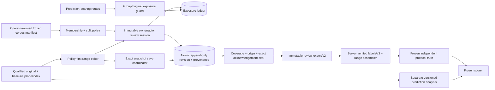
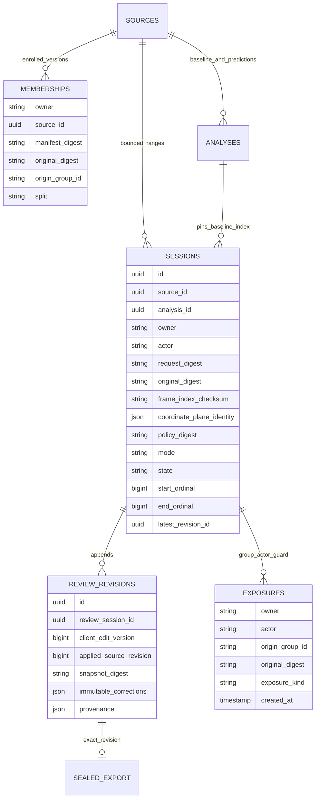

# SC-2150 — Full Fedora remaining implementation and delivery plan

Date: 2026-10-26. Project: `C:\Dev\IdeaProjects\ChromaScape`.
Felix: `task_1792382767281_cd8dbu69`, workflow `shortcut_delivery`, tag `shortcut:sc-2150`, classification `change:ui`.
Shortcut: https://app.shortcut.com/leeuwbot/story/2150 .
Windows follow-up: https://app.shortcut.com/leeuwbot/story/2204 .

This is the authoritative **remaining** execution plan. It supersedes conflicting remaining-work instructions in the 2026-10-25 plan while preserving its historical evidence. It does not certify unfinished code or mark test gates passed. Code already written but not verified end to end remains open below. Fedora means native execution on this host; no Windows runtime is required for SC-2150.

## Current execution order — review update 2026-10-27

This update takes precedence over older baseline/status descriptions below. The full Fedora packages remain in scope; Windows stays on SC-2204. Review evidence: `review-protocol-20261027.md`, Felix `note_1793090730452_228230aa`.

**Current verdict: not done.** Required policy injection, 201/200 result semantics, V48 coordinate-plane storage, converter plane checks and an assembler implementation now exist. Do not reimplement those completed code additions. Finish the defects and acceptance gates below. Earlier statements that the plane is not persisted describe the pre-V48 baseline; V48 now stores it, but its retry/read-back behavior needs correction.

Fresh independent checks: 370 JS tests, 87 Python tests and 23 focused Java tests passed. The Java selection includes 13 real PostgreSQL session tests, five migration tests, three plane tests and two controller tests, with no skips. These passing tests did not catch the two reproduced defects. The real browser run saved only five labels, then frame 15's exact preview entered `NEEDS_RECONCILIATION / CLEANUP_UNCONFIRMED`; the 60-label acceptance flow is **not passed**. The review did not rerun the whole reported 301-test package or the full ordinary Java suite.

### Remediation status — implementation run 2026-10-27

R27-1 and R27-2 are implemented with regression evidence. The assembler now requires a frozen `sc2150-fa12-derivation/v1` manifest (out-of-band digest), binds each document/label projection to it, and refuses edited, removed, out-of-plane, non-finite, origin/state-mismatched, duplicate-session and empty sealed inputs. The identical creation retry now returns the shared plane-aware projection.

The generated-fixture real browser flow now passes on this working tree: **60 labels entered, 60 reloaded, sealed, byte-identical immutable export, v3 conversion, 60/60 preview jobs `SUCCEEDED`, zero `CLEANUP_UNCONFIRMED`/reconciliation**, and the real sealed output assembles with the hardened assembler while all three tamper/empty variants are refused. The preview helper now uses a bounded allowance and fails with job diagnostics on a terminal preview error.

Evidence: `implementation-evidence-r27-remediation-20261027.md`; private receipts under `build\sc2150-r27-20261027\`. This update does **not** close the full Step 3 host-boundary proof, the remaining Step 4 access/race/cap/read-only matrix, Step 5, or Step 6 (F4–F11). Checklist items below stay unchecked until their complete evidence exists; Windows remains in SC-2204.

### Step 1 — Correct assembler integrity (R27-1, P1; F27I06/F27T07)

File: `scripts\sc2150\assemble_label_set.py`; tests: `src\test\python\test_sc2150_assemble_label_set.py`.

- Bind the supplied labels to verified sealed corrections and the pinned projection. Require authenticated immutable export/index evidence, or an independently trusted frozen derivation manifest with expected input/projection hashes. Self-set verification flags, copied sealed-export hash strings and freshly computed hashes of edited files are insufficient.
- Validate exact source/media/index/plane/split/template/range identities and required fields. Reject malformed ranges, duplicate sessions/ordinals, overlapping/conflicting sessions and mismatched projections.
- Require label state and manual origin to agree: VISIBLE/MANUAL_VISIBLE, ABSENT/MANUAL_HIDDEN, UNKNOWN/MANUAL_AMBIGUOUS. Validate coordinate types, finite values and the applicable output-plane bounds. Reject missing visible coordinates and contradictory visibility/drop fields.
- Compare the complete label projection against its sealed derivation so removed/extra labels cannot retain the independent-protocol claim. Check required dense PTS coverage against the frozen requirements, not merely declared interval metadata. Do not require labeling every raw frame or interpolate missing truth.
- Regression cases: take genuine current converter output, preserve its session/revision/export fields, then edit a label, inject an out-of-bounds or non-finite point, mismatch origin/state, delete labels, or empty the claimed range. Every invalid case must refuse before writing output. Also retain positive adjacent-session and compatible-plane cases.

Exit: altered converter output cannot become verified truth; legitimate sealed multi-session input assembles with exact identities, counts and coverage.

### Step 2 — Preserve the plane on identical creation retry (R27-2, P2; F27I03/F27T03)

File: `src\main\java\com\chromascape\web\debug\tickdebugger\video\service\MouseVideoReviewSessionService.java`; regression: `MouseVideoReviewSessionPostgresTest` and controller tests.

- Replace the retry branch's inconsistent `SELECT *`/`view` path with the same plane-aware projection used by `row`/`get`, or a shared mapping that always includes the persisted plane JSON.
- Preserve the same session ID, source/analysis/index/range, coordinate-plane document and plane digest. Keep 201 for new state and 200 for identical reuse; do not insert another session or advance a revision during creation retry.
- Add a real-PG retry case with valid non-null plane facts. Compare the immediate first/retry response's full pinned metadata, not only ID and `created`. Exercise a lost creation response followed by retry and later session resume. Lifecycle fields may reflect their documented current state, but immutable context must never disappear.

Exit: a valid first response and identical retry both expose the same non-null plane/digest and stable context.

### Step 3 — Diagnose the actual Fedora preview cleanup blocker (F2/F3/F9)

The observed failed job was `35d0d78e-2c98-4ac0-a36c-c8e8ee95e522`; the failure occurred at preview frame 15 after five saved labels in a generated fixture run. This is a confirmed runtime blocker, not an established regression attribution to the latest increment.

- Reproduce in a disposable loopback instance. Capture exact job/generation/lease, owned systemd scope/cgroup, root/descendant process identity and start times, control-command outcomes, output/drain completion and cleanup deadlines.
- Determine whether ambiguity comes from actual surviving descendants, a control timeout, disappearing/unloaded scope/cgroup state, permissions, or a runner/state race. Make a bounded source fix or correct the specific host prerequisite supported by that evidence.
- Verify process death and empty owned containment before successful cleanup/capacity release. Preserve uncertainty as reconciliation; never disable containment, force success, clear a job arbitrarily or kill unrelated scopes to make the test pass.
- Add a deterministic regression for the diagnosed failure. Keep the real fixture, error and cleanup receipts as evidence.

Exit: exact preview progression and owned cleanup are repeatable under the qualified Fedora boundary; the previously failing case no longer leaves ambiguous cleanup.

### Step 4 — Complete the real browser acceptance flow (F27I05/I06; F27T04–T07)

- Run the real Spring/PostgreSQL/Chromium scenario through at least 60 dense labels, both autosave thresholds, latest-version flush, close/reload/resume, seal, immutable export and coordinate-plane-validated conversion.
- Give preview assertions a bounded allowance matching the supported job budget and fail immediately with useful job diagnostics on terminal preview errors. The original helper's five-second wait was too short for one pending preview; a later 60-second run reached a genuine reconciliation failure. Do not hide that failure with longer waits or label frames that were never displayed.
- Prove delayed nonce/POST/history handling, lost responses with later edits, two sources/analyses/sessions, conflict/reload, remove-to-empty, 2,000/2,001 and encoded-byte limits, complete long-range paging and cancellation.
- Prove sealed read-only behavior across every mouse, keyboard, undo/remove/form/save path, plus the registered anonymous/other-owner/actor/nonce/Origin matrix. Recheck all prediction-bearing routes before sealing.
- Feed actual sealed outputs through the hardened assembler and verify old revisions/exports remain byte-stable.

Exit: all real mechanics and access/race/cap/read-only assertions pass on the exact candidate; synthetic mechanics evidence is not human-input or real-corpus accuracy evidence.

### Step 5 — Freeze and rerun the corrected candidate

Re-hash the final source/runtime/tool inputs; rerun the focused Java/PG/migration, complete JS/Python, owned formatting/static checks and whole video package. Execute required corpus tests explicitly when their inputs are ready; a skipped corpus harness is not a pass. Reproduce and attribute the reported CdiStartupRegressionTest failure before calling it unrelated, then complete the ordinary full Java/native/replay/stabilization selections and rollback checks in F10. Record actual counts rather than assuming the next run will still contain 301 tests.

### Step 6 — Complete the remaining Fedora product packages

The dependency table and detailed F4–F11 sections below still apply:

1. F4: locate/complete owner independent labels, prepare approved fresh held-out top-up and contamination ledger, and seal a complete frozen truth corpus. The recorded split still has three full held-out videos against a target of at least six; no labels or rights may be invented.
2. F5/F6: finish exact-identity dev-library/existing-source tooling, measured/versioned cursor and declared additional observations, hard negatives and complete live/offline parity.
3. F7: freeze candidate, truth, split, templates, tools and scorer before the single final evaluation; retain the 99% recall and all other numerical/coverage gates.
4. F8: complete the acquisition-specific sandbox, enforced proxy-only egress, pinned runtime/CLI and actual product YouTube success/fault/cancel/security proof. Corpus downloading alone does not qualify the product route.
5. F9: complete actual Fedora resource/recovery boundaries and the genuine owner-operated native trace/frame round trip.
6. F10/F11: complete full regressions, truthful readiness/telemetry, rollback rehearsal, feature-only delivery bundle, historical/current checklist reconciliation and actual validated Felix/Shortcut/PR handoff.

Owner artifact locations, fresh source choices and the native capture remain external inputs where absent. Continue independent implementation and fixtures meanwhile. No production deployment, automatic training/control activation or Windows work is included. Keep Felix `in_progress / spec_ready` and Shortcut In Progress until their real gates pass; this amendment checks no completion item.

## 1. Scope, exclusions and rules

Complete the Fedora external-video product: trustworthy review and label provenance; complete bounded queues; independent corpus preparation and qualification; measured visual methods; constrained product YouTube acquisition; actual native trace compatibility; operational readiness; regressions; evidence-backed delivery.

The owner explicitly moved **all Windows implementation and native Windows qualification** to SC-2204. This includes Job Objects, AppContainer/lowbox, Windows bounded volumes, Windows acquisition adapters and Windows browser/resource/trace verification. Those requirements are transferred, not passed, and cannot block SC-2150.

Continue to exclude gameplay dispatch, account login, live control, Micro6 production source changes, movement diagnosis (SC-309), exact video-to-tick alignment (SC-2151), training admission/activation (SC-712), model activation, automatic production deployment and unrelated repository cleanup. Owner-operated native capture is verification of existing integration, not authorization to manufacture a gameplay run. Preserve user WIP, old media, predictions, revisions, exports, Git index and applied migration checksums.

Rules: shared `C:\Dev\IdeaProjects\AGENTS.md`, repository `AGENTS.md`, Felix rule `rule_1792384572818_kvbix29u`, `.felix\shortcut-sync.json`, and `docs\CHROMASCAPE_RESTART_RUNBOOK.md`. Existing architecture/ERD/API/security/observability/mockup notes remain linked; amendments in this plan govern the session contract and Fedora scope. Use native POSIX paths locally; every path in Felix/Shortcut arguments or evidence references uses this canonical Windows root.

## 2. Verified baseline and limits

| Area | Observed evidence | Meaning for remaining work |
|---|---|---|
| Git | Branch `codex/sc-2150-mouse-video-import`, HEAD `e1eb17cd34af79333cff3f61c79a5271937a38a3`; local changes, no new commit/push | Freeze the eventual candidate before final qualification; never equate local code with PR contents |
| Earlier F1–F3 increment | 367 JS, 38 Python, 37 focused Java passed; actual Spring/PostgreSQL/Chromium review POST/retry/history/export passed | Interim corrections/v2 compatibility and exact uncertain retry are verified; legacy labels remain unqualified |
| Latest JS/core work | 370 JS tests passed, including >41-page complete index, cursor/gap/cancel refusal, dense PTS queue and time-scaled extrapolation | Later client history/session lifecycle changes still need a final browser and JS rerun |
| Broad Fedora video snapshot | 291 tests: **290 passed, 1 opt-in corpus test skipped**, zero failures | Run predates the final bounded-history edits; do not call it the final candidate run |
| Database/migration subset in that run | 39 PostgreSQL/migration tests, zero failures/errors/skips | Includes real PostgreSQL protocol races; does not replace clean-app and owner-bound HTTP qualification |
| Corpus skip | `MouseVideoCursorCorpusHarnessTest` requires `SC2150_FA12_CORPUS` | Accuracy/corpus qualification is not passed by a skipped harness |
| New server session work | V47, policy/exposure/session service/controller, bounded snapshot acknowledgement/history, session UI, sealed exporter and v3 converter exist locally | Implementation is in progress; final tests, protocol audit, actual 60-label flow and API/docs alignment remain mandatory |
| Fresh final video rerun | 294 tests: **293 passed, 1 opt-in corpus skip**, 0 failures/0 errors; PG/migration subset 42, zero skips | Includes latest bounded server history/session changes in the private snapshot; actual 60-label session/browser qualification is still open |
| Fedora tools | ffmpeg, ffprobe, bwrap and systemd-run are installed | Installation alone does not prove containment or qualification |
| Downloader | Recorded yt-dlp 2026.08.19 binary exists; hash matches `58162f9bfdc27458ea47bfcb311cf47028f17d8154a8bf7d689861d46399230a` | Missing PATH alias is not a missing tool; signature/runtime/egress/product-route qualification remain separate |
| Real corpus | Recorded held-out split has 9 full sections from **3 full videos**, plus cut-only material; target is at least **6 full videos** and about **6,000 visible labels** | Fresh full-video top-up and independent truth are still required |
| Owner label evidence | No `*.labels.json` in the recorded real-footage evidence directory | Locate owner-created exports elsewhere or obtain the required annotations; do not invent them |
| Native trace/capture | A fresh owner artifact location has not been supplied or verified in this execution | Keep genuine native round trip open; historical/unit evidence is insufficient |
| Tracker | Felix `in_progress / spec_ready`; Shortcut In Progress | Whole-story review/done gates remain unmet |

Evidence roots: `build\sc2150-fixes-20261026\` and `build\sc2150-sessions-20261026\`. Preserve the snapshot/source hash associated with each report. Use `final-video-summary.json` and `latest-owned-source-hashes.json` for the finished current run. Only the owned Java files were copied back after private-snapshot formatting; unrelated live files were not formatted.

## 3. Dependency order and finish criteria

| Package | Outcome | Depends on | Exit gate |
|---|---|---|---|
| F0 | Exact isolated Fedora baseline | none | source/tool/input hashes and actual test inventory |
| F1 | Finished authoritative review protocol | F0 | bounded, atomic, owner/actor-bound server invariants and migrations pass |
| F2 | Finished session/queue/save UI | F1 | complete range, mode, lifecycle, race and accessibility regressions pass |
| F3 | Real review → sealed export → labels | F1–F2 | 60-label real browser reload, sealed v3 conversion and access matrix pass |
| F4 | Approved independent truth corpus | safe F3 workflow, owner labels/rights/top-up | frozen source-disjoint manifest, full ranges and sealed label sets |
| F5 | Dev tools and measured detector successor | F3, dev labels | exact identities, hard-negative report and complete live/offline parity |
| F6 | Advertised additional visual methods | F3, supported-case dev labels | bounded supported methods and required precision/recall/boundaries |
| F7 | Single frozen final evaluation | F4–F6 | all frozen numerical and integrity gates pass |
| F8 | Constrained YouTube product acquisition | F0, chosen public clip/runtime/egress | product-route and network/fault/cancel/resource matrix pass |
| F9 | Fedora native and containment compatibility | F0/F3, owner capture | real trace/frame round trip and current host resource/recovery proof |
| F10 | Full regressions and rollback | F3/F7/F8/F9 | exact release candidate, dispositions and rollback rehearsal |
| F11 | Evidence, review and tracker/PR handoff | all preceding required exits | actual validated transitions and successful read-backs |

F8 preparation, F9 preparation and regression diagnosis can proceed while labels are being collected. F7 cannot proceed before independent truth and the evaluated method are frozen. Do not add routine permission checkpoints between already-authorized reversible steps. Do not stop all work because one package needs owner input.

## 4. F0 — Freeze and reproduce the Fedora candidate

Files: existing scripts under `scripts\sc2150`, `build.gradle.kts`, migration inventory and evidence manifests.

1. Record remote/branch/HEAD/index status and hash all owned Java, JS, HTML, Python, SQL, templates, tool binaries and truth/scorer manifests. Preserve unrelated files; scope Git operations explicitly.
2. Build in a private source snapshot with its own ordinary Gradle project/build outputs. Do not use a late `buildDirectory` override. Keep companion Micro6/SC967 fixture paths explicit. Do not copy `.env.local` wholesale into evidence or output credentials.
3. Use JDK21 only as the compatible Gradle launcher and the configured Java17 toolchain for compilation/tests. Set Docker API compatibility only for the process that needs it.
4. Use disposable `sc2150_...` databases, private media and ports 18190–18199. Record exact PIDs; stop only verified task-owned processes. Never repurpose/restart the normal 8090 service during qualification.
5. Capture actual JUnit counts, failures/errors/skips, JS/Python counts and source hashes. Keep the corpus opt-in skip visible until that corpus gate is actually run.
6. Preserve V42–V46 hashes. V47 is the current local **unreleased** session migration; verify it has not been applied to an external shared database before changing its draft. Once published/applied outside disposable verification, fix it only with a new migration.

Exit: one manifest identifies the tested code, runtime, tools and input data; no claims rely on unspecified “latest” code.

## 5. F1 — Finish the server-authoritative review protocol

Primary files:

- `src\main\resources\db\migration\V47__sc2150_review_session_provenance.sql`
- `...\video\service\MouseVideoReviewSessionService.java`
- `...\video\controller\MouseVideoReviewSessionController.java`
- `...\video\controller\MouseVideoController.java`
- `...\video\service\MouseVideoReviewService.java`
- `...\video\MouseVideoProperties.java`
- `src\test\java\...\video\MouseVideoReviewSessionPostgresTest.java`

### 5.1 Trusted membership and exposure

- Finish the operator-owned `review-corpus/v1` manifest contract. Inputs include original SHA-256, stable original-video/channel group and fixed dev/held-out split; browser `context`/reason/flags never confer membership.
- Bound manifest bytes and member count; reject malformed/duplicate digest entries, inconsistent group splits, invalid fields and unavailable policy. Record exact manifest digest and immutable membership versions.
- Forbid reassignment of already-enrolled originals/groups across dev and held-out, including reuploads. Preserve exposure recorded before enrollment by matching original digest as well as trusted group identity.
- Derive owner and audit actor from the existing principal. Audit every prediction-bearing route: observations, any raw observation/quality/manifest path, legacy history/review/export, export retrieval, derived catalog summaries and analysis scheduling. No alternate route may bypass the policy service.
- Persist permitted exposure before returning suggestions. Deny pre-seal held-out exposure and exposure during an open Blind session. Serialize exposure/session/seal decisions under one consistent source/group lock order; prove both directions with real PostgreSQL barriers.
- Remove or prove safe any optional-injection fallback that could leave production routes without their policy guard. Test wiring may use explicit mocks; production must fail closed if required guard infrastructure is missing.
- Keep external viewing limits explicit: the protocol records application access and an annotation attestation. It does not prove a person never saw footage elsewhere or certify human physical input.

### 5.2 Immutable session identity and lifecycle

Pin source, completed **probe/baseline** analysis, original digest, exact frame-index checksum, source coordinate plane, owner/actor, manifest digest, immutable mode and inclusive ordinal range. Blind labels must be possible before any `visual/v1` prediction is scheduled.

- Modes: WITHOUT_SUGGESTIONS and DETECTOR_ASSISTED. States: OPEN, SEALED, ABANDONED, with stale policy/index contexts refused or explicitly INVALIDATED.
- Keep a range at 1–2,000 indexed frames; keep existing 2,000-correction / 512 KiB normalized correction limits. Do not raise caps to fit long videos.
- Validate the current 256-session-per-owner/actor/source bound against the 150,000-frame supported maximum and normal 2,000-frame batching. Document the refusal and resumable existing sessions; never silently truncate.
- Make creation, retry, seal and abandonment stable and context-bound. Reusing a UUID with changed relevant content conflicts. Never mutate sealed labels or exports. Abandonment retains saved history and disqualifies that session's export.
- Refuse overlapping active/sealed ranges unless an explicitly defined immutable replacement protocol exists. Resume the existing session instead of accidentally creating duplicates after reload or an unknown response.
- Session reads/history must be owner/actor bound. Cursor IDs cannot disclose another source/session. Reconcile stale session state and explicit lifecycle UI behavior.

Before real qualification, explicitly finish persisted coordinate-plane/rotation/scaling identity and validate converter dimensions against it. The current new mechanics path does not yet establish that full guarantee. Also review mandatory production guard wiring, post-failure session resume, read-only controls, and bounded history as unfinished integration work.

### 5.3 Atomic review writes and acknowledgements

Retain legacy `corrections/v1`/`corrections/v2` inspection compatibility. Session-backed labels use unchanged v1 correction shapes plus `review-provenance/v1`; do not backfill old rows as independent.

The current additive session POST uses `{snapshotJson: <exact serialized snapshot>}`. The inner allowlisted snapshot contains requestId, analysisId, expectedBaseRevision, clientEditVersion, reason, sourceUse, corrections and origins. The server hashes the exact UTF-8 inner string and validates every parsed field. Finish and document this concrete wire contract rather than leaving the old proposed DTO ambiguous.

- Bound the wire snapshot separately from the normalized correction cap; reject unknown fields and non-integral/negative versions/ordinals.
- Validate exact origin keys and visibility: MANUAL_VISIBLE, MANUAL_HIDDEN, MANUAL_AMBIGUOUS, ACCEPTED_PREDICTION. Accepted predictions are forbidden in Blind sessions. Missing/extra/duplicate origins or out-of-range labels fail.
- Lock and validate source/global base plus session/policy/index, append the revision, persist provenance/client version/snapshot digest/applied revision and update the session acknowledgement atomically.
- Flush persisted state before constructing the first acknowledgement. Normalize timestamps and JSON numeric representations from stored data so retry acknowledgements match. Do not include mutable successor fields in an immutable acknowledgement.
- Return sourceId, analysisId, sessionId, revisionId, appliedSourceRevision, acknowledgedClientEditVersion and snapshotDigest. Identical retry remains stable after later global source changes; the client never guesses the base from an arbitrary response.
- Finish `getSnapshot`/`createSnapshot` bounded paths so session operations do not materialize all global source revisions just to calculate successors.
- Page session history by a session-bound immutable revision cursor. Cap item count and encoded response bytes; return explicit continuation. The latest cumulative revision remains available without loading older history.

### 5.4 Migration and evidence preservation

Test clean V47 startup and V46-populated upgrade with existing legacy revisions/exports and partial rows. Verify constraints, FKs, range uniqueness/application locking, null historical provenance and immutable old bytes. Do not use schema auto-update as migration evidence. Retest rollback/no-partial-write behavior on validation, geometry, lock and database failures.

Exit: protocol tests, clean/upgrade migrations, actual owner/anonymous HTTP tests and route audit pass. Existing code is not sufficient evidence by itself.

## 6. F2 — Finish client review, paging and save coordination

Files: `mouse-video.js`, `mouse-video-review-core.js`, `mouse-video.html`, applicable CSS, `src\test\js\mouse-video.test.js`, browser probes.

1. Resolve trusted policy before rendering suggestions, reading prediction-bearing history/exports or starting observations. On policy failure, leave review visibly unavailable and suggestions hidden.
2. Bind every callback/draft/undo/pending write to source + analysis + index + session + generation. Analysis switches use the baseline index when needed; stale callbacks cannot overwrite the new editor.
3. Keep local exposure monotonic and conservative. It supplements server evidence; clearing local storage does not erase the server ledger. Assisted → Blind cannot rename an old draft/session.
4. Require a truthful protocol attestation when opening an eligible session. Pin mode/range for its lifetime. Show open/sealed/abandoned state and qualification eligibility in plain language.
5. Retain deep exact pending snapshots before nonce/digest/network awaits. At most one save per editor is in flight. Retry unknown outcomes with the exact UUID/body; only after acknowledgement send later edits under a new UUID. Verify server context, edit version and content digest.
6. Autosave after 25 mutations and short idle; flush the latest version on close/source/analysis switch. Stop on conflicts, preserve labels, require explicit base reload/new identity. Support intentional empty cumulative saves after undo/removal.
7. Protect browser navigation while dirty/writing; do not claim unload/sendBeacon persisted anything. Reload acknowledged content and resume the same server session/edit-version lineage.
8. Finish the checksum-pinned complete index iterator: declared count, contiguous ordinals, changing/repeated cursors, empty/partial pages, byte bounds, cancellation and context change. Cover more than 8,200 frames and the supported maximum. Eliminate silent 41-page truncation.
9. Keep rendering and queue memory bounded. Page/window the frame table, show full range coverage, and partition session ranges instead of growing correction arrays beyond caps. Optimize PTS nearest-frame lookup with sorted maps/binary search.
10. Use a dense PTS-based 10 Hz queue for truth, including range endpoints. The sparse 0.6 s triage grid is not dense qualification coverage. Match client and server dense coverage semantics on CFR/VFR/ties/gaps.
11. Segment trails at cuts, unknown/non-visible samples, missing indices, timing and transform discontinuities. Extrapolate with actual PTS deltas, clamp source bounds and omit invalid/final-frame estimates; never treat the dot as observation.
12. Make sealed sessions read-only across every path: keyboard, accept/click/H/A, undo, draft removal, manual correction form and save. Prevent a locally editable sealed draft from producing a false saved notice.
13. Finish explicit abandonment/resume/history paging and sealed download controls. Older history must not replace the latest save acknowledgement. Preserve focus, status announcements, keyboard behavior and narrow-screen geometry.

Exit: complete JS suite and deterministic browser races pass, including delayed nonce/POST/history, lost response + later edits, close/switch failure, stale responses, mixed/legacy origins, sealed read-only and empty saves.

## 7. F3 — Actual Spring/PostgreSQL/browser qualification and v3 truth export

Scripts: `qualify_review_protocol.mjs`, `qualify_review_backend.mjs`, new `qualify_review_sessions.mjs`, existing access/lifecycle/restart/browser helpers, and `labels_from_review_export.py`.

### Required real mechanics run

Use a generated fixture explicitly labeled GENERATED, in a disposable app/database. Do not touch real held-out footage for mechanics tests.

- Install a hashed synthetic operator policy; verify observations, old export routes and prediction scheduling refuse before sealing.
- Open an eligible Blind session before any suggestions, manually exercise **60 labels**, cross two autosave thresholds, final-flush close, reload and assert the exact same 60 labels/origins.
- Exercise ordinary/assisted versus Blind sessions, two analyses, two sources, source-wide base conflict from another page, unknown save outcome, delayed nonce/read, failed flush, undo/remove-to-empty, 2,000/2,001 items and encoded-byte limits.
- Exercise long-source complete range paging, repeated/changing cursors, malformed/empty terminal pages, cancellation and source/index mismatch.
- Seal only the latest exact acknowledged revision with full dense coverage. Incomplete ranges, old acknowledgements, wrong digest, accepted predictions, mixed/unknown origin and stale policy/index must refuse.
- Reopen sealed state, prove read-only controls, download byte-identical sealed exports, retain old v1/v2 exports unchanged and verify all owner/actor/anonymous/nonce/Origin cases against actual registered routes.

### Export and converter completion

- Use `mouse-video-review-export/v2` + `review-provenance/v1`, exact session/revision/range/media/index/policy identities and content digest. Preserve raw sealed bytes; no reconstruction of old files.
- Finish the `sc2150-fa12-labels/v3` adapter. Verify raw export bytes against the authenticated server's immutable sealed endpoint; only a literal loopback verification origin is accepted, redirects refused and response bytes bounded.
- A local independent flag, CLI protocol choice or free-text reason cannot grant qualification. Legacy unknown and BLIND_UNVERIFIED inspection labels remain dev-only.
- Verify origins, baseline analysis, frame count, checksum, PTS, coordinates and corpus split. Distinguish application protocol independence from external viewing, human input and training eligibility.
- Add a multi-session label-set assembler: pin immutable export/revision refs and checksums; require compatible media/index/coordinate/split identities; reject overlapping/conflicting ranges, missing required ranges, duplicate frames and mixed protocols. Do not silently fill/interpolate labels.
- Version scorer adapters explicitly. Frozen v2 scorers remain unchanged history; qualify the v3 adapter and any new scorer semantics before looking at held-out outcomes.

Exit: real 60-label workflow, complete access/race/cap matrix, actual sealed conversion and multi-range integrity proof. Generated mechanics labels do not satisfy real accuracy or human-input gates.

## 8. F4 — Real corpus, contamination ledger and owner truth

Inputs: `verification-runs\20261023T021614Z-fa12-real-footage\{manifest,split,screening,import-receipts}.json`, acquired media under ignored `build\sc2150-yt`, owner annotation exports.

1. Audit existing byte hashes, source IDs, URLs/rights/privacy, full-video/channel groups, frozen split and cursor-template provenance. Acquisition and owner-held-out labeling decisions D1/D2 were already recorded; do not ask for those permissions again.
2. Locate existing owner label/export files. If absent, prepare the now-safe annotation ranges and a concrete operator queue. Never fabricate owner annotations or silently upgrade historical unknown provenance.
3. Prepare a versioned top-up manifest adding **at least three fresh full videos** to the current three, satisfying the channel-disjoint requirement and targeting about **6,000 actually visible** labeled frames, plus real absent frames across multiple sources. More sections from the same three videos do not meet a six-video target.
4. Select fresh sections and annotation density before outcomes are known. Preserve all previous assignments. Never move dev sources to held-out after tuning.
5. Record Theoatrix's already-exposed/cut-only status. Prepare fresh cut-footage replacements for selection before the final evaluation; preserve the original manifest and contamination history.
6. Freeze inclusion/exclusion reasons, original-group identities, rights/privacy decisions, window/range IDs, required 10 Hz ordinals, visible/absent/ambiguous/drop counts and template classes. Owner supplies/validates missing source choices and labels.
7. Seal independent session exports and assemble complete per-source label sets. Hash the label index, exports, reviews, frame indices and scorer input. Report unlabelled and dropped coverage explicitly.

Exit: complete approved source-disjoint corpus and auditable dense truth. No final scoring is allowed while this gate is open.

## 9. F5 — Dev library tools and measured cursor successor

Files: add `scripts\sc2150\analyze_library_sections.py`; extend `qualify_live_cursor.py`; `MouseVideoAnalysisIdentity`, scheduling/catalog identity DTOs, `MouseVideoCursorTracker`, visual analyzer and corpus adapter tests.

- Add loopback-only, explicit-source dev analysis tooling. Consult trusted server membership, refuse held-out even if an evaluator could read it, validate original hashes, and retain per-source receipts/errors.
- Expose/pin the server-owned method/config/template/tool identities needed by tooling. Skip only an exact completed match; an arbitrary old selected analysis is not sufficient. Validate expected identities atomically before scheduling, not merely after consuming media.
- Add an existing-source/analysis collection path; do not reupload the library to collect predictions. Fully page index/observations with pinned hashes, cursor-loop checks, ordinals/PTS and source/output coordinate transforms.
- Start with real dev evidence, including Langsamt s3 hard negatives at ordinals 375 and 1989, cursor disappearance, stationary valid cursors and window takeovers. Do not inspect held-out predictions while tuning.
- Measure current `cursor-template/v7`; retain only evidence-supported changes. Candidates include reviewed per-video templates, appearance/motion verification and higher-resolution local matching. Do not implement every candidate blindly.
- Every retained output change receives a new method/config/tool/template identity. Preserve prior artifacts. Publish per-source gains/regressions, supported cursor styles, runtime/resource costs and rejected experiments.
- Establish complete live/offline parity: no missing required observations, coordinates, visibility states or cuts; exact source media/index/PTS binding despite intentionally different truth versus prediction analysis IDs.

Exit: dev thresholds and hard negatives pass with reproducible identity/parity evidence; no global accuracy promise from a synthetic clip.

## 10. F6 — Additional observations and honest capability manifests

Files: `MouseVideoVisualAnalyzer`, reviewed templates/method configuration, observation/quality contracts, catalog capabilities and corpus tests.

Current TARGET_REGION is explicitly UNSUPPORTED. Implement a bounded declared case, such as an approved visible UI rectangle template, with exact source pixels and confidence; never invent game-entity/world positions. Add supported-case action indicators for visible menu/highlight/cursor-state changes without calling them physical clicks. Separate cursor pause from static background motion. Qualify regional camera/activity estimates and genuine edit cuts against interface-change hard negatives.

For each method, publish configured/installed/runnable/isolated/qualified separately; include method/version, supported layouts/templates, unknown reasons, sampling and coordinate plane. Do not advertise an unmeasured configured method as qualified. Keep unsupported cases deterministic unknown.

Exit: declared supported-case labels and method-specific metrics meet the gates below; all required outputs have complete live/offline parity and bounded execution.

## 11. F7 — Freeze and execute one final evaluation

Freeze exact code candidate, original source/group/split manifest, sealed truth/export hashes, templates, algorithms, tools, scorer, metric/PTS/coverage semantics and runtime settings **before** any held-out outcome is read.

| Gate | Required result |
|---|---|
| Cursor median error | ≤4 equivalent 1080p source pixels |
| Cursor p95 error | ≤12 equivalent 1080p source pixels |
| Visible recall | ≥99%, required supported frames included |
| Absent false detections | ≤1%, real denominator reported across sources |
| Genuine edit cuts | F1 ≥0.90 within one indexed source-frame tolerance |
| Advertised action/target/camera/activity candidates | precision ≥0.95 and recall ≥0.80 on declared supported cases |
| Pause boundaries | p95 within two selected-frame intervals |
| Determinism | identical normalized observation hashes on identical fixed input/method |
| Live/offline parity | zero missing/mismatched required observations |
| Unsupported/physical/native/control claims | explicit unknown; no fabricated telemetry or eligibility |

Test the scorer's VFR matching, missing-frame penalties, sampling coverage, coordinate transforms, dropped spans and cut tolerance before evaluation. Report per-source/template counts, visible/absent coverage, errors, confidence intervals clustered by clip/source, cuts and failures. Run the frozen real and synthetic held-out evaluation once. A failed gate stays failed; tuning after outcomes requires a fresh independent set. Do not weaken thresholds or selectively drop hard clips.

## 12. F8 — Fedora product YouTube acquisition

Files: `MouseVideoYouTubeAcquirer`, restricted/process runner, import/finalization pipeline, new acquisition-specific sandbox/egress components, configuration/capabilities and tests. Existing third-party corpus downloading is not product-route qualification.

1. Reconcile existing recorded decisions, preserve the known yt-dlp 2026.08.19 pin and verify its release signature. Validate exact CLI flags with that binary. Pin any required JS runtime independently; no unattended latest install.
2. Prepare a concrete fixed runtime/public-clip/egress manifest. Resolve only the still-missing clip/runtime/provisioning details; do not repeat settled acquisition permissions. Do not upload private owner recordings or choose third-party use rights on the owner's behalf.
3. Implement a separate acquisition sandbox. Decoder/analysis execution remains no-network. Acquisition gets an operator-provisioned namespace whose only reachable endpoint is a filtering proxy; a downloader `--proxy` flag alone is not enforcement.
4. Restrict CONNECT to reviewed provider/CDN names and port 443. Resolve and check addresses at connection time, including redirects/subrequests/rebinding and IPv4-mapped IPv6. Deny loopback, private, CGNAT, link-local, metadata, ULA and multicast destinations. Bound DNS/connect/read/overall time, connections and bytes.
5. Use only server-owned argv/canonical provider IDs, generated paths and a hard bounded workspace. No cookies, browser profiles, netrc, plugins, arbitrary flags, credential inheritance or executable selection. Verify binary/runtime pins immediately before launch.
6. Fetch bounded metadata first; verify the returned video ID and refuse playlists, live/upcoming, unavailable and authentication-required material. Accept only the expected complete regular media file, never links/sidecars/partial output. Record exact bytes/hash, provider identity, acquisition time, selected format and tool/runtime pins.
7. Publish through existing fenced/idempotent import registration. Cancellation/lease loss kills and verifies owned containment; ambiguous cleanup remains reconciliation, never false cancellation success.
8. Exercise the actual `/imports/youtube` route: approved public success/retry, private/unavailable faults, pin drift, missing runtime, oversize/timeouts, cancellation, filesystem/credential/egress attacks and cleanup. Use controlled rate-limit fixtures instead of provoking a provider.

Exit: complete real product and enforcement matrix. Keep `youtube-enabled=false` until its gates genuinely pass.

## 13. F9 — Fedora host containment and genuine native compatibility

### Host boundary proof

Re-run actual systemd/cgroup-v2 + bwrap execution: memory plus `MemorySwapMax=0`, CPU/PID/time/output bounds, hard bounded job storage, exact read-only inputs/runtime and private writable workspace. Demonstrate secret/profile/network denial and no sibling-original write access. A disk polling loop is not a hard quota. Prove descendant termination before reporting cleanup/capacity release, including fast-parent exit, session-changing descendants, cancellation, shutdown and JVM death. Preserve live foreign leases; fence stale generations and late publication with current PostgreSQL barrier tests and restart/sweep checks.

### Owner-operated native round trip

Locate or obtain the owner-run recording/frame-timing sidecar/trace artifacts and exact selected runtime identity. The owner performs login/gameplay/recording. Enable only existing approved sidecar/trace paths for that session; do not dispatch gameplay to manufacture input.

Verify recording/trace source identity, PTS/trace clocks with ≤50 ms skew, frame drops/duplicates and explicit unknowns. Export and convert using `label_from_mouse_trace.py`; compare exact ordinals of a known generated cursor path. Mark generated/bot traces as such; they do not prove human movement. Restore prior settings and stop only task-owned resources.

Exit: actual Fedora containment/recovery and native trace/frame evidence. Unit tests and installation checks alone cannot close it. Windows is wholly SC-2204.

## 14. F10 — Full regressions, readiness and rollback

1. Run final focused video, trace/frame-timing, native mouse/replay/stabilization and full ordinary Java suites on the exact candidate. Run all JS and Python suites and owned-file formatting/static checks. Keep SC967 inputs, toolchain and Docker configuration explicit.
2. Reproduce and attribute failures by exact test/code/input. The older audit's 2,907 tests, 69 failures and 16 skips are historical, not current proof or automatically unrelated. Compare candidate and appropriate baseline without wiping WIP; fix owned regressions and record genuine external/unrelated blockers precisely.
3. Name every skip and actually execute required opt-in corpus/host checks. No skipped database or required corpus gate is called passed.
4. Finish bounded low-cardinality telemetry for policy/session create/refuse/seal/abandon, exposure, snapshot retry/conflict/context mismatch, queue coverage, export/converter refusal, provider/egress outcomes and containment reconciliation. Never metric-label actor/source/URL/path.
5. Report configured/available/runnable/isolated/qualified honestly. Feature-disabled, missing-policy and unsupported-method states must be explicit and safe. Raw import never grants training, control, human-input or exact native-tick claims.
6. Rehearse rollout on a disposable clone: migration first, additive server, compatible client, qualification off until proven. Use the repository host runbook for any later authorized actual restart.
7. Rehearse rollback: disable new qualification/provider admission, drain or truthfully reconcile jobs, flush or visibly retain drafts, restore an intact prior artifact, retain additive schema and immutable evidence, reject stale tool/config identities and clean only unreferenced verified-owned work volumes. Do not reverse V47 destructively or rewrite v2/v3 evidence for old readers.

Exit: exact candidate reports, failure dispositions, readiness/operations docs and successful rollback/restart evidence.

## 15. Acceptance criteria

All remain open until their complete evidence exists; partial implementation is not acceptance.

- A1 Given an enrolled unsealed held-out source, when any UI/API prediction-bearing route is used, then no suggestions escape and the decision is owner/actor/group bound.
- A2 Given assisted/unknown/exposed lineage, when Blind is requested or an export converted, then it cannot be certified as independent protocol truth.
- A3 Given edits during nonce/POST/history delays or a lost response, when saved/closed/switched, then the exact uncertain snapshot is resolved first and every later edit is acknowledged once or visibly retained.
- A4 Given two contexts and stale responses, when selecting/seeding/undoing/reloading, then source/analysis/index/session/generation binding prevents cross-context mutation.
- A5 Given cuts, unknowns, missing indices or invalid timing, when trails/extrapolation render, then no discontinuity is bridged and source bounds/PTS are respected.
- A6 Given 60 real-page mechanics labels and intentional removal to empty, when saves settle and reload occurs, then the exact latest set and origins survive revision/export.
- A7 Given clean/V46-upgrade/legacy data, when migration/session/export paths run, then old evidence stays immutable/unknown and new acknowledgements are stable.
- A8 Given long sources, malformed/repeated cursors and caps, when reviewing, then complete bounded coverage or an explicit terminal error is shown.
- A9 Given anonymous/other-owner actors, malformed bodies and policy/session/seal races, when routes are called, then authentication, nondisclosure, atomicity and idempotency hold.
- A10 Given sealed truth and later prediction analyses, when converted/scored, then original/index/PTS/coordinate identities match without relabeling truth.
- A11 Given the frozen source-disjoint corpus and fixed candidate, when evaluated once, then every numerical, coverage, integrity, parity and determinism gate passes.
- A12 Given approved public YouTube input and faults/attacks, when the product route executes, then bounded acquisition/provenance/egress/cancel/cleanup are proved with no credential bypass.
- A13 Given an owner-operated native recording on Fedora, when trace/frame evidence is converted, then clocks/drops/lineage/ordinals and generated classification are correct.
- A14 Given current Fedora resource/recovery paths and regressions, when exercised, then required boundaries hold, foreign work is preserved and original workflows remain correct.
- A15 Given final evidence and all historical/current obligations, when delivery transitions are attempted, then Felix validation actually succeeds and tracker/PR state matches successful operations.

## 16. Authoritative implementation and verification checklist

These execution items supplement, not erase, original/CP25 obligations. Reconcile both inventories before handoff. Windows-only originals are transferred to SC-2204, not checked as passed.

### Implementation

- [ ] F27I01 Freeze exact Fedora source/tool/input/runtime baseline (F0).
- [ ] F27I02 Finish trusted membership, immutable split/group identity and all-route exposure guards (F1).
- [ ] F27I03 Finish bounded session lifecycle, atomic provenance snapshots and stable acknowledgements (F1).
- [ ] F27I04 Finish V47 clean/upgrade compatibility and bounded snapshot/history data access (F1).
- [ ] F27I05 Finish session-aware client saves, complete bounded queues, dense truth, read-only/lifecycle UX and PTS-safe trails (F2).
- [ ] F27I06 Complete actual app review/seal/export/v3 converter and multi-session label-set handling (F3).
- [ ] F27I07 Prepare approved corpus top-up/contamination ledger and complete independent sealed truth (F4).
- [ ] F27I08 Add exact-identity dev analysis and existing-source prediction tools (F5).
- [ ] F27I09 Retain measured/versioned cursor improvements and complete parity (F5).
- [ ] F27I10 Implement and qualify declared additional observations/capabilities (F6).
- [ ] F27I11 Freeze and pass one final real/synthetic held-out evaluation (F7).
- [ ] F27I12 Implement/qualify acquisition sandbox, proxy enforcement and product YouTube route (F8).
- [ ] F27I13 Complete actual Fedora containment/recovery and owner native round trip (F9).
- [ ] F27I14 Complete ordinary/full regressions, bounded telemetry/readiness and rollback rehearsal (F10).
- [ ] F27I15 Review the isolated feature diff and prepare the concrete authorized delivery bundle (F11).
- [ ] F27I16 Reconcile all obligations/evidence and perform actual Felix/Shortcut/PR handoff (F11).

### Verification

- [ ] F27T01 Exact baseline hashes, complete test inventory and all skip reasons.
- [ ] F27T02 Real PG membership/exposure/session/submit/seal/abandon races, legacy contamination, split drift and owner/actor boundaries.
- [ ] F27T03 Clean/V46 migration, immutable legacy rows/exports and request/ack retry stability after later revisions.
- [ ] F27T04 Browser delayed nonce/POST/history, unknown response, queued edits/close/switch, stale callbacks and empty saves.
- [ ] F27T05 Complete >41-page/max-supported range, cursor/identity/byte/count/cancel failures and bounded history.
- [ ] F27T06 Actual 60-label reload/seal/export/converter, caps, read-only state, multiple contexts and registered auth/nonce/Origin routes.
- [ ] F27T07 Sealed v3 and multi-range identity/coverage/origin verification; forged/local/assisted/unknown truth refusal.
- [ ] F27T08 Corpus rights/privacy/groups/split/contamination/density audit and scorer VFR/coverage fixtures.
- [ ] F27T09 Real/synthetic dev hard negatives, exact method/template/tool identity and complete live parity.
- [ ] F27T10 Frozen numerical gates, source-clustered confidence intervals, determinism and immutable report hashes.
- [ ] F27T11 Provider pin/signature/runtime/CLI, product success/retry/fault/cancel, proxy-only address/redirect/DNS and hard workspace tests.
- [ ] F27T12 Actual Fedora resource/secret/network/filesystem/descendant/restart/lease/publication/sweep boundary checks.
- [ ] F27T13 Genuine owner capture/trace/frame timing, ≤50 ms skew, drops/ordinals and generated classification.
- [ ] F27T14 Full ordinary Java/native/replay/stabilization, all JS/Python, static checks and rollback/disable/recovery.
- [ ] F27T15 Evidence integrity, historical/current checklist reconciliation and successful tracker/PR read-backs.

## 17. External inputs and execution policy

| Input | Still needed | Work that proceeds meanwhile |
|---|---|---|
| Owner labels | Locations of sealed owner exports, or completion of the prepared safe annotation queue | F0–F3, dev tools, fixtures and regressions |
| Fresh held-out top-up | Concrete source/window/rights choices and contamination disposition | Protocol, existing dev work and candidate manifest preparation |
| Native evidence | Owner capture/trace/sidecar files plus actual runtime/session identity | Trace conversion/contracts and synthetic regression tests |
| Product acquisition | Missing public product test clip/runtime/egress provisioning details after reconciling recorded decisions | Exact manifests, sandbox/proxy code and controlled fault tests |
| Release/merge | Reviewable tested feature diff and existing delivery authorization | All reversible implementation/evidence preparation |

Windows host access is **not** an SC-2150 dependency. If a required external input is absent, record the specific missing input and continue independent work. Do not invent labels, rights, human input, source membership, successful acquisition, metrics, test passes or tracker transitions.

## 18. Delivery and durable evidence

Use the existing Felix task and classification; never create a second SC-2150 task. Before any new Felix writes, check the active project's pending outbox and reconcile applicable SC-2150 records idempotently. Successful validation is not a transport outage. A genuine double transport failure uses the canonical project's `docs\builderflow\felix-sync\pending` outbox; never manually author pending records in generated `felix-notes`.

Before `in_progress → in_review`: every implementation obligation must be evidenced, with an Implementation Evidence note containing `## Changed files`, `## Tests`, `## Remaining work`. Before `in_review → done`: every acceptance/test obligation must be evidenced, with Verification Evidence containing `## Acceptance results`, `## Tests`, `## Risks`, `## Rollback`.

Current Shortcut mapping: planned 500000007, started 500000008, review 500000009, done 500000010; blocked/cancelled are intentionally null. Read the actual repository mapping again before mutations. Existing planned/started markers must not be duplicated. Only after a real Felix transition succeeds may the corresponding mapped Shortcut state and exact idempotency marker be sent; read back actual results. Keep SC-2204 linked and outside Fedora completion.

Prepare a concrete feature-only diff/commit/PR bundle while preserving unrelated WIP. Do not claim local source is pushed or PR #70 is current without comparing actual heads. Follow the session's authorization for commit/push/release; no automatic production deployment is included.

Final completion report must state the complete implemented plan, task/status, actual Shortcut synchronization, changed files, tests run and skips, numerical results, risks, rollback evidence and remaining work. If any required gate is unrun or failed, state it and keep the task truthful.

## 19. Reference architecture, data and API contract





The diagram is the target design. A separate sealed-export table is optional: the existing immutable sealed text field can implement the one-session/one-sealed-export relationship if byte stability, identity and size bounds are proven. `coordinate_plane_identity` represents the still-required authoritative transform binding; do not pretend the current draft table already stores it.

### API completion table

All routes are under `/api/debug/mouse-videos`; all object reads require the existing owner principal, all mutations require the existing nonce and same-origin guard. Wrong-owner/actor objects are nondisclosing 404; malformed input 400; policy refusal 403/422 as frozen by the versioned error contract; changed identity/base/state 409. Unknown request fields are refused.

| Route | Concrete request | Response/remaining contract work |
|---|---|---|
| `GET /sources/{id}/review-policy` | `analysisId` query | index/policy digest, eligible immutable modes, split, prediction access, max range, resumable sessions; bounded, no predictions |
| `POST /sources/{id}/review-sessions` | requestId, analysisId, frameIndexChecksum, policyDigest, mode, startOrdinal, endOrdinal, annotationAttestation | pinned session; finish distinction of 201 new versus 200 identical retry and test it; never infer a new row from status alone |
| `GET /review-sessions/{id}` | session identity | immutable context, lifecycle state, latest acknowledged revision; no other actor's data |
| `GET /review-sessions/{id}/reviews` | optional session-bound `before` revision ID and capped `limit` | ascending display page of recent immutable revisions, explicit nextCursor, <=20 items and bounded encoded bytes |
| `POST /review-sessions/{id}/reviews` | outer `snapshotJson` string; strict inner snapshot described in F1 | exact persisted acknowledgement; finish 201 new/200 identical retry semantics without changing legacy endpoint behavior silently |
| `POST /review-sessions/{id}/seal` | requestId, revisionId, snapshotDigest | SEALED only for latest exact acknowledgement, complete dense range, valid origins and no disqualifying exposure |
| `POST /review-sessions/{id}/abandon` | requestId, latestRevisionId or explicit null for an empty session | ABANDONED; saved history retained; sealed evidence never abandoned/deleted |
| `GET /review-sessions/{id}/export` | sealed session ID | raw immutable `mouse-video-review-export/v2`, exact revision JSON/digest, session/policy/media/index/plane/origins, attestation and seal time |
| Existing legacy review/export routes | unchanged v1/v2 inspection inputs | immutable historical compatibility, exposure policy enforced, no fabricated independent provenance |
| Existing frame/index/preview routes | exact source/index/ordinal | raw blind-safe source evidence; existing frame geometry authorization retained |
| Existing observations/catalog/analysis/export reads | existing bounded inputs | shared policy/exposure decisions before derived outputs; no policy bypass through metadata or alternate routes |

Freeze the full machine-readable OpenAPI 3.1 request/response/error schemas before client rollout. Include the byte/count/range/session bounds, immutable acknowledgement fields and concrete status/refusal semantics above; update all browser/HTTP fixtures to exercise the real contract rather than accepting arbitrary future shapes.

### UX state contract

```text
CHECKING_POLICY -> READY_BLIND or READY_ASSISTED or REFUSED
READY -> SAVING (editor remains usable; newer edits distinct)
SAVING -> SAVED | RETRY_SAME_SNAPSHOT | CONFLICT_WITH_DRAFT_RETAINED
CLOSE/SWITCH -> FLUSH_LATEST -> CLOSED/SWITCHED or STAYS_OPEN_UNSAVED
OPEN_SESSION -> SEALED_READ_ONLY or ABANDONED_HISTORY_RETAINED
SEALED_READ_ONLY -> IMMUTABLE_DOWNLOAD
```

Display the current source/index/range, session mode/eligibility, labelled coverage, latest acknowledged edit and any queued/unsaved/conflict state. Keep raw exact-frame labeling separate from prediction analysis. An independent-protocol label is not a claim of human physical input or downstream training admission.

End of authoritative Fedora remaining implementation plan.
