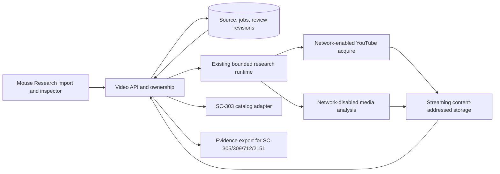
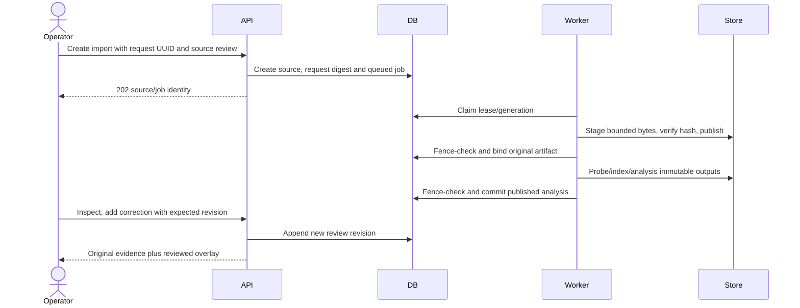
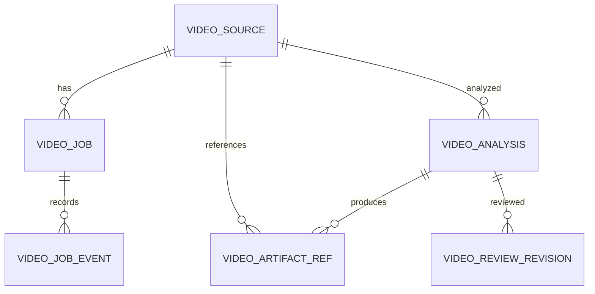

# SC-2150 — External video import and human-behavior analysis

Status: full delivery plan; implementation has not started. Prepared 2026-10-19.
Source: https://app.shortcut.com/leeuwbot/story/2150
Canonical project: `C:\Dev\IdeaProjects\ChromaScape`.
Classification: `change:ui` (one authoritative classification; implementation also includes API, data, worker and security changes within this repository).
User requested planning only. Do not interpret this document, estimates or unchecked lists as implementation or acceptance evidence.

## 1. Product goal and first demonstration

An operator opens Mouse Research, uploads an OSRS video or supplies a supported YouTube link, reviews visible cursor movement and behavior in the resulting catalog entry, corrects uncertain observations, and exports a versioned evidence bundle. This supplies human-behavior references for diagnosing unnatural/ineffective mouse movement, including Original NaturalMouse, without claiming that pixels are native mouse telemetry.

First demonstration: import a short owned OSRS Fishing clip, inspect its original and browser-playable video, review the cursor overlay and pauses, mark an obscured interval unknown, correct a cursor point and label a visible interaction, then export source/media/analysis/review identities. Repeat an identical request and prove no duplicate job/source. Import a corresponding public YouTube clip when the provider is available; provider refusal must be truthful but cannot substitute for the required successful supported-source integration check.

No real gameplay, Micro6 changes, service restart, model fitting or model activation is required to implement this story. Native capture remains available and unchanged.

## 2. Verified baseline and linked rules

Inspected local ChromaScape HEAD: `5a7c30f8369806be6d6a400fd1fd59a45a32b5ec`; this is a baseline identifier, not a promise about the eventual implementation base. Preserve existing changes and inventory the scoped worktree before coding.

Existing code:

- `src/main/java/com/chromascape/web/debug/tickdebugger/service/MouseResearchService.java`: native-session catalog, persisted labels/jobs, one worker/eight queued slots; unfinished jobs become failed at startup. Do not describe it as a leased multi-instance scheduler.
- `MouseResearchWorker.java`: fixed configured Python worker, frozen code/input hashes, bounded process execution and owned process cleanup. Reuse these mechanisms; do not put video through the three-minute training limit or accept arbitrary executables.
- `controller/MouseResearchController.java`: `/api/debug/mouse-dataset` dashboard/catalog/labels/jobs. Its catalog selects native tick sessions, so an external source must not be represented by a fabricated `DebugSession`.
- `controller/MouseRecordingInspectionController.java`: native exact-action inspection. Keep that route and evidence semantics intact.
- `src/main/resources/templates/mouse-research.html`, `mouse-recording.html`, `static/js/mouse-research.js`, `mouse-recording.js`, and `static/css/mouse-research.css`: extend existing navigation with a separate external-video inspector module.
- `src/main/java/com/chromascape/web/replay/artifact/ReplayArtifactService.java`: content-addressed staging/publication, but preparation takes `byte[]` and references are replay-run-bound. Extract/reuse a streaming byte-store primitive without inventing a replay run, retaining its existing adapter and regression coverage.
- `docs/mouse-recording-dashboard.md`: documents native research constraints. Some capability statements are historical; actual inspected source and fresh tests take precedence.
- `build.gradle.kts`: Java 17, Spring MVC/JPA/Flyway, JavaCV dependency, JUnit/Mockito/Testcontainers and Spotless/Checkstyle. No inspected YouTube or external-video analysis implementation exists.

Rules linked to the Felix task must include the project `AGENTS.md`, the shared Felix/Shortcut delivery contract and these story-specific constraints: immutable raw evidence; observed versus inferred source separation; server-generated IDs/paths; bounded processes and downloads; no raw input/control; preserve unrelated work; no fabricated validation evidence.

Pending Felix sync records were scanned oldest-first: twenty existing records are already marked `conflict` for unrelated SC-1112/1429/1449/1618/728/811 work. Leave them pending without overwriting their conflicting Felix content. No SC-2150 pending record was present at intake.

## 3. Scope, ownership and exclusions

Included:

1. Authenticated bounded file upload; supported YouTube single-video import; immutable original media and acquisition provenance.
2. Durable source/job metadata, idempotency, progress, cancel, restart reconciliation and safe artifact publication.
3. Media probing, browser proxy/thumbnail, frame presentation-time index and video-quality/visibility report.
4. Visible cursor tracking for standard arrow and a reviewed OSRS cursor-template pack, operator-selected viewport/crop/scale, cuts and track gaps; no unsupported cursor claims.
5. Visible pause/motion intervals, candidate interaction/camera/activity annotations, confidence and exact source-frame references. Automatically detect only qualified features; provide manual annotations for the rest.
6. Catalog integration, an external video inspector, append-only correction/source-use review and a source-linked export consumable by sibling stories.

Ownership:

- SC-2150 owns import, media artifacts, video observations and the minimal review needed to inspect/correct them.
- SC-303 owns the broader recording catalog and shared inspection experience; this story implements the external-video entry/adapter, not every remaining SC-303 acceptance item.
- SC-305 owns training-quality policy; emit quality facts and conservative per-feature eligibility here, without claiming its full completion.
- SC-712 owns published curation and dataset admission. Implement a versioned review contract/adapter here; if a publishing API is unavailable, export it and keep training eligibility false.
- SC-309 owns bad/unnatural movement detection, reference cohorts and calibrated verdicts. Show measurements/unknowns here; no automatic “human”/“bot” label from tracking confidence.
- SC-2151 owns video-to-native-tick alignment; export stable PTS/frame/identity references now. No tick synchronization implementation here.
- SC-280 owns replay integration, SC-360 time-base rules, SC-754 artifact-byte lifecycle, SC-806 scheduler evolution and SC-753 privacy/security policy. Integrate available contracts; do not block fixture work on whole sibling stories.

Excluded: private/account-gated/DRM bypass; arbitrary URL download; playlists/live streams; audio/speech analysis; arbitrary computer-vision model training; hidden world state; physical click reconstruction; device polling-rate inference; exact tick inference; causal simulation; new live executor; model fitting/activation; automatic promotion; fleet infrastructure; changes to Micro6 or backend services.

## 4. Architecture and design decisions

Use Spring for authenticated API, ownership, metadata and catalog; a fixed server-owned Python video worker for download/probe/decode/tracking. Pin yt-dlp, FFmpeg/ffprobe and OpenCV toolchain versions and binary/package hashes in the worker manifest. First build must resolve exact tested versions and lock them; do not download tools/plugins/models at job runtime or silently auto-update. yt-dlp is a bounded provider adapter, never a generic URL executor. FFmpeg probe/decode uses presentation timestamps, not `frame_number / nominal_fps`.

Reuse the current research job submission/status/cancellation facade through a typed video handler. Persist video execution claims/leases and publication metadata in PostgreSQL, polling from the existing bounded worker runtime. Reuse the same concurrency admission, process cleanup and artifact primitives. Do not create a competing public scheduler. Existing training jobs retain their contract; extraction of shared runtime code requires regression tests. SC-806 can later consume this typed handler/store contract.

Worker stages are explicit: acquire → probe → proxy/index → cursor/quality analysis → publish. Each stage has immutable inputs and a staging directory owned by job/attempt. Original bytes are published before an analysis attempt; failed analysis leaves an inspectable source. Original and browser proxy have separate hashes and an explicit timestamp mapping.





### Cursor and behavior method

Decode original media at source PTS, retaining source dimensions/timebase and rotation. A user may mark the game viewport and select/seed a cursor template. Use normalized template matching across a bounded scale pyramid, temporal displacement/shape consistency and scene-cut resets. Distinguish detection confidence from tracking continuity and source-human confidence. No synthetic interpolation across hidden/cut spans in authoritative point output; any UI interpolation is separately labeled display-only.

For supported tracks publish image-pixel displacement, PTS duration, visible pauses, curvature and corrections where sampling permits; normalized viewport coordinates accompany original coordinates. These are video-space quantities, not physical device velocity/acceleration. Repeated loops/scene differences do not establish an actual repeated mouse action. Mark candidate visible menu/interaction or camera events `VIDEO_DERIVED`; manual annotations can name activity/target class but cannot manufacture a native object ID, click button or successful outcome. First release offers manual action/camera/activity labels; automatic event detectors are enabled individually only with separate tested coverage in the analysis capability manifest.

## 5. Persistence and ERD

Use an additive Flyway migration, choosing the next free version on the actual implementation base. Do not assume the current highest local number is deployable. PostgreSQL constraints and real migration tests are required; no Hibernate schema mutation.



Proposed tables (prefix `mouse_video_`):

- `sources`: UUID, authenticated owner, source kind (`UPLOAD|YOUTUBE`), canonical provider ID/URL (safe metadata), declared origin (`HUMAN|GENERATED|UNKNOWN`), origin review, task/skill/context/place labels, lifecycle, revision, created time. Never use native session IDs for external media.
- `jobs`: UUID, source/owner, kind/stage, input/config/toolchain digest, idempotency key and normalized request digest, status, generation/fence, lease expiry, attempt, progress, cancellation revision, bounded sanitized error and timestamps. Unique `(owner, request_id)`; conflicting body reuse is 409. Analysis dedup includes media digest/config/toolchain; changed parameters create a distinct attempt/version.
- `job_events`: immutable transition/event ID, job/generation, type/time and bounded metadata; preserve unknown outcome and cleanup evidence.
- `artifact_refs`: UUID, owner/source/analysis, role (`ORIGINAL|PROXY|THUMBNAIL|FRAME_INDEX|OBSERVATIONS|QUALITY|REVIEW_EXPORT|MANIFEST`), SHA-256, byte length, media type and `STAGING|FINALIZED|QUARANTINED` state. Byte objects may deduplicate globally; source metadata and access never deduplicate across owners. SQL row registration follows verified file publication; reconcile orphans after failure.
- `analyses`: immutable UUID, source/original digest, algorithm/template pack/config/toolchain digest, capability/coverage summary, manifest hash, completed time. Points live in bounded indexed artifact shards, not millions of SQL rows.
- `review_revisions`: UUID, source/analysis, predecessor, authenticated actor/time/reason, expected base revision, source/use review, append-only correction artifact/manifest and state (`DRAFT|REVIEWED|SUPERSEDED`). Optimistic revision conflicts return 409. Keep the current revision pointer separately guarded; final manifests never mutate.

Artifact contract `mouse-video-evidence/v1`: source identity and acquisition manifest; original/proxy hashes and mapping; video stream metadata; toolchain/config/template manifest; index/shard identities; raw estimated points/events; gaps/quality; review references; source/use/provenance decisions; `native_telemetry=false`, `exact_ticks_available=false`, `control_allowed=false`, `training_eligible=false` until a separate validated published curation admits a declared use.

Point/event fields: `analysis_id`, stable observation ID, source stream/frame ordinal, integer PTS plus rational timebase, presentation time in microseconds, optional x/y and bounding box in source pixels, viewport transform version, visibility, separate detector/continuity confidence, method/template ID, gap reason, evidence reference. Optional native IDs are absent, not invented placeholders. Canonical JSON avoids floating non-finite values; exact rational source time is retained for SC-2151.

## 6. API contract

Proposed prefix `/api/debug/mouse-videos`; validate unknown fields, ownership and bounded inputs. Reuse existing local replay principal infrastructure where suitable, verified by dedicated tests. State changes require authenticated server-established actor and existing CSRF policy; caller audit headers are labels, not authentication.

| Method/route | Request | Result |
|---|---|---|
| GET `/capabilities` | none | Available tools/formats/limits/methods; no private paths |
| POST `/imports/upload` | multipart file, request UUID, declared source/context/use metadata | 202 sourceId/jobId/statusUrl; bytes streamed to owned staging |
| POST `/imports/youtube` | request UUID, supported URL, declared source/use metadata | 202 source/job; download occurs only in worker |
| GET `/sources` | cursor, limit 1–25, source/status/context filters | Paginated external catalog; opaque source-kind adapter for SC-303 |
| GET `/sources/{id}` | owner access | Source/probe/analysis/review status and capability reasons |
| GET `/sources/{id}/media/{role}` | controlled media role, HTTP Range | Authorized 200/206, 416 invalid range; no filesystem URL |
| POST `/sources/{id}/analyses` | UUID, crop/scale/cursor-pack and bounded versioned config | 202 analysis job; identical retry returns same identity |
| GET `/jobs/{id}` | owner access | Stage/status/progress, typed error, attempt and cleanup state |
| POST `/jobs/{id}/cancel` | UUID, expected revision | 202 cancelling or 200 settled; no false cancellation success |
| GET `/analyses/{id}/observations` | time range/page cursor/limit ≤500 | Bounded points/events, gap/coverage and exact source refs |
| POST `/analyses/{id}/reviews` | UUID, expected revision, corrections/reason/use decision | 201 new review; old predictions preserved |
| GET `/sources/{id}/export` | analysis and review identity | Exact authorized manifest/refs; checksums and eligibility reasons |

Errors use `{code,message,retryable,jobId,sourceId,details}` with safe details: 400 invalid URL/schema/range/config; 401 unauthenticated; 403 unauthorized operation; 404 inaccessible/missing source; 409 idempotency/revision conflict; 413 byte limit; 415 unsupported container/codec; 422 undecodable/missing video/unsupported protected/live source; 429 queue/storage quota; 503 configured tool/provider unavailable. Asynchronous provider/worker errors are persisted with equivalent stable codes (`SOURCE_UNAVAILABLE`, `SOURCE_AUTH_REQUIRED`, `SOURCE_RATE_LIMITED`, `MEDIA_LIMIT`, `CURSOR_UNSUPPORTED`, `NO_VISIBLE_CURSOR`, `DECODER_FAILED`, `CHECKSUM_MISMATCH`, `WORKER_TIMEOUT`, `INTERRUPTED`, `CLEANUP_UNCONFIRMED`). A valid video with no visible cursor remains inspectable with unavailable tracking, rather than a false failed import or fabricated points.

## 7. Limits, job lifecycle and recovery

Initial reviewed defaults (configurable only by server operator and recorded per attempt): upload/download 512 MiB; decoded duration ≤20 minutes; ≤3840×2160 and ≤120 fps; decode at most 150,000 frames; ≤60 fps cursor analysis sampling with exact selected PTS; one active video worker within the research admission boundary, eight waiting slots; source/job disk quota 4 GiB; 30-second network connect/read limits, 10-minute acquire budget, 30-second probe budget, 20-minute decode/analysis budget, 5-second child shutdown budget. Account for transient decoder frame buffers; process RSS bound 2 GiB and CPU/process limits enforced by the worker launcher. Limit violations retain reasons and cannot publish a “complete” analysis. No unbounded extracted-frame directory. User-facing limits are shown before import; defaults must be tested on supported hosts before release.

States: `QUEUED → RUNNING → SUCCEEDED|FAILED|TIMED_OUT|CANCELLING`; `CANCELLING → CANCELLED|NEEDS_RECONCILIATION`. Stage is independent of status. Lease heartbeat every 5 seconds, expiry 30 seconds, DB clock for ownership; generation and expected revision guard progress/publication. No external video work begins from a GET.

On restart/lease loss, preserve source bytes and stage evidence; do not assume old process success. Recover a fully verified publication using manifest and fenced DB reconciliation; otherwise settle interrupted attempt and offer an explicit new bounded attempt. No blind reacquisition/analysis on startup. Late workers cannot publish after cancellation or generation change. Confirm only owned process descendants stopped; if cleanup cannot be proved, mark reconciliation required and hold its worker slot until resolved. Retries consume a new attempt budget and never overwrite prior evidence.

## 8. Security and privacy decision record

Uploads are untrusted media. Use generated paths, extension-independent probing, size/time/dimension/frame caps, network-disabled decoder, bounded output and protected temp directories. Reject symlinks/path traversal and external FFmpeg protocols; decoding must not fetch URLs embedded in media. File/decoder permissions cannot read application secrets. Serve playable proxy with correct content type, `nosniff`, Range ownership and no HTML execution; escape titles/annotations.

YouTube input permits reviewed `youtube.com/watch?v=…` and `youtu.be/…` single-video forms only; normalize to provider ID and rebuild the URL. Reject userinfo, custom ports, local/private destinations, playlist/live/auth-required sources and arbitrary extractors. Network access is confined to a constrained acquisition process with operator-reviewed YouTube/media-CDN egress and redirect/IP validation; application source checks alone do not sandbox yt-dlp. Disable user config, plugins, cookies, credentials, caller flags, exec/postprocessing hooks and runtime self-update. Provider tools/JS runtime (if required) are pinned and isolated. Unavailable access never triggers a workaround that bypasses authentication.

Source-use review records operator declaration and permitted use; public availability is not proof of human input or training permission. Default all imported sources to inspection-only. Original footage may contain player names/chat: restrict it to its owner; retain crop/redaction derivatives separately, never mutate originals or leak content into logs. No external vision/provider API receives media in the first implementation. Retention/deletion is owner-authorized and reference-aware: garbage collection only after references expire; deletion leaves a minimal audit tombstone without keeping forbidden private content. Training reference invalidation follows curation policy.

## 9. UX specification and mockup

Mouse Research adds “Import video” next to native recording controls. Dialog tabs: Upload file / YouTube link; fields: source declaration, context/skill/place, source/use declaration. Before submit show limits and “Video observations are estimates; import does not verify human input.” Submit returns a durable progress card with cancel/status link. Tool unavailable shows a specific remediation and keeps native recording usable.

External inspector: original/proxy player, source/time/visibility, cursor and gap overlay toggles, quality panel, source-use review, paginated events/corrections and export. Clicking an observation seeks its exact presentation-time range; keyboard seeking/range selection and screen-reader labels work. No native tick column without an SC-2151 alignment. Bad-movement labels appear only from an identified SC-309 report; this story exposes evidence and descriptive metrics.

```text
Mouse Research    [Record native session] [Import video]
Filters: Source | Context | Skill | Place | Review
Video title  UPLOADED/YOUTUBE  origin UNKNOWN  READY / 62% cursor coverage
  [Inspect] [Analysis status] [Review source/use]

Video inspection                              [Export evidence]
[      video + optional cursor overlay      ]  Source/use: needs review
[play] 00:12.420 [seek] [visible gaps]           Tracking: supported/uncertain
Timeline: [track][gap][track][cut][unknown]      Native ticks: unavailable
Observation | time/frame | estimate | confidence | [correct]
[Add visible action annotation] [Save new review revision]
```

States to cover: empty, upload in progress, queued, acquiring, probing, analyzing, cancelling, cancelled, timed out, unavailable provider/tool, decode failure, no visible cursor, partial coverage, review conflict, inaccessible/deleted artifact and ready. Never label unknown as zero movement. Refresh restores durable IDs; losing a browser tab does not duplicate work.

## 10. Acceptance criteria (all currently unchecked)

- [ ] AC1 Given a valid bounded upload, when submitted, then one immutable source/original hash and playable proxy/index become inspectable.
- [ ] AC2 Given a supported accessible YouTube video, when imported, then the canonical provider ID/acquisition metadata and exact downloaded digest are retained; unavailable/protected/live sources fail explicitly.
- [ ] AC3 Given identical request UUID/body, when concurrently retried, then one source/job exists; conflicting content receives 409 without partial publication.
- [ ] AC4 Given malformed/oversized/overlong/pathological media, when processed, then bounded failure occurs with no unbounded memory/disk/CPU or complete-artifact claim.
- [ ] AC5 Given a qualified visible cursor clip and pinned tools/config/templates, when analyzed, then source-linked tracks/metrics meet the declared held-out threshold and repeated outputs have the same normalized hash.
- [ ] AC6 Given hidden/unsupported cursors, overlays, crop/resize, cuts or frame-rate variation, when analyzed, then gaps and feature eligibility are accurate and unsupported observations remain unknown.
- [ ] AC7 Given manual point/event corrections, when saved, then the original video/predictions remain immutable and the new reviewer/reason/base-revision lineage is resolvable.
- [ ] AC8 Given imported footage, when training is requested, then no import/source declaration alone grants human or training eligibility; published curation and independent policy gates are required.
- [ ] AC9 Given cancel/restart/lease loss at each stage, when reconciled, then no late/duplicate publication occurs, source evidence is preserved and cleanup/outcome is truthful.
- [ ] AC10 Given another owner or unauthenticated caller, when requesting media/status/review/export, then access is denied without private metadata disclosure.
- [ ] AC11 Given no native telemetry/alignment, when inspecting/exporting, then PTS/frame evidence is available but native ticks/physical clicks/hidden state are not invented.
- [ ] AC12 Given catalog filters, refresh, keyboard navigation and error states, when used, then source/status/coverage are clear and existing native mouse capture/inspection still works.
- [ ] AC13 Given browser/worker differing representations, when seeking/exporting, then original/proxy time mapping and hashes identify the actual frame evidence, within one source-frame interval on qualified ranges.
- [ ] AC14 Given a bad-movement or human-origin claim, when shown, then it is supported by a separate reviewed source/report identity; tracker confidence never substitutes for detector calibration or human verification.

## 11. Implementation checklist and sequence

- [ ] I1 Inventory scoped changes/base and prerequisites; read nested rules; reserve the migration version on the actual target base.
- [ ] I2 Freeze v1 schemas for import, source, evidence, job/error, review and SC-2151 handoff; add golden manifests.
- [ ] I3 Add PostgreSQL source/job/analysis/review/ref/event schema, unique constraints, fenced transitions and migration tests.
- [ ] I4 Extract/reuse bounded streaming artifact bytes with checksum/publication/recovery; keep replay adapters working.
- [ ] I5 Add typed video handlers to research runtime with limits/leases/cancellation and no silent startup rerun.
- [ ] I6 Implement authenticated streaming upload and source/use metadata with UUID/body idempotency.
- [ ] I7 Implement pinned YouTube adapter, canonicalization and constrained acquisition environment; persist truthful provider outcomes.
- [ ] I8 Implement probe/proxy/thumbnail/frame PTS index; verify original/proxy mapping and bounded temporary storage.
- [ ] I9 Add reviewed cursor-template pack provenance and tracker, quality/gap report and descriptive feature/annotation capability manifest.
- [ ] I10 Add append-only manual corrections/source review and export adapter; training defaults remain false.
- [ ] I11 Add external-source catalog adapter and video inspector/API/media Range handling with ownership.
- [ ] I12 Add accessible import/progress/cancel/inspection/review UX and explicit uncertainty/error states.
- [ ] I13 Add observability, reference-aware cleanup, operator configuration/tool lock/setup and rollback runbook.
- [ ] I14 Run focused contracts, real PostgreSQL, worker media tests and native regression; fix scope-related failures.
- [ ] I15 Run browser and supported-host public-source smoke with exact tool hashes; archive results and all unrun gates.
- [ ] I16 Link Implementation Evidence with changed files/tests/remaining work; check only proved items before in_review. Link Verification Evidence with acceptance/tests/risks/rollback before done. Synchronize only successful Felix states using repository mapping.

Deliver upload/probe/inspect first; then tracking/review; then supported YouTube acquisition; then hardening and independent qualification. These are increments, not permission to drop the YouTube acceptance path or report partial coverage as whole-story completion.

## 12. Test checklist and release gates

- [ ] T1 Contract: valid/invalid/unknown fields, stable typed errors, rational PTS and canonical manifest hashes.
- [ ] T2 PostgreSQL: clean migration plus upgrade from actual base, uniqueness, concurrent retry/conflict, fenced publication, revision races and immutable history.
- [ ] T3 Artifact: streaming byte limits without full-file allocation, digest mismatch, simultaneous reuse, failure between move/DB bind, orphan/ref-aware cleanup and denied traversal/symlink.
- [ ] T4 Upload: real small valid media, truncated/no-video/unsupported codec, false extension, quota/rate limit, disconnect and Range 200/206/416.
- [ ] T5 Provider: fake adapter for deterministic success/removal/auth/rate limit/redirect/download overflow; real accessible controlled public YouTube video on release host, exact version/log proof. Never make network availability a passing mocked live test.
- [ ] T6 Isolation: arbitrary URL/host/port/userinfo, private IP/redirect/media protocol and config/plugin/cookie/exec injection refusal; no decoder egress or secret reads.
- [ ] T7 Real-tool media corpus: fixed and variable FPS, dropped/duplicate frames, rotation/crop/resize, cuts, speed changes and proxy mapping. Synthetic fixture results are labeled synthetic.
- [ ] T8 Tracking: manually annotated owned OSRS clips with visible standard/OSRS cursor, menu/overlay, occlusion and unsupported styles. Split whole source videos before tuning. On declared supported held-out visible spans target median error ≤4 source pixels (at 1080p-equivalent scale), p95 ≤12 px and ≥90% visible-frame recall; on explicitly absent spans false detections ≤1%. Report counts/CIs and domain-specific failures; unavailable data means unverified, not relaxed thresholds. These qualify tracking only, not detector or engine quality.
- [ ] T9 Repeatability: identical tool/config/media on same supported build produces same normalized observations/manifests; cross-platform tool differences get distinct toolchain identities and no false byte-identical claim.
- [ ] T10 Review: correction precedence, revision conflict/idempotency, reviewer authority, raw immutability, source-use/curation rejection and export lineage.
- [ ] T11 Lifecycle: cancel/timeout/restart/lease theft before/during each stage/publication; owned process cleanup and slot release, late-worker refusal and reconciliation-only ambiguity.
- [ ] T12 API ownership: anonymous, foreign owner, forged audit header, authorized owner, private logs/title escaping, media/export access.
- [ ] T13 JS/browser: import fields/limits, empty/progress/error/no-cursor/gap states, durable refresh, inspect/overlay/seek/review/export, keyboard and narrow viewport.
- [ ] T14 Regression: existing MouseResearchService/worker/controller, MouseRecordingInspection, catalog JS, campaign/training/capture and replay artifact tests, plus Spotless/Checkstyle and scoped diff check.
- [ ] T15 Supported-host smoke: upload and public-source import, inspect/correct/export, cancel mid-job, restart recovery and deny cross-owner media; record native commands and actual binary hashes. No Micro6 build/login required.

Planned commands (confirm names on implementation branch): `./gradlew test --tests '*MouseVideo*Test' -Psc967VectorsPath=<native-fixture-path>`; focused existing mouse/replay-artifact JUnit selectors; `python3 -m unittest discover -s src/test/python -p 'test_mouse_video*.py'`; `node --test src/test/js/mouse-video*.test.js`; existing mouse JS suites; dedicated Playwright external-video smoke; `./gradlew spotlessCheck checkstyleMain checkstyleTest`; `git diff --check -- <owned-paths>`. New tests must be wired to repository verification, not ad hoc scripts alone. Ordinary test compilation may reveal unrelated baseline failures; archive them and do not claim a full green suite.

## 13. Planned changed files

All implementation paths below are proposed; none has been changed by this planning task:

- `C:\Dev\IdeaProjects\ChromaScape\src\main\java\com\chromascape\web\debug\tickdebugger\video\` — typed API/service/entities/repositories/config/import/review contracts.
- Existing `MouseResearchService.java`, `MouseResearchWorker.java` and catalog/page wiring — narrow handler/adapter extraction only where required.
- `...\web\replay\artifact\` and shared streaming byte-store package — retain backward API/behavior with regression tests.
- `...\src\main\resources\db\migration\V<next>__mouse_video_sources.sql`.
- `...\src\main\resources\mouse-research\video_worker.py`, tool lock/template-manifest assets and schemas.
- `...\src\main\resources\templates\mouse-video.html`, existing research template; `static\js\mouse-video.js` and related CSS.
- Mirrored Java/Python/JS/browser tests plus reviewed small fixtures and documented fixture provenance.
- `...\docs\mouse-video-import.md`, `docs\mouse-recording-dashboard.md`, `.env.example` and packaging/config docs as needed.

Do not modify Micro6, its source or live runtime. A later discovered cross-repository necessity requires an explicit plan revision and truthful classification change, not a second classification tag.

## 14. Observability, rollout, risks and rollback

Structured logs: source/job/stage/attempt/generation/toolchain hash, bounded progress, bytes/frames/time, source-kind, typed failure and cleanup result; no raw titles, credentials, private URLs or original content. Counters: queued/active, quota/timeout/refusal, decode/tracking coverage, cancellation/cleanup failures and artifact corruption. Health reports missing tools/isolation and queue capacity, never “ready” on executable existence alone. Export coverage/unknowns separately from success counters.

Default `MOUSE_VIDEO_ENABLED=false`; enable upload/analysis after local verification and `MOUSE_VIDEO_YOUTUBE_ENABLED` only when pinned downloader/egress checks pass. Show capabilities/reasons, not silent feature absence. Deploy additive migration and tool bundle first, run upload smoke, then provider smoke. First host is the identified Fedora host; Windows runtime claims need separate native verification. No service restart or deployment is authorized merely by a plan-writing request.

Risks: YouTube access/tool changes; cursor invisibility/low-resolution footage; tracking confounds from edits and UI; large media/disk pressure; migration collisions on divergent branches; existing file-backed job constraints; extracting shared artifact logic; lack of reviewed human clips. Mitigation is explicit pinned capabilities, strict bounds, unknowns/inspection-only defaults, real PostgreSQL/decoder/browser testing and source/algorithm versioning. The user must supply or approve an owned human reference corpus for real-human tracking/behavior qualification; synthetic success is not human acceptance.

Rollback: disable both video flags and stop/reconcile only owned video jobs; retain original media/manifests/review history under access controls. Revert scoped application integration while preserving native mouse/replay behavior and additive database tables. Never drop shared artifact bytes referenced by native/replay/other source owners. Restore prior worker/tool manifest. Re-enabling requires integrity/recovery smoke, not automatic replay of old jobs.

## 15. Planning verification and handoff

Performed for this plan: Shortcut story/comments/relations read; local project rules and sync mapping read; pending-folder conflict inventory; source/API/worker/artifact/build/document inspection; official tool documentation review. No code build, application test, media import, model training, browser QA, gameplay, deployment or restart has been performed.

Reference documentation (design support, not installed-version evidence):

- yt-dlp maintained integration/options: https://github.com/yt-dlp/yt-dlp#embedding-yt-dlp
- ffprobe stream/frame metadata: https://ffmpeg.org/ffprobe.html
- OpenCV template-matching method: https://docs.opencv.org/4.x/d4/dc6/tutorial_py_template_matching.html

Felix remains the durable plan record; this repository document is a reviewable copy. Link the full plan and any conditional Architecture, ERD, API Contract, Observability, UX Mockup and Security Decision artifacts to the one `shortcut:sc-2150` task. Keep all implementation/acceptance/test items unchecked. For this planning-only request, validate specification completeness without a transition that automatically starts implementation; leave status `planning` and report the actual validation result. A future full-delivery request follows the normal spec_ready → in_progress flow automatically.
