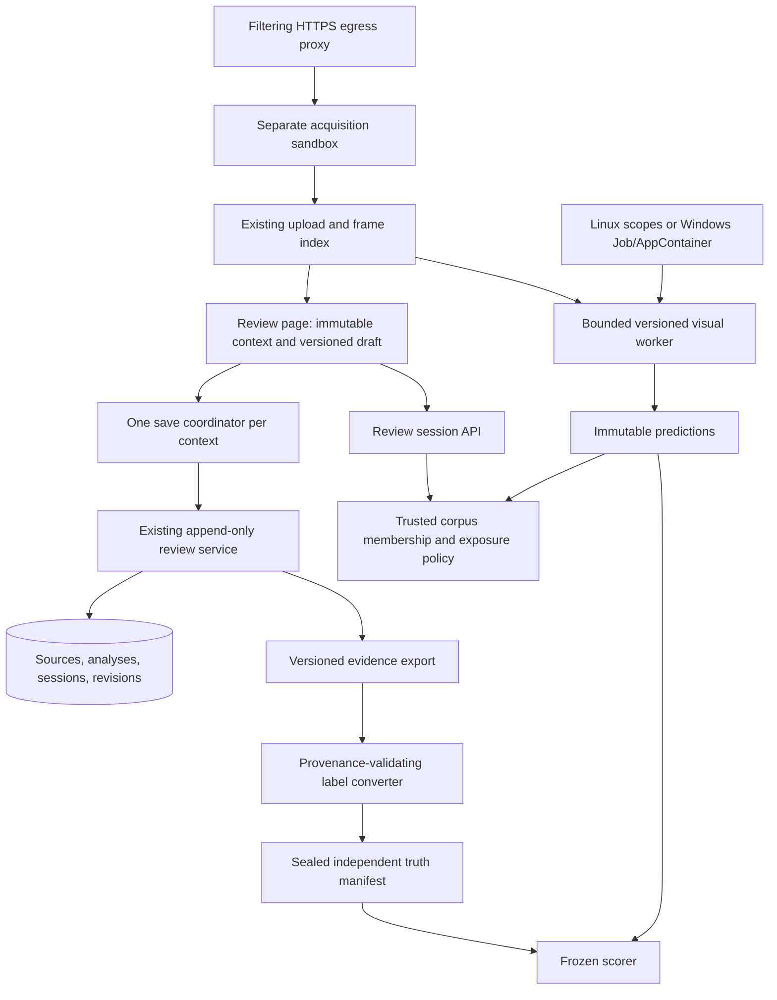
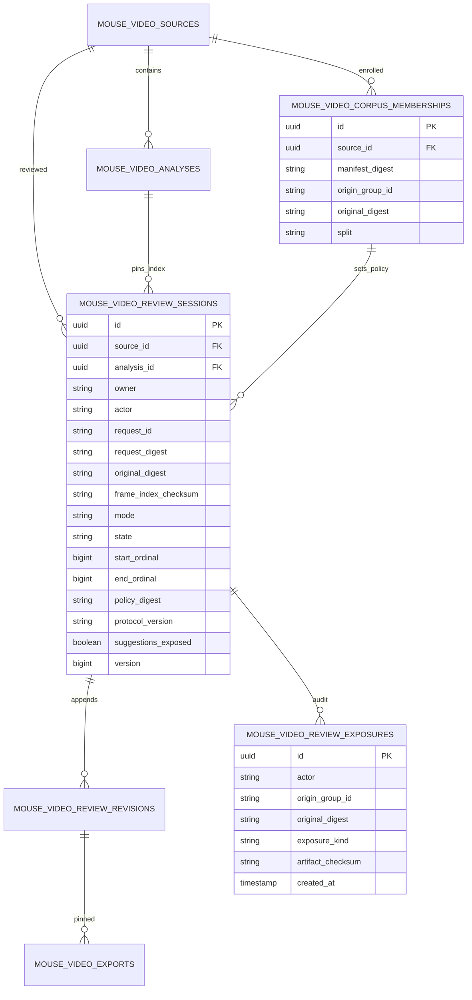

> Current authoritative Fedora execution plan: `fedora-remaining-implementation-plan-20261026.md` (Felix `note_1793017313598_71a46088`). This document remains historical context.

> Owner amendment 2026-10-26: Windows implementation and native Windows verification are transferred to [SC-2204](https://app.shortcut.com/leeuwbot/story/2204) and excluded from SC-2150 completion. Preserve the Windows sections below as historical design for that follow-up. Fedora/Linux, corpus, provider and owner-operated native-capture obligations remain. See `execution-scope-20261026.md`.

# SC-2150 — Full remaining implementation and delivery plan

Date: 2026-10-25. Project: `C:\Dev\IdeaProjects\ChromaScape`.
Felix task: `task_1792382767281_cd8dbu69`; workflow: `shortcut_delivery`;
source: https://app.shortcut.com/leeuwbot/story/2150; classification: `change:ui`.

This is a planning deliverable. It does not implement the changes below, qualify a detector,
enable a feature, authorize a production restart, or claim review/done. All CP25 implementation,
acceptance and verification items start unchecked. Existing evidence and checklist content are
preserved. This amendment supersedes older remaining-work instructions where they conflict,
including instructions that call review mode wholly absent or still use 90% recall.

All file references below are relative to the canonical Windows project root unless a full
Windows path is supplied. Native Fedora commands must run on Fedora; Windows qualification must
run natively on Windows. The Git remote is `ikiddoi/ChromaScape`.

## 1. Baseline, scope and linked rules

### Verified baseline and limits of that evidence

- Upload, durable jobs, probe/derivatives, exact previews, ownership, correction revisions,
  catalog split and immutable exports already exist. Reuse them rather than rebuilding intake.
- Local V7 tracking and review-mode code is newer than PR #70's fetched head
  `16ecd8393dea66a3bdbf7885c1acac7a6d4d1aa5`. The branch has unrelated user changes.
- The memory fix now sets `MemorySwapMax=0`; the follow-up invoked all three current resource
  test methods successfully. Imported replay has its notice/loader fix and passing JS regressions.
- The latest follow-up ran 360 JS tests successfully but reproduced R1–R4 in
  `docs\builderflow\sc-2150\review-remaining-20261025.md`.
- The prior audit ran 2,907 ordinary Java tests with 69 failures and 16 skips on its older
  snapshot. One snapshot companion-path failure subsequently passed in isolation. This is not
  a fresh count for later code and is not proof that all failures are unrelated to this story.
- The later implementation increment reports a video run with 31 skips. Those database and
  corpus gates are not passed. One synthetic V7 dev clip and 299-frame live parity are mechanics
  evidence only, not FA12 qualification.
- Eight-channel corpus acquisition/screening and the label converter exist. The recorded pending
  corpus evidence is being reconciled separately; acquisition is not product YouTube qualification.
- Felix was read as `in_progress / draft`; Shortcut as In Progress. No later state is inferred.

### Included work

R1–R4 corrections; enforceable review-session provenance; source/analysis-bound cumulative saves;
complete bounded review queues; independent corpus preparation and labelling; V7 successor and
all advertised observation qualification; constrained YouTube product acquisition; native trace
round trip; Linux/Windows containment and qualification; regression reconciliation; operational
readiness; PR and durable completion evidence.

### Exclusions

No gameplay automation, account login, live input/control, Micro6 production source changes,
human-versus-NaturalMouse diagnosis (SC-309), exact video-to-tick alignment (SC-2151), training
admission/policy activation (SC-712), invented physical clicks/device polling/hidden state,
model activation, automatic release/deployment or unrelated repository cleanup. Micro6 is used
as an existing producer during owner-operated verification. A discovered need to change that
repository requires an explicit amendment and its repository rules, not an unnoticed expansion.

### Rules and prior artifacts

- `C:\Dev\IdeaProjects\AGENTS.md` — canonical identity, outbox recovery, evidence and tracker gates.
- `C:\Dev\IdeaProjects\ChromaScape\AGENTS.md` — native host commands and repository operations.
- Linked Felix constraint `rule_1792384572818_kvbix29u` — immutable video evidence, bounded work,
  owner access, no fabricated telemetry and preservation of unrelated changes.
- `docs\builderflow\sc-2150\full-plan.md`,
  `fedora-implementation-and-qualification-plan.md`, `fa12-gate-amendment-20261023.md`,
  `fa12-review-mode-and-real-footage-plan.md`, `audit-20261025.md`,
  `review-remaining-20261025.md`, `fa13-youtube-acquisition-proposal.md`.
- `docs\mouse-video-import.md`,
  `docs\builderflow\sc-2150\fedora-verification-operator-guide.md`,
  `docs\CHROMASCAPE_RESTART_RUNBOOK.md`, `.felix\shortcut-sync.json`.
- Preserve V42–V46 and all applied migration checksums. Reserve the next free migration version
  at implementation time; V47 is currently the next available version, not a permanent reservation.

## 2. Dependency order and completion packages

| Package | Deliverable | Depends on | Exit evidence |
|---|---|---|---|
| P0 | Frozen worktree/input inventory and repeatable isolated baseline | none | source/tool hashes; private build/runtime; selected test report |
| P1 | R1–R4 UI correction and save coordinator | P0 | deterministic browser race, Blind, analysis and trail regressions |
| P2 | Server-authoritative review-session/provenance contract and migration | P0; coordinated with P1 | clean/upgrade PG tests, exposure/session/export contract tests |
| P3 | Real application review→export→labels qualification | P1, P2 | real HTTP/PG/Chromium evidence including 60-label reload |
| P4 | Corpus manifest, held-out top-up and independent truth labels | safe P2/P3 workflow; owner inputs | audited source-disjoint split, sealed label exports and coverage |
| P5 | Dev-only detector and other visual observation implementation | P3; dev labels from P4 | dev gate table, original hard negatives, complete live parity |
| P6 | Frozen real and synthetic held-out evaluation | P4, P5 | single frozen evaluation; all gates; integrity/determinism report |
| P7 | Constrained product YouTube acquisition | P0; approved pins/clip/egress | actual product-route success/refusal/cancel and egress attacks |
| P8 | Native trace and Windows implementation/qualification | P2/P3; host availability | native producer round trip; Windows containment/browser evidence |
| P9 | Full regression, rollout/rollback and final diff | required P3/P6/P7/P8 exits | reproducible release candidate, failure dispositions, rollback rehearsal |
| P10 | Felix/Shortcut/PR handoff | P9 and all original obligations | actual validated transitions, evidence links and read-backs |

P7 and host provisioning can proceed independently of detector tuning. P6 cannot start early.
The current request produces this complete plan; later execution should continue all independent
authorized work while external-input-dependent work waits. Do not add arbitrary stop-and-confirm
checkpoints between ordinary reversible implementation steps.

## 3. Architecture



Keep acquisition networking separate from decoder networking. Keep label truth separate from
predictions. A label set identifies the original digest, exact frame-index checksum, coordinate
plane, reviewer/protocol and immutable revision IDs. A prediction identifies its own algorithm,
configuration, tools and artifacts. They meet at explicit media/frame identities, not by copying
corrections into a new analysis and pretending their lineage is unchanged.

### 3.1 P0: isolate and inventory

1. Read the repository rules and remote; inventory current local changes by explicit paths and
   hash the feature source, scripts, templates, migrations and tool binaries. Preserve the index.
2. Use a private source snapshot and Gradle project/build/cache outputs, plus a runtime classpath
   produced by that completed build. Do not repeat a late `buildDirectory` override that leaves
   Java output and test classpath inconsistent. Keep companion fixture paths explicit and valid.
3. Give every run a UTC ID; separate source code, raw diagnostics, JUnit XML, HTTP records,
   screenshots, metric JSON and concise README. Keep media/frames/screenshots of footage under
   ignored `build` storage, never the Git diff or generated Felix mirror.
4. Use disposable databases with `sc2150_` names, private media/runtime directories, loopback
   ports 18190–18199 and recorded process identities. Never repurpose the ordinary 8090 service.
5. Run the current video/trace/frame-timing selection with real PostgreSQL and process-local
   Docker API compatibility configuration when required. Count all skips explicitly. Reproduce
   the current memory ceiling, including swap, before attributing later process failures.

## 4. P1: implement correct client review state

Primary files: `src\main\resources\static\js\mouse-video.js`,
`mouse-video-review-core.js`, `src\main\resources\templates\mouse-video.html`,
`src\main\resources\static\css\mouse-research.css`,
`src\test\js\mouse-video.test.js`, and real-browser harnesses under `scripts\sc2150`.

### 4.1 Immutable context and versioned draft

Represent each editor as a context with `{sourceId, analysisId, frameIndexChecksum, sessionId,
sessionMode, contextGeneration}`. A draft holds normalized corrections, per-label origin,
`editVersion`, `acknowledgedVersion`, `baseSourceRevision`, and undo history. Increment
`editVersion` for every addition, replacement, removal, undo and protocol-affecting edit.
Derive dirty state from versions; do not use one mutable boolean as the authority.

On source/analysis changes, first drain or explicitly abandon the old editor. Keep its draft
bound to its original context. Clear preview/observations/queue/undo/request identity only after
the switch is safe. Never reuse coordinates from another analysis implicitly. Filter history by
the exact selected analysis/session/range before choosing its latest cumulative revision.
Source-wide revision numbers remain optimistic concurrency tokens, not analysis selectors.

### 4.2 Serialized cumulative saves — R2

Introduce a save coordinator, preferably a testable helper `mouse-video-review-save.js`:

1. Capture a deep immutable snapshot **before any await**, including before fetching a write
   nonce. Snapshot context, draft edit version, expected base, corrections, provenance and body.
2. Allocate one request UUID per distinct snapshot. Retry that exact UUID/body after timeout or
   a lost response. Never send edited content under a UUID whose original outcome is uncertain.
3. Permit at most one write in flight per editor. Later edits remain usable and dirty; queue the
   latest cumulative state. Intermediate unsent versions may coalesce, acknowledged ones may not.
4. On success, verify the response's context and acknowledged content digest. Advance the base
   once using the server-returned applied source revision. Ignore duplicate acknowledgements.
   Mark only the submitted version acknowledged; later versions remain dirty and are flushed.
5. On 409, stop automatic retry, retain the exact draft and snapshot, and show a conflict state.
   Reload the base without copying another analysis's corrections. Explicitly resubmit with a
   new request UUID. No silent merge, label loss or success notice before acknowledgement.
6. Autosave after 25 new mutations, after a short idle debounce, and on explicit review close.
   `flushAndWait()` must finish the latest version. Failed/conflicted close keeps review active;
   failed switching restores the old selection. A close during a write waits rather than returning.
7. Protect refresh/navigation while dirty or writing. Browser unload is not a reliable async
   delivery channel: do not claim `sendBeacon` saved data. Restore acknowledged server content
   on reload; provide an unsaved-work guard if a flush has not finished. Qualify reload after
   60 labels only after the final queued save has acknowledged all 60.
8. Support an empty cumulative draft when undo/removal intentionally clears a prior label set;
   the current early return on `draft.length === 0` must not preserve deleted server labels.

### 4.3 Blind mode and provenance — R1

- Determine held-out policy before loading observations, rendering history-derived overlays or
  selecting a preview. Start in `CHECKING_POLICY`, with prediction controls disabled/hidden.
- Route **all** suggestion rendering through one policy predicate: original prediction points,
  regions, new guess boxes, confidence text, trails, next-position dots and detector-driven queues.
  Blind uses raw frames plus a PTS-only queue and independently seeded spot checks. Enter cannot
  accept predictions; manual visible/hidden/ambiguous labels remain available.
- Record whether the reviewer was exposed to suggestions. Assisted → Blind is a new session,
  not a metadata toggle on the old cumulative draft. Preserve assisted labels in their original
  session; do not copy or rename them `without-suggestions`. Warn about the actual eligibility
  consequence and keep the original labels accessible as assisted evidence.
- A forced held-out source never runs assisted review for that annotator. Historical labels with
  missing provenance are `UNKNOWN`, not automatically blind. The server and converter enforce
  this; string matching `context` or a free-text review reason is only a display hint.
- Persist label origin (`MANUAL_VISIBLE`, `MANUAL_HIDDEN`, `MANUAL_AMBIGUOUS`,
  `ACCEPTED_PREDICTION`) in typed provenance. Do not infer it solely from a human-readable note.

### 4.4 Analysis binding — R3

`seedDraft` must take an explicit context and reject/miss incompatible history. Select the latest
revision **for that analysis and review session/range**, not the latest source-wide revision.
Every pending request and callback carries `contextGeneration`; an old response cannot clear or
advance a newly selected editor. Undo state must not survive a change of context. If reprojecting
labels between representations is ever needed, make that a separately versioned, verified
operation; this plan does not silently add such reprojecting.

### 4.5 Trail segmentation — R4

Build an ordered event timeline with exact PTS and source ordinals. End a trail segment at any
scene cut, hidden/ambiguous/unsupported interval, missing sample, transform change or >0.3 s gap.
Use boundary/range semantics for cuts and unknown spans; do not first discard those events.
Start the next visible sample in a new segment. Extrapolate only from two valid samples in the
same uninterrupted segment, account for their actual time delta, clamp display bounds and omit
the dot when timing is invalid. The dot is a display prediction, never an observed coordinate.

### 4.6 Complete bounded queues and label batches

The current index loader stops after 40 additional pages of 200 frames. Replace silent truncation
with a cancellable, checksum-pinned iterator or server-generated bounded queue windows covering
the declared review range. Detect repeated cursors, changed identities and incomplete pages.
Display queue coverage and a terminal error if a range cannot be loaded. Precompute ordinal/PTS
maps and use binary search for nearest-frame queries; avoid scanning all frames per grid point.

Keep the 2,000-correction / 512 KiB server caps. Partition long review ranges deterministically
into separate bounded sessions; do not raise caps to accommodate unbounded cumulative drafts.
Aggregate their sealed export references for scoring with explicit non-overlap and coverage checks.

## 5. P2: data design and authoritative provenance

Primary additions: `MouseVideoReviewSessionService`, `MouseVideoReviewPolicyService`,
`MouseVideoReviewExposureService`, corresponding entities/repositories and controller DTOs.
Extend `MouseVideoReviewService`, `MouseVideoExportService` and their tests. Reuse the existing
owner/principal/write-nonce protections, source-row locks, digest code and artifact byte store.

### ERD



### Migration and invariants

- Add forward migration `V47__sc2150_review_session_provenance.sql` if still free. Use the next
  reviewed version if another change reserves it first. Do not edit V42–V46 or reuse an applied ID.
- Corpus membership is installed from an operator-owned, hashed manifest, not trusted from the
  upload `context` string. Key source groups by original video/channel provenance from that
  manifest; a reupload or another section must not evade a spent-source rule.
- Sessions pin owner, audit actor, source, **completed baseline index analysis**, original digest,
  frame-index checksum, source-coordinate plane, bounded ordinal range, corpus policy and mode.
  Mode and identity are immutable. States are OPEN, SEALED, ABANDONED or INVALIDATED; transitions
  use row locking/version checks. Session create is idempotent by owner/request UUID and digest.
- Add nullable `review_session_id` and `provenance_json` to revisions. Keep `corrections/v1`
  correction shapes and caps unchanged; add a separate `review-provenance/v1` envelope. Existing
  revisions have `UNKNOWN` provenance and remain byte-identical. Do not backfill fictional proof.
- A provenance snapshot includes session/policy/index IDs, protocol, labeller actor, cumulative
  label-origin map, suggestion-exposure status, range, client snapshot digest and server time.
  Bind it to the revision's request digest. The origin map must match correction keys exactly;
  duplicates, omitted origins and accepted predictions in blind sessions are refused.
- Write exposure events before returning prediction-bearing responses to the enrolled reviewer:
  observations, raw observations artifacts, review prediction payloads and equivalent export
  routes must share the guard. Persist actor + origin group + digest, not just one source UUID.
  On policy/ledger failure, fail closed for qualification. An administrator viewing files outside
  this application is outside this mechanism; record annotation attestations and do not claim
  the application proves a person has never seen footage or verifies human input provenance.
- After independent labels are sealed, prediction evaluation may be authorized under a separate
  evaluator session. Do not show evaluation outputs back to the annotator before sealing.
- Use source locking to validate global expected base, session identity and provenance and append
  one revision atomically. Old revision data and predecessor content remain immutable.

### Important identity distinction: blind labels before predictions

Held-out labelling must work from the import's complete frame-index/proxy/preview artifacts
without first scheduling `visual/v1`. Truth labels bind to this baseline analysis/index.
After sealing, a new visual prediction analysis is allowed. The scorer explicitly verifies that
truth and predictions share original digest, exact source PTS/index and coordinate transforms.
Their analysis IDs may differ intentionally; labels are never reassigned to the prediction
analysis. This avoids requiring predictions merely to obtain a blind review UI.

## 6. API contract and compatibility

Keep the existing authenticated owner scope and nonce/Origin guard on mutations. Anonymous
requests are 401; another owner's objects are nondisclosing 404. Public errors contain stable
codes and correlation IDs, not paths, tool output or credentials. The following are additive
changes; validate concrete DTO fields and reject unknown security-sensitive input fields.

| Route | Request / behavior | Success / important refusal |
|---|---|---|
| `GET /sources/{sourceId}/review-policy?analysisId=...` | owner-bound policy, range capabilities, eligible modes, reason codes; no predictions | 200; 404 wrong binding |
| `POST /sources/{sourceId}/review-sessions` | requestId, analysisId, frameIndexChecksum, mode, corpusManifestDigest, ordinal range | 201 new / 200 identical; 409 changed UUID body; 422 ineligible blind |
| `GET /review-sessions/{sessionId}` | immutable identity, state and latest acknowledged revision | 200; 404 cross-owner |
| `POST /review-sessions/{sessionId}/seal` | requestId and exact acknowledged revision/content digest | 200; 409 concurrent/unacknowledged version; 422 incomplete required provenance |
| Existing `POST /sources/{sourceId}/reviews` | existing fields plus sessionId, clientEditVersion, snapshotDigest, provenance envelope | 201 new / 200 identical; 400 malformed; 409 base/body/context conflict; 422 policy/geometry refusal |
| Existing frame/index/preview reads | blind-safe original frame evidence, context checks and bounded paging | existing 200/202 behavior; never a prediction overlay |
| Existing observation/artifact reads | server exposure policy shared by every prediction-bearing route | permitted dev/evaluator reads; 403 policy refusal with no prediction bytes |
| Existing `POST /sources/{sourceId}/exports` | optional `contractVersion=export/v2`, exact reviewRevisionId and sessionId | immutable new/reused export; refuses mismatched owner/source/analysis/session |

The review POST response adds `{sourceId, analysisId, sessionId, revisionId,
appliedSourceRevision, acknowledgedClientEditVersion, snapshotDigest, created}`. A repeated
request returns the same immutable acknowledgement, even if the global source later advances.
Do not calculate a new revision client-side by adding one to whichever response arrives last.

```yaml
openapi: 3.1.0
info:
  title: SC-2150 additive review-session contract
  version: review-session-v1
paths:
  /api/debug/mouse-videos/sources/{sourceId}/review-sessions:
    post:
      summary: Create an owner-bound immutable review context
      parameters:
        - {name: sourceId, in: path, required: true, schema: {type: string, format: uuid}}
      requestBody:
        required: true
        content:
          application/json:
            schema:
              type: object
              additionalProperties: false
              required: [requestId, analysisId, frameIndexChecksum, mode, startOrdinal, endOrdinal]
              properties:
                requestId: {type: string, format: uuid}
                analysisId: {type: string, format: uuid}
                frameIndexChecksum: {type: string}
                mode: {enum: [DETECTOR_ASSISTED, WITHOUT_SUGGESTIONS]}
                corpusManifestDigest: {type: [string, 'null']}
                startOrdinal: {type: integer, minimum: 0}
                endOrdinal: {type: integer, minimum: 0}
      responses:
        '201': {description: New pinned session}
        '200': {description: Identical idempotent creation}
        '401': {description: Principal required}
        '404': {description: Source or analysis not available to owner}
        '409': {description: Request identity conflict}
        '422': {description: Policy or bounds refuse session}
```

This excerpt and the route/DTO table define the planned additive changes; implementation must
expand the repository contract with full request/response/error schemas before client rollout.

### Export and converter changes

Keep old exports retrievable byte-for-byte. New `export/v2` identities include the exact revision
UUID, session identity, provenance digest and policy digest. Resolve an explicitly sealed revision
by ID rather than requiring it to be the latest global source revision. Add a bounded review
history/session filter so the client need not fetch all source history to find its own labels.

Update `scripts\sc2150\labels_from_review_export.py` to accept legacy inspection exports and
new session-backed qualification exports. Emit a new label schema version for provenance-rich
truth; do not silently change `sc2150-fa12-labels/v2` semantics. Held-out conversion requires an
eligible sealed WITHOUT_SUGGESTIONS session, matching actor/media/index/range/digests, complete
origin records and no assisted label lineage. A CLI flag or reason string cannot override this.
Legacy UNKNOWN remains usable for explicitly unqualified inspection/dev evidence only.

For a multi-session clip, assemble a hashed label-set index of immutable export/revision refs;
reject incompatible indices, overlapping conflicting labels, missing required ranges and mixed
protocol claims. Keep dropped/unlabelled/ambiguous counts explicit; never interpolate truth.

## 7. UX mockup and interaction states

```text
[Source + analysis/index + reviewed range]   [Session: Blind · eligibility verified]
[Raw exact frame: manual label only]        [frame 375 · PTS 6.25 s · item 38/600]
[Prev] [Visible: click] [Hidden H] [Ambiguous A] [Skip S] [Undo Z] [Next]
[Labelled 60 | accepted 0 | corrected 60 | absent 12]
[Saved version 58 | Saving version 59 | 1 later edit queued]   [Save] [Close review]

CHECKING_POLICY: preview/suggestions unavailable until policy identity is bound.
READY_ASSISTED: guesses/trail/accept available; origin explicitly assisted.
READY_BLIND: no guesses, old prediction layer, confidence, trail or accept action.
SAVING_DIRTY: editing allowed; pending saved snapshot distinct from current draft.
CONFLICT: labels retained; save queue paused; reload base / inspect conflict.
FLUSHING_CLOSE: old context retained until latest acknowledgement; close may fail visibly.
SEALED: immutable labels and export link; prediction evaluation is a separate action/session.
```

The linked Excalidraw mockup shows these views and transitions. Preserve keyboard focus, labels,
status announcements, narrow-screen geometry and exact source-pixel clicks. Error states expose
whether work is saved, queued, conflicted or unqualified. Do not expose implementation details
such as database names to ordinary reviewers.

## 8. P3: real application and database qualification

Extend `scripts\sc2150\qualify_browser.cjs` with a true review-session scenario. Use generated
mechanics fixtures and already-designated dev clips, not held-out data. The browser must call
the running Spring controller and real PostgreSQL, not intercept review POSTs with successful
stub responses. Retain the small stubbed race reproductions as fast regressions too.

Prove two analyses on one source, different source-coordinate label sets, 60 cumulative labels
with two autosave thresholds and final flush, acknowledgement loss/retry, slow-save edits,
undo/remove-to-empty, conflicts from a second page, analysis/source switching, policy failure,
forced Blind before first render, assisted→Blind refusal, stale callbacks, 2,000/2,001 corrections,
512 KiB cap, and a long source requiring more than 41 frame-index pages.

Create and download the exact pinned export, fetch its revision/index, convert to labels and
check source/analysis/session/digest/protocol lineage end-to-end. Reopen the UI and assert the
server's cumulative labels agree. Verify old raw media, predictions, old revisions and old export
bytes are unchanged. Re-run anonymous/independent-owner access for new routes, including seal.

Re-run lease, cancel, expiry, restart, stale generation, publication/sweep, quotas and resource
tests with real PostgreSQL and current MemorySwapMax behavior. Qualify native recording and
replay pages alongside imported playback. Zero database skips are required for those gates.

## 9. P4–P6: real corpus, detector work and frozen qualification

### 9.1 Corpus and owner annotation

Re-read the hashed existing manifest, screening and channel split. D1 acquisition permission and
D2 owner-held-out labelling were already resolved in the recorded work; do not ask for them again.
No source is moved from dev to held-out after tuning. Record derivative/source grouping explicitly.

The current held-out has nine full sections over three full videos; extending those same videos
does not satisfy a six-video requirement. Prepare a concrete top-up manifest adding enough fresh
full videos/channels to reach at least six full held-out videos and the recorded channel-disjoint
minimum, with about 6,000 actually visible labelled frames. Fix section selection and annotation
density before outcomes are known. Record absent frames across multiple source videos; a missing
denominator is an unmet false-positive gate. Record confidence intervals and cluster by clip/source.

Theoatrix sections were already probed. Preserve that history and their frozen assignment; do
not tune against those outputs. Propose replacement fresh held-out cut footage for approval
before final evaluation rather than silently calling exposed material unspent. Keep the original
manifest as history and issue a new version with an explicit inclusion/exclusion ledger.

Keep the old 10 Hz independent truth protocol for qualification coverage; the review page's 0.6 s
triage grid is not a replacement for dense truth. Add a declared dense annotation queue and
bounded session ranges. Sparse between-tick checks aid dev review but do not prove a continuous
trajectory. Owner labels held-out without suggestions; dev may be assisted, reported as such.
Finish screening/rights/privacy/template provenance before use. Existing source/use declaration
is not proof of human input or training eligibility.

### 9.2 Dev tools and tracker iteration

- Add `scripts\sc2150\analyze_library_sections.py`: loopback-only, explicit source filters,
  trusted split check, refuses held-out scheduling, pins expected current method/config/template
  identities and skips only an exact already-complete match. Never skip because an arbitrary
  older selected analysis exists. Write per-source receipts and terminal errors.
- Extend `qualify_live_cursor.py` with an existing-source/analysis read path; avoid reuploading
  labelled media. Validate source hash, complete paged observations/index and coordinate plane.
  Carry full artifact hashes and exact PTS. Add converter/prediction adapter tests.
- Begin with Langsamt s3 hard negatives, including ordinals 375 and 1989. V7 must be measured,
  not presumed fixed by synthetic tests. Maintain valid stationary cursors, disappearance and
  window-takeover cases. Use diagnostics only from dev footage.
- Improve in measured increments: dev-specific reviewed templates; appearance/motion checks;
  coarse-to-fine higher-resolution local matching; colour/learned per-video appearance if measured
  useful; CPU-only pinned verifier if simpler methods fall short. Do not implement every candidate
  blindly. Record retained/rejected experiments, runtime/resource costs and per-source results.
- Every output-affecting retained change gets a new method ID and config/tool/template identity.
  Preserve earlier artifacts; require exact live/offline parity. No global promise of accuracy
  from a single favourable synthetic clip or template.

### 9.3 Other visual observations

`TARGET_REGION` is currently explicitly unsupported. Implement a declared bounded OSRS case,
such as a reviewed visible UI rectangle template, with source-frame geometry and confidence;
do not infer an entity/world coordinate from pixels. Keep unsupported layouts unknown. Separate
cursor pause from low scene motion: stationary background is not proof the cursor paused.
Qualify visible action indicators against labelled menu/highlight/cursor-state events; never
convert an effect into a physical button press. Qualify regional camera/activity estimates and
real edit cuts versus interface changes using dev hard negatives. Ship per-method capability
status and supported-case manifest; configured/available/qualified are distinct states.

### 9.4 Frozen gates

| Measurement | Required result |
|---|---|
| Cursor median error | ≤4 equivalent 1080p source pixels |
| Cursor p95 error | ≤12 equivalent 1080p source pixels |
| Visible recall | ≥99%, including required labelled supported frames |
| Absent-span false detections | ≤1%; real absent denominator reported |
| Cuts | F1 ≥0.90 within one indexed source-frame tolerance |
| Advertised action/target/camera/activity candidates | precision ≥0.95, recall ≥0.80 on declared supported cases |
| Pause boundaries | p95 within two selected-frame intervals |
| Identical-input determinism | identical normalized observation hashes |
| Live/offline parity | zero missing/mismatched required observations |
| Unsupported cases | explicit deterministic unknown; no physical/native/control invention |

Freeze source split, labels/export checksums, methods/configuration/templates, tools, code commit,
scorer and metric semantics **before** looking at held-out outcomes. Audit VFR/PTS matching and
coverage so sampled/missing frames are not silently excluded to inflate recall. Keep frozen old
scorers unchanged; any new schema adapter/scorer gets its own version, tests and hash before use.

Seal independent labels, then run the frozen real and synthetic held-out evaluation once. Derive
determinism from the same fixed method/input replay and publish hashes; it is not permission to
tune or repeatedly inspect held-out results. A failed gate remains failed. A changed method after
seeing outcomes requires a new independent held-out set; do not substitute dev results or alter
thresholds. Publish per-source/variant counts, visibility coverage, errors, CIs, cuts and all dropped
spans. Mark unmeasured methods unqualified and keep feature readiness false until required gates pass.

## 10. P7: constrained product YouTube acquisition

Primary files: `MouseVideoYouTubeAcquirer`, `MouseVideoProcessRunner`, `MouseVideoImportService`,
configuration/capabilities and a new acquisition-specific launcher interface. Reuse immutable
source registration, digest-bound request identity, job leases, cancellation and quota accounting.

1. Turn the existing proposal into a concrete approved tool/runtime/public-clip/egress manifest.
   The existing yt-dlp 2026.08.19 hash is recorded; verify signatures and exact CLI compatibility
   locally. Pin any needed JavaScript runtime independently. No unattended latest-version install.
2. Add a separate acquisition sandbox. On Linux, provision an operator-owned network namespace
   whose only reachable service is the filtering proxy. Do not enable networking on the decoder
   sandbox and do not treat a downloader `--proxy` flag as enforcement by itself.
3. Proxy-only HTTPS CONNECT to approved provider/CDN hosts and port 443. Resolve on the proxy;
   reject loopback, RFC1918, CGNAT, link-local, ULA, multicast, metadata and rebinding destinations
   at connection time, including IPv4-mapped IPv6. Verify redirects and every subrequest route.
   Bound DNS/connect/read time, connections, total bytes and overall job resources.
4. Run a fixed server-owned argv with caller data limited to a canonical video ID. Verify the
   pin immediately before launch; expose no plugins, user configuration, cookies, browser
   profiles, netrc, credentials, arbitrary output paths or arbitrary executable flags. Validate
   every proposed flag against the pinned executable. A missing dependency fails closed.
5. Acquire bounded metadata first and refuse playlists, live/upcoming streams, unavailable and
   authentication-required material. Parse only whitelisted bounded fields; verify returned video
   identity equals the requested canonical ID. Do not trust provider filenames or stdout JSON.
6. Download to a generated workspace on a hard bounded volume. Bound per-file and aggregate
   bytes, duration and disk use. Accept only the expected complete media file, not a thumbnail,
   sidecar, symlink or `.part`. Hash exact downloaded bytes and retain acquisition time, provider
   ID/URL, selected format, downloader/runtime pins and reviewed source/use evidence.
7. Publish through the existing fenced import path. Retried requests do not duplicate sources;
   cancellations/lease loss stop the acquisition containment, prevent late publication and retain
   a truthful cancellation/reconciliation outcome. Keep provider errors sanitized and durable.
8. Qualify the real `/imports/youtube` route on the approved public clip: success, duplicate retry,
   private/removed/unavailable inputs, oversize, timeout, cancellation, address/redirect/DNS
   attacks, credential absence and cleanup. Rate-limits may use controlled fixtures rather than
   provoking a provider. Keep shipped `youtube-enabled=false` until all required evidence exists.

## 11. P8: native trace and Windows

### Native trace round trip

The owner operates the client/login and recording. Enable the existing frame-timing sidecar and
Micro6 trace sender only for the planned session. Verify the actual selected runtime delivers
trace to the intended recording, reconcile PTS/frame/trace clocks with ≤50 ms skew, and report
drops, duplicates and unknowns. Export and convert with `label_from_mouse_trace.py`; score a
known generated cursor path and compare exact ordinals. These are bot/crosshair regression
labels, not evidence of human mouse movement. Do not dispatch gameplay to manufacture a run.
Restore the prior sidecar/trace settings and stop only task-owned resources.

### Windows implementation if Windows remains required

Current restricted execution refuses Windows. A Windows smoke test alone cannot turn that into
support. Add a `MouseVideoExecutionContainment` platform interface and native Windows adapter
using JNA/Win32 APIs already available to the project:

- Create a Job Object before child execution; configure kill-on-job-close, job/process memory,
  active-process and tested CPU controls. Create the process suspended, assign it to the Job,
  then resume. Disallow descendant breakaway. Failed assignment fails before media work.
- Add a no-network AppContainer/lowbox execution profile with no network capabilities, explicit
  read-only runtime/input grants and only the task workspace writable. A restricted token alone
  does not establish the filesystem/network boundary. Do not inherit operator environment,
  account credentials, home/profile files or broad writable media-store access.
- Provide an operator-provisioned hard bounded job volume, for example a fixed-size per-job
  VHDX pool with private ACLs and temp on the same volume. A disk-usage polling loop is not a hard
  quota. Validate provisioning, exact mount identity and empty containment before reuse/dismount.
- Handle native command-line quoting and handles without a shell. Capture descendants, limits,
  cancellation, output drains, parent JVM death, stale leases and orphan volume cleanup with
  explicit receipts. Keep required readiness false when any enforcement cannot be demonstrated.
- Acquisition needs its own approved Windows proxy/firewall sandbox design; never reuse the
  no-network decoder token with unrestricted host networking to make YouTube succeed.

Run the HTTP/browser/preview/ownership/cancel/restart/resource/trace suite natively on Windows
with actual executable hashes, filesystem semantics and live parity. Linux evidence cannot close
Windows gates. If the host or provisioning is unavailable, record the external dependency and
leave that acceptance open; do not silently revise the supported-host promise or waive it.

## 12. Observability, operations and security decisions

### Observability

Add bounded counters for session create/refusal/seal, assisted exposure, Blind policy refusals,
save retries/conflicts/context mismatch, late-edit flushes, export/converter provenance refusals,
provider outcome/egress denial, containment cleanup and unqualified capability requests. Retain
existing job/intake/sweeper counters. Use stable low-cardinality labels; never label metrics by
source UUID, URL, actor or local path. Logs may carry correlated IDs in private diagnostics but no
credentials, raw frames, source URLs with secrets or tool stdout in public errors. Record save
latency, queued-edit age and review queue coverage without inferring reviewer performance.

Readiness exposes configured, installed, runnable, isolated and qualified separately for the
host, cursor/other methods and provider. It must not advertise a template's presence as an
accuracy certificate. Alerts/runbook actions cover repeated cleanup uncertainty, pending saves,
disk admission exhaustion, missing tools and a growing Felix outbox.

### Security decision record

- Server sessions and structured provenance are chosen over a reason-string-only fix because
  dataset integrity survives exports, browser reloads and direct API calls.
- Legacy evidence remains immutable/UNKNOWN, not rewritten as independent. Outside-application
  viewing cannot be proved absent; annotation attestations and contamination ledgers remain explicit.
- Same-origin principal/nonce protections remain on new mutation paths. Trusted corpus manifests
  are operator inputs; caller metadata never grants dataset policy privileges.
- Acquisition egress is isolated from decoding; host/network provisioning is an explicit operator
  prerequisite. No cookies, authentication bypass or machine credential capture is introduced.
- Hard memory/swap, process, disk/time/output limits and publication fencing remain required on
  every supported host. Failed verification disables the affected capability.

## 13. Acceptance criteria — CP25A

All items are unchecked until their full evidence exists.

- [ ] CP25A1 Given an enrolled held-out source, when opened/refreshed or reviewed through any UI
  or prediction-bearing route, then no suggestions reach its unsealed annotator session.
- [ ] CP25A2 Given an assisted or UNKNOWN draft/history, when Blind is requested, then the
  original provenance is retained and no revision/export/converter can call those labels independent.
- [ ] CP25A3 Given edits during a delayed save, when it acknowledges and review closes, then
  every later edit is flushed exactly once or remains visibly unsaved/conflicted in the old context.
- [ ] CP25A4 Given a lost write response, when retried, then the same UUID/body returns the same
  acknowledgement and neither increments the base twice nor overwrites a newer draft.
- [ ] CP25A5 Given two analyses or sources, when selecting/reloading/seeding/undoing/saving,
  then labels and callbacks remain bound to their original source/analysis/index/session.
- [ ] CP25A6 Given a cut, unknown span or invalid timing, when trails/next-position dots render,
  then no segment or extrapolation crosses the discontinuity.
- [ ] CP25A7 Given 60 labels and edits/removals, when cumulative saves settle and the page reloads,
  then the exact latest set, including intentional empty sets, survives in revision and export.
- [ ] CP25A8 Given clean/V46-upgrade/legacy data, when session migration and new review/export
  paths run, then old media/revisions/exports stay immutable and historical provenance stays UNKNOWN.
- [ ] CP25A9 Given a long supported clip and correction caps, when reviewing its complete range,
  then paging/range batches are complete, bounded and explicit; no silent 41-page truncation occurs.
- [ ] CP25A10 Given anonymous or independent owners and malformed/replayed bodies, when new
  policy/session/seal/review/export routes are called, then authorization and idempotency hold.
- [ ] CP25A11 Given baseline ingest indices and independently sealed labels, when a later visual
  analysis is scored, then original/index/PTS/coordinate identities match without relabelling truth.
- [ ] CP25A12 Given the frozen approved source-disjoint held-out corpus, when evaluated once,
  then all cursor/cut/determinism/parity and additional observation gates in section 9.4 pass.
- [ ] CP25A13 Given unsupported cases or a human/training/native claim, when inspected/exported,
  then uncertainty is explicit and import success grants none of those capabilities.
- [ ] CP25A14 Given approved pinned public YouTube input, when imported via the product API,
  then bounded idempotent acquisition, provenance, egress, failure/cancel and cleanup are proven.
- [ ] CP25A15 Given a real owner-operated native capture, when trace/frame evidence is converted,
  then clock skew, drops, lineage and generated-cursor classification are correct.
- [ ] CP25A16 Given each required release host, when containment and the live suite run, then
  resource/network/filesystem/descendant/restart boundaries are enforced with no unsafe fallback.
- [ ] CP25A17 Given current memory/replay fixes and original native/catalog/stabilization flows,
  when regressions run, then the fixes hold and no required existing behavior is broken.
- [ ] CP25A18 Given all original/amended obligations and final evidence, when delivery is requested,
  then Felix gates genuinely pass and Shortcut/PR state reflects actual successful operations.

## 14. Implementation checklist — CP25I

- [ ] CP25I1 Freeze private source/tool/input/runtime baseline and preserve unrelated work (P0).
- [ ] CP25I2 Implement immutable context, edit-version draft and analysis-filtered seeding (R3).
- [ ] CP25I3 Implement serialized immutable save snapshots, stable retries and version acknowledgements (R2).
- [ ] CP25I4 Implement final flush, guarded navigation, conflict recovery and empty cumulative saves.
- [ ] CP25I5 Gate every suggestion layer before first held-out render and separate assisted/Blind sessions (R1).
- [ ] CP25I6 Segment trails across cuts/unknowns and bound valid timing-based extrapolation (R4).
- [ ] CP25I7 Replace silent page limits with complete bounded range queues and correction-cap batching.
- [ ] CP25I8 Add forward session/membership/exposure/revision-provenance migration with legacy UNKNOWN.
- [ ] CP25I9 Implement trusted policy, exposure ledger, session lifecycle and authorization/idempotency.
- [ ] CP25I10 Extend review DTO/service acknowledgements and atomic provenance/context validation.
- [ ] CP25I11 Add immutable session-pinned exports, history filtering and provenance-aware label conversion.
- [ ] CP25I12 Complete real Spring/PostgreSQL/Chromium review→export→labels qualification (P3).
- [ ] CP25I13 Prepare approved top-up/contamination ledger and complete independent corpus labels.
- [ ] CP25I14 Add dev-library analysis and existing-source prediction collection tools with split guards.
- [ ] CP25I15 Improve/version tracker from real dev evidence and keep complete live/offline parity.
- [ ] CP25I16 Implement/qualify bounded target/action/pause/camera/cut methods and capability manifests.
- [ ] CP25I17 Freeze identities/scorer/truth and execute the single held-out qualification (P6).
- [ ] CP25I18 Implement acquisition-only sandbox, proxy egress enforcement and pinned downloader/runtime.
- [ ] CP25I19 Complete real product YouTube success/fault/egress/cancel/cleanup qualification.
- [ ] CP25I20 Complete owner-operated native trace/frame/label round trip without gameplay dispatch.
- [ ] CP25I21 Implement any required Windows containment/isolated workspace/acquisition adapters.
- [ ] CP25I22 Complete native Windows host/browser/resource/recovery/trace qualification.
- [ ] CP25I23 Add bounded telemetry, truthful readiness, operator guides and deployment compatibility notes.
- [ ] CP25I24 Reconcile ordinary full-suite failures and style baseline on the exact release candidate.
- [ ] CP25I25 Rehearse feature disable, queued-job compatibility, service rollback and volume cleanup.
- [ ] CP25I26 Review isolated feature diff and prepare/push only the authorized feature commits/PR update.
- [ ] CP25I27 Reconcile all old/amended checklists and link complete Implementation/Verification Evidence.
- [ ] CP25I28 Execute validated Felix and mapped Shortcut completion handoff with idempotent read-back.

## 15. Test checklist — CP25T

- [ ] CP25T1 Unit: analysis-bound seed/draft/undo/context generations and two-analysis histories.
- [ ] CP25T2 Browser: all Blind prediction layers, first render, direct toggles, legacy/assisted contamination.
- [ ] CP25T3 Browser: edits during delayed nonce/POST/history reads, queued close/switch and failed flush.
- [ ] CP25T4 Integration: lost response, identical retry, changed-body UUID conflict and one acknowledgement.
- [ ] CP25T5 Unit/browser: short/long unknowns, explicit cuts, VFR timestamps and no cross-cut extrapolation.
- [ ] CP25T6 Unit/integration: clean and V46-populated migration, constraints and legacy immutable exports.
- [ ] CP25T7 PG/API: policy/session/exposure/seal races, wrong actor/owner/source/analysis/index and caps.
- [ ] CP25T8 Real browser/API: 60 labels, cumulative refresh, conflict, undo/remove-to-empty and 2,000 limit.
- [ ] CP25T9 Integration: full long-source paging, repeated cursor, byte caps, cancellation and partial-page refusal.
- [ ] CP25T10 Export/converter: sealed provenance, exact revision UUID, multi-session ranges, mismatched identities.
- [ ] CP25T11 Video PG/process: claims, heartbeat/cancel/finalize races, expiry/restart/sweep, no unexplained skips.
- [ ] CP25T12 Host: memory plus zero swap, CPU/PID/disk/output bounds, secret/network/descendant isolation.
- [ ] CP25T13 Corpus: media/group/split/rights/label manifest audit, frozen scorer VFR/coverage unit fixtures.
- [ ] CP25T14 Detector: real and synthetic dev gates, stationary and original hard negatives, full live parity.
- [ ] CP25T15 Qualification: frozen real/synthetic held-out, all metrics/counts/CIs, hash replay and contamination audit.
- [ ] CP25T16 Provider: pin drift, dependency/CLI compatibility, metadata identity, faults and hard workspace limits.
- [ ] CP25T17 Provider live: actual route success/retry/cancel, proxy-only network and address/redirect/DNS attacks.
- [ ] CP25T18 Native: genuine capture sidecar/trace/clock/drops/labels round trip with exact runtime identity.
- [ ] CP25T19 Windows: native containment/JVM death/volume/egress/browser/trace and identical-input parity.
- [ ] CP25T20 Regression: ordinary full Java suite, native mouse/replay/stabilization, all JS/Python and styles.
- [ ] CP25T21 Operations: disable/restart/recovery, old queue/legacy-client behavior and rollback rehearsal.
- [ ] CP25T22 Handoff: evidence hashes/links, complete checklist reconciliation, real tracker/PR read-backs.

Use the ordinary Gradle `test` task with filters for
`com.chromascape.web.debug.tickdebugger.video.*`, `*Micro6MouseTrace*` and
`*RecordingFrameTimingWriterTest` for the focused baseline, then the unfiltered ordinary suite.
Run `spotlessCheck`, `checkstyleMain` and `checkstyleTest` without applying repo-wide formatting.
Run the package's complete JS test script and Python unittest discovery. Keep shared SC-967
fixture selection explicit, JVM/Docker compatibility process-local and reports in private paths.
Separate certification tasks and unsupported-host tests must be named as unrun until executed.

## 16. Decisions, dependencies and risk handling

| Input/decision | Current treatment | Independent work that can proceed |
|---|---|---|
| Owner labels held-out | Already recorded; preserve D2 | all P0–P3 and dev tools |
| Fresh held-out top-up/rights and exposed cut replacement | Prepare concrete manifest; owner selects/approves before acquisition/final split | UI/server fixes, existing dev labelling |
| FA13 binary/runtime/public clip and egress provisioning | Existing proposal is not product qualification; retain chosen pins until explicitly changed | deterministic adapter/sandbox fixtures |
| Native session timing/account/client | Owner performs login/gameplay and recording | trace contracts and conversion tests |
| Windows machine and sandbox/volume provisioning | Required gate remains open until host exists | portable adapter/contracts and Linux regressions |
| Broad regression ownership | Attribute exact candidate failures; preserve user WIP | isolated story tests and review improvements |
| Release/merge timing | Prepare concrete diff and evidence; follow existing authorization | implementation and draft PR preparation |

99% may remain unreachable on some compressed cursor styles. Report the measured failure and
its supported-case distribution; do not dilute the held-out split, silently exclude hard clips
or weaken gates. Qualification may require more dev work and a new independent set. Browser
policy cannot prove absence of external viewing; use attestations, access controls and explicit
limitations. New server/session contracts must roll out compatibly with old inspection clients.

## 17. Rollout, rollback and final handoff

### Rollout

Apply the forward migration first. Deploy server support with qualification features off and
legacy inspection preserved. Deploy the new client only after additive responses/DTOs exist.
Run isolated/real-host qualification against the exact release candidate. Enable review-session
qualification for the test corpus, then qualified visual/provider capabilities only after their
own gates. Keep ordinary import, provider and training/control readiness independent; imported
evidence always retains `nativeTelemetry=false`, `exactTicksAvailable=false`, `controlAllowed=false`
and `trainingEligible=false` within this story.

### Rollback

Disable new review qualification and YouTube admission before stopping workers. Flush or visibly
retain active review drafts; drain jobs or leave durable fenced/reconciliation outcomes. Restore
the prior deployable client/server artifact, not a partial-tree checkpoint pretending to be a
release. Keep additive schema and historical bytes; do not reverse migrations destructively.
Prevent old clients from writing fake independent provenance. Reconcile stale queued identities
as `IDENTITY_CHANGED` when required; do not run them under a different method silently. Dismount
only verified empty owned work volumes and preserve referenced media/exports. Rehearse against
a disposable database/media copy and record exact rollback/restart checks on required hosts.

### Evidence and tracker protocol

Before `in_progress -> in_review`, reconcile every original and amended implementation item to
actual evidence and link an Implementation Evidence note with `## Changed files`, `## Tests`,
`## Remaining work`. Before `in_review -> done`, reconcile every original/amended acceptance/test
item and link Verification Evidence with `## Acceptance results`, `## Tests`, `## Risks`,
`## Rollback`. Old unchecked items are not automatically satisfied by new package names.

Use the existing task and `shortcut:sc-2150`; keep exactly one classification `change:ui` unless
scope actually changes. Read `.felix\shortcut-sync.json` before external synchronization.
Check existing comments for the exact planned/started/review/done marker before posting. Earlier
planned/started markers already exist; do not duplicate them for this amendment. Only after a
real successful transition may the mapped Shortcut state/marker be written. Blocked/cancelled
mappings are null; report that limitation without inventing state IDs. Auth failure stops external
sync; a Felix outage follows the durable outbox protocol and never fabricates a successful gate.

Planning validation is not implementation or acceptance evidence. This request adds the complete
plan and its design artifacts to Felix; it deliberately leaves actual delivery gates open.
