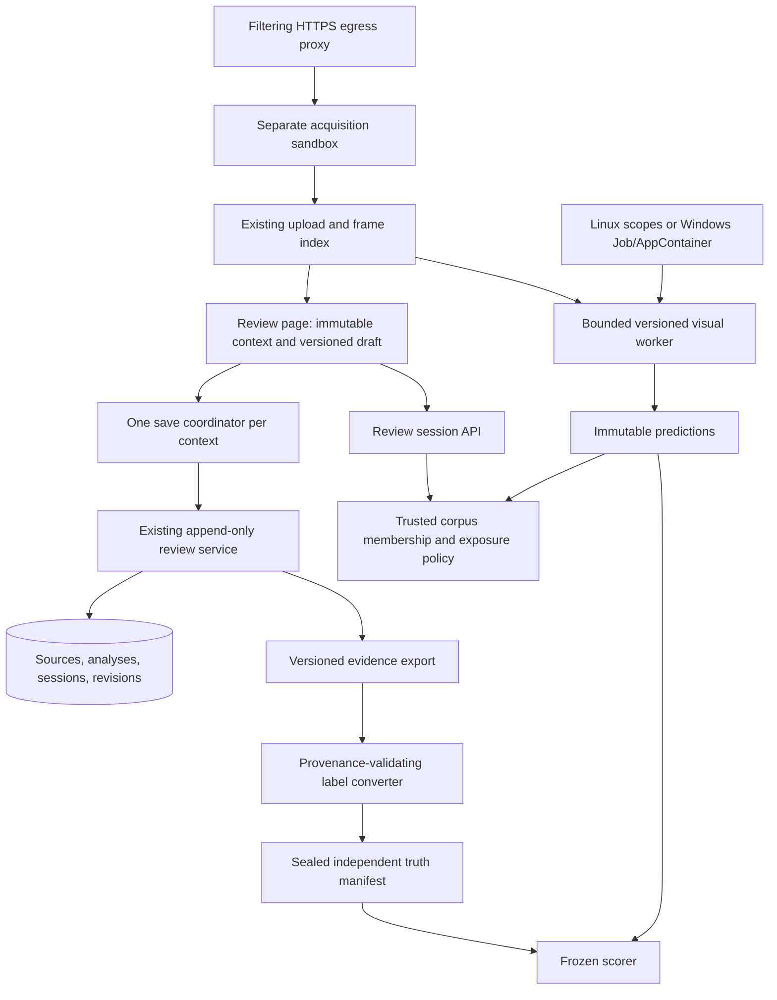

# SC-2150 Remaining Architecture

## 3. Architecture

Keep acquisition networking separate from decoder networking. Keep label truth separate from
predictions. A label set identifies the original digest, exact frame-index checksum, coordinate
plane, reviewer/protocol and immutable revision IDs. A prediction identifies its own algorithm,
configuration, tools and artifacts. They meet at explicit media/frame identities, not by copying
corrections into a new analysis and pretending their lineage is unchanged.

### 3.1 P0: isolate and inventory

1. Read the repository rules and remote; inventory current local changes by explicit paths and
   hash the feature source, scripts, templates, migrations and tool binaries. Preserve the index.
2. Use a private source snapshot and Gradle project/build/cache outputs, plus a runtime classpath
   produced by that completed build. Do not repeat a late `buildDirectory` override that leaves
   Java output and test classpath inconsistent. Keep companion fixture paths explicit and valid.
3. Give every run a UTC ID; separate source code, raw diagnostics, JUnit XML, HTTP records,
   screenshots, metric JSON and concise README. Keep media/frames/screenshots of footage under
   ignored `build` storage, never the Git diff or generated Felix mirror.
4. Use disposable databases with `sc2150_` names, private media/runtime directories, loopback
   ports 18190–18199 and recorded process identities. Never repurpose the ordinary 8090 service.
5. Run the current video/trace/frame-timing selection with real PostgreSQL and process-local
   Docker API compatibility configuration when required. Count all skips explicitly. Reproduce
   the current memory ceiling, including swap, before attributing later process failures.

## 4. P1: implement correct client review state

Primary files: `src\main\resources\static\js\mouse-video.js`,
`mouse-video-review-core.js`, `src\main\resources\templates\mouse-video.html`,
`src\main\resources\static\css\mouse-research.css`,
`src\test\js\mouse-video.test.js`, and real-browser harnesses under `scripts\sc2150`.

### 4.1 Immutable context and versioned draft

Represent each editor as a context with `{sourceId, analysisId, frameIndexChecksum, sessionId,
sessionMode, contextGeneration}`. A draft holds normalized corrections, per-label origin,
`editVersion`, `acknowledgedVersion`, `baseSourceRevision`, and undo history. Increment
`editVersion` for every addition, replacement, removal, undo and protocol-affecting edit.
Derive dirty state from versions; do not use one mutable boolean as the authority.

On source/analysis changes, first drain or explicitly abandon the old editor. Keep its draft
bound to its original context. Clear preview/observations/queue/undo/request identity only after
the switch is safe. Never reuse coordinates from another analysis implicitly. Filter history by
the exact selected analysis/session/range before choosing its latest cumulative revision.
Source-wide revision numbers remain optimistic concurrency tokens, not analysis selectors.

### 4.2 Serialized cumulative saves — R2

Introduce a save coordinator, preferably a testable helper `mouse-video-review-save.js`:

1. Capture a deep immutable snapshot **before any await**, including before fetching a write
   nonce. Snapshot context, draft edit version, expected base, corrections, provenance and body.
2. Allocate one request UUID per distinct snapshot. Retry that exact UUID/body after timeout or
   a lost response. Never send edited content under a UUID whose original outcome is uncertain.
3. Permit at most one write in flight per editor. Later edits remain usable and dirty; queue the
   latest cumulative state. Intermediate unsent versions may coalesce, acknowledged ones may not.
4. On success, verify the response's context and acknowledged content digest. Advance the base
   once using the server-returned applied source revision. Ignore duplicate acknowledgements.
   Mark only the submitted version acknowledged; later versions remain dirty and are flushed.
5. On 409, stop automatic retry, retain the exact draft and snapshot, and show a conflict state.
   Reload the base without copying another analysis's corrections. Explicitly resubmit with a
   new request UUID. No silent merge, label loss or success notice before acknowledgement.
6. Autosave after 25 new mutations, after a short idle debounce, and on explicit review close.
   `flushAndWait()` must finish the latest version. Failed/conflicted close keeps review active;
   failed switching restores the old selection. A close during a write waits rather than returning.
7. Protect refresh/navigation while dirty or writing. Browser unload is not a reliable async
   delivery channel: do not claim `sendBeacon` saved data. Restore acknowledged server content
   on reload; provide an unsaved-work guard if a flush has not finished. Qualify reload after
   60 labels only after the final queued save has acknowledged all 60.
8. Support an empty cumulative draft when undo/removal intentionally clears a prior label set;
   the current early return on `draft.length === 0` must not preserve deleted server labels.

### 4.3 Blind mode and provenance — R1

- Determine held-out policy before loading observations, rendering history-derived overlays or
  selecting a preview. Start in `CHECKING_POLICY`, with prediction controls disabled/hidden.
- Route **all** suggestion rendering through one policy predicate: original prediction points,
  regions, new guess boxes, confidence text, trails, next-position dots and detector-driven queues.
  Blind uses raw frames plus a PTS-only queue and independently seeded spot checks. Enter cannot
  accept predictions; manual visible/hidden/ambiguous labels remain available.
- Record whether the reviewer was exposed to suggestions. Assisted → Blind is a new session,
  not a metadata toggle on the old cumulative draft. Preserve assisted labels in their original
  session; do not copy or rename them `without-suggestions`. Warn about the actual eligibility
  consequence and keep the original labels accessible as assisted evidence.
- A forced held-out source never runs assisted review for that annotator. Historical labels with
  missing provenance are `UNKNOWN`, not automatically blind. The server and converter enforce
  this; string matching `context` or a free-text review reason is only a display hint.
- Persist label origin (`MANUAL_VISIBLE`, `MANUAL_HIDDEN`, `MANUAL_AMBIGUOUS`,
  `ACCEPTED_PREDICTION`) in typed provenance. Do not infer it solely from a human-readable note.

### 4.4 Analysis binding — R3

`seedDraft` must take an explicit context and reject/miss incompatible history. Select the latest
revision **for that analysis and review session/range**, not the latest source-wide revision.
Every pending request and callback carries `contextGeneration`; an old response cannot clear or
advance a newly selected editor. Undo state must not survive a change of context. If reprojecting
labels between representations is ever needed, make that a separately versioned, verified
operation; this plan does not silently add such reprojecting.

### 4.5 Trail segmentation — R4

Build an ordered event timeline with exact PTS and source ordinals. End a trail segment at any
scene cut, hidden/ambiguous/unsupported interval, missing sample, transform change or >0.3 s gap.
Use boundary/range semantics for cuts and unknown spans; do not first discard those events.
Start the next visible sample in a new segment. Extrapolate only from two valid samples in the
same uninterrupted segment, account for their actual time delta, clamp display bounds and omit
the dot when timing is invalid. The dot is a display prediction, never an observed coordinate.

### 4.6 Complete bounded queues and label batches

The current index loader stops after 40 additional pages of 200 frames. Replace silent truncation
with a cancellable, checksum-pinned iterator or server-generated bounded queue windows covering
the declared review range. Detect repeated cursors, changed identities and incomplete pages.
Display queue coverage and a terminal error if a range cannot be loaded. Precompute ordinal/PTS
maps and use binary search for nearest-frame queries; avoid scanning all frames per grid point.

Keep the 2,000-correction / 512 KiB server caps. Partition long review ranges deterministically
into separate bounded sessions; do not raise caps to accommodate unbounded cumulative drafts.
Aggregate their sealed export references for scoring with explicit non-overlap and coverage checks.
