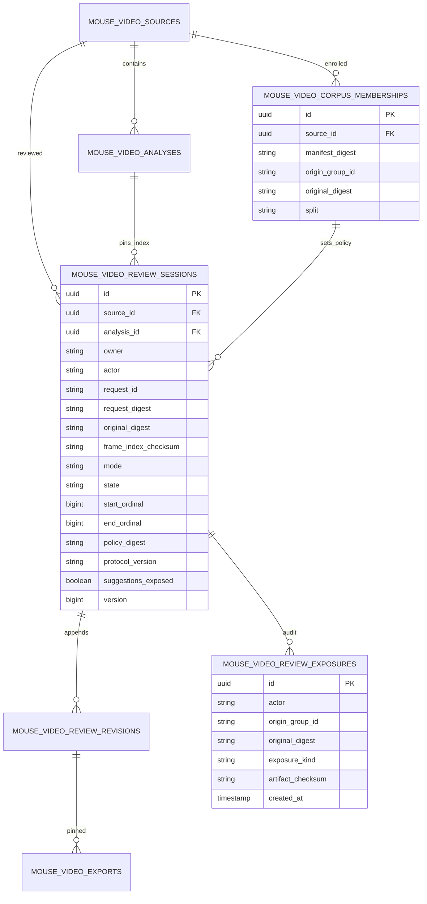

# SC-2150 Remaining ERD and data invariants

## 5. P2: data design and authoritative provenance

Primary additions: `MouseVideoReviewSessionService`, `MouseVideoReviewPolicyService`,
`MouseVideoReviewExposureService`, corresponding entities/repositories and controller DTOs.
Extend `MouseVideoReviewService`, `MouseVideoExportService` and their tests. Reuse the existing
owner/principal/write-nonce protections, source-row locks, digest code and artifact byte store.

### ERD

### Migration and invariants

- Add forward migration `V47__sc2150_review_session_provenance.sql` if still free. Use the next
  reviewed version if another change reserves it first. Do not edit V42–V46 or reuse an applied ID.
- Corpus membership is installed from an operator-owned, hashed manifest, not trusted from the
  upload `context` string. Key source groups by original video/channel provenance from that
  manifest; a reupload or another section must not evade a spent-source rule.
- Sessions pin owner, audit actor, source, **completed baseline index analysis**, original digest,
  frame-index checksum, source-coordinate plane, bounded ordinal range, corpus policy and mode.
  Mode and identity are immutable. States are OPEN, SEALED, ABANDONED or INVALIDATED; transitions
  use row locking/version checks. Session create is idempotent by owner/request UUID and digest.
- Add nullable `review_session_id` and `provenance_json` to revisions. Keep `corrections/v1`
  correction shapes and caps unchanged; add a separate `review-provenance/v1` envelope. Existing
  revisions have `UNKNOWN` provenance and remain byte-identical. Do not backfill fictional proof.
- A provenance snapshot includes session/policy/index IDs, protocol, labeller actor, cumulative
  label-origin map, suggestion-exposure status, range, client snapshot digest and server time.
  Bind it to the revision's request digest. The origin map must match correction keys exactly;
  duplicates, omitted origins and accepted predictions in blind sessions are refused.
- Write exposure events before returning prediction-bearing responses to the enrolled reviewer:
  observations, raw observations artifacts, review prediction payloads and equivalent export
  routes must share the guard. Persist actor + origin group + digest, not just one source UUID.
  On policy/ledger failure, fail closed for qualification. An administrator viewing files outside
  this application is outside this mechanism; record annotation attestations and do not claim
  the application proves a person has never seen footage or verifies human input provenance.
- After independent labels are sealed, prediction evaluation may be authorized under a separate
  evaluator session. Do not show evaluation outputs back to the annotator before sealing.
- Use source locking to validate global expected base, session identity and provenance and append
  one revision atomically. Old revision data and predecessor content remain immutable.

### Important identity distinction: blind labels before predictions

Held-out labelling must work from the import's complete frame-index/proxy/preview artifacts
without first scheduling `visual/v1`. Truth labels bind to this baseline analysis/index.
After sealing, a new visual prediction analysis is allowed. The scorer explicitly verifies that
truth and predictions share original digest, exact source PTS/index and coordinate transforms.
Their analysis IDs may differ intentionally; labels are never reassigned to the prediction
analysis. This avoids requiring predictions merely to obtain a blind review UI.
