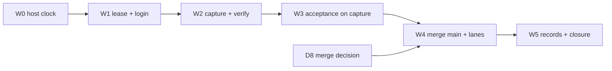

# SC-274 — full plan and full inventory (6 November 2026)

This supersedes `remaining-plan-20261103.md` as the single planning document. That file keeps the hard
rules, the environment table and the phase detail it already carries; the 2 November runbook
(`remaining-plan-20261102.md`) still supplies the raw commands. Nothing here restates verified facts
that are already in the ledger without pointing at the evidence path.

Everything in §2 is **verified** on 6 November 2026 unless a row says otherwise. §3–§7 are the plan.

---

## 1. The story, as it now stands

| Story | State | Meaning |
|---|---|---|
| **SC-274** REPLAY-2 | In Review, `blocked=true` | Narrowed on 3 Nov. Six retained rows; two of them still need the genuine capture |
| **SC-2273** REPLAY-2b | To Do, `blocked=true` | Holds everything that needs a qualified causal runtime; blocked by SC-2201 and SC-1498 |
| SC-2201 runtime qualification | To Do | No registered causal xRSPS runtime exists; the compiler refuses to emit any manifest without it |
| SC-1498 provider-origin bootstrap | In Review | One-use human approval; needed for the alignment row that moved to 2273 |
| SC-276 kernel adapter | Done (narrowed) | Native world support is its remaining subject and is what causal use still needs |

SC-274's retained rows and their current state:

| Row | Status | What closes it |
|---|---|---|
| 3 stable source-linked refusals | **Closed** (2 Nov) | — |
| 5 incomplete stays playback-only (service boundary) | **Closed** (2 Nov) | — |
| 5 genuine-recording half | Open | Row-5 preflight on the new recording (W3.2) |
| Travel negative half | **Closed** (2 Nov) | — |
| Historical `recording_b83c37e5` verdict | **Closed** (2 Nov) | — |
| Capture quality | Open | The capture itself (W2) |
| Output completeness | Open | Named blockers recorded (W3.3); closes only with a manifest |

---

## 2. Full inventory — what exists right now

### 2.1 Repository

| Item | Value |
|---|---|
| Worktree | `C:\Dev\IdeaProjects\.worktrees\sc274-completion` |
| Branch | `codex/sc274-completion-20261015` |
| HEAD | `fa31a09c` (pushed; tree clean) |
| Divergence | **66 ahead / 133 behind** `origin/main`; merge-base `c791c6d4`; `main` at `6042ccf2` |
| PR | **#108** open, `mergeable=CONFLICTING`, 292 files, +47,698 / −5,899 |
| Conflicts when merging `main` (measured with `git merge-tree`) | `ScenarioManifestV2Compiler.java`, `ScenarioManifestV2CompilerTest.java`, `LocalReplayPrincipalConfig.java`, `LocalReplayPrincipalConfigTest.java` — four files, all in the replay/manifest and replay/security area |

### 2.2 Code delivered in this story's recent increments

| Area | Change | Commit |
|---|---|---|
| Capture identity | Reuse guard compares canonical `contextHash` (numbers normalized), verifies both digests, names `differingFields` at both `IMMUTABLE_PROVENANCE` sites | `331297cf` |
| Diagnostics | SESSION_START log reduced to presence/field counts; no payload serialization | `331297cf` |
| Tests added | `BehaviorRunContextIdentityTest` (6), `DebugSessionProvenanceReuseTest` (3) | `331297cf` |
| Docs | Plan, narrowed-acceptance draft, implementation/verification evidence, ledger sections | `7d257581`, `6622a23d`, `ac5b0ab9`, `131a4c06`, `db8d9e41`, `1edaff45`, `a73b9a78`, `fa31a09c` |

### 2.3 Tests actually run (last run, `--offline`, JDK 17)

| Lane | Result |
|---|---|
| Focused provenance (`BehaviorRunContextIdentityTest`, `DebugSessionProvenanceReuseTest`, `DebugSessionServiceTest`, `HumanFishingFinalizationTest`) | **31 tests, 0 failures** |
| `com.chromascape.web.debug.tickdebugger.*` | **317 tests, 0 failures** |
| Full `replayTest` | **871 tests, 26 failed, 42 skipped** — the 16 recorded environmental baseline failures plus 10 `ContainerLaunchException` while Docker was stopped |
| `bootJar` | `chromascape-0.2.0-SNAPSHOT.jar`, 722,060,888 B, `sha256:3b82cee0…bc0025` |

### 2.4 Runtime

| Thing | State |
|---|---|
| ChromaScape 8090 | PID **233944**, the clean candidate jar from `6622a23d`, no class overlay; `/debugger` 200 and `/api/replay/capabilities` 200 |
| Containers | **26 running**. SC-274: capture PostgreSQL healthy on **15474**, registry PostgreSQL on 55440, mule healthy on **8182**. Catalog bridge is **down** (by design after a VM restart; `--replace` rebuilds it) |
| Restart policy | `unless-stopped` on the capture PostgreSQL, registry PostgreSQL and mule — proven by a `wsl --shutdown` + Docker restart that brought all 26 back |
| Executor | Not running. Port 8180 free |
| Lease | None. Last state `FAILED_CLOSED`, error `Registry clock outside existing five-second safety limit`; the previous lease `008c80eb…` ended cleanly as `STOPPED_LEASE_RELEASED` at its deadline |
| **Host clock** | **7.1 s slow against NTP**; the container VM is on time. `w32time` stopped; no elevation available |
| Shortcut sync file | `.felix/shortcut-sync.json` present in all five canonical projects |

### 2.5 Records

| Record | Id |
|---|---|
| Felix plan of record (30 Oct) | `note_1793383300090_26c4edf1` |
| Felix live plan (child of the above) | `note_1793730398654_fe7a8b7a` — carries every dated status section |
| Felix implementation evidence | `note_1793383660891_e2cb85fe` |
| Felix verification evidence | `note_1793383661203_c8c05411` |
| Outbox replay note (4 Nov) | `note_1793741389129_fc38f89c` |
| Outbox pending for SC-274 | **0**; the last record is in `ChromaScape\docs\builderflow\felix-sync\synced\sc-274\` |
| Evidence root | `C:\Dev\IdeaProjects\verification\sc274-sc276-continuation-20261102\` (71 files, 939 MB) |
| Evidence added since 4 Nov | `acceptance\world-number-mapping.md`, `acceptance\output-completeness.md`, `capture\catalog-bridge-verification.json`, `start-supervisor-detached.ps1`, `sync-host-clock.ps1`, `redeploy\start-8090-candidate-20261103.ps1` |

### 2.6 Operational defects found and fixed (each would have blocked the capture)

| Defect | Fix | Evidence |
|---|---|---|
| Supervisor killed with its launching shell, no release | `start-supervisor-detached.ps1` (Win32_Process.Create, single-instance guard, timestamped logs) | Survived its launcher; also shut down cleanly at the 4 Nov deadline |
| Killed supervisor leaves a `claimed` assignment that blocks every new claim (sweeper disabled, release API answers `410`) | Bounded SQL release with a reason; documented | Next claim succeeded |
| Orphan client holds 8180 | Stop the orphan before relaunch | Relaunch clean |
| Catalog bridge cannot be replaced and would be built for a dead lease | `--replace` with a label check + expired-lease guard + hash from the image | `/health` and catalog 200 inside the registry namespace |
| A failed state write dropped the phase update (`ENOSPC` on a disk with 366 GB free) | In-place fallback in `hold-windows-assignment.cjs` | Fallback exercised |
| Containers did not survive a Docker restart | `--restart unless-stopped` + rule-11 check | 26 containers returned after `wsl --shutdown` |

---

## 3. Decisions

| Id | Question | Status |
|---|---|---|
| D1 | How SC-274 closes | **Decided: B — narrow.** Applied to the story text on 3 Nov |
| D2 | G1 hidden state / G4 Mule intervals | Deferred to SC-2273 by D1 |
| D3 | Pending outbox record | **Done:** replayed as `note_1793741389129_fc38f89c`, moved to `synced/sc-274` |
| D4 | Review and merge route | **Done:** branch pushed, PR #108 open. Merge is now blocked by a real conflict (§2.1) |
| D5 | The 3 Nov child note | **Done:** it is the live plan note |
| D6 | Shortcut closure with no Felix task | **Open:** keep notes-only and let the owner move SC-274 by hand, or allow one `shortcut_delivery` task so the marker and transition become compliant |
| D7 | Restart approval | **Done:** 8090 restarted on the clean candidate; supervisor restarts as needed |
| D8 | New: merge `main` into the branch | **Needs a call:** merge `main` forward now (4 conflicting files) or rebase 66 commits. Merge forward is the low-risk option |

---

## 4. The plan



### W0 — Host clock (owner, one action, ~1 minute)

Blocking: the supervisor refuses to claim while the host is more than 5 s from the mule.

Owner does one of: Settings → Time & language → Date & time → **Sync now**; or an elevated
`net start w32time; w32tm /resync /force`.

I verify: `date -u +%s` against NTP and against `docker exec sc274-registry-mule-20261020 date -u +%s`
inside 2 s, twice, 30 s apart. Anything above 5 s stops here.

### W1 — Lease, login, bridge (~5 minutes of my time + owner login)

1. `powershell -File C:\Dev\IdeaProjects\verification\sc274-sc276-continuation-20261102\start-supervisor-detached.ps1`
2. Wait for `phase=AWAITING_USER_LOGIN`, `catalogState=READY`, `schemaBundleState=AVAILABLE`,
   `recorderReady=true`, deadline ≥ 1 h; confirm the client JAR is `sha256:0a26e022…`.
3. `python -I ...\capture\deploy-catalog-bridge.py --replace` → expect `passed: true`, both checks 200.
4. **Owner logs in by hand.** I poll `/health` until `game_logged_in=true` and the account hash
   matches, then `phase=OBSERVED_ACCOUNT_MATCH`, `accountMatches=true`, `grantIssued=true`.

Stop conditions: a second client on 8090/8180, an unexpected process, a lease that expires mid-way.

### W2 — Capture (~30–45 minutes, owner at the machine)

| Step | Action | Pass |
|---|---|---|
| 2.1 | `python -I ...\capture-context\prepare-capture-context.py` | exit 0, allocation/executor equal to the state file, graph revision `sha256:741a1131…` |
| 2.2 | `python -I ...\capture\start-context-bound-human-fishing.py` | HTTP 200 with `recordingId`, `recordingEnabled=true`, **and** the client's SESSION_START accepted — no `IMMUTABLE_PROVENANCE` within 30 s |
| 2.2a | If refused | Read `Immutable provenance mismatch … differingFields=[…]` in
`redeploy\runtime-8090-candidate\application.out.log`. Fix only the named cause, add a regression test, rebuild the jar, restart 8090 (owner), relaunch on the same lease, log in again; retry **once** |
| 2.3 | API check | Stored run context contains `graphRevision`, `recordingId`, `debugSessionId`, `contextHash` |
| 2.4 | Owner catches **5 trout** | The monitor only observes; no dispatch from me |
| 2.5 | Stop + finalize | `/api/debug/replay/stop-recording`, wait for `FINALIZED`, then the supervisor STOP file |
| 2.6 | Verify | `verify-genuine-fishing.py` + `FullMediaProbe.java` → `capture\capture-verification.json`: contiguous ticks, calibration present, 0 unknown/dropped frames, media decodes, every Fishing-spot NPC has `spotId`, every tick has `world{worldId, regionId, plane}`, 5 trout and the XP delta |

If 2.6 fails, the recording stays untouched; I record the failure and ask before re-recording.

### W3 — Acceptance that needs the recording (~10 minutes)

| Step | Output |
|---|---|
| 3.1 | `publish-genuine-curation.py` → new immutable HELD_OUT curation (`bf83bfe1` untouched) |
| 3.2 | Row-5 genuine half: preflight the new recording plus `recording_af17d0dc` read-only; both `playbackEligible=true`, causal refused with a stable code, 0 writes, capability flags identical before and after |
| 3.3 | Re-run the output-completeness table against the new recording; replace named blockers with provenance where the recording now supplies it |
| 3.4 | Record the capture's own world/region/plane against the named world-mapping blocker (`world-number-mapping-20261104.md`) — no mapping is invented |

### W4 — Branch integration (needs D8; ~1 hour)

1. `git merge origin/main` in the worktree → resolve the four conflicted files, keeping both intents
   (main's `SC-2150` review changes and this branch's compiler/provenance changes).
2. Re-run: focused provenance lane, `manifest.*` + `compiler.*`, `debug.tickdebugger.*`, full
   `replayTest`, `bootJar`. Any new failure is a finding, not a baseline.
3. `git diff --check`; format only the touched files (the repository's `spotlessCheck` is red at base).
4. Push; PR #108 goes back to mergeable. Merge **after** review (D6/D8 owner call).

### W5 — Records and closure (~30 minutes)

1. Update `implementation-evidence-20261103.md` (or a 6 Nov successor) and
   `verification-evidence-20261103.md` with the capture, the merge and the final lanes.
2. Append dated sections to the three Felix notes; the live plan note stays the index.
3. Shortcut: apply D6. Without a Felix task, no `[felix-sync:…]` marker and no transition — the owner
   moves the story. Clear `blocked` only when nothing retained is blocked (that means the capture and
   the merge are both done).
4. Cleanup with approval: stop the supervisor and 8090; keep containers and volumes as evidence.

---

## 5. Definition of done (narrowed acceptance)

- Rows 3, 5 (boundary + genuine half), travel-negative and historical have evidence in the ledger.
- The capture row has `capture-verification.json` with every field in W2.6 passing.
- The output row has per-element provenance from that recording, or a named blocker (currently named).
- The code is merged to `main` with the lanes green on the merge commit, the 16 environmental
  failures listed by name, and no accidental diagnostic in the diff.
- Felix notes and the outbox reconciled; Shortcut state matches the evidence; SC-2273 carries every
  moved row.

## 6. Risks and stop conditions

| Risk | Handling |
|---|---|
| Host clock drifts again mid-run | W0 re-verified before W1.3; the supervisor fails closed |
| Lease shorter than the work | Take the lease only when the owner is ready to log in; ≥ 1 h remaining |
| `IMMUTABLE_PROVENANCE` repeats | The WARN now names the field; one bounded fix and exactly one retry per lease |
| Docker or WSL restart during the capture | Containers now self-restart, but the capture DB connection would still drop — no Docker work during W2 |
| Merge conflicts in the compiler | Four known files; resolve by hand, never by taking one side wholesale |
| 16 environmental failures masking a regression | Compare failure **names** against `wp0\baseline-failures.txt` every run |

## 7. Rollback

- Recordings and curations are append-only: mark non-acceptance, never delete.
- Code: `git revert` the scoped commits; nothing is on `main` until W4 merges.
- 8090: restart from the mixed build or restore the preserved `GraphSchemaValidator.class`.
- Client: `verification\private\sc274-full-capture-20261031\windows-handoff-config.pre-3817133f.20261101T213808Z.json`.
- Shortcut: restore the SC-274 description from `verification\sc274-sc276-continuation-20261102\acceptance\sc274-description-before-narrowing-20261103.md`.

## 8. Id and path index

```
worktree        C:\Dev\IdeaProjects\.worktrees\sc274-completion   (fa31a09c, PR #108)
evidence        C:\Dev\IdeaProjects\verification\sc274-sc276-continuation-20261102\
private         C:\Dev\IdeaProjects\verification\private\sc274-full-capture-20261031\
8090            PID 233944, build/libs/chromascape-0.2.0-SNAPSHOT.jar (sha256:3b82cee0…)
supervisor      ...\sc274-sc276-continuation-20261102\start-supervisor-detached.ps1
bridge          ...\capture\deploy-catalog-bridge.py --replace
reference       ...\capture-context\prepare-capture-context.py
start           ...\capture\start-context-bound-human-fishing.py
verify          ...\capture\verify-genuine-fishing.py  +  ...\capture\FullMediaProbe.java
curation        ...\capture\publish-genuine-curation.py
profile         FISHING_TRAINING / 1a67835e-3c32-4d95-94ab-46b537ff5687 v1
graph           sc274_human_fishing v1, sha256:741a1131036365a57d9abced9bfaf570c2d7c9385ffb335d9b5bacee86476372
client artifact sha256:0a26e022ab65091be46e078dd1cc292cc95df7f6d4613bb03c46e6103c650c6f
```
