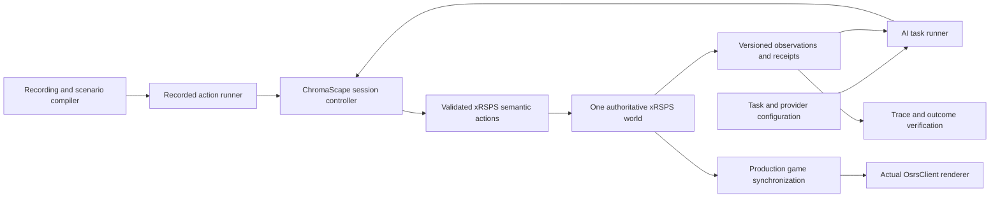

# xRSPS Client Replay and AI Execution Plan

Execute recording-derived actions through the real xRSPS game services, display their computed results in the existing 3D xRSPS client, and let the AI bot observe and act in that same game session. The recording runner and AI runner use one semantic action interface and one authoritative game state. This is an implementation plan; the client integration and autonomous execution described below are not delivered yet.

## Required outcome

From ChromaScape, the user selects a recording and starts **Run Recording in xRSPS**. The actual xRSPS client opens at the scenario's initial position with the scenario's player, inventory, equipment, skills and world. The recording runner submits actions at their recorded ticks. xRSPS computes movement, interactions, resources, inventory, XP and interface changes, and the client renders those results as gameplay.

The user can separately start **Run AI in xRSPS** with a task and an initial scenario. The AI observes the current authoritative state, selects supported actions, executes them through the same interface, and checks the resulting state until the task succeeds or stops. The client shows that execution while it is happening. Replaying a recorded sequence and allowing an AI to choose new actions are separate run modes with explicit ownership.

Completion requires a real client demonstration, recorded-action execution, and an AI completing a task from observed state. A semantic observer, video player, accepted request, or successful worker process alone does not satisfy these requirements.

## Current baseline and gaps

Baseline inspected on 6 October 2026:

| Component | Available behavior | Required change |
| --- | --- | --- |
| xRSPS upstream main | Commit `78081cd131984b17450df052fe046cbfa26ab17d` contains the authoritative server replay worker and bounded Fishing and Misthalin Mystery support | Base new work on a clean reviewed source snapshot, preserve local changes, and extend declared action coverage |
| Local xRSPS checkout | The checkout contains earlier replay work and extensive uncommitted changes | Use an isolated branch/worktree; selectively retain relevant fixes and verify each integration |
| ChromaScape runtime | The running worker is pinned to `dab41959d90537d840e3c70e2b8728454dc91a6c` and advertises `INTERACT_NPC` | Integrate the current production-service worker only after compatibility and regression checks |
| Actual game client | `client/game/OsrsClientApp.tsx`, `OsrsClient.ts`, and `network/serverConnection` provide the real renderer and game connection | Add a scenario-session connection and startup path using those components |
| Replay viewer | `/replay-observer` renders semantic entities rather than the normal game client | Keep it as a diagnostic view and add the actual client launch path |
| Authoritative replay context | `server/src/replay/headless-replay-context.ts` composes real services without constructing `WSServer`; its current composition does not run normal network synchronization | Publish the actual session's game updates through shared production synchronization services |
| Replay transport | `server/src/replay/worker-main.ts` serves the existing stdio worker protocol | Add session streaming and incremental controls without breaking that protocol |
| AI integration | ChromaScape has provider, gameplay and task orchestration contracts; the inspected v1 action contract contains `START_FISHING_TASK` and `ABSTAIN` | Map the existing task/provider flow to xRSPS observations and actions; prove the bot loop executes real tasks |

Upstream PR #2 is merged and establishes authoritative server-service replay. PR #6 is currently open and concerns quest key recovery and donor edge semantics. Neither supplies the actual client/session integration. The presence of ordinary banking or teleport code upstream does not establish support in the replay context.

### Latest recording acceptance case

`recording_b83c37e5` is the latest recording observed during this investigation, associated with `debug_365ecab7650a47c892e4a21f54e50507`. It lasts approximately 8 minutes 26 seconds and has 11 typed actions. Its archived RSProx binary is available, but its existence alone does not establish complete semantic capture.

The current preflight is `BLOCKED`: it reports `TYPED_ACTION_STREAM_INCOMPLETE`, an unresolved exchange NPC target, and no supported Fishing NPC in the initial world. Its reported 100% action coverage describes the captured typed actions; it does not cancel the incomplete-stream warning.

The captured sequence includes bank objects, deposits of raw trout/salmon, ring of wealth and games necklace interactions, an exchange NPC, feather interaction, and lure Fishing NPCs. The new implementation must audit the exact options and widget parameters before interpreting any interaction as a purchase, withdrawal, deposit or teleport.

Keep this recording as a required coverage and fidelity case. Recover missing semantics only from sufficient original captured evidence with explicit provenance. If an action or required initial state cannot be recovered, the recording remains blocked with the exact reason. Do not declare it replayed by skipping actions, inserting later recorded state, or replacing it with a successful new recording. A fresh fully captured recording is a separate acceptance case.

## Scope and compatibility

The first release includes visible recorded-action execution, visible AI task execution, the action families needed by the latest recording, lifecycle controls, evidence and recovery. Fishing is the first integrated vertical slice, followed by its banking, travel and exchange-interface dependencies. Broader quests, combat, crafting and Magic follow only after their action and content support is independently verified.

Reuse the authoritative xRSPS service graph, cache, content, action scheduler and existing ChromaScape contracts. Do not create another simulator or route this execution through Micro6. Existing Micro6 Java plugins cannot run directly in a TypeScript client; reuse their task intent and verified behavior through explicit xRSPS adapters, rather than claiming binary/plugin compatibility.

The normal xRSPS login/game path and existing headless replay APIs must continue to work. A failed xRSPS launch must produce an actionable failure rather than launching a replacement Micro6 client. Existing video and RSProx capture choices remain independent of starting a simulator run.

Simulation authority is scoped to the isolated xRSPS session. Retain the existing prohibition on live-account control. Do not flip the existing global `controlAllowed` flag to grant AI execution; introduce explicit session-scoped semantic execution capabilities and update validation for that versioned capability contract.

## Shared session architecture

### Session ownership

A ChromaScape-owned session has one worker, one mutable scenario world and one execution mode: `RECORDED_ACTIONS` or `AI_TASK`. The real client attaches as an observer of that world. It does not create a second player/world or load a separate replay trace as its authority.

Extract reusable world composition and synchronization from `WSServer` where necessary. The replay session must not invoke the ordinary server constructor merely to obtain broadcasting, because that constructor opens listeners and persistent storage. Share the production services while keeping session resources, deterministic tick control and persistence explicit.

Add a render snapshot from the actual server context. The current canonical observation is sufficient for selected semantic checks but lacks some normal client data. The render snapshot must include actual player appearance, equipment, actors, animation, region/plane, interface state, varps/varbits, containers and effects required by the supported methods. Use the production player/NPC synchronization encoders and client decoders. Never construct a plausible world from a few entity coordinates and call it complete gameplay.

### Time and determinism

The session owns simulation ticks and RNG. Wall-clock pacing determines when a tick is displayed, not its domain result. Recorded execution submits actions in stable source order at their relative ticks. AI execution permits one pending decision/action sequence at a time and advances according to declared task rules.

The first AI mode uses `WAIT_FOR_DECISION`: while awaiting a provider response at an action boundary, simulation time pauses. This prevents variable provider latency from changing game outcomes. A future real-time decision mode must declare missed-deadline and wait behavior separately. Record model decisions and their observation revisions so the resulting action trajectory can be replayed deterministically without requesting new model output.

Normal client animation interpolation may run at display frame rate. Authoritative animation events, paths, XP, interactions and task outcomes come from server ticks. Presentation must not feed camera choices or frame-rate timing back into game state.

### Client attachment

Add a route such as `/scenario-session/:sessionId` that mounts the real `OsrsClientApp` and renderer. Resolve a short-lived session attachment through ChromaScape, verify client/cache compatibility, and connect to a session transport. Do not use the ordinary account login credentials or silently connect to the normal multiplayer world.

Bootstrap using the real client handshake, region rebuild, player synchronization, interfaces and inventory/skills protocol. Load the required cache regions and XTEA data for the exact scenario content. Handle plane changes, region changes and teleports through normal synchronization. Reconnecting requires a complete current bootstrap plus a sequence cursor; it must not duplicate execution.

Use separate command and viewer authority. The client permits camera, zoom and inspection while run actions are owned by the recording runner or AI. Outgoing gameplay packets from the observer are refused server-side. If direct manual control is later added, it must explicitly transfer run ownership and create a distinct evidence mode.

## Proposed API and data contracts

The following names are proposed additions, not existing endpoints. Finalize them against the existing replay API before implementation.

| Operation | Proposed surface | Behavior |
| --- | --- | --- |
| Create a session | `POST /api/xrsps/sessions` | Validate mode, scenario/task identity, capabilities, pins and budgets; reserve one durable session using an idempotency key |
| Inspect a session | `GET /api/xrsps/sessions/{id}` | Return lifecycle, execution owner, tick, revision, capability failures and client availability |
| Start execution | `POST /api/xrsps/sessions/{id}/start` | Start once after scenario validation; client availability is an independent presentation status |
| Pause or resume | `POST /api/xrsps/sessions/{id}/pause` and `/resume` | Apply at a documented safe tick boundary and preserve the current action lifecycle |
| Advance a tick | `POST /api/xrsps/sessions/{id}/step` | Advance a bounded number of ticks only while paused |
| Cancel | `POST /api/xrsps/sessions/{id}/cancel` | Fence new commands, stop at the safe boundary and finalize evidence |
| Attach the client | `POST /api/xrsps/sessions/{id}/client-session` | Return a short-lived viewer attachment and real client URL |
| Observe | `GET /api/xrsps/sessions/{id}/observation` | Return tick, revision, supported/legal actions and canonical game state |
| Submit an action | Internal versioned session command | Accept a semantic action with expected revision, command identity, budget and source; return a lifecycle receipt |
| Snapshot and restore | Internal worker/session commands | Persist or restore the domain state, action cursor and execution metadata with compatibility checks |
| Download evidence | Existing replay artifact APIs where compatible | Return manifest, source mapping, executed actions, state hashes, outcome report and pins |

Viewer streaming should use a same-origin ChromaScape WebSocket relay to a worker-bound loopback transport. This avoids exposing arbitrary worker ports or placing backend command credentials in the browser. Bootstrap and packets carry `sessionId`, `epoch`, monotonically increasing `sequence` and simulation tick. A new epoch after restore invalidates prior packets. A slow viewer cannot slow or corrupt the simulation; bound queues and replace overflow with an explicit resynchronization request.

Extend the worker protocol with capability negotiation for session bootstrap/streaming and incremental execution. Audit `step()` first: currently an action can advance multiple ticks internally. Publish every relevant tick from the actual context, including intermediate movement and activity progress, rather than emitting only action-start and action-end frames. Keep stdout reserved for the existing stdio protocol and route logs to stderr.

### Durable session data

Reuse replay runs and artifact storage where semantics fit. Add migrations only for information that cannot be represented accurately by existing entities:

- Session identity, mode, run/scenario identity, lifecycle, execution lease/fence and worker identity.
- Initial manifest checksum, seed, build/cache/content pins, action schema and projection versions.
- Current tick, observation revision, epoch, execution cursor and terminal reason.
- Task identity, provider/model/prompt/tool versions, budgets and AI decision journal.
- Command idempotency records, payload hashes and structured action receipts.
- Checkpoint references and immutable evidence artifacts.

Model the ownership explicitly: one session owns its command journal and checkpoints; recording runs reference their original source actions; AI sessions reference their task and policy bundle. Multiple viewers can attach to a single session without owning execution.

The lifecycle is `CREATING -> READY -> RUNNING`, with explicit pause, stop and terminal states. Worker loss becomes a reconciliation state rather than automatic duplicate execution. Identical idempotent requests return the existing result; reuse with different content fails. Resume from a verified checkpoint and journal only after the previous lease is fenced.

## Action and world coverage

Advertise support by method/profile and required state, not by action name alone. For every supported action, validate before mutation and report dispatch, activation, progress and terminal outcome separately.

| Family | Implementation requirements | Evidence required |
| --- | --- | --- |
| Movement | Real pathfinding, collision, run energy, plane/region changes and interruption | Server position, path and tick progression; blocked-path and stale-target tests |
| Fishing | Stable spot identity, option, rod/bait/level gates, actual catch timing, resources, inventory and XP | Multiple catches, resource consumption, full inventory and interrupted action |
| Bank objects | Exact object identity, option and position; authoritative proximity and bank interface opening | Correct object selection, reachability and actual bank state |
| Bank widgets and containers | Exact interface, component, item slot, option, quantity, capacity and bank contents | Correct deposited/withdrawn quantities with unchanged unrelated slots |
| Inventory items | Item identity and option, equipment/container transitions and UI events | Actual item/resource changes and incompatible-option refusal |
| Jewelry travel | Native item option, charges, destination choices, level/condition gates and teleport timing | Correct destination and plane, charges and interfaces; interruption/failure behavior |
| Exchange interaction | Exact NPC option and native exchange interface; add transaction behavior only if the captured sequence actually requires it | Correct native interface and state; any transaction uses declared market fixtures and is not a live-market parity claim |
| Dialogue and product selection | Versioned supported choice identities and interface preconditions | Correct selected branch and effects, stale/unknown choice rejection |

`INTERACT_WIDGET` requires an actual authoritative handler and exact captured parameters. It must not be accepted as an opaque generic callback. Audit whether additional closed action types are needed for container quantities or item-on-item operations and version the schema compatibly.

### World initialization and capture repair

Audit all future-relevant state used by each method: player position/appearance, inventory, equipment, skills, bank/container contents, run energy, jewelry charges, varps/varbits, NPC/object identity, content revisions and collision data. Dynamic entities must come from captured initial evidence or deterministic native content with declared provenance. A target first seen later in the recording cannot be inserted into the initial world merely because a later action needs it.

The current preflight assumes an initial Fishing spot even when a recording begins at a bank and travels to Fishing later. Replace that assumption only after native world loading and target resolution across region transitions are implemented. Resolve static world content by pinned definitions and dynamic content by explicit spawn/state rules. Validate each action against the world at execution time while preflight verifies that its required content can be represented.

Preserve capture version compatibility and source action ordering. Audit the incomplete stream against archived packet evidence and original tick/menu data. A recovered action is derived evidence with source references and a versioned decoder; ambiguity remains a gap. The RSProx binary is an evidence source for this audit, not the execution transport.

For new recordings, capture complete semantic actions and task/session boundaries, including manual widget actions when allowed by the capture contract. Keep the existing publish-client reuse behavior and fix explicit relaunch recording finalization separately so an old video cannot remain attached to a departed client while a new task records only ticks. This capture-lifecycle work is a dependency for reliable fresh end-to-end evidence, not evidence that an old recording is repaired.

## AI bot execution

### Observe and act loop

Use the existing configured AI provider and task planning pipeline. Add an xRSPS execution adapter beneath that pipeline, scoped to a scenario session. The adapter must expose current position, actors and interactable objects, inventory/equipment, skills, active interfaces, task progress, last action receipt and available actions. Derive all values from the authoritative session; do not feed the next recorded action or future recorded state to the AI.

At each decision boundary:

1. Read a versioned observation and legal action catalog.
2. Ask the configured provider or policy for a typed decision using the current task and budget.
3. Validate the decision against the task, supported method, observation revision and target identity.
4. Submit one action through the shared session action path.
5. Reconcile its actual activation, progress and terminal receipt.
6. Verify the expected transition, update task progress and obtain the next observation.

Record the prompt/tool/schema and provider/model identities, observation revision, decision, selected action, receipts and task verification. A transport acknowledgement is never task completion. Invalid output, unavailable provider, stale state, exhausted budget or unsupported action produces an explicit outcome; it cannot select an unrelated fallback runtime.

### Task execution and provider compatibility

Start with the existing Fishing task intent and a declared small target, such as a fixed number of catches or XP increase from a seeded scenario. Implement task stages for preparation, movement, interaction, progress verification and completion. Extend those stages to deposit catches and resume Fishing once banking is supported. Add a travel task only after its native content and capture prerequisites pass.

Reuse provider-neutral decision normalization and applicable orchestration receipts. Inspect the existing v2 contracts before creating a new schema, since the inspected v1 contract is too narrow for arbitrary per-action control. The adapter may share a command model with recorded execution, but mode-specific source validation remains explicit. A deterministic test policy is useful for conformance; the release demonstration must also run the user's configured AI provider.

The AI runner must handle a rejected action, full inventory, unavailable target, lost path and interrupted action with bounded recovery based on fresh observations. It cannot edit world state or force the task verifier to pass. Cancellation and pause stop new decisions as well as new actions. Provider requests that return after cancellation or a restored epoch are discarded.

## User experience

ChromaScape offers **Run Recording in xRSPS** on eligible recordings and **Run AI in xRSPS** on supported task/scenario combinations. Preflight lists specific missing actions, content or capture state before a run is created. It clearly distinguishes support, execution success and comparison with the recorded outcome.

The session screen embeds or opens the actual 3D client and displays run mode, task, current tick, playback speed, current action, verified progress and terminal reason. Provide start, pause, resume, single tick and stop. Keep semantic diagnostics and original recording playback available as separate views.

When execution diverges from the recording, the client continues to display the simulated state according to the selected stop policy, and the report links the first mismatch to its source action. Never correct the simulated player from a later capture simply to make the view match.

Initially support seek for recorded execution only: restore a verified checkpoint, replay the intervening commands, then issue a new client bootstrap. In AI mode, checkpoint restoration creates an explicit branch or resumes the exact journaled trajectory; it does not silently re-query a provider and claim the original run continued unchanged.

## Implementation sequence

### Phase 1 Baseline and contract audit

- [ ] Create an isolated branch/worktree from the reviewed xRSPS baseline and inventory relevant local fixes.
- [ ] Inspect existing replay, gameplay v2 and policy adapter contracts before adding new ones.
- [ ] Freeze the latest recording and source mapping as immutable acceptance evidence.
- [ ] Record action/content/capture gaps and actual runtime pins separately from upstream capabilities.
- [ ] Finalize session, command, observation, viewer and capability schemas with compatibility tests.

Exit: a reproducible baseline, exact required action matrix and agreed shared session contract. No unsupported recording is marked eligible.

### Phase 2 Shared authoritative session

- [ ] Refactor world composition into services reusable by headless execution and a client-connected scenario session.
- [ ] Implement deterministic tick advancement, incremental action execution and per-tick synchronization hooks.
- [ ] Add durable lifecycle, leases, idempotency, cancellation and worker reconciliation.
- [ ] Keep existing worker and normal game-server startup behavior compatible.

Exit: headless and client-connected sessions execute the same supported scenario with identical authoritative state/effect hashes.

### Phase 3 Actual client connection

- [ ] Add normal-client scenario attachment and real handshake/bootstrap without account login.
- [ ] Implement production player/NPC synchronization, appearance, regions, animation, inventory, skills and supported interface updates.
- [ ] Add same-origin streaming, viewer reconnect, epochs and bounded backpressure.
- [ ] Prove that camera/viewer inputs cannot mutate run-owned gameplay.

Exit: real terrain, player and NPC models render through `OsrsClient`; movement, catches, inventory and XP are visible during a real Fishing execution, including intermediate ticks.

### Phase 4 Recorded action runner

- [ ] Connect the existing compiler/run flow to the session mode and ordered command journal.
- [ ] Implement relative-tick scheduling, pacing, pause/step/stop and first-mismatch reporting.
- [ ] Display recorded expectations separately from server-computed outcomes.
- [ ] Implement verified checkpoint restore and client resynchronization for seeking.

Exit: an eligible real Fishing recording runs visibly from initial state to terminal result with complete executed-action evidence; seek restores the correct state without duplicate effects.

### Phase 5 Latest recording coverage

- [ ] Implement audited bank objects and widget/container actions through production services.
- [ ] Implement the actual recorded jewelry options and destinations with native travel effects.
- [ ] Implement required exchange NPC/interface behavior without assuming unrecorded transactions.
- [ ] Resolve world content across regions and validate targets at their execution tick.
- [ ] Recover historical gaps only where captured evidence is sufficient; improve new capture for unresolved gaps.
- [ ] Fix explicit client replacement recording finalization and verify launch-to-publish capture continuity.

Exit: every action in `recording_b83c37e5` has either verified native support and sufficient source state or a precise visible blocker. Full success for this recording requires resolving every required blocker; a fresh recording does not substitute for that verdict.

### Phase 6 AI task runner

- [ ] Wire the configured AI provider/task pipeline to authoritative observations and the same action path.
- [ ] Add task stages, legal-action filtering, transition verification and decision/action budgets.
- [ ] Journal provider decisions and implement bounded task recovery and cancellation.
- [ ] Demonstrate Fishing completion, then bank-and-resume and supported travel tasks.

Exit: the AI completes a declared task from current state while the real client displays it; the journaled action trajectory reproduces its domain results without new provider calls.

### Phase 7 ChromaScape integration and runtime packaging

- [ ] Add the two explicit run modes and real-client launch to the debugger/task UI.
- [ ] Package the compatible client, authoritative worker, cache/content pins and capability versions together.
- [ ] Validate startup readiness and present client failures separately from execution failures.
- [ ] Follow `docs/CHROMASCAPE_RESTART_RUNBOOK.md` for native Windows deployment checks.
- [ ] Preserve existing publish-client reuse and independent video/packet capture choices.

Exit: the user can launch and inspect both modes from ChromaScape without manually configuring worker transports or restarting a gameplay client during task publication.

### Phase 8 End to end verification and handoff

- [ ] Complete the acceptance matrix below and publish immutable evidence artifacts.
- [ ] Verify cancellation, reconnect, process loss, checkpoint restore and incompatible runtime behavior.
- [ ] Record remaining unsupported methods and any blocked historical recording accurately.
- [ ] Document Windows startup, rollback, support boundaries and tracker ownership.

Exit: all advertised capabilities pass their tests and live demonstrations. No worker-process success is used as a substitute for semantic task success or rendered client evidence.

## Acceptance and test matrix

| Given | When | Required result |
| --- | --- | --- |
| Compatible finalized Fishing recording and pinned assets | Run Recording in xRSPS starts | The actual client renders its initial world and displays server-computed actions through completion or an explicit semantic mismatch |
| Long movement/activity between actions | The runner advances | Intermediate gameplay updates appear; execution is not represented by only two endpoint frames |
| Latest recording with missing capture or unsupported content | Preflight runs | Full execution is blocked with exact source-linked reasons; the original recording remains available |
| Recovered complete latest scenario | All recorded actions run | Bank, travel, exchange interaction and Fishing execute without omitted actions or inserted recorded outcomes |
| Supported task and configured AI provider | Run AI in xRSPS starts | The AI observes real state, selects valid actions and reaches the verified task target while visible in the real client |
| AI sees full inventory or an interrupted action | Recovery runs | It selects a bounded supported recovery from a fresh observation or stops with an explicit reason |
| Same scenario, seed, assets and fixed action journal | Headless and rendered runs execute | Domain state hashes and ordered effects match; viewer attachment and speed do not change the result |
| Completed AI decision journal | Recorded decisions execute again | Domain outcomes reproduce; model response text is not claimed deterministic |
| Duplicate command with identical content | Request retries | The previous receipt is returned with no duplicated resources, XP or movement |
| Reused command identity with conflicting content or stale revision | Submission occurs | It is rejected before mutation |
| Pause or cancellation during activity/provider request | Control applies | Tick boundary and receipt are explicit; late decisions cannot resume the run |
| Viewer disconnects or falls behind | It reattaches | It receives current bootstrap/epoch and observes the same session without restarting execution |
| Worker or ChromaScape restarts | Recovery runs | The old lease is fenced; recovery uses a verified checkpoint/journal or reports unrecoverable state without duplicate dispatch |
| Recorded-run seek across a teleport | Restore and replay run | Correct plane, region, interfaces, items and current epoch appear in the real client |
| Different cache/content or incomplete client assets | Startup runs | Compatibility failure is actionable; no alternate world or simulator is selected |

Run focused TypeScript contract/domain tests, Java API/lifecycle tests and existing capture/publish regressions. Add production-service parity fixtures for every newly supported action family. Use Playwright/WebGL for real-client bootstrap, terrain/actor visibility, interface state, movement, region transitions and reconnect; semantic state alone cannot establish rendered success. Finally run native Windows demonstrations for recorded execution and the configured AI provider.

Keep infrastructure validity, execution lifecycle, semantic outcome, task verification and rendering status distinct in reports. Archive exact source revisions, cache/content inventories, manifests, action journals, receipts, hashes, screenshots and mismatch reports. Performance measurements follow correctness: measure tick/stream throughput, render latency, memory and bounded queues using declared local-machine baselines.

## Ownership and delivery breakdown

Existing stories are related dependencies, not proof that the new outcome is already covered:

| Story | Existing ownership | Relationship to this plan |
| --- | --- | --- |
| [SC-1199](https://app.shortcut.com/leeuwbot/story/1199) | Recording-to-authoritative-xRSPS vertical slice | Reuse compiler/run/evidence integration; retain its original bounded acceptance |
| [SC-276](https://app.shortcut.com/leeuwbot/story/276) | Authoritative semantic kernel | Own new action/method support and deterministic world behavior |
| [SC-280](https://app.shortcut.com/leeuwbot/story/280) | Debugger replay/simulation adapter | Coordinate UX; its current semantic viewer does not cover the actual client |
| [SC-1432](https://app.shortcut.com/leeuwbot/story/1432) | AI gameplay simulation and certification | Consume real task/trajectory evidence; certification is separate from task execution wiring |
| [SC-1489](https://app.shortcut.com/leeuwbot/story/1489) | Policy observation/action adapter, as placed in the roadmap | Audit and reuse its canonical encodings and legal-action contract |
| [SC-1953](https://app.shortcut.com/leeuwbot/story/1953) | Bounded quest gameplay parity | Preserve quest regressions; does not deliver banking/travel or client integration |
| [SC-1427](https://app.shortcut.com/leeuwbot/story/1427) | Deterministic simulation roadmap | Record client/session presentation as a new integration layer over the same authoritative kernel |

Proposed new delivery units are: shared session contract and lifecycle; production client synchronization and attachment; recorded execution controls; latest-recording action/capture coverage; AI task execution adapter; ChromaScape integration and end-to-end evidence. Give each an independent testable acceptance scope and connect dependencies in the implementation order above. These are proposed units, not newly created Shortcut stories.

Primary source changes belong in `C:\dev\IdeaProjects\xrsps-typescript\server\src\replay`, shared server game/network services, `packages\replay-kernel`, and the actual client startup/connection paths. ChromaScape owns session APIs, persistence, worker orchestration, debugger UI and gameplay-provider/task adapters. Micro6/RSProx changes are limited to necessary capture completeness and recording identity; they are not the simulator execution route.

For a subsequent request to implement a named Shortcut story, use the shared Felix delivery workflow, reuse any existing task by stable Shortcut tag, and persist architecture, schema, API, acceptance and implementation/test checklists before passing its planning gate. This request produces a plan only; no implementation, tracker-state transition or certification is implied.

## Risks and rollback

The main risks are incomplete historical capture, insufficient native action/content coverage, divergence between headless and normal synchronization behavior, cache/revision incompatibility, and overly broad AI task assumptions. Resolve these through explicit support profiles, shared domain composition, differential tests and source-linked preflight failures. Do not hide them by copying expected recording state into the simulated world.

Deliver changes in the phase order with separate runtime switches for client attachment and AI session execution. Keep prior immutable client/worker bundles and configuration pins. Rollback disables new sessions and returns the UI to the previous supported modes; it fences active workers, preserves artifacts and never reroutes their tasks to a live client. Existing recordings and run reports remain readable.

The release is complete only when the real client displays authoritative recorded execution, the configured AI completes supported tasks in that same runtime, lifecycle recovery passes, and every advertised action is verified. The latest historical recording's final verdict remains explicit even if its capture gaps cannot be recovered.
