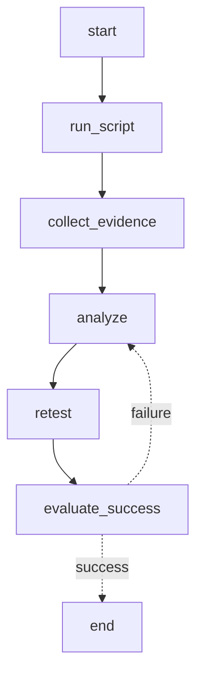

# ADR 001: Canonical Patch Loop Execution Model

## Status
Accepted

## Context
The Patch Loop feature provides two API endpoints for executing analysis iterations:

1. **Simple API** (`POST /api/debug/patch-loop/execute`)
   - Intended for basic analysis workflows
   - Simple request with scriptName, prompt, context
   - Returns iteration ID and basic status

2. **Graph API** (`POST /api/debug/patch-loop/execute-graph`)
   - Intended for custom autonomous loops
   - Requires Mermaid graph definition
   - Supports advanced features like pause/resume, retry from node

Prior to this decision (E6.5), the two endpoints had diverging implementations:
- Simple API used `PatchLoopOrchestratorService` directly
- Graph API used `PatchLoopGraphOrchestratorService`
- New fields (executionMode, maxAttempts, successCriteria, sessionContext) were only persisted by graph API
- Response fields differed between endpoints (simple API didn't return executionId, wsUrl, apiUrl)

This divergence created several problems:
- **Code duplication**: Two separate execution paths maintained different logic
- **Inconsistent behavior**: New features only worked in graph API
- **Missing persistence**: Request fields were lost in simple API path
- **Confusion**: Unclear which endpoint to use for common use cases
- **Testing burden**: Both paths needed separate test coverage

## Decision

The simple `/execute` endpoint will **internally delegate to the graph orchestrator** using the `DefaultBmadGraphTemplate`.

### Architecture

```
Simple API Request (PatchLoopExecuteRequest)
    ├── scriptName, prompt, context
    ├── executionMode, maxAttempts, successCriteria
    ├── sessionContext
    └── evidenceConfig
         ↓
PatchLoopOrchestratorService.executeIteration()
    ├── Persist all fields to PatchLoopIteration entity
    ├── Create GraphExecuteRequest with DefaultBmadGraphTemplate
    │   └── Uses canonical BMAD Mermaid template
         ↓
PatchLoopGraphOrchestratorService.executeGraph()
    ├── Compile graph
    ├── Create graph execution record
    ├── Build execution context
    └── Trigger async graph execution
         ↓
Map GraphExecuteResponse → PatchLoopExecuteResponse
    ├── executionId (from graph)
    ├── iterationId (from iteration)
    ├── wsUrl (WebSocket connection URL)
    └── apiUrl (graph control API URL)
         ↓
Simple API Response
    └── Returns executionId, wsUrl, apiUrl for UI
```

### Default BMAD Template

The `DefaultBmadGraphTemplate` provides the canonical Mermaid graph for the standard BMAD loop:



This graph implements the standard loop:
1. **run_script**: Execute the target script
2. **collect_evidence**: Gather logs, tick logs, decisions
3. **analyze**: Run Claude analysis on evidence
4. **retest**: Run script again to verify patch (autofix_loop mode only)
5. **evaluate_success**: Check if issue is resolved
6. On success → end
7. On failure → loop back to analyze (up to maxAttempts)

### Execution Modes

- **analysis_only** (default): Run script → collect evidence → analyze → complete
- **autofix_loop**: Run script → collect evidence → analyze → retest → evaluate → loop if failed

### Lifecycle State Transitions

The implementation adds two new lifecycle states for retesting:

```
QUEUED → RUNNING_SCRIPT → RUN_COMPLETED → COLLECTING_EVIDENCE → EVIDENCE_COLLECTED
→ ANALYZING → ANALYZED
```

For **autofix_loop** mode with attempts remaining:
```
ANALYZED → RETESTING → RETESTED
    ↓ (success)
COMPLETED
```

For **autofix_loop** mode with retest failure:
```
RETESTED → ANALYZING (increment attempt) → ... → ANALYZED → RETESTING → RETESTED
    ↓ (max attempts exceeded)
FAILED
```

For **analysis_only** mode:
```
ANALYZED → COMPLETED
```

## Consequences

### Positive

1. **Single source of truth**: All execution flows through graph orchestrator
   - Consistent behavior across both endpoints
   - Bug fixes and features apply everywhere
   - Reduces code duplication

2. **Consistent persistence**: All request fields persisted correctly
   - executionMode, maxAttempts, successCriteria, sessionContext
   - Evidence config passed through properly

3. **Feature parity**: Simple API clients get graph features automatically
   - WebSocket updates for real-time status
   - Graph control API (pause/resume/cancel)
   - Access to graph state and artifacts

4. **Reduced duplication**: Less code to maintain
   - Simple orchestrator is now a thin wrapper
   - Graph orchestrator contains all business logic

5. **Clear separation**: Different endpoints for different use cases
   - Simple API: Basic workflows, common use cases
   - Graph API: Custom graphs, advanced control

6. **Backward compatibility**: Existing simple API clients continue to work
   - Response now includes executionId, wsUrl, apiUrl
   - No breaking changes to request format

### Negative

1. **Graph overhead**: Simple API pays graph compilation overhead
   - Mermaid graph compilation on every request
   - Graph execution record creation
   - **Mitigation**: Overhead is minimal (~10-50ms) and acceptable for most use cases

2. **Dependency coupling**: Simple API now depends on graph infrastructure
   - Graph orchestrator becomes required dependency
   - Graph compilation errors affect simple API
   - **Mitigation**: Default template is stable and tested

### Neutral

1. **Both endpoints remain available**: Clients can choose based on needs
   - Simple API for basic use cases
   - Graph API for custom graphs and advanced control

2. **Response format changes**: Simple API now returns more fields
   - executionId, wsUrl, apiUrl added
   - Existing clients ignore these fields (no impact)

3. **Implementation complexity**: Graph orchestrator gains more responsibility
   - Already the primary execution engine
   - Simple orchestrator becomes a thin wrapper

## Implementation

See E6.5 implementation plan for detailed changes:

### Phase 1: Update Simple API Execution Logic
- Modified `PatchLoopOrchestratorService.executeIteration()` to delegate to graph orchestrator
- Added persistence of new E6.5+ fields
- Created GraphExecuteRequest using DefaultBmadGraphTemplate

### Phase 2-3: Update Response DTOs
- Added new fields to `PatchLoopIterationResponse`
- Created `ArtifactSummaryDto` and `RetestSummaryDto`

### Phase 4: Implement Lifecycle States
- Added RETESTING and RETESTED state transitions in `PatchLoopAsyncWorker`
- Implemented `executeRetest()` method for retest execution

### Phase 5: Update UI
- Modified `debugger.js` to call simple `execute()` method
- Added new `execute()` method in `patchloop.js`
- Added status classes for RETESTING and RETESTED states

### Phase 6: Integration Tests
- Created `PatchLoopSimpleApiIntegrationTest` with comprehensive coverage

### Phase 7: Documentation
- This ADR document

## Alternatives Considered

### Alternative 1: Keep Separate Paths
Maintain separate execution paths for simple and graph APIs.

**Rejected because**:
- Code duplication
- Inconsistent behavior
- Missing field persistence in simple API
- Higher maintenance burden

### Alternative 2: Deprecate Simple API
Remove simple API entirely, require all clients to use graph API.

**Rejected because**:
- Breaking change for existing clients
- Graph API requires Mermaid knowledge
- Simple API provides better UX for common use cases

### Alternative 3: Simple API Calls Graph API via HTTP
Simple API makes HTTP request to graph API endpoint.

**Rejected because**:
- Unnecessary network overhead
- Complicates error handling
- harder to test

## Related Decisions

- **ADR 002**: Evidence Collection Strategy (if applicable)
- **ADR 003**: Graph Node Execution Model (if applicable)

## References

- E6.5 Patch Loop Closure Implementation Plan
- `DefaultBmadGraphTemplate.java`
- `PatchLoopOrchestratorService.java`
- `PatchLoopGraphOrchestratorService.java`
- `PatchLoopAsyncWorker.java`
- `PatchLoopIterationResponse.java`
- `PatchLoopExecuteRequest.java`

## Implementation Status

- ✅ Phase 1: Simple API delegates to graph orchestrator
- ✅ Phase 2-3: Response DTOs updated with new fields
- ✅ Phase 4: RETESTING/RETESTED lifecycle states implemented
- ✅ Phase 5: UI updated to use simple API
- ✅ Phase 6: Integration tests created
- ✅ Phase 7: ADR document (this document)

**Status**: Implementation Complete

## Revision History

| Date | Version | Author | Changes |
|------|---------|--------|---------|
| 2025-01-XX | 1.0 | Claude Code | Initial ADR for E6.5 closure |
